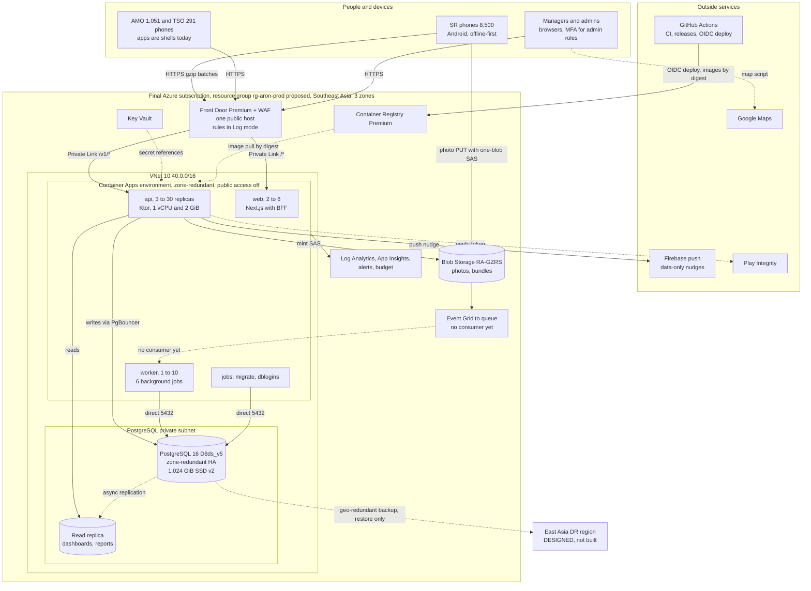

# Aron final Azure architecture: executive summary

**For:** the sponsor (owner) and the engineering leads
**System:** Aron, AKTCL's field-sales platform: native Android apps for SR, AMO and TSO, web dashboards and an admin portal, one API, one database. It replaces the vendor app (Apsis).
**Scope of this document:** the FINAL Azure account (profiles `prod` and `stage`), sized for 8,500 sales representatives and about 9,850 app users. The Azure subscription used today is a temporary TEST account (5 to 10 users) and is not described here except where it is the only place something has been proven.
**Evidence state:** repository commit `26cfb26a` on the integration branch, dated 2026-10-08. Anything done after that commit is **UNKNOWN** to this pack. Today is 2026-10-11.
**The pack:** `part-a-high-level-design.md` (Part A), `part-b-low-level-platform.md` (Part B, platform and operations), `part-c-low-level-application-data.md` (Part C, application and data), and this summary. Section references such as "B5" or "C2.4" point into those parts.

**Status words used everywhere.** IN_REPO: written as code or infrastructure templates on this commit. DESIGNED: specified in documents only. PLANNED: a backlog row not yet built. DEFERRED: sponsor-deferred (target, loyalty, every discount or promotion programme; Apsis data migration and cutover are out of scope, not merely deferred). UNKNOWN: could not be established. **IN_REPO never means proven at 8,500 users**: that proof can only run in the final account.

---

## (a) The architecture in one page

**What it does.** About 8,500 reps visit shops every day on cheap shared Android phones that often have no signal. The phone does the work first: it downloads the day's route in the morning, checks on the phone itself that the rep is at the shop, records the sale, and prints a paper memo on a Bluetooth printer. None of this waits for the network. Later, whenever a connection appears, the phone sends its records in batches. Every record carries a number the phone made up (a UUID), and the server stores each number once, so a repeated, split or out-of-order upload can never create a second sale. Managers see the day's numbers on dashboards in the evening. Money is whole milli-taka, units are sticks, pieces and dozens, and every transaction carries both a UTC time and a Dhaka business date.

**How it is built.** Three native Kotlin Android apps (SR, AMO, TSO), each also acting as its own device-owner controller so that distracting apps can be switched off during work hours, even offline. One web application (Next.js) holds the dashboards and an admin portal where every setting is edited as data; the browser never holds a login token. One Kotlin server program (Ktor) runs in three modes from the same container image: an API, a background worker and a one-shot database migrator. One PostgreSQL 16 database is the system of record, with a separate analytics area (`dw`) that the dashboards read. Photos go straight from the phone to Blob Storage with a one-time upload link, so the API does not carry them (small feedback and support pictures are the one exception).

**Where it runs in the final account.** One resource group in Azure Southeast Asia (Singapore, three availability zones; Azure has no region in Bangladesh). All traffic enters through one Azure Front Door Premium gate with a web application firewall, and reaches the application containers over a private link. The containers (Azure Container Apps) talk to a zone-redundant PostgreSQL server in a private subnet that nothing on the internet can reach, with a read copy for dashboards. Secrets live in Key Vault, images in a private registry, logs and alerts in Azure Monitor. Everything is described in Bicep templates and deployed by GitHub Actions without any stored Azure password. Only parameter files differ between the test account and the final account.

**Honest position.** The code and the templates for almost all of this exist and pass their automatic tests on small data. The SR app is built end to end but has never run on a real phone in a recorded test. The AMO and TSO apps are login-plus-placeholder shells. Nothing at final size has ever been created or run: not the Premium gate, not the private link, not the large database, not the read copy, not a load test, not a restore. Section (g) lists what only the final account can prove.

*Legend: solid arrows are runtime paths that exist in the templates; dotted arrows are replication, secret, pull or paths with no consumer. The web container reaches the API through the same Front Door host, which the diagram omits for clarity. Boxes inside the VNet are private; Storage, Key Vault and the registry keep public endpoints protected by Entra identity or one-time links (no private endpoints yet). Nothing in the Azure box has ever been created at this size.*

---

## (b) Headline numbers

All volumes and peaks are **design values from `docs/18`**, not measurements. "IN_REPO" on a setting means the parameter file says so; it has not run at that size.

| Area | Quantity | Value | Status | Source |
|---|---|---|---|---|
| Users | App users | 9,842 = 8,500 SR + 1,051 AMO + 291 TSO (sized as about 9,850) | design | A1.2; `docs/18-scale-reliability-azure.md:23` |
| Users | Web users | about 150 modelled outside the TSOs (about 70 DMO, WM and TOP plus about 80 HQ and admin); exact counts are UNKNOWN. An earlier figure of 130 survives only in `docs/setup/azure-quota-request.md` and a parameter-file comment | ASSUMPTION | A1.2; `docs/18:23,95` |
| Users | Concurrent dashboard readers | about 1,490 designed at 17:00 to 19:00 (1,051 AMO + 291 TSO + about 150 HQ). Only about 440 can reach the web today because AMOs have no web login and the AMO app is a shell | design, gap | A1.2, A10.3 row 37; `web/src/lib/auth/roles.ts:9` |
| Volume | Successful API calls per day | about 450,000 | design | A1.3; `docs/18:19-34` |
| Volume | Visits, memos, memo lines per day | 500,000; 450,000; 1.125 M | design | A1.3 |
| Volume | Business rows per day | 3.0 M (about 350 per SR-day) | design | A1.3 |
| Volume | Photos | 150,000 per day at 150 KB = 22.5 GB per day, about 8.2 TB per year | design | A1.3; B6.1 |
| Volume | Master data (load generator) | 11,336 routes, about 735,000 outlets, 1,051 zones, 291 territories, 10 wings | design | `db/perf/generate.sql:1`; C5.12 |
| Peaks | Design peaks | morning bundle storm about 400 requests per second; trickle about 50 batches per second; check-out spike about 4,500 rows per second | design | A1.3; B11.1 |
| Peaks | Load-test gate (final account) | 8,000 rows per second; 8,500 x 350 rows in 30 minutes; 1.5 x fleet = 12,750 users; primary CPU at most 80 percent; data IOPS at most 7,200 of 12,000 | PLANNED, not run | B11.1; `docs/18:1237-1290` |
| Compute | API | 1 vCPU / 2 GiB, 3 to 30 replicas, HTTP rule 50 concurrent requests per replica, pre-scale to 8 replicas 06:15 to 10:00 and 16:45 to 20:00 Dhaka | IN_REPO | `infra/params/prod.apps.bicepparam`; B4.1 |
| Compute | Worker | 1 vCPU / 2 GiB, 1 to 10 replicas, **no scale rule, no probe** | IN_REPO (gap) | B4.2 |
| Compute | Web | 0.5 vCPU / 1 GiB, 2 to 6 replicas (stage 1 to 6), no cron pre-scale | IN_REPO | B4.3 |
| Compute | Container Apps cores at replica maxima | 43.5 vCPU (api 30 + worker 10 + web 3 + migrate 0.5) | derived | B11.3; `docs/setup/azure-quota-request.md` |
| Database | Engine and size | PostgreSQL 16, General Purpose `Standard_D8ds_v5` (8 vCores), zone-redundant HA (primary zone 1, standby zone 2) | IN_REPO, never created | `infra/params/prod.bicepparam:47-50`; B5.1 |
| Database | Disk | Premium SSD v2, 1,024 GiB, 12,000 IOPS (D8 cap 12,800, so about 6 percent headroom), 300 MB/s, no autogrow; grow by hand at 70 percent; first grow to 2,048 GiB planned by month 6 | IN_REPO | B5.1 |
| Database | Read replica | same SKU and disk, zone 3, own PgBouncer; template only, and the pipeline cannot create it as written (B13.2 rows 36, 37) | IN_REPO template, gap | B5.2 |
| Database | Pooling | built-in PgBouncer, transaction mode, pool 20 per user and database; API uses 6432, worker and migrate use 5432; `max_connections` for D8 is UNKNOWN | IN_REPO | B5.3, C5.1 |
| Database | Contents | `app` 148 relations, `dw` 33 relations, `stg` empty; 72 migrations V0001 to V0073; 8 stable `dw.v_*` views | IN_REPO | C5.2, C5.11 |
| Database | Growth | about 2.8 GB per day (app 1.66, dw 1.18); about 1.0 TB in year 1; about 1.6 TB steady state | design | B5.1, C5.12 |
| Storage | Blob | `Standard_RAGZRS`; soft delete 14 days; media to Cool at 30 days and Cold at 90 days; bundles deleted after 3 days; no photo delete rule | IN_REPO | B6.1 |
| Edge | Front Door | Premium with WAF in Prevention, managed rules in **Log** action, IP backstop 60,000 requests per 5 minutes, origin timeout 60 s (API times out at 25 s) | IN_REPO, never run at Premium | B3 |
| Observability | Logs and alerts | Log Analytics 90 days, 8 GB per day cap; 5 log alerts, 4 PostgreSQL metric alerts, app and resource-health alerts; **e-mail only** | IN_REPO | B9.3 |
| Availability | Target (SLO) | 99.9 percent of auth, sync and day calls, 07:00 to 21:00 Dhaka on working days = 25.2 minutes per month | DESIGNED, not measured | B9.4 |
| Recovery | Database zone failure | RPO 0; 60 to 120 s documented at size; **about 30 s user-visible measured once on a small dev server** (the Azure call itself took 429 s) | IN_REPO; not measured at size | B5.5; `docs/runbooks/database-failover.md` |
| Recovery | Bad deploy | traffic back to the previous API revision in seconds; redeploy by digest in 8 to 15 minutes | IN_REPO; no rollback drill | B4.5, B12.5 |
| Recovery | Bad migration or data loss | point-in-time restore into a new server, 35 days in prod; **RTO 2 hours is an assumption**; drill built, never run | IN_REPO procedure | B5.6 |
| Recovery | Region outage, wave 1 | geo-redundant backup and geo-restore into East Asia: RPO about 1 hour, RTO unmeasured; runbook RB-52 not written | backup IN_REPO; restore DESIGNED | B12.4 |
| Recovery | Region outage, target | RTO 4 hours, RPO 15 minutes needs a cross-region replica and a warm East Asia environment | DESIGNED, not built | A7.2; B12.4 |
| Performance targets | Sync and reads | batch ack p95 1.5 s (up to 50 rows) and 8 s (200 rows); bundle p95 2 s on the server; dashboards p95 1.0 s; reports p95 5 s; aggregation lag p95 60 s; sync success 99.5 percent; reconciliation mismatch at most 0.1 percent | DESIGNED, none measured at size | A7.3; B9.4 |
| Phone budgets | Field apps | APK at most 30 MB per ABI (SR universal now 12.09 MB); cold start gate 2.5 s median; at most 80 location fixes and 15 GPS minutes per day; sync and bundle at most 5 MB per day and photos at most 3 MB per day on mobile data; non-screen battery at most 6 percent over 8 hours | gates IN_REPO; battery and cold start unproven on phones | A7.4; C6.12 |
| Interfaces | API and web | OpenAPI 3.1 v1.3.0: 209 operations on 168 paths; 162 routes served (150 guarded, 12 public); 69 web pages; 26 backend-for-frontend handlers | IN_REPO | C1.4, C7.5 |
| Cost | Monthly list price at full design | about **USD 6,630** (`docs/18` lines sum to 6,620): database primary 1,780; in-region replica 850; cross-region replica 850; Container Apps 1,000 + 350 fixed; Redis 120; Front Door 430; BI 400; Blob 190; registry 100; logs 490; misc 60 | ASSUMPTION (list prices) | A7.7; B11.5; `docs/18:466-491` |
| Cost | As built (derived) | about **USD 5,100** per month: leaves out the DR replica, Redis, BI and half the Container Apps fixed fees (about 1,545). Unverified until the first invoice | ASSUMPTION | B11.5 |
| Cost | Budgets | `budget-aron-prod` USD 7,000 per month, stage 2,500; alerts at 50, 90, 100 percent actual and 100 percent forecast. A running stage costs extra and its figure is UNKNOWN; the pilot-size figure is UNKNOWN | IN_REPO | `infra/modules/budget.bicep` |
| Quota | Final subscription requests | PostgreSQL Ddsv5 vCores: 40 (prod alone: 24 steady + drill + headroom) or 64 (if stage and prod share a subscription; stage + prod + drill is 56); Container Apps cores 100 per environment; environments 2; Load Testing engines 40 | PLANNED; lead time up to a week | B11.3; `docs/setup/azure-quota-request.md` |
| Delivery | Build progress | 363 of 490 BUILD backlog rows built (74.1 percent, lead tally 2026-10-08 06:50 UTC); backlog 619 rows = 490 BUILD + 33 DEFERRED + 96 DROP | measured by lead | `docs/status/forecast.md:83`; A10.2 |
| Delivery | Tests and CI | about 2,494 `@Test` annotations in the repository, 833 in the backend; CI has 10 jobs since train 41 (the backend analytics tests run in their own job, D-QA-CI-HANG-01) and takes about 27 to 29 minutes wall on a lane run, the analytics job alone about 27 minutes, against a 15-minute target | IN_REPO | A8.3; C9 |

---

## (c) Status by area, and what is proven where

**Component counts** (from A10.2). These are the author's classification made while writing the pack; the underlying catalogue is not in the repository, so the counts are **not reproducible** from it, and a component can appear in two areas. Read them as proportions, not an audit.

| Area | Components | IN_REPO | DESIGNED | PLANNED | DEFERRED | UNKNOWN | Share IN_REPO |
|---|---|---|---|---|---|---|---|
| Apps (Android and devices) | 27 | 24 | 0 | 3 | 0 | 0 | 89 percent |
| Backend and API | 37 | 30 | 1 | 5 | 1 | 0 | 81 percent |
| Database and data | 37 | 29 | 3 | 3 | 2 | 0 | 78 percent |
| Web | 35 | 30 | 2 | 1 | 1 | 1 | 86 percent |
| Infrastructure (Azure) | 33 | 29 | 3 | 1 | 0 | 0 | 88 percent |
| Security and privacy | 30 | 26 | 3 | 1 | 0 | 0 | 87 percent |
| Delivery and operations | 31 | 25 | 4 | 2 | 0 | 0 | 81 percent |
| **Total** | **230** | **193** | **16** | **16** | **4** | **1** | **84 percent** |

Reading notes. (1) Apps: the three PLANNED items are the AMO app, the TSO app and the on-phone and fleet proofs; the AMO and TSO apps are the weakest part of the delivery. (2) Web: Part C finds about ten web pages and operations (web entry, QC entry, releases, entry unlocks, paper backfill, dues, supervisor targets, sales plan, audit list, day reopen) whose web code exists but whose backend routes are not served, so they are IN_REPO as web code and PLANNED as capabilities (C7.5, C10 G34). (3) Backend: 51 of 209 contract operations are not routed: 25 are sponsor-deferred programme operations and 26 are held or dropped rows; 4 routed operations are not in the contract.

**Build progress by area** (lead tally, 2026-10-08 06:50 UTC, `docs/status/forecast.md:83`): backend 100 of 135; SR app 56 of 57; Android shared core 52 of 61; web dashboards 49 of 50; database, web admin, infrastructure, shared and contract 100 percent; **AMO app 1 of 40; TSO app 0 of 22; QA lane 0 of 20**. The remaining 127 rows were almost all behind a hold: wave 2 (about 81 rows) and backend-admin and backend-reports (about 35 rows) plus 9 shared-core rows. The lead judged the Day 7 date (2026-10-11) lost; Day 10 (2026-10-14) depended on the held lanes starting by 2026-10-09. What happened after 2026-10-08 is UNKNOWN to this pack.

**What is proven, and where.** Four places exist: local and CI (a laptop or the CI runner with a small PostgreSQL), dev (the test account at 5 to 10 users), the device lab (the owner's phones), and the final account.

| Area | Local and CI (host, small data) | Dev (test account, pilot scale) | Device lab | Final account |
|---|---|---|---|---|
| Apps | JVM and Robolectric tests; APK size gate; strings, contrast and no-polling checks; shared money and geo code | nothing runs the app; the slice smoke script drives the API with a signed device proof | **no result recorded**; about 30 checks are DEVICE-PENDING (battery, cold start, MP-58N printing, spoofing apps, device-owner lockdown, outdoor legibility) | n/a |
| Backend | 833 backend tests on real PostgreSQL 16; sync convergence fuzz at 12 seeded runs per push (the designed 10,000 and 100,000 do not exist); scope leak test of 200 random queries | deployed by digest; health gate; slice smoke (login, bundle, one sale uploaded twice, void) passed | n/a | load, autoscale, login storm, 17:00 spike: **not run** |
| Database | migrations apply on an empty database and a second run is a no-op; roles matrix; data-dictionary test; plan probes on a generated 735,000-outlet database | **one forced failover on a small D2 server (about 30 s outage)** | n/a | PITR drill (built, never run), geo-restore, replica lag, failover at size: **not run** |
| Web | Vitest (about 680 to 695 cases), Playwright (91 tests) against a contract mock | serves `/login` through the health gate | n/a | never tested against the real API; never load-tested |
| Infrastructure | Bicep build and lint, 95 infrastructure checks, actionlint, shellcheck, what-if guard | dev profile (VNet, zone-redundant D2, Front Door Standard) deployed and redeployed | n/a | Front Door Premium, Private Link, D8 on SSD v2, replica, Multiple-revision fallback: **never created at any size** |
| Security | gitleaks, OSV, Semgrep, CodeQL, Trivy, SBOM; 51 of 150 guarded routes have a scope test and 33 have a documented exemption | nothing beyond the above | n/a | no penetration test, no key-rotation drill, no WAF Block run, no auth-storm test |
| Delivery | 9-job CI (22.3 min), migration immutability, contract-break gate | automatic deploy from a green integration branch | n/a | `promote-prod` is inert; **stage cannot be deployed or started** (section (e), R4) |

The test account cannot prove fleet behaviour by design (sponsor rule 1): there are no load-testing resources there. Nothing in this table is labelled "drilled" unless a drill ran; exactly one drill has run (the dev failover).

---

## (d) Where older documents disagree with the code, and the ruling

Rule applied everywhere: **code and infrastructure outrank documents.** The full lists are A10.3 (41 rows), B13.4 and C10.2; the ones that matter most:

| # | Topic | Older documents say | Code says | Ruling |
|---|---|---|---|---|
| 1 | Mobile stack | `CLAUDE.md`, `docs/02`, `docs/13`, `DECISIONS.md` D-01: Flutter, Drift | Native Kotlin, Compose, Room with SQLCipher, fused location | Code wins; Flutter text is stale |
| 2 | Backend stack | `CLAUDE.md`, `docs/02`, `docs/13`, `docs/18`: Node.js, NestJS, Prisma or Kysely | Ktor 3.6 on JVM 21, JDBI, Flyway | Code wins |
| 3 | API shape | `docs/09`: `{message, success, data}` envelope, `/auth/login` | everything under `/v1`, RFC 9457 problem responses, `X-Aron-Api: 1`; contract v1.3.0 | Contract and code win |
| 4 | Process topology | separate auth app; Redis; ten cron jobs with KEDA scaling | login runs in the API; no Redis; one worker with six in-process jobs and no scale rule | As built; USD 120 Redis line superseded |
| 5 | Autoscale | 30 requests per second per replica; min 1/2/3, max 3/10/30 | 50 concurrent requests per replica; prod min 3, max 30; Dhaka cron pre-scale to 8 | Code wins; untested |
| 6 | Storage and vaults | two storage accounts (WORM evidence); `kv-sign` non-exportable key, `kv-pii`, DR vault | one storage account; one vault; exportable PEM signing secret | Code wins |
| 7 | Network plan | ACA /26, `snet-pe`, `snet-gw`, DR 10.41/16, staging 10.50/16 | ACA /23, `snet-pg` /28 only, stage 10.41/16 | Code wins; renumber stage or DR before building either |
| 8 | Edge | custom hostnames, caching, per-path rate rules, DR origin | default Front Door host, no caching, one IP backstop rule | Code wins |
| 9 | Alert routing | SMS and voice paging (`ag-sev1/2/3`) | one e-mail action group | Code wins |
| 10 | Schemas | four schemas incl. `cfg`; about 140 `app` tables, 23 partitioned; registry 64 partitions | `app`, `dw`, empty `stg`; 148 + 33 relations; 7 + 5 partitioned; registry 16 partitions | Code wins |
| 11 | Batch ingest shape | one savepoint per batch, bisection; limit of 64 subtransactions | one transaction per family, savepoint per record (families up to about 175 rows) | Code wins; risk R17 |
| 12 | Bundles and photos | worker builds 22:00 snapshots into Blob; Blob event marks photo stored | built live per request; no queue consumer | Code wins; both PLANNED |
| 13 | Database auth and RLS | Entra-only; row-level security on 14 tables; per-app logins in force | password auth; **no RLS**; per-app logins built but **off in prod and stage** | Code wins; flip needed (D6) |
| 14 | Password hashing | Argon2id m=64 MiB, t=3, pepper | m=19 MiB, t=2, p=1, no pepper | Code wins |
| 15 | Token content | scope encoded in the token | token carries a scope version only; reach computed on the server per request | Intent met; a changed scope is refused within about 10 s, not one call |
| 16 | Mock-location default | `warn_rep` | `block_sale` | Code wins |
| 17 | CI and release | `pr.yml`, `nightly.yml`, merge queue, two reviewers, 72 h soak, canary 10/50/100 | one `ci.yml` (22 min), no nightly, one reviewer, 24 h soak, health-gate fallback | `docs/30` and code win |
| 18 | Staging | `promote-prod` and `docs/30` assume a "Deploy to stage" job | `deploy.sh` offers no stage profile; **backend refuses `ARON_ENV=stage`** | Stage is parameter files only; cannot deploy or start (R4) |
| 19 | Read replica on the second deploy | `prod.bicepparam` comment and move runbook | no pipeline input sets the variable; the what-if guard refuses a second PostgreSQL server | Template only; fix before use (R28) |
| 20 | Quota | `docs/18`: 64 vCores, 64/128 cores | operational request: 40 vCores, 100 cores (withdrawn for the test account) | 40 covers prod alone; request 64 if stage shares the subscription |
| 21 | PostgreSQL SKU ladder | `DECISIONS.md` D-06: pilot D2, wave 1 D4, full D8, scaled in place | `prod.bicepparam:47` sets D8 from the first deploy | Parameter file wins; decide in D5 |
| 22 | AMO dashboards | `docs/18` gives AMOs web logins and counts them in the 1,500 readers | AMO is not a web role; the AMO app is a shell | Code wins; about 70 percent of the designed dashboard audience has no working channel yet |
| 23 | Photo cap | `docs/31`: 200 KB | compressor and `docs/18`: 150 KB | Code wins |
| 24 | Rollout and cutover | Apsis parallel run, delta imports, re-key rollback | out of scope (sponsor rule 3); wave-control rows dropped | Standing rule wins; reusable parts stay DESIGNED |
| 25 | Distribution | "Play or MDM" (the brief) | APK by device-owner QR from GitHub Releases, signer digest pinned | Code wins |

---

## (e) Top risks

Ranked by what can stop or damage the launch. Identifiers are Part A's (A10.4); B13.2 and C10.1 hold the full gap registers.

| Rank | Risk | Why it matters | Mitigation and where |
|---|---|---|---|
| 1 | **Nothing in the final topology has run at size** (R1) | Premium gate, private link, D8 on SSD v2, replica, revision fallback, 8,500-user load, failover and restore at scale are all untested; even the PITR drill has not run in dev | The final-account proof plan, section (g); the QA lane (0 of 20 rows built) must exist first |
| 2 | **Stage can neither be deployed nor started** (R4) | `promote-prod` requires a staging deploy that cannot exist, and the backend exits at start on `ARON_ENV=stage`. Stage is the environment where every load, failover and soak proof is meant to run | Wire `stage` into `deploy.sh`, `deploy.yml`, bootstrap; map stage to prod behaviour in `ServerEnv` (B13.2 rows 2, 35; C10 G31) |
| 3 | **AMO and TSO apps are shells; QA lane not started** (R2) | 1,051 AMOs and 291 TSOs have no field app; AMO share of the dashboard audience has no channel; rollout waves cannot run with shells | Start the held Android lanes; decide dates in D12 and D13 |
| 4 | **Android 12 and later cannot be QR-enrolled** (R11) | Provisioning activities exist in code but are in no manifest. In prod an unenrolled phone's sales are held in quarantine, so every phone must be enrolled before its sales count | Declare the activities (`docs/requests/android-geo-dpc-provisioning-activities.md`); device proof on the owner's phones |
| 5 | **No device proof recorded** (R6) | Battery, cold start, printing on the MP-58N, spoofing apps, device-owner lockdown and outdoor legibility have never been tested on a phone | Device lab checks D-ENR, D-04, D-05, D-UI-01, D-PERF-04, D-P1, D-P2; needs the owner's phone on USB |
| 6 | **API and worker would run as the database administrator** (R3) | `dbPerAppLogins=false` in prod and stage: the least-privilege logins and role time limits are built and proven in dev but off | Decision D6; flip and drill in stage first |
| 7 | **Morning bundle storm** (R7) | Each bundle is built live (10 to 40 queries, even for a 304 answer) and delta fingerprints are per replica, so many delta calls fall back to the full bundle | Build pre-generation F-SYS-067 and durable fingerprints, or prove the live build in the first load test (D13) |
| 8 | **No disaster recovery for a region outage** (R5) | RTO unmeasured; geo-restore runbook not written; cross-region replica not built | Decision D2; timed geo-restore drill T-4-174 |
| 9 | **Legal position unknown** (R8) | Bangladesh data-protection law, hosting in Singapore, employee-location consent wording and breach duty have no counsel opinion; eight questions are open | Decision D9 before real personal data |
| 10 | **Scope enforced only in application code** (R9) | No row-level security; 66 of 150 guarded routes have no scope test (frozen baseline) | The gap set may only shrink; RLS is DESIGNED |
| 11 | **Key custody and audit durability below design** (R10) | JWT signing key is an exportable vault secret held in API memory, rotation is undrilled and unsafe; audit chain has no scheduled verification or off-database export | Decision D8; rotation drill T-7-71 |
| 12 | **Signing key for the apps must be fixed before any phone is enrolled** (OD-10) | A signer change later needs a factory reset of every device-owner phone | Decision D4 |
| 13 | **Incident tooling thin** (R13, R12) | E-mail-only alerts, 4 of about 54 runbooks, no paging, no crash SDK; no web TOTP enrolment screen, so a first-time admin cannot finish login without an operator API call | Decision D14; build the enrolment screen |
| 14 | **Photos never become "stored"** (R14) | The queue consumer is missing, so size and hash are never verified and the pending-photo flag cannot clear | Build the consumer (D13) |
| 15 | **Read-replica creation path broken** (R28) | The first prod run would try to create the replica and fail; the guard refuses the second server | Add the replica exception and the variable mapping before the move |

---

## (f) Open decisions for the owner

These are the choices only the owner can make. Each has options and a recommendation. Part-local identifiers are shown so each decision can be traced (A = Part A OD-nn, B = Part B OD-n, C = Part C ODn). Engineering fixes that need no owner decision are in section (e) and in B13.2 and C10.1.

| ID | Decision | Options | Recommendation | Needed by | Trace |
|---|---|---|---|---|---|
| **D1** | Confirm the permanent Azure region and the data-residency position | (a) Southeast Asia (Singapore): nearest region with three zones, SSD v2 and geo features; (b) another region; (c) delay until counsel answers | Confirm (a) now, because the whole design assumes it and a region change later is expensive; make the loading of real personal data conditional on D9. Run the Dhaka-to-Singapore latency check (D-422, not yet run) in stage | Before the move and before any real data | A OD-01; B OD-1; C OD9 |
| **D2** | Disaster-recovery ladder | (a) Wave 1 on geo-restore only: RPO about 1 hour, RTO unmeasured, no extra cost; (b) add a cross-region replica and warm East Asia environment before wave 2: RTO 4 h and RPO 15 min target, about USD 850 per month plus a second-region build that is not in the templates | (a) for wave 1, with RB-52 written and a timed geo-restore drill in the final account; decide (b) before wave 2 from the drill result. Reps keep selling offline and re-send, which bounds the business impact of a region outage | Before wave 1 (RB-52); before wave 2 (replica) | A OD-02; B OD-6 |
| **D3** | Company domain and certificates (`api.`, `app.`, `dl.`) | (a) Choose the domain before the first fleet enrolment; (b) run the pilot on the default `*.azurefd.net` host | (a). The API address is baked into enrolment QR codes and APKs and there is no certificate pinning, so changing the host after enrolment means re-provisioning phones. (b) is acceptable only for the owner's own phones | Before the first fleet phone is enrolled | A OD-03; B OD-2; C OD10 |
| **D4** | Custody of the final APK signing key | (a) Keep it in GitHub secrets on the CI runner only (as built, and what sponsor rule 8 says); (b) GitHub secrets plus an owner-held offline backup, which needs the owner to relax rule 8 for this one key; (c) sign on a machine or service off the runner | (a) now, because rule 8 is a standing rule. Raise (b) with the owner explicitly: a lost or leaked key means a factory reset of every device-owner phone, so a backup may be worth an exception. Plan (c) before wave 2. Use `app-v1.0.0` or later as the first tag. Do not enrol a fleet phone before the key is fixed | Before any fleet phone is enrolled | A OD-10; B7.5; C OD14 |
| **D5** | PostgreSQL size ladder | (a) D8ds_v5 from the first prod deploy (as `prod.bicepparam` says): about USD 1,780 per month for the primary from day one; (b) the recorded default D-06 (status DEFAULT, not locked): create at D2 for the pilot, scale compute in place to D4 for wave 1 and D8 for the fleet | (b), provided the D2 to D4 to D8 compute-only scale-up is rehearsed on stage first (it exists on paper in `docs/18` and has never been exercised on a live SSD v2 server); otherwise accept (a). The pilot-size cost figure is UNKNOWN. Stage runs D8 for the load test either way. Zone redundancy, geo-redundant backup and the 1,024 GiB SSD v2 disk are creation-time choices and stay as they are in both options | Before the first prod deploy | A OD-18 |
| **D6** | When to turn on per-app database logins in stage and prod | (a) On from the first stage deploy, prod on after a clean stage week; (b) leave off until after launch | (a). Real users must not run on the administrator login; the logins are built and were proven in dev. Also create the logins for `auth_rw`, `web_ro`, `bi_reader` | Before the first real user | A OD-04; B OD-4; C OD1 |
| **D7** | Evidence-gated edge and abuse settings: WAF Log to Block, and Redis | WAF: stay in Log; Block after clean pilot traffic; Block with exclusions. Redis: reinstate (about USD 120 per month) or keep per-replica limits | WAF: stay in Log through the pilot and the first wave-1 week, then Block with explicit exclusions for `/v1/sync` once seven trading days show no false positive. Redis: stay without it; decide after the final-account login-storm test, because per-replica limits multiply by up to 30 replicas | After pilot traffic; after the load test | A OD-07, OD-05; B OD-3, OD-5; C OD8 |
| **D8** | Hardening scope in the final subscription | Private endpoints for Key Vault, registry and Blob; Azure Policy and locks; per-secret RBAC; separate signing vault with a non-exportable key; keep Blob public for phones | Do Policy, locks and per-secret RBAC at the move; private endpoints for Key Vault and registry before wave 1; keep Blob public (phones need it, access is by one-blob SAS); move to the non-exportable signing key before wave 2. Needs a subscription-owner step | At the move; before wave 1 | A OD-06; B OD-9, OD-14 |
| **D9** | Legal opinion and retention | (a) Hold real personal data until counsel answers; (b) pilot with consented volunteers on a limited data set meanwhile | (b) now and (a) for the fleet. Ask counsel the eight open questions: Bangladesh data protection, Singapore hosting, NID rules, employee-location consent wording, breach duty and the statutory retention period (84 months is only an assumption) | Before real data at scale | A OD-08; B OD-13; C OD9 |
| **D10** | Play Integrity and device-evidence enforcement | Keep flag-only; enable Play Integrity and `require_integrity` at wave 1; move record signatures to `enforce` | Finish owner action 13 now so verdicts are collected; keep flag-only through the pilot; move to enforce after the false-positive rate is measured. Lanes may not change these defaults without the owner (BC-83) | Before wave 1 | A OD-09; B OD-12 |
| **D11** | Subscription layout, quota and names | (a) Stage and prod in one subscription: request 64 PostgreSQL vCores (stage + prod + a drill server is 56); (b) separate subscriptions: 40 each. Also fix the stage resource-group name and renumber the stage VNet or the DR plan (stage 10.41.0.0/16 collides with the DR plan) | (a): one billing scope and one quota request, at the price of the larger quota. Whichever is chosen, request on day one because lead time is up to a week: 100 Container Apps cores per environment, 2 environments, 40 Load Testing engines. Create the GitHub environments so that `azure-prod` accepts tags only (bootstrap writes an integration-branch policy by default) | Day one of the move | A OD-11, OD-17; B OD-7, OD-10, OD-11 |
| **D12** | Rollout plan without the Apsis parallel run | Pilot of 10 to 20 routes; wave 1 of about 290 SRs or 1,000 SRs (question Q51); helpdesk of 8 to 12 Bangla agents; ring plan 0 (owner's phones), 1 (20 to 50 pilot SRs), 2 (fleet by `rollout_pct`) | Start with the pilot on SR-only functions plus TSO web; set wave dates only after AMO and TSO apps, Android 12 and later enrolment and the device proofs exist; size wave 1 at about 290 SRs; staff the helpdesk before it | Before the pilot | A OD-12; B OD-15; C OD5 |
| **D13** | Engineering sequence before the first load test and wave 1 | Build bundle pre-generation (F-SYS-067) with durable delta fingerprints, the media-event consumer, worker autoscaling, the stage fix and the AMO and TSO apps now; or accept the risks R7, R14, R15 | Nothing is cut (sponsor rule 4). Order: stage bootable and deployable; replica path fixed; media consumer; durable fingerprints or pre-generation; worker scale rule; AMO and TSO apps and Android 12 provisioning in parallel; QA lane (load generator, N-054) so that the load test can run | Start now | A OD-14; C OD2, OD3, OD5, OD13, OD15, OD16; B13.2 rows 35 to 37 |
| **D14** | Governance and operations | Production approval: one reviewer and 24 h soak (as built) or two reviewers and 72 h for sync changes; MFA for DMO, WM and TOP as well as admins; who receives prod alerts, SMS or voice paging and the on-call rota; date the repository goes private (set an Actions spending limit first) | Keep one reviewer for ordinary releases and require the 72 h soak for sync or ingest changes; require MFA for DMO, WM and TOP because they see national data; name alert recipients and build paging before wave 1; make the repository private when the product is complete and the spending limit is set | Before wave 1 | A OD-13, OD-16, OD-17; B OD-8, OD-11; C OD6, OD7 |

Test-account housekeeping (not an architecture decision): the zone-redundant dev resources kept by sponsor exception were due for review on 2026-10-10; the outcome is UNKNOWN (A OD-15).

---

## (g) What can only be proven after the move to the final account

Per sponsor rule 1 none of this can run in the test account, and none has run anywhere. "Gate" is the planned pass criterion; the load scenarios S1 to S14 are written in `docs/18` section 8.2 and need the QA lane, which has not started.

| Proof | Why not earlier | Planned gate |
|---|---|---|
| 8,500-user load, 1.5 x fleet (12,750 users), morning storm, 17:00 spike, soak | Needs fleet-size resources and Azure Load Testing (forbidden in the test account) | S1 to S14; S4: 8,500 x 350 rows in 30 minutes, 8,000 rows per second, CPU at most 80 percent, IOPS at most 7,200 of 12,000, ack p95 at most 8 s |
| Autoscale behaviour, connection arithmetic, HTTP rule of 50 against 9 blocking slots, per-replica limits at 30 replicas, `max_connections` on D8 | Needs real replica counts and the D8 server | Tune from S1 to S10 |
| Zone failover under load and replica re-attachment after failover | The replica and D8 do not exist in test; replica behaviour after failover is UNKNOWN | RB-02 at scale; error window at most 120 s (S7) |
| Point-in-time restore and geo-restore with row-count comparison | The PITR drill has never run, even in dev; geo-restore needs the final-region setup | RB-14; RB-52 (to be written); timed drill T-4-174 |
| Front Door Premium, Private Link, refusal of direct-origin calls | Premium is not deployed in test | Smoke test and manual test |
| WAF Prevention flip and false-positive tuning on `/v1/sync` | Premium WAF not deployed in test | Pilot traffic first, then Block (D7) |
| Multiple-revision rollback and canary steps | Dev uses a single revision | Rollback drill |
| `promote-prod` end to end and the staging soak | Inert before the final account; stage cannot deploy | First tagged release after the stage fix |
| Per-secret Key Vault scoping, Service Health alert, Policy and locks | Needs subscription scope | Hardening step (D8) |
| Cost at size (the USD 5,100 versus 6,630 question) | Only the first invoices show it | Budget alerts and cost report re-pointed to the final account |
| Wave-day behaviour: login jitter with 8,500 phones, push fan-out to about 9,850 phones | Needs a fleet or a synthetic fleet generator (N-054, not built) | Wave gates: login at least 95 percent of baseline by day 3, mismatch at most 0.1 percent, sync success at least 99.5 percent, crash-free at least 99.5 percent (all assumptions) |

**Proven outside the final account, but only on small data:** the CI and deploy pipeline, deployment by digest, the health gate, the worker check, the SR slice smoke at the API level, and one forced database failover on a small dev server. Anything else described as working in the three parts is IN_REPO and host-tested, not field-proven. **Not proven anywhere:** a rollback drill, a point-in-time restore drill, battery and cold start on real phones, installed-upgrade on enrolled phones, key-rotation drills, an external penetration test.

---

## How the pack was checked

Each of the three parts was written by one author and then independently reviewed against the repository at commit `26cfb26a`: about 125 claims in Part A, 150 in Part B and 170 in Part C were checked, and the findings were corrected in the files. The chief architect then read all three parts for consistency (numbers, names, statuses, cross-references) and fixed the differences; the main ones were the AMO and SR row counts in Part C, the missing stage and replica gaps in Parts A and C, the quota arithmetic, the key-count wording, the photo-path wording and the overlapping decision numbers. Some citations remain unverified (the 12 GB registry estimate, the 337 finish-time count, the 54-runbook figure), the component counts in section (c) are the author's classification, and every cost figure is a list-price estimate.
