# Part A: High-Level Design (final Azure account)

**Aron, AKTCL's field-sales platform: final solution architecture, high-level view**

---

## A0 Document control and how to read it

**In plain words:** This document describes what Aron will look like once it runs in AKTCL's own, final Azure account for all 8,500 sales representatives. It says, component by component, what already exists as code, what is only a design, and what has never been tried at full size.

### A0.1 Purpose and audience

| Item | Value |
|---|---|
| Purpose | The published final solution architecture of Aron: the system that replaces the vendor app (Apsis) with native Android apps, web dashboards, an admin portal, one API and one database |
| Readers | The sponsor (not an engineer) and the engineering leads |
| Part A (this file) | High-level design: context, containers, the Azure estate, runtime flows, cross-cutting concerns, delivery, the move from the test account, decisions and risks |
| Part B (`lld-platform.md`) | Low-level design, platform and operations: Azure resource catalogue, network, edge, compute, database platform, storage, identity and secrets, security, observability, CI/CD, capacity and cost, resilience, gaps. Cited as "see B5" and so on |
| Part C (`lld-app-data.md`) | Low-level design, application and data: backend modules and endpoints, sync engine, jobs and reporting, media and notifications, database schema, Android, web and admin portal, data contracts, test architecture, gaps. Cited as "see C2" and so on |
| Executive summary (`00-executive-summary.md`) | One-page architecture, headline numbers, status table, conflicts, risks, the owner's open decisions and what only the final account can prove |
| Identifier scope | Risk (R), conflict (row), open-decision (OD) and gap (G) identifiers are local to the part that defines them. Part A uses OD-01 to OD-18, Part B uses OD-1 to OD-15, Part C uses OD1 to OD16. The executive summary re-numbers the owner's decisions as D1 to D14 and maps each to the part-local identifiers |
| Evidence commit | `26cfb26a`, integration branch `claude/wonderful-thompson-k6ejnf`, dated 2026-10-08 |
| Anything newer | Work done after that commit is **[UNKNOWN]** to this document |

### A0.2 Status legend

Every component, capability or claim carries one of these tags. A tag is never upgraded because a document sounds confident.

| Tag | Meaning |
|---|---|
| **[IN_REPO]** | Implemented in code or infrastructure templates on commit `26cfb26a`. It does not mean proven at 8,500 users |
| **[DESIGNED]** | Specified in documents only. No code or template exists |
| **[PLANNED]** | A backlog row that is not built yet (`docs/status/*.csv`, `docs/25-build-backlog.csv`) |
| **[DEFERRED]** | Sponsor-deferred programmes: target, loyalty (Astha, Diamond League, Superstar, gifts), every discount or promotion programme. Apsis data migration and cutover are out of scope, not merely deferred |
| **[ASSUMPTION]** | A number or choice we made to proceed, to be confirmed |
| **[OPEN DECISION]** | An unresolved choice that needs the owner |
| **[UNKNOWN]** | Could not be established from the repository |

### A0.3 What "final account" means

| Term | Meaning |
|---|---|
| **Test account** | The temporary Azure subscription and Google project in use today. Profiles `dev` (a rehearsal of the full topology kept by an owner exception, review date 2026-10-10) and `dev-lite` (cheap, 5 to 10 users). Source: `docs/28-environment-profiles.md` |
| **Final account** | The AKTCL-owned subscription that arrives later. Profiles `prod` (live fleet) and `stage` (its production-shaped rehearsal twin). Sized for 8,500 SRs, about 9,850 app users (8,500 SRs + 1,051 AMOs + 291 TSOs = 9,842) |
| **Shared templates** | One Bicep codebase (`infra/main.bicep`, then `infra/apps.bicep`) deploys every profile. Only the parameter files under `infra/params/` differ |

### A0.4 Honesty statement: what is proven where

1. **Designed is not built.** Items marked **[DESIGNED]** exist only in documents.
2. **Built is not proven.** Items marked **[IN_REPO]** compile, pass tests on small data and, for the infrastructure, have been validated offline. Only dev-shaped resources have ever been deployed to Azure (`infra/README.md:149-152`).
3. **Proven so far, in the test account only:** the CI and deploy pipeline, deployment by image digest, the health gate, the worker check, the sales-representative slice smoke test (login, bundle, one sale uploaded twice, void), and one forced PostgreSQL failover on a small dev server (about 30 seconds of user-visible outage; the Azure call itself returned after 429 seconds) (`docs/runbooks/database-failover.md`).
4. **Not proven anywhere yet:** a rollback drill, a point-in-time restore drill, battery and cold-start budgets on real phones, installed-upgrade on enrolled phones, key-rotation drills, an external penetration test.
5. **Provable only in the final account:** the 8,500-user load and the 1.5x fleet test, failover and restore at scale, geo-restore, the web application firewall in blocking mode, Front Door Premium with Private Link, weighted canary traffic steps, `promote-prod`, and the staging soak.
6. **Delivery state at the evidence commit:** 363 of 490 BUILD backlog rows were reported built by the lead at 2026-10-08 06:50 UTC (74.1 percent). The AMO app (1 of 40 Android rows built; still a login-plus-placeholder shell) and the TSO app (0 of 22) were shells, and the QA lane (0 of 20) had not started (`docs/status/forecast.md:83`). The state after that moment is **[UNKNOWN]**.

### A0.5 Conventions used throughout

- Units: cigarettes in **sticks**, lighters in **pieces**, matches in **dozens**. Money is an **integer in milli-taka**.
- Every transaction stores a UTC timestamp and an explicit **Asia/Dhaka (UTC+6) business date**.
- Stack as built: native Kotlin Android apps, a Ktor (Kotlin, JVM 21) backend, PostgreSQL 16, a Next.js web app, Azure Container Apps, Bicep, GitHub Actions.
- Where an older document (`CLAUDE.md`, `docs/02`, `docs/13`, parts of `docs/16` to `docs/19`) says Flutter or Node.js/NestJS, the code and infrastructure outrank it. All such conflicts are listed in A10.3.
- Citations are repository-relative paths, with line numbers where known.

Evidence: `CLAUDE.md`; `docs/28-environment-profiles.md`; `docs/setup/move-to-final-account.md`; `infra/README.md:149-152`; `docs/runbooks/database-failover.md`; `docs/status/forecast.md:83`; `docs/25-build-backlog.csv`.

---

## A1 Business context, scope and scale

**In plain words:** About 8,500 sales representatives visit shops every day, record sales on cheap shared Android phones that often have no signal, and print a paper memo for each sale. Aron must work through a full selling day with no network, send everything later without ever double-counting a sale, and show managers the day's numbers by evening.

### A1.1 The field-sales day

1. **Morning (about 06:00 to 10:00 Dhaka):** the SR logs in, downloads the day's route bundle (outlets, prices, stock, tasks), checks in for attendance.
2. **In the field:** at each outlet the app takes one on-demand location fix and checks the distance to the shop on the phone itself. The SR sells, the app computes the memo, and a Bluetooth 58 mm thermal printer prints it. Dues are collected. None of this waits for the network.
3. **Sync:** whenever a connection appears, the app uploads batches of records, each carrying a client-generated UUID. The server accepts each UUID once.
4. **Evening (about 16:45 to 20:00):** day close, Sales Submit by the SR, Final Submit by the TSO. Managers read dashboards from about 17:00 to 19:00.

### A1.2 Roles

| Role | App or channel | Count | Notes |
|---|---|---|---|
| SR (sales representative) | Android SR app | 8,500 | **[IN_REPO]**, host-tested; device proofs pending |
| AMO (area manager) | Android AMO app only; no web access (web is for TSO and above, `web/src/lib/auth/roles.ts:9`) | 1,051 | App is a login-plus-placeholder shell: **[PLANNED]** (1 of 40 Android rows built, `docs/status/forecast.md:83`) |
| TSO (territory sales officer) | Android TSO app, web | 291 | App is a shell: **[PLANNED]** (0 of 22 Android rows built). TSO web back-office **[IN_REPO]** |
| DMO, WM, TOP, ANALYST | Web dashboards | **[UNKNOWN]** exactly. Model assumes about 70 for DMO, WM and TOP | **[ASSUMPTION]** from `docs/18` |
| ADMIN, SUPERADMIN, SUPPORT | Web admin portal | **[UNKNOWN]** exactly. Model assumes about 80 HQ/admin users | **[ASSUMPTION]**. MFA is required for these roles |
| Total | | 9,842 app users | Ten roles exist in the database (`role_def`): SR, AMO, TSO, DMO, WM, TOP, ANALYST, SUPPORT, ADMIN, SUPERADMIN |

SR and AMO have no web access; web is for TSO, DMO, WM, TOP, ANALYST and the admin roles (`web/src/lib/auth/roles.ts:7-63`).

**Web audience caveat.** `docs/18-scale-reliability-azure.md:23` rejects the early figure of about 130 web users (it survives only in the header comment of `infra/params/prod.bicepparam:1` and in `docs/setup/azure-quota-request.md:18`) and models HQ, DMO, WM and top management (about 150 with managers, line 95) plus TSOs and AMOs with web logins (D-185, D-207). The code gives AMOs no web login, and the AMO app is a shell, so roughly 70 percent of the designed dashboard audience (1,051 of about 1,490) currently has no working channel. See A10.3 row 37.

### A1.3 Volumes (design point and peaks)

All of these are **design values** from `docs/18-scale-reliability-azure.md`; none has been measured at fleet scale. **[ASSUMPTION]** until the final-account load test.

| Quantity | Design value |
|---|---|
| App users | 9,842 (8,500 SR, 1,051 AMO, 291 TSO) |
| Successful API calls per day | about 450,000 (about 0.5 M API requests per day in the backend sizing) |
| Visits per day | 500,000 |
| Memos per day | 450,000; memo lines 1.125 M |
| Business rows per day | 3.0 M, about 350 rows per SR-day |
| Photos per day | 150,000 at 150 KB, about 22.5 GB per day, about 8.2 TB per year |
| Master data (load generator) | 11,336 routes, about 735,000 outlets, 1,051 zones, 291 territories, 10 wings |
| Concurrent dashboard readers | about 1,490 to 1,500 at 17:00 to 19:00 (1,051 AMO + 291 TSO + about 150 HQ and managers, `docs/18-scale-reliability-azure.md:95`). Readers who can reach the web today are only about 440 (150 HQ + 291 TSO); the AMO share waits for AMO app dashboards (A10.3 row 37) |
| Design peaks | morning bundle storm about 400 requests per second; trickle about 50 batches per second; check-out spike about 4,500 rows per second; load-test gate 8,000 rows per second |
| Database growth | about 2.8 GB per day (app 1.66, dw 1.18); first disk grow to 2,048 GiB planned by month 6 |

### A1.4 Scope

| Area | Status |
|---|---|
| Three native Android apps (SR, AMO, TSO) with a device-owner policy controller | SR **[IN_REPO]**; AMO and TSO **[PLANNED]** |
| Web dashboards (role-aware) and admin portal for every setting | **[IN_REPO]** (69 pages, 26 server handlers; tested against a contract mock only) |
| One API (Ktor) and one database (PostgreSQL 16) | **[IN_REPO]** |
| Offline-first sync, geo-validation with anti-spoofing, print, photos, push | **[IN_REPO]** (host-tested) |
| Target, loyalty (Astha, Diamond League, Superstar, gifts), every discount and promotion programme | **[DEFERRED]**. Hooks only; the memo offer-discount line stays zero |
| Apsis data migration, parallel run and cutover | Out of scope (sponsor rule 3). The stack keeps hooks (`stg` schema, empty) |
| Phase 2 portals | Later; hooks kept |

Evidence: `docs/18-scale-reliability-azure.md:19-34, 95-111, 163-186`; `docs/27-deferred-programmes.md`; `CLAUDE.md` (sponsor rules 2 to 5); `web/src/lib/auth/roles.ts:7-63`; `docs/status/forecast.md:79-83`; `db/perf/generate.sql:1`.

---

## A2 Architecture drivers and principles

**In plain words:** A handful of non-negotiable rules shape every part of the design. The table shows each rule and what it forced us to build. This is why the phone does the work first and the server checks it afterwards.

| # | Driver | Design consequence | Status |
|---|---|---|---|
| 1 | **Offline-first.** A full selling day with no connectivity | Per-user encrypted Room/SQLCipher database on the phone; sale commit writes records and outbox rows in one transaction and never waits for network or printer; bundle with ETag/delta/paging so the day runs from cache for up to 2 days (`cfg.bundle.stale_max_days`) | **[IN_REPO]** |
| 2 | **Idempotent sync.** One client UUID, one record | Client UUIDs everywhere; server `ingest_registry` (PK `client_uuid`, 16 hash partitions) written first in the ingest transaction; batch replay by `(device, batch_uuid)` with stored response for 48 h; same UUID with a different payload is quarantined, never overwritten; fuzz harness for duplicates, reorder, partial and concurrent uploads | **[IN_REPO]** (fuzz default 12 runs per push, not the designed 10,000 to 100,000) |
| 3 | **Battery and data budgets.** Shared 2 GB phones, 2 GB/day pack | No continuous GPS (on-demand balanced-power fix, at most 80 fixes and 15 GPS minutes per SR-day); no polling (lint-enforced); gzip batches; photos compressed to 150 KB; push is data-only and only makes the phone pull; Wi-Fi first for photos; APK gate 30 MB per ABI | **[IN_REPO]** by code and CI gates; **device proofs [PLANNED]** (all DEVICE-PENDING) |
| 4 | **Server-side scope.** Client never sends zone or route ids | JWT carries role and a `scope_version`, never reach; the server resolves reach per request from role plus assignments and caches it 5 minutes keyed by `scope_version` (`SqlReach.kt:51,61`); a stale `scope_version` is refused with 401 `ERR_SCOPE_CHANGED` within the 10 s per-replica scope-version cache (`JdbiStores.kt:23-24`, `AuthGuard.kt:66-72`); PostgreSQL row-level security is **not** built | **[IN_REPO]** (application-level); RLS **[DESIGNED]** |
| 5 | **Offline geo-validation and anti-spoofing** | Shared Kotlin function computes the verdict on the phone against downloaded outlet coordinates; the server recomputes with the same function and the config in force at capture, never refuses the visit, and raises risk signals (mock flag, teleport, zero jitter, GNSS inconsistency, and more) | **[IN_REPO]** (9 of 19 signal codes computed) |
| 6 | **Dhaka business date** | `timestamptz` UTC plus `business_date` (Asia/Dhaka) on every transaction; "today's route" and all rollups key off it; the server accepts a window of 7 days | **[IN_REPO]** |
| 7 | **Bangla-first** | Bundled Noto Sans Bengali fonts, string resources with `values-bn`, a hard-coded-string scan in CI, Bengali digits, own Bangla shaper for receipts (the printer has no Bengali font) | **[IN_REPO]** |
| 8 | **Device owner and scheduled app blocking** | Each field app embeds a device-policy controller; blocking engine suspends configured apps from committed check-in to check-out or 20:00 Dhaka hard end, offline | **[IN_REPO]** for Android 11 and below; Android 12+ QR provisioning activities not declared in the manifest (**gap**) |
| 9 | **No disruption to selling** | Security flags, never silently blocks capture; a failed server never stops a sale; rollbacks reuse stored images; deploy freeze window variable exists | **[IN_REPO]** |
| 10 | **Enterprise bar** (`docs/31`): speed, battery, size, data, security, money correctness; database as a product | Stable `dw.v_*` views, domain-event outbox with a catalogue, data dictionary enforced in CI, versioned reference data, forward-only migrations | **[IN_REPO]**; several budgets measured only on a host |
| 11 | **Money in integer milli-taka; units in sticks, pieces, dozens** | `*_mtk` bigint columns, CHECK constraints on the memo equation, shared `Money`/`Memo` rules module used by phone and server | **[IN_REPO]** |
| 12 | **Honest guarantees and cost discipline** | Pilot-size test account; final-size resources only in the final account; every proof labelled with where it runs | Process rule |

Evidence: `CLAUDE.md`; `docs/24-build-spec.md:263-266, 400-451, 503-515, 577-596, 717-765`; `docs/31-quality-bar-and-data-standards.md:9-27`; `backend/sync/src/main/kotlin/com/aktcl/aron/backend/sync/IngestService.kt:236-278`; `backend/platform/src/main/kotlin/com/aktcl/aron/backend/platform/AuthGuard.kt:48-84`; `shared/rules/src/commonMain/kotlin/com/aktcl/aron/rules/Geo.kt:15-110`; `db/migrations/V0008__sync_ingest_events.sql:15`; `android/dpc/src/main/kotlin/com/aktcl/aron/dpc/blocking/BlockingEngine.kt`; `docs/requests/android-geo-dpc-provisioning-activities.md`.

---

## A3 System context (C4 level 1)

**In plain words:** Aron sits between the people who sell (and their managers) and a small number of outside services: Google for maps, push messages and device checks, GitHub for building and releasing, and Azure for hosting. There is no Google Play distribution and no separate phone-management product: the apps manage the phone themselves.

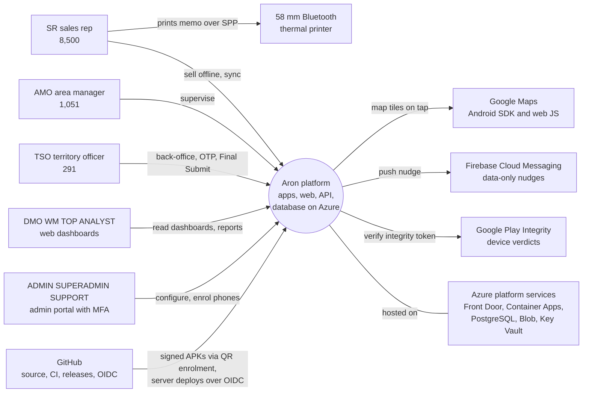

*Legend: the round node is the system in scope; rectangles are actors and external systems. The printer talks only to the phone (Bluetooth Classic SPP), never to Azure.*
*Distribution ruling: APKs reach phones through device-owner QR provisioning and in-app update from GitHub Releases, not Google Play and not a third-party MDM.*

| External party | Role | Status |
|---|---|---|
| Google Maps (Android SDK, web JS) | Lite on-demand map; web maps behind a server permission and a daily cap | **[IN_REPO]**. Android key and web key are build secrets; the web runtime key `MAPS_WEB_KEY` is not wired in Azure, so maps fall back to a pin list until it is (**gap**) |
| Firebase Cloud Messaging | Data-only nudges (HIGH priority, TTL 30 min); a push never uploads | **[IN_REPO]**; off until a service account is configured. Final account needs its own Firebase project |
| Google Play Integrity | Device verdict collected at enrolment and check-in; the gate `cfg.device.require_integrity` defaults to `false` and no seed or template turns it on in prod (`db/migrations/V0006__cfg_key_registry.sql:48`, `db/seed/04_dev_config_and_codes.sql:14`, `infra/scripts/seed-secrets.sh:9`); enabling it is OD-09 | **[IN_REPO]** in code; **not effective** until the owner enables the API and links the app in Play Console (owner action 13) |
| Play or MDM distribution | None. Device-owner provisioning by QR; APKs from GitHub Releases | **[IN_REPO]** (`release-app.yml`, inert until `ARON_FINAL_ACCOUNT=true`) |
| GitHub | Source, Actions CI/CD, Releases, OIDC identity to Azure, Dependabot, CodeQL | **[IN_REPO]**. Repository public until the product is complete (sponsor rule 13) |
| Azure | Hosting (A5) | Templates **[IN_REPO]**; final account **[PLANNED]** (not yet created) |
| Printers | RPP02N/MP-58N class 58 mm, 384 dots, Bluetooth SPP, ESC/POS raster | **[IN_REPO]** host-tested; physical output not yet verified (N-020) |
| Apsis (vendor) | Not integrated. Clean-room rebuild; no calls to the vendor backend | Out of scope |

Evidence: `docs/28-environment-profiles.md`; `.github/workflows/release-app.yml:1-30`; `android/core-geo/src/main/kotlin/com/aktcl/aron/core/geo/integrity/PlayIntegrity.kt:44-70`; `backend/notify/src/main/kotlin/com/aktcl/aron/backend/notify/Push.kt:40-140`; `web/src/lib/maps/guard.ts:1-44`; `docs/status/android-print.md:19-27`; `docs/status/forecast.md:78`; `CLAUDE.md` (guardrails).

---

## A4 Logical architecture (C4 level 2)

**In plain words:** The system is a small number of deployable pieces: three phone apps, one web app, one API program that also runs as a background worker, and one database. Photos go straight from the phone to cloud storage. The phone does the work first; the server checks it again.

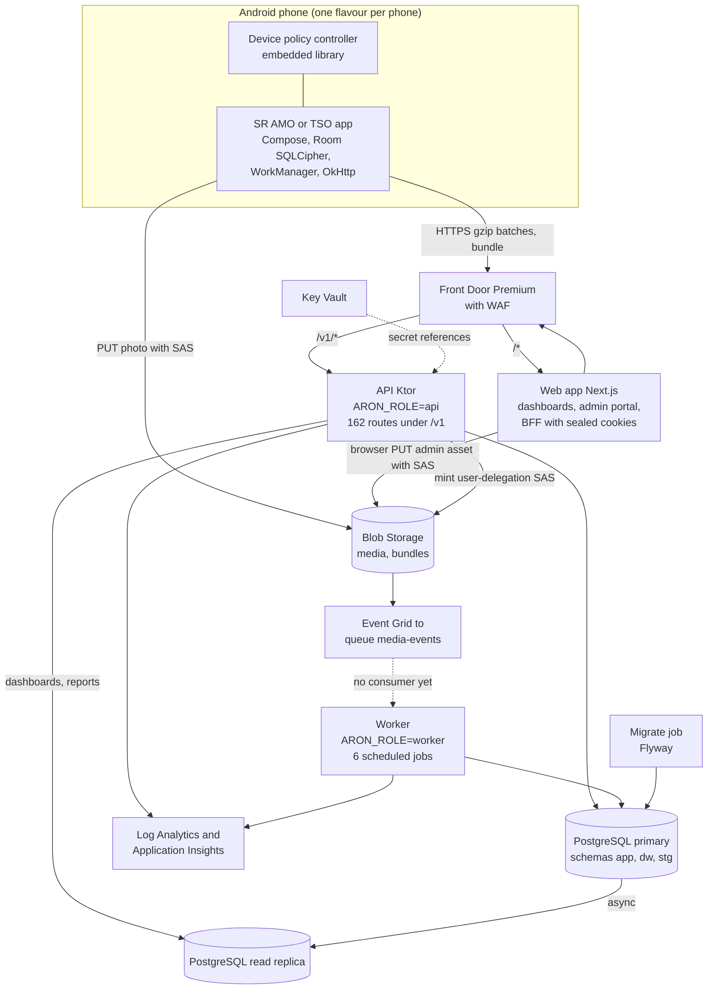

*Legend: solid arrows are runtime calls; the dotted line from the queue to the worker marks a connection that is provisioned but not yet consumed by any code. Cylinders are data stores.*
*FCM pushes are sent from the API process, not the worker; the worker never sends push (see A6.6).*

### A4.1 Container catalogue

| Container | Responsibility | Technology | Protocol | Owner | Status |
|---|---|---|---|---|---|
| **SR app** (`com.aktcl.aron.sr`) | Login, enrolment, bundle, attendance, stock, visit and geo check, sale, memo, dues, Sales Submit, sync, print, photos | Kotlin 2.4.20, Compose, Room 2.8.5 + SQLCipher 4.19.1, Hilt, WorkManager, OkHttp 5.5; minSdk 26, targetSdk 36 | HTTPS to `/v1`, Bluetooth SPP, SAS PUT to Blob | android lanes | **[IN_REPO]**; 56 of 57 SR rows built (`docs/status/forecast.md:83`); host-tested, no device proof recorded |
| **AMO app** (`com.aktcl.aron.amo`) | Zone supervisor: control and joint calls, verification, team, dashboards | Same toolchain | same | android-amo | Shell (login, bind, placeholder): **[PLANNED]** (1 of 40 rows built, `docs/status/forecast.md:83`) |
| **TSO app** (`com.aktcl.aron.tso`) | Territory dashboard, Final Submit, leave, visit plans, team map, feedback | Same toolchain | same | android-tso | Shell: **[PLANNED]** (0 of 22 rows) |
| **Device policy controller (`dpc`)** | Embedded library; each app is its own device owner; policy, scheduled blocking, QR enrolment, managed update | Android library | local; `POST /v1/devices/enrol`, `GET /v1/devices/me/policy` | android-geo-dpc | **[IN_REPO]**; unwired pieces: breadcrumbs, battery exemption request, managed updater |
| **Web app** | Dashboards (18 pages), admin portal (50 pages), login; backend-for-frontend (26 handlers); the browser never holds a token | Next.js 16.3.8, React 19.3, TypeScript, Tailwind 4; Node 22 standalone; 0.5 vCPU / 1 GiB | HTTPS; calls the API on the Front Door host | web lanes (on hold since 2026-10-07) | **[IN_REPO]**, mock-tested only |
| **API** (`ARON_ROLE=api`) | All `/v1` routes: auth, sync, bundle, masterdata, config, reports, devices, media SAS; the only role holding the JWT signing key | Ktor 3.6.0 (Netty), Kotlin on JRE 21, JDBI 3.55, HikariCP 7.1; 1 vCPU / 2 GiB | REST + problem+json; OpenAPI 3.1 v1.3.0, 209 operations, 168 paths. The routing tree serves 162 method-and-path pairs (150 guarded, 12 public): 209 contract operations, less 51 not routed (25 sponsor-deferred, 26 held or dropped), plus 4 routed operations the contract does not list (C1.4) | backend lanes | **[IN_REPO]** |
| **Worker** (`ARON_ROLE=worker`) | Outbox projector and aggregation (5 s), risk signals (15 min), route-day planning (5 min), geo sweep (10 min), retention (6 h), outlet-request lapse (60 min) | Same image | direct PostgreSQL 5432 for writes and advisory locks; read pool through the replica PgBouncer on 6432 (`ARON_DB_READ_URL`, `infra/apps.bicep:100-106, 373-381`) | backend-core | **[IN_REPO]**; no scale rule, no probe |
| **Migrate / dblogins jobs** | Flyway before any app revision changes; least-privilege DB logins | Container Apps jobs; psql 16 image | PostgreSQL 5432 | infra, db | **[IN_REPO]** |
| **PostgreSQL 16** | System of record: `app` (148 relations), `dw` (33), `stg` (empty); 72 migrations V0001 to V0073 | Azure Flexible Server | JDBC via built-in PgBouncer 6432 / direct 5432 | db lane | **[IN_REPO]** |
| **Read replica** | Dashboards and reports off the primary | Same SKU, zone 3 | JDBC 6432 | infra | **[IN_REPO]** template; never deployed |
| **Blob Storage** | Photos (`media`), bundle snapshots (`bundles`), admin assets; queue `media-events` | StorageV2, RA-GZRS (prod) | HTTPS, user-delegation SAS only | infra | **[IN_REPO]** |
| **Edge** | TLS, WAF, routing `/v1/*` to API and `/*` to web, health probes, Private Link | Front Door Premium | HTTPS | infra | **[IN_REPO]** template; never run at Premium |
| **Key Vault, ACR, Log Analytics, App Insights** | Secrets, images, logs and traces | Azure | | infra | **[IN_REPO]** |
| **Bundle pre-generation, async exports, blob-created consumer** | Designed worker duties | | | | **[PLANNED]** |
| **Redis, separate auth app, DR region** | Present in `docs/18` | | | | **[DESIGNED]** only; not in the as-built architecture (ruling in A10.3) |

### A4.2 Ownership and boundaries

- **Single source of truth for the wire:** `contract/openapi.yaml` (13,020 lines) with generated types for web (`openapi.d.ts`) and shared Kotlin DTOs. Drift tests fail the build when code and contract diverge.
- **Module graph (backend):** nine Gradle modules (platform, auth, sync, masterdata, config, analytics, notify, media, app). Only `backend:app` sees all modules and holds `main()`. One image, `ARON_ROLE` selects api, worker or migrate.
- **Scope boundary:** the token proves who the user is; the server derives what they may see.
- **Data boundary:** the browser reaches the API only through the web BFF; phones call the API directly and Blob only with a one-blob SAS. Admin-portal browsers also PUT content assets (tutorials, definitions) directly to Blob with a write-only user-delegation SAS; the storage CORS rule allows PUT only, for the Front Door web origin (`infra/modules/storage.bicep:56-66`, `infra/main.bicep:217`).

Evidence: `settings.gradle.kts:42-80`; `backend/app/src/main/kotlin/com/aktcl/aron/backend/app/Main.kt:38-72`; `android/app-amo/build.gradle.kts:83-103`; `android/feature-amo/src/main/kotlin/com/aktcl/aron/feature/amo/AmoPlaceholder.kt`; `web/README.md:1-5`; `infra/apps.bicep:262-447`; `contract/openapi.yaml:1-60`; `docs/data-dictionary.md:12`; `docs/status/forecast.md:83`; `infra/modules/storage.bicep:56-66`; `infra/main.bicep:217`; `web/src/components/admin/asset-upload.ts`.

---

## A5 Azure deployment architecture of the final account

**In plain words:** In the final account everything lives in one resource group in the Azure region Southeast Asia (Singapore), the nearest region with three availability zones. All phone and browser traffic enters through one front door that filters attackers and then reaches the application over a private link. The database is a zone-redundant server with a read copy for dashboards.

### A5.1 Region and pairing

| Item | Value | Status |
|---|---|---|
| Primary region | Southeast Asia (3 availability zones). No Azure region exists in Bangladesh | **[IN_REPO]** (parameter default); decision D-05 is **[OPEN DECISION]** (must-confirm) and data-residency question Q19 is open |
| Resource group | One per environment; the final name `rg-aron-prod` is only a name the bootstrap command suggests (`docs/setup/move-to-final-account.md:29, 33, 70`); no template or parameter file contains it, so treat it as proposed; stage group name **[UNKNOWN]** | **[IN_REPO]** (scope: group only; no subscription-scope resource) |
| Paired / DR region | East Asia: warm environment, cross-region replica, ACR geo-replica, second vault, DR Front Door origin | **[DESIGNED]** only; nothing in `infra/` creates it |
| Latency bake-off Dhaka to Singapore (D-422) | | **[DESIGNED]**, not run |

### A5.2 Deployment diagram

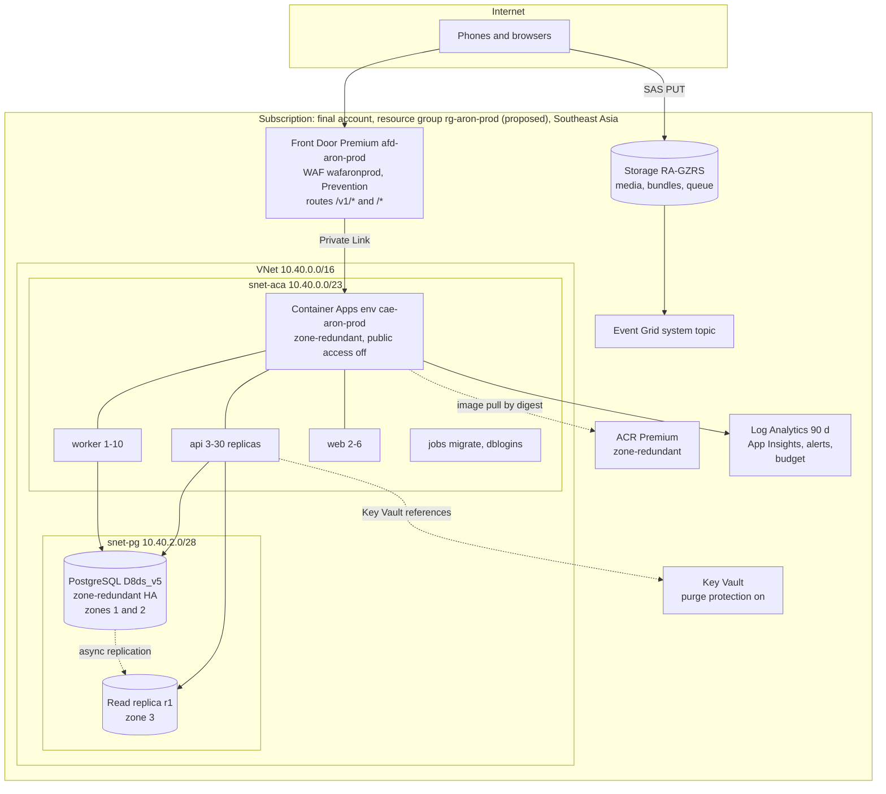

*Legend: boxes inside the VNet are private; Storage, Key Vault and ACR keep public endpoints protected by Entra or SAS (no private endpoints yet). Dotted lines are secret, replication or pull relationships.*
*Only dev-shaped resources have ever been deployed. This whole picture is **[IN_REPO]** as templates and parameters and has never run at final size.*

### A5.3 Summary resource table (details in Part B)

| Layer | Resource and key setting | Status |
|---|---|---|
| Edge | Front Door `Premium_AzureFrontDoor` `afd-aron-prod`, default `*.azurefd.net` host, origin timeout 60 s (API times out at 25 s); WAF policy `wafaronprod` in Prevention: managed Microsoft_DefaultRuleSet 2.1 in **Log** action plus BotManager 1.1; custom IP backstop 60,000 requests per 5 min per IP; methods allow-list; custom domains, edge caching, per-path rate rules, DR origin | Core **[IN_REPO]**; custom domains and caching **[DESIGNED]** |
| Network | VNet `vnet-aron-prod` 10.40.0.0/16; `snet-aca` 10.40.0.0/23; `snet-pg` 10.40.2.0/28 with NSG (allow ACA to 5432 and 6432, deny rest); one private DNS zone for PostgreSQL. No NAT gateway, firewall, peering, `snet-pe` or private endpoints for Key Vault, ACR, Blob | **[IN_REPO]**; private endpoints **[DESIGNED]** |
| Compute | Container Apps env `cae-aron-prod` (Consumption profile, zone-redundant, VNet-injected); `ca-aron-prod-api` 1 vCPU/2 GiB, 3-30 replicas, HTTP rule 50 concurrent, cron pre-scale to 8 replicas 06:15-10:00 and 16:45-20:00 Dhaka, Multiple revisions; `ca-aron-prod-worker` 1 vCPU/2 GiB, 1-10, no scale rule; `ca-aron-prod-web` 0.5 vCPU/1 GiB, 2-6; jobs `caj-aron-prod-migrate`, `caj-aron-prod-dblogins` | **[IN_REPO]** |
| Data | PostgreSQL Flexible Server 16, `Standard_D8ds_v5`, ZoneRedundant HA, Premium SSD v2 1,024 GiB / 12,000 IOPS / 300 MB/s, backup 35 days + geo-redundant, built-in PgBouncer, replica `-r1` (intended for the second deploy, but the creation path does not work as written: B13.2 rows 36 and 37), maintenance Friday 01:00-02:00 Dhaka. The D8 size applies from the first deploy; the D2 to D4 to D8 ladder of D-06 is not in the parameter files (A10.3 row 38). Storage `staronprod<s>` RA-GZRS (soft delete 14 d; media Cool 30 d / Cold 90 d; bundles deleted 3 d) | **[IN_REPO]** |
| Security services | Key Vault `kv-aron-prod-<s>` (RBAC, soft delete 90 d, purge protection on); four user-assigned identities (api, worker, web, migrate); ACR `craronprod<s>` Premium; GitHub OIDC deploy principal limited to one resource group; no Azure Policy, no locks, no Defender | Vault, identities, ACR **[IN_REPO]**; Policy and locks **[DESIGNED]** |
| Monitoring | Log Analytics `log-aron-prod` 90 d, 8 GB/day cap; App Insights `appi-aron-prod` (Java agent 3.7.10); workbook "Aron operations"; 5 log alerts, 4 PostgreSQL metric alerts, app metric alerts, resource-health alerts; e-mail action group `ag-aron-prod`; budget `budget-aron-prod` USD 7,000/month | **[IN_REPO]**; SMS/voice paging **[DESIGNED]** |
| Delivery | `ci.yml` (10 jobs since train 41) then `deploy.yml` / `infra/deploy.sh`, digest-pinned images, what-if guard, health gate; `promote-prod.yml` from a `server-vX.Y.Z` tag, inert until `ARON_FINAL_ACCOUNT=true` | **[IN_REPO]**; staging path not wired |

Evidence: `infra/main.bicep:11, 104, 221-234`; `infra/params/prod.bicepparam:99-144`; `infra/modules/network.bicep:14-110`; `infra/modules/frontdoor.bicep:24-129`; `infra/apps.bicep:262-529`; `infra/modules/postgres.bicep:84-166`; `infra/modules/storage.bicep:19-173`; `infra/modules/keyvault.bicep:22-78`; `infra/modules/monitoring.bicep:15-84`; `docs/18-scale-reliability-azure.md:263-272, 740-799`; `docs/setup/move-to-final-account.md:29, 33, 70, 72`.

---

## A6 Key runtime flows

**In plain words:** These eight diagrams follow the most important things that happen in the system, step by step. Each ends with a verdict on how much of the flow exists as working code. In every flow the phone keeps working when the network does not.

### A6.1 Enrol a phone, log in, MFA for admins

**In plain words:** A factory-reset phone is turned into a company-controlled device by scanning a QR code; only then can a rep log in. A password alone cannot attach a new phone to an account: a TSO reads a short code to the rep. Admins also need a second factor.

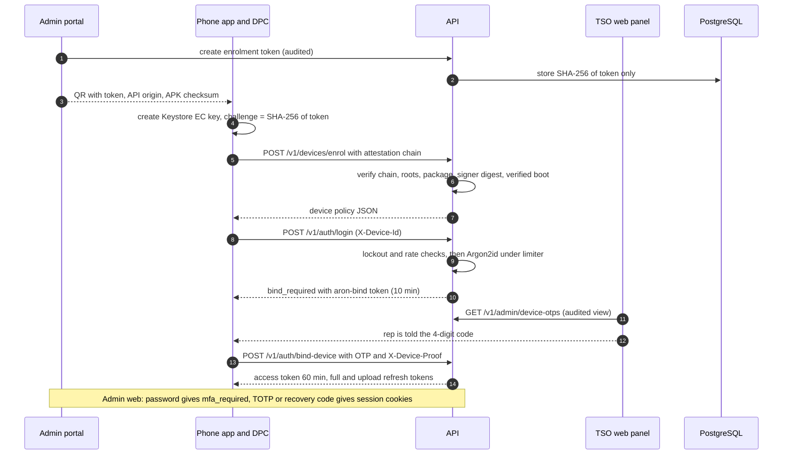

*Legend: solid arrows are requests, dashed are responses. The web admin path runs through the Next.js BFF, which keeps all tokens in HttpOnly sealed cookies.*

| Step group | Status |
|---|---|
| Enrolment token, attestation, policy return | **[IN_REPO]**. Prod lockdown requires a Google root hash, device owner, verified boot and hardware-backed key. Android 11 and below QR path wired; **Android 12+ provisioning activities are not declared in any manifest** (gap) |
| Login, OTP bind, refresh families with reuse detection | **[IN_REPO]** |
| MFA TOTP login for ADMIN, SUPERADMIN, SUPPORT | **[IN_REPO]**. The web **TOTP enrolment screen does not exist** (**[PLANNED]**): first enrolment is an API call by the laptop operator |
| Play Integrity verdict | Code **[IN_REPO]**; not effective until the owner links the app (owner action 13) |

Evidence: `backend/analytics/src/main/kotlin/com/aktcl/aron/backend/analytics/devices/DeviceService.kt:60-190`; `backend/auth/src/main/kotlin/com/aktcl/aron/backend/auth/LoginService.kt:80-130, 199-389`; `backend/auth/src/main/kotlin/com/aktcl/aron/backend/auth/Mfa.kt:19-194`; `web/src/app/api/bff/login/route.ts`; `docs/requests/backend-core-mfa-enrol-web.md`; `docs/requests/android-geo-dpc-provisioning-activities.md`.

### A6.2 One SR day offline: bundle, visit, geo-check, sale, print, day close, sync

**In plain words:** The rep downloads the day once, then everything (location check, sale, printed memo) happens on the phone. Uploads trickle out whenever there is signal and the day is closed by two submit steps.

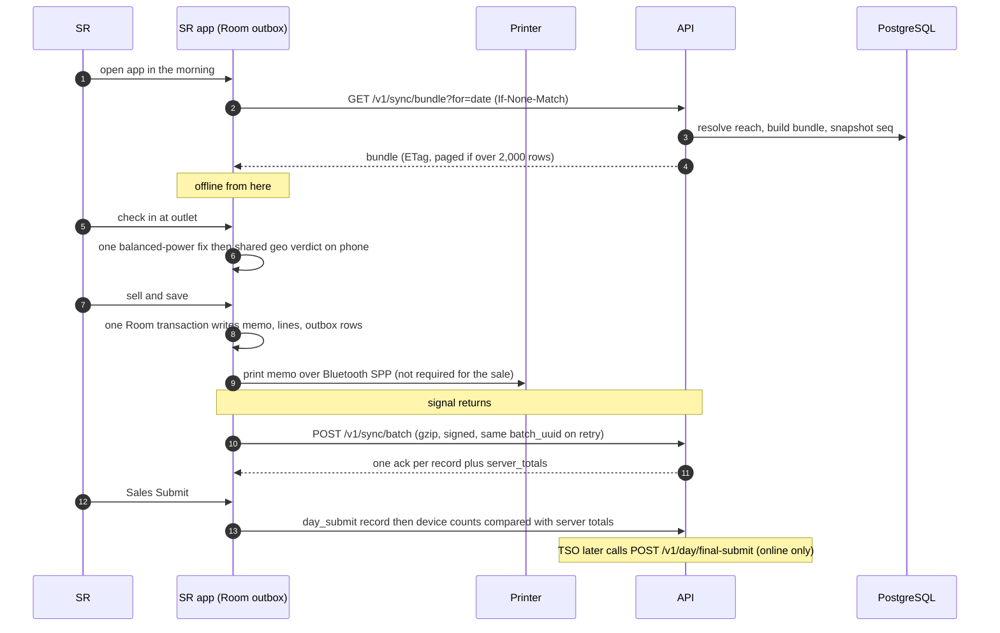

*Legend: the "offline" note marks the span where no step needs the network. Retry always reuses the same batch UUID with an attempt counter.*

| Part | Status |
|---|---|
| Bundle (live build, ETag, delta, paging), offline sale commit, geo verdict, SaveAndPrint, Sales Submit, outbox sync | **[IN_REPO]** for the SR app; JVM and Robolectric tested; **no real-phone proof** (cold start, battery, MP-58N print are DEVICE-PENDING) |
| Bundle pre-generation at 22:00 into Blob (F-SYS-067) | **[PLANNED]**. Today every bundle request is built live, including requests answered 304 |
| Delta cursor shared across replicas | Per-replica cache only, so many delta calls will answer 410 and fall back to the full bundle (gap) |
| Final Submit | **[IN_REPO]** server and web; the TSO Android screen is **[PLANNED]** |

Evidence: `backend/sync/src/main/kotlin/com/aktcl/aron/backend/sync/BundleService.kt:72-215`; `backend/sync/src/main/kotlin/com/aktcl/aron/backend/sync/BundleDelta.kt:132-148`; `docs/status/android-core.md:26-33`; `android/core-sync/src/main/kotlin/com/aktcl/aron/core/sync/SyncRules.kt:9-24`; `docs/status/android-print.md:7-27`; `backend/sync/src/main/kotlin/com/aktcl/aron/backend/sync/DayApi.kt:77-110`; `docs/25-build-backlog.csv:F-SYS-067`.

### A6.3 Idempotent batch ingest, including duplicate and partial upload

**In plain words:** Whatever the phone sends, however many times and in whatever order, each record is stored once. A repeated batch gets the earlier answer back. A record that arrives twice with different content is set aside for a human, not overwritten.

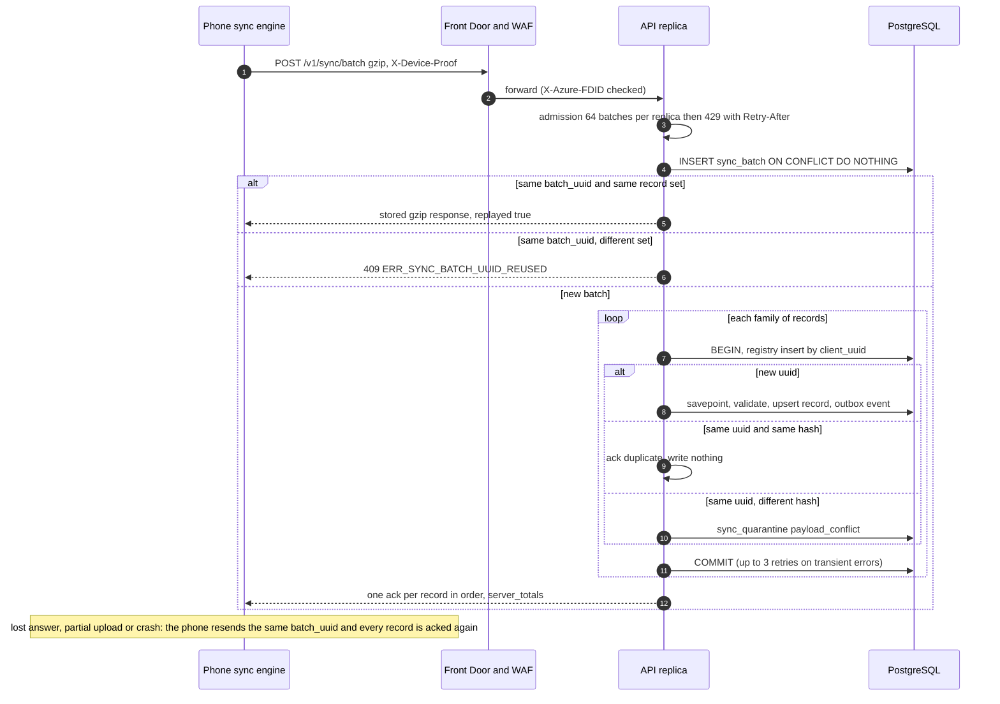

*Legend: `alt` shows the three outcomes for the batch and, inside the loop, for each record. A rejected record is parked in `sync_rejected`, an ambiguous one in `sync_quarantine`; nothing is dropped.*

| Control | Status |
|---|---|
| Registry first, replay store 48 h, content-duplicate detection, 7-day business-date window, per-record acks, quarantine | **[IN_REPO]** |
| Convergence fuzz harness (shuffle, split, replay, concurrent, dropped tails) | **[IN_REPO]**: default 12 seeded runs per push. The designed 10,000 per pull request and 100,000 nightly do **not** exist (no nightly test or fuzz workflow; only `codeql.yml`, `cost-report.yml` and `acr-purge.yml` are scheduled) |
| One savepoint per record inside a family transaction | **[IN_REPO]**; contradicts the `docs/18` limit of 64 subtransactions per transaction, behaviour under the 17:00 wave is **untested** (risk R17 in A10.4) |
| Parked rows expiry after 7 days, registry pruning at 45 days | **[PLANNED]** (nothing deletes them) |

Evidence: `backend/sync/src/main/kotlin/com/aktcl/aron/backend/sync/SyncApi.kt:147-204`; `backend/sync/src/main/kotlin/com/aktcl/aron/backend/sync/IngestService.kt:140-560`; `db/migrations/V0008__sync_ingest_events.sql:15, 42`; `backend/app/src/test/kotlin/com/aktcl/aron/backend/app/SyncConvergenceFuzzTest.kt:41-56`; `docs/18-scale-reliability-azure.md:546`.

### A6.4 Outbox to aggregation to dashboard

**In plain words:** Each stored sale also leaves a small event note in the same database transaction. A background worker reads those notes, recomputes the affected day totals and managers see them on the dashboards, normally within a minute.

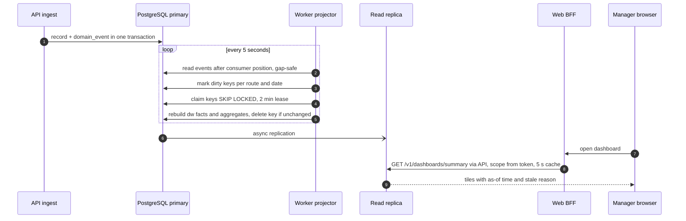

*Legend: the open arrow is asynchronous replication. Dashboards read the replica through the pooled port; the design target is aggregation lag p95 of 60 seconds.*

| Part | Status |
|---|---|
| Outbox, projector, dirty-key drain, dw facts and aggregates, 8 stable `dw.v_*` views, dashboard summary cache | **[IN_REPO]** |
| Worker scaling on outbox depth (KEDA) | **[DESIGNED]**: worker stays at 1 replica; aggregation freshness at the 17:00 spike is **unproven** |
| 60-second live tile refresh in the browser | **[DESIGNED]**; pages render on load or date submit |
| Replica lag alert, BI path (gateway or Fabric) | **[DESIGNED]** |

Evidence: `backend/analytics/src/main/kotlin/com/aktcl/aron/backend/analytics/AggregationWorker.kt:22-195`; `backend/analytics/src/main/kotlin/com/aktcl/aron/backend/analytics/DashboardApi.kt:100-140`; `db/migrations/V0015__dw_stable_views.sql`; `db/migrations/V0033__outbox_commit_order_dead_letter.sql`; `infra/apps.bicep:383-386`; `docs/18-scale-reliability-azure.md:81-92, 316`.

### A6.5 Admin configuration change reaching devices

**In plain words:** Every setting is data that an admin edits in the portal. Small changes apply at once, risky ones need a second approver, and phones notice the new version from a header on their next call and fetch only what changed.

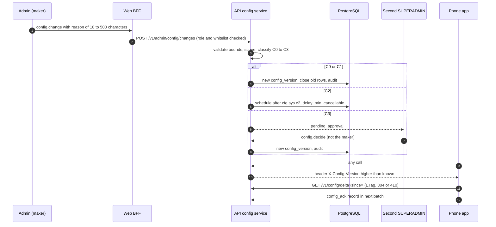

*Legend: C0 to C3 are risk classes; C3 needs a different SUPERADMIN. Rollback always creates a new version.*

| Part | Status |
|---|---|
| Registry (226 keys listed in `docs/24` s9.5; about 244 key insert rows in the migrations; the exact count is **[UNKNOWN]** until the registry is queried, C1.5), scoped values, classes, maker-checker, audit hash chain, delta endpoint, ack record | **[IN_REPO]** |
| Scheduled C2 changes applied by a worker | Not built: applied lazily on the next admin read or phone delta call (gap) |
| Instant cross-replica notification | `pg_notify` is emitted but nothing listens; replicas converge through a 30 s cache |
| The 649-key registry of `docs/19` | **[DESIGNED]** |

Evidence: `backend/config/src/main/kotlin/com/aktcl/aron/backend/config/ConfigService.kt:30-110, 311-323`; `backend/config/src/main/kotlin/com/aktcl/aron/backend/config/ConfigApi.kt:44-100`; `web/src/lib/admin/ops.ts:30-111`; `backend/platform/src/main/kotlin/com/aktcl/aron/backend/platform/DbServerConfig.kt:18-85`; `docs/19-admin-config.md:1261-1275`.

### A6.6 Notifications

**In plain words:** Push messages carry no readable content. They only tell the phone to come and fetch, after a short random delay, so that 8,500 phones never call at the same second.

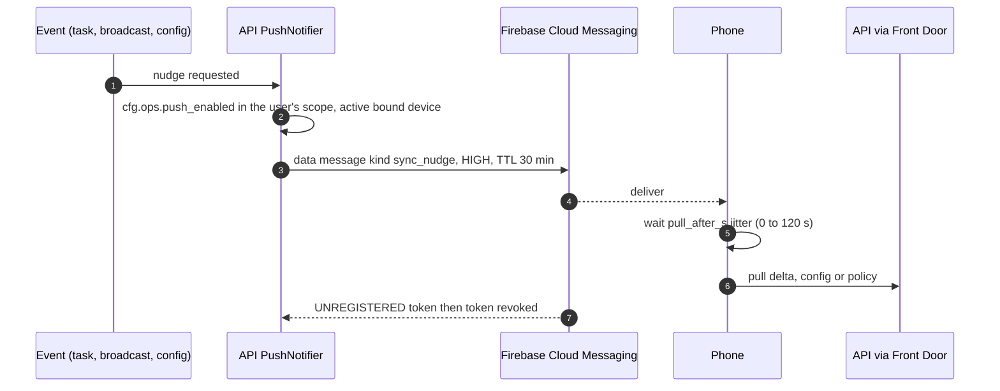

*Legend: a push never triggers an upload; if the nudge queue overflows the nudge is dropped and the phone's own triggers still sync.*

| Part | Status |
|---|---|
| FCM data nudges and admin broadcasts (`POST /v1/admin/notifications`) | **[IN_REPO]**; sent from the API process, not the worker; off until a service account is configured |
| Final-account Firebase project and FCM service account | **[PLANNED]** (owner/move step) |
| Visible-body notifications, SMS paging | not built |

Evidence: `backend/notify/src/main/kotlin/com/aktcl/aron/backend/notify/Push.kt:40-140`; `backend/notify/src/main/kotlin/com/aktcl/aron/backend/notify/Notifications.kt:72-110`; `android/core-sync/src/main/kotlin/com/aktcl/aron/core/sync/push/PushMessage.kt:1-60`.

### A6.7 Photo upload

**In plain words:** Photos normally never pass through the API. The phone asks for a one-time upload permission and sends the picture straight to cloud storage. One small exception exists: feedback and support pictures of at most 300 KB (and web-admin uploads of the same kind) can be posted to `POST /v1/media/upload`, and the API then writes the blob with its own identity (B6.2, C4.1).

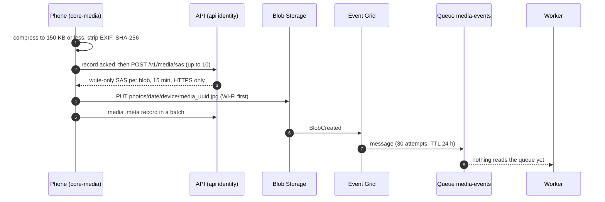

*Legend: the last arrow marks the missing consumer; photo rows therefore stay `pending_blob`.*

| Part | Status |
|---|---|
| Compression, SAS issue (user-delegation, no account key), direct PUT, supervisor read SAS | **[IN_REPO]** |
| Server-side small-file path `POST /v1/media/upload` (JPEG, at most 307,200 bytes, idempotent ledger `app.media_upload`, V0061); this is why the api identity holds Storage Blob Data Contributor | **[IN_REPO]** |
| Blob-created consumer that marks photos stored and verifies size and SHA-256 | **[PLANNED]**: infrastructure provisioned, no backend code. The pending-photo figure and 7-day flag cannot clear (high-severity gap) |
| WORM audit export, Archive tier, 730-day photo deletion rule | **[DESIGNED]** |

Evidence: `backend/media/src/main/kotlin/com/aktcl/aron/backend/media/MediaModule.kt:67-138`; `backend/app/src/main/kotlin/com/aktcl/aron/backend/app/AzureBlobSasIssuer.kt:29-100`; `infra/modules/storage.bicep:127-173`; `infra/apps.bicep:124-125`; `android/core-media/src/main/kotlin/com/aktcl/aron/core/media/PhotoCompressor.kt:30-48`.

### A6.8 Device lockdown and scheduled app blocking

**In plain words:** On the company phone, distracting apps are switched off from the moment the rep checks in until check-out or 20:00, even with no network, and are switched back on automatically.

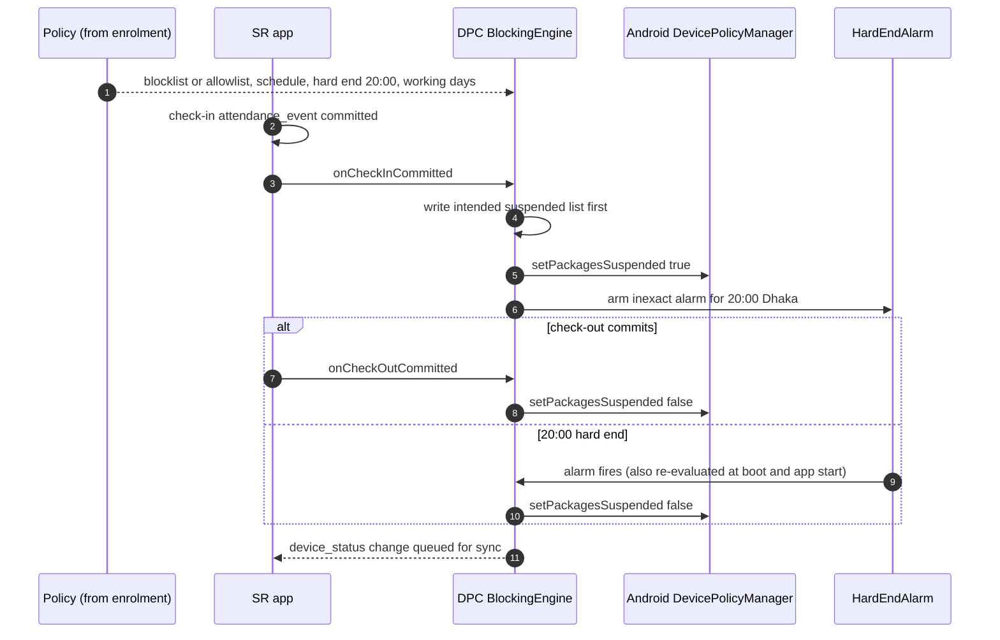

*Legend: the write-ahead suspended list means a crash can never leave a package suspended with no record. The Aron app and the always-allowed list are never suspended.*

| Part | Status |
|---|---|
| Blocking engine, hard-end alarm, prod lockdown policy applier, boot re-apply | **[IN_REPO]**, wired in the SR app only; phone behaviour (airplane mode, reboot) is DEVICE-PENDING |
| Android 12+ QR provisioning; managed silent self-update; battery-exemption request | **[IN_REPO]** code but not wired (**gap**) |
| Prod lockdown (no debugging, no uninstall, pinned permissions) | **[IN_REPO]**; once applied a phone leaves it only by recovery-mode reset |

Evidence: `android/dpc/src/main/kotlin/com/aktcl/aron/dpc/blocking/BlockingEngine.kt`; `android/dpc/src/main/kotlin/com/aktcl/aron/dpc/blocking/HardEndAlarm.kt`; `android/app-sr/src/main/kotlin/com/aktcl/aron/sr/SrDay.kt:272-273`; `android/dpc/src/main/kotlin/com/aktcl/aron/dpc/DeviceOwnerPolicy.kt:96-112`; `docs/status/android-geo-dpc.md:1-14`; `docs/24-build-spec.md:1139-1180`.

---

## A7 Cross-cutting architecture

**In plain words:** This section pulls together the qualities that cut across every component: how big it can grow, how it survives failure, how fast it must be, how little battery and data it may use, how it is secured, how it is watched, and what it costs. Each headline number is marked as designed, built or proven.

### A7.1 Scalability and capacity (headline numbers)

| Tier | Final-account setting | Status |
|---|---|---|
| API | 1 vCPU / 2 GiB per replica, min 3, max 30, HTTP rule 50 concurrent requests per replica, cron pre-scale to 8 replicas 06:15-10:00 and 16:45-20:00 Asia/Dhaka | **[IN_REPO]**; the 50-concurrent rule is **untested at fleet scale** (design had 30 requests per second per replica) |
| Worker | 1 vCPU / 2 GiB, min 1, max 10, **no scale rule and no probe** | **[IN_REPO]**; KEDA rules on outbox depth (target 200) and photo queue (target 100) **[DESIGNED]** |
| Web | 0.5 vCPU / 1 GiB, min 2, max 6, 50 concurrent per replica, no cron pre-scale | **[IN_REPO]**; capacity against about 1,500 readers **unproven** |
| Container Apps cores at replica maxima | api 30 + worker 10 + web 3 + migrate 0.5 = 43.5 vCPU (derived); a retained previous api revision adds 3 vCPU, a revision swap can briefly double the api | **[ASSUMPTION]** (derived) |
| PostgreSQL | `Standard_D8ds_v5` (8 vCores), HA standby counted as 8 more, replica 8 more; IOPS cap 12,800 and 12,000 provisioned, so about 6 percent headroom | **[IN_REPO]** |
| Connections | Per api replica 10 write + 10 read pool (`infra/apps.bicep:47-50`); at 30 replicas that is 300 write clients on the primary PgBouncer and 300 read clients on the replica PgBouncer (separate servers, `infra/modules/postgres.bicep:159-176`), each funnelled into a `default_pool_size` of 20 per user/database pair, which is one admin login while `dbPerAppLogins=false`; the worker and migrate use direct 5432 for writes (the worker's read pool goes through the replica on 6432); `max_connections` on D8 **[UNKNOWN]** | **[IN_REPO]**, unproven |
| Storage growth | About 2.8 GB per day; 1,024 GiB disk; Premium SSD v2 has no autogrow, so growth is by hand at 70 percent; alert at 70 percent | Alert **[IN_REPO]**; the by-hand grow is an operating rule |
| Photos | 22.5 GB per day to Blob (RA-GZRS), lifecycle to Cool at 30 days and Cold at 90 days | **[IN_REPO]** |
| Quota to request (final subscription only) | PostgreSQL: 40 General Purpose Ddsv5 vCores (operational doc) versus 64 (`docs/18`); prod alone needs 24 steady (primary 8, standby 8, replica 8) and 32 with a restore-drill server, which is why the operational document requests 40; stage plus prod plus one drill server is 56 (derived, B11.3), so 64 is the figure to request if stage and prod share a subscription; Container Apps Consumption cores 100 per environment; environment count 2 in `docs/setup/azure-quota-request.md:26` means dev plus the move-rehearsal group, not stage plus prod, so the count for stage and prod in one subscription is to be decided (R18, OD-11); Azure Load Testing 40 engines | **[PLANNED]**; the two documents disagree (A10.3) |

**What is not built for scale:** bundle pre-generation (every morning bundle is built live), a shared delta cache (per-replica only), worker autoscaling, async exports and PDF (exports above 10,000 rows return 503), the Blob-created consumer. These are the first items to prove or fix in the final account.

Evidence: `infra/params/prod.apps.bicepparam:171-185`; `infra/apps.bicep:53-58, 245-260, 348-447`; `infra/modules/postgres.bicep:84-139`; `docs/18-scale-reliability-azure.md:316-345, 451-464`; `docs/setup/azure-quota-request.md:23-28, 47-71`; `backend/sync/src/main/kotlin/com/aktcl/aron/backend/sync/BundleDelta.kt:132-148`.

### A7.2 Availability and disaster recovery (RPO and RTO)

| Failure | Mechanism | RPO | RTO | Status |
|---|---|---|---|---|
| Phone loses signal | Offline-first; outbox retries with the same UUIDs | 0 | not applicable (selling continues) | **[IN_REPO]** |
| API replica or zone loss | Zone-redundant Container Apps, min 3 replicas, readiness probe | 0 | seconds | **[IN_REPO]**, never drilled |
| Database zone failure | Zone-redundant HA, standby promoted, same name and DNS; liveness stays green so replicas are not restarted | 0 | 60-120 s documented; **about 30 s user-visible measured on a small dev server** (Azure call 429 s) | **[IN_REPO]**; not measured at fleet size |
| Bad deploy | api Multiple revisions: automatic traffic return after a failed health gate; manual `ingress traffic set`; `rollback_sha` redeploy by digest (no migration) | 0 | seconds (traffic) to 8-15 min (redeploy), design figures | **[IN_REPO]**, no rollback drill yet |
| Bad migration or data loss | Point-in-time restore into a NEW server, 35 days (prod); phones re-send rows acked after the restore point; server generation lineage | up to the restore point | 2 h assumed | **[IN_REPO]** procedure; **PITR drill never run** (waits for owner phrase) |
| Region outage, wave 1 | Geo-redundant backup, geo-restore into East Asia (runbook RB-52 not yet written) | about 1 h | unmeasured | Backup **[IN_REPO]**; restore **[DESIGNED]** |
| Region outage, target | Cross-region D8 replica, warm East Asia environment, ACR geo-replica, DR Front Door origin | 15 min | 4 h | **[DESIGNED]**, decisions D-127/D-420/D-522 **[OPEN DECISION]**; not built |
| Blob loss in region | RA-GZRS, soft delete 14 days | geo-lag | read from secondary | **[IN_REPO]** |

SLO window and budget (**[DESIGNED]**): availability 99.9 percent of `/v1/auth`, `/v1/sync`, `/v1/day` between 07:00 and 21:00 Dhaka on working days, which is 25.2 minutes per month. The server-generation mechanism (`GET /v1/sync/generation`, kinds initial, failover, pitr) lets phones re-send rows lost in a restore window; it is **[IN_REPO]**.

Evidence: `docs/runbooks/database-failover.md:1-41`; `docs/runbooks/rollback-bad-migration.md:1-48`; `docs/runbooks/rollback-bad-deploy.md:33-45`; `infra/deploy.sh:204-243, 609-655`; `docs/18-scale-reliability-azure.md:740-799, 852-873`; `DECISIONS.md:179, 646`; `backend/sync/src/main/kotlin/com/aktcl/aron/backend/sync/ServerGeneration.kt:1-51`.

### A7.3 Performance targets

All **[DESIGNED]** targets (`docs/18` s6, `docs/31`); none is measured at fleet size. Window 07:00 to 21:00 Dhaka.

| Path | Target |
|---|---|
| Batch upload, trickle (up to 50 rows) | ack p95 1.5 s |
| Batch upload, catch-up (200 rows) | ack p95 8 s |
| Bundle | p95 2 s on the server, 10 s end to end on 3G |
| Dashboards | p95 1.0 s (alert at 1 s over 10 min); sync-health page 1.5 s |
| Reports | p95 5 s; export of 100,000 rows in 120 s (**async export not built**) |
| Aggregation lag | p95 60 s, p99 5 min |
| Sync success within 3 attempts | 99.5 percent; reconciliation mismatch 0.1 percent of route-days or less |
| Request timeout | API answers at 25 s, before the 60 s Front Door timeout (**[IN_REPO]**) |
| Load-test gate (final account) | 8,000 rows per second; scenario S4: 8,500 users x 350 rows in 30 min; primary CPU 80 percent or less; data IOPS 7,200 or less of 12,000 (**[PLANNED]**, qa lane 0 of 20 built) |

Evidence: `docs/18-scale-reliability-azure.md:852-875, 1237-1290`; `docs/31-quality-bar-and-data-standards.md:16`; `backend/platform/src/main/kotlin/com/aktcl/aron/backend/platform/RequestIsolation.kt:32-62`.

### A7.4 Offline, battery and data budgets

| Budget | Value | Enforced by | Status |
|---|---|---|---|
| Location | at most 80 fixes and 15 GPS minutes per SR-day; no continuous GPS; fix timeout 15 s | code, no-polling lint | **[IN_REPO]**; device proof pending |
| Non-screen battery | 6 percent of a 5,000 mAh battery over a scripted 8-hour day | QA row N-060 | **[PLANNED]**, unproven |
| Mobile data | 1 MB per day without photos (`docs/17-sync-engine.md:940`, D-73; `docs/31` does not state this figure, its row says well under tens of MB including photos, `docs/31-quality-bar-and-data-standards.md:13`), sync and bundle at most 5 MB per SR-day (docs/24), photos at most 3 MB per day | design | ruling: the documents differ, the stricter figure is the goal; **unproven** |
| Photo size | 150 KB, long edge 1024 px (`docs/31` says 200 KB; code and `docs/18` say 150 KB; code wins, A10.3 row 39) | `PhotoCompressor` (`android/core-media/src/main/kotlin/com/aktcl/aron/core/media/PhotoCompressor.kt:25-30`) | **[IN_REPO]** |
| APK | 30 MB download per ABI, 70 MB installed; warn at +5 percent, fail at +15 percent; SR universal baseline 12.09 MB | CI size gate | **[IN_REPO]** |
| Cold start | 2.5 s median on the A06 (target 2 s) | macrobenchmark gate | **[IN_REPO]** gate; first A06 number not recorded |
| Sale save | 300 ms | design | proof pending |
| Offline unlock | 7 days since last online login | session module | **[IN_REPO]** |
| Stale bundle tolerated | 2 days | `cfg.bundle.stale_max_days` | **[IN_REPO]** |
| Wave smoothing | login jitter 120 s, check-out upload jitter 0-90 s, resync jitter 0-900 s, push pull delay 0-120 s | phone code | **[IN_REPO]**, unproven with 8,500 phones |

Evidence: `docs/24-build-spec.md:587-596`; `docs/17-sync-engine.md:940`; `docs/31-quality-bar-and-data-standards.md:9-21`; `tools/ci/apk-size-gate.py:1-30`; `tools/ci/apk-size-baseline.json`; `docs/status/android-core.md:228-245, 298-302`; `docs/status/device-checks.md:87-106`.

### A7.5 Security and privacy summary

| Control | Status |
|---|---|
| ES256 access tokens, rotating refresh families with reuse detection, upload-only grant, Argon2id behind a concurrency limiter, lockout | **[IN_REPO]** |
| Device identity: Keystore key, attestation at enrolment, signed refresh, bind, batch and header records | **[IN_REPO]**; record-signature mode defaults to `record` (flag only), so forged records are flagged, not rejected |
| Server-side scope with `scope_version`; application-level only | **[IN_REPO]**; 66 of 150 guarded routes have no scope test (frozen baseline); PostgreSQL row-level security **[DESIGNED]** |
| TOTP MFA for ADMIN, SUPERADMIN, SUPPORT; sealed HttpOnly cookies, CSRF guard, CSP with nonce | **[IN_REPO]**; first TOTP enrolment screen **[PLANNED]** |
| Hash-chained append-only audit log; security-event table | **[IN_REPO]**; scheduled verification, WORM export and security-event alerts **[DESIGNED]** |
| Front Door Premium + WAF + Private Link; backend refuses requests lacking the right `X-Azure-FDID` | **[IN_REPO]**; WAF managed rules stay in **Log** mode until pilot traffic shows no false positive on `/v1/sync` |
| Private PostgreSQL, NSG; Key Vault, ACR and Blob with public endpoints (RBAC, SAS) | **[IN_REPO]**; private endpoints and Azure Policy **[DESIGNED]** |
| Per-app least-privilege database logins | Built and proven in dev; **OFF in the prod and stage parameter files** (`dbPerAppLogins=false`), so api and worker would use the admin login (**high-severity gap**) |
| JWT signing key | An exportable Key Vault secret held in api memory; non-exportable key in a separate vault **[DESIGNED]**; rotation not drilled |
| PII: schema for envelope encryption exists, no code uses it; `pii` claim never minted true; row budgets not enforced | Schema **[IN_REPO]**, behaviour **[DESIGNED]** |
| Pen test, DAST, key-rotation drill, security incident runbooks | **[PLANNED]** |
| Legal position (Bangladesh data protection, localisation to Singapore, employee-location consent wording) | **[UNKNOWN]**; eight counsel questions open |

Evidence: `docs/21-security-privacy.md:13-56, 439-464`; `backend/platform/src/main/kotlin/com/aktcl/aron/backend/platform/AuthGuard.kt:48-111`; `backend/app/src/test/resources/scope-gaps-baseline.txt`; `infra/params/prod.apps.bicepparam:25`; `infra/modules/identities.bicep:50-58`; `infra/modules/frontdoor.bicep:42-129`; `db/migrations/V0049__outlet_pii_envelope_columns.sql`; `DECISIONS.md` BC-52, BC-53.

### A7.6 Observability and operations summary

| Capability | Status |
|---|---|
| Structured JSON request log (route template, status, duration, pseudonymous ids); App Insights Java agent 3.7.10; one Log Analytics workspace (90 d, 8 GB/day cap); workbook "Aron operations" with deploy annotations | **[IN_REPO]** |
| Alerts: batch 5xx > 1 percent (Sev1), batch p95 > 3 s (Sev2), dashboards p95 > 1 s (Sev3), sync errors, aggregation stuck, PostgreSQL CPU above 80 percent for 15 min (Sev2), storage above 70 percent (Sev2), failed connections above 10 per 5 min (Sev2), not alive for 5 min (Sev1), api 5xx, restarts, no running replica, resource health | **[IN_REPO]**; delivery is **e-mail only** |
| Custom `aron_*` metrics, burn-rate alerts, SMS/voice paging, replica-lag and origin-health alerts, device-lookup workbook, crash SDK, status page | **[DESIGNED]** or **[PLANNED]** |
| Web application telemetry | None: connection string set, no SDK, only a restart alert |
| Runbooks | 4 of about 54 written: rollback-bad-deploy (RB-01), database-failover (RB-02), rollback-bad-migration (RB-14), rotate-mfa-key; geo-restore RB-52 not written |
| Service Health alert | Module exists but cannot be enabled by parameter and needs subscription scope the deploy identity lacks |

Evidence: `infra/modules/alerts.bicep:16-219`; `infra/modules/monitoring.bicep:15-100`; `infra/apps.bicep:536-621`; `docs/runbooks/README.md:1-16`; `docs/18-scale-reliability-azure.md:981-1022`; `infra/main.bicep:265-276`.

### A7.7 Cost summary at final size

The figures below are list prices from `docs/18`, in USD per month, Southeast Asia. They are an **[ASSUMPTION]** until the first invoices.

| Line | USD/month | In the IaC? |
|---|---|---|
| PostgreSQL primary D8, HA, 1,024 GiB | 1,780 | yes |
| In-region read replica | 850 | yes |
| Cross-region replica (DR) | 850 | **no** |
| Container Apps compute | 1,000 | yes |
| Container Apps fixed fees | 350 | half (about 175 counted as not built) |
| Redis | 120 | **no** |
| Front Door Premium | 430 | yes |
| BI | 400 | **no** |
| Blob | 190 | yes |
| ACR Premium | 100 | yes |
| Logs (5.5 GB/day) | 490 | yes |
| Misc | 60 | yes |
| **Total in `docs/18`** | **about 6,630** (the lines above sum to 6,620) | `infra/README.md` says 5,500 to 6,500 |
| **As built (derived, unverified)** | **about 5,100** | lines not in the IaC total about 1,545 |

Sizing ladder caveat: `docs/18-scale-reliability-azure.md:433` and `DECISIONS.md` D-06 plan the PostgreSQL primary at D2ds_v5 for the pilot, D4ds_v5 for wave 1 and D8ds_v5 for the full fleet on one server scaled in place, but `infra/params/prod.bicepparam:47` already sets D8ds_v5 for the first prod deploy. The first deploy therefore costs the full-size line above (1,780 for the primary), not a pilot figure; the pilot figure is **[UNKNOWN]** here. See A10.3 row 38 and OD-18.

Budget guard: `budget-aron-prod` is USD 7,000 per month (stage 2,500), with e-mail at 50, 90 and 100 percent actual and 100 percent forecast. One-year reservations on PostgreSQL compute are about 40 percent cheaper and three-year about 60 percent, to be bought only after 30 stable days. The rehearsal dev topology costs about USD 560 per month (dev-lite about 35 to 55).

Evidence: `docs/18-scale-reliability-azure.md:466-491`; `infra/README.md:128`; `infra/modules/budget.bicep:11-49`; `infra/params/prod.bicepparam:109-115`; `docs/status/infra.md:617-628, 777-790`.

---

## A8 Environments, delivery and rollout

**In plain words:** Code moves through a fixed ladder: an engineer's laptop, an automatic build and test, a shared development system, real phones on a desk, a rehearsal copy of production, and finally the live system. Nothing reaches the live system without passing the earlier steps and the owner's approval. The apps reach phones in rings, never to everyone at once.

### A8.1 Environments

| Environment | Purpose | Where | Data | Status |
|---|---|---|---|---|
| local | Engineer and lane loop | Container or laptop, PostgreSQL 16, JDK 21 | Synthetic (`db/seed`) | **[IN_REPO]** |
| CI | Every push | GitHub Actions `ubuntu-24.04`, `postgres:16` service container | Discarded | **[IN_REPO]** |
| dev (test account) | Shared integration, device testing | `rg-aron-dev`: profile `dev` (rehearsal topology) and `dev-lite` (5-10 users); auto-deployed after green CI | Synthetic | **[IN_REPO]**, live |
| device lab | Our QA for the apps | Owner's Galaxy A06, A07, Honor X5c Plus, MP-58N printer | Synthetic and test accounts | Protocol **[IN_REPO]**; **no recorded results** |
| stage (final account) | Production-shaped rehearsal: load, failover, restore, WAF, soak | `stage*.bicepparam`: VNet 10.41.0.0/16, ZRS storage, 7-day PITR, 30-day logs, budget 2,500 | Synthetic fleet (N-054, not built) | Parameter files only: **[PLANNED]**, **cannot be deployed today**: `deploy.sh` and `deploy.yml` offer no `stage` profile, and the backend refuses `ARON_ENV=stage`, so stage replicas would exit at start (B13.2 rows 2 and 35, C10 G31) |
| prod (final account) | The 8,500 SRs | `prod*.bicepparam` | Real | Parameter files only |

Ring plan for apps: ring 0 the owner's three phones, ring 1 20 to 50 pilot SRs, ring 2 the fleet by `rollout_pct`.

### A8.2 Branching and release flow

| Element | Rule | Status |
|---|---|---|
| Lane branches | Lanes push only `lane/<sublane>`, never the integration branch (INT) | **[IN_REPO]** |
| Integration train | An integrator session merges ready lane heads into `lane/train-<time>`; only a candidate whose own CI is green is fast-forwarded to INT with an ancestor check. Introduced 2026-10-07 after a CI audit found no green INT run after 04:51 UTC | **[IN_REPO]** |
| `main` | Protected release branch (PR required, strict checks, 0 required approvals because there is one human owner, no force-push); promoted from INT once a day by a **daily gate pull request** after the owner's 10-minute check | Protection **[IN_REPO]** as a script (`tools/github-governance.ps1:61-90`); applied 2026-10-07 per `docs/30-environments-git-release.md:32`, current live state **[UNKNOWN]** (repository settings are not in the commit); **the first gate pull request has not been opened and no gate tags exist**, because no PR is opened until the owner approves the flow |
| Required checks on `main` | Eight: Repository gates; Shared, db and backend; Backend app tests; Android debug APKs; Release APKs and APK size gate; Web; Container images; Infra validation. Whether live protection was re-applied after a rename is **[UNKNOWN]** | **[IN_REPO]** in script |
| Tags | `gate-dayN-YYYYMMDD` (daily), `app-vX.Y.Z` (Android), `server-vX.Y.Z` (production); `hotfix/*` from main | Defined |
| Repository visibility | Public until the product is complete, then private after an Actions spending limit | Owner decision 2026-10-07 |

### A8.3 CI and CD gates

**CI (`ci.yml`, 10 jobs since train 41, actions pinned by commit SHA).** Measured: 22.3 minutes wall before the split (run 37682155791, 9 of 9 green); after the split 27.3 and 28.6 minutes wall on the qa lane runs 40174952495 and 40178671065 (10 of 10 green), where the new "Backend analytics tests" job alone takes about 27 minutes and every other job finishes within 21 minutes, so the wall is the longest job rather than a sum (D-QA-CI-HANG-01; a migrated template database for FreshDb is the next cut, hand-offs file); the 15-minute target is **not met**. Since train 60 the analytics suite (39.5 minutes on slow runners by 2026-10-29, against a 42-minute hang guard) runs as two complementary matrix jobs, "Backend analytics tests (a)" and "(b)", about 20 minutes each, so the 10 job definitions of ci.yml give 11 check runs (D-LEAD-CI-ANALYTICS-SHARD-01).

| Job | Gate |
|---|---|
| gates | gitleaks over history, OSV on the web lockfile, Semgrep diff-aware, migration immutability by git blob id plus squawk, oasdiff contract breaks, Redocly lint, gate self-tests (32) |
| jvm / jvm-app | Shared, db and nine backend modules on real PostgreSQL 16 (about 2,494 `@Test` annotations in the repo); data-dictionary drift test |
| android | Three debug APKs, unit tests, lint |
| android-release | Three R8 release APKs, size gate, INT-only signing with apksigner |
| web | audit, contract regeneration diff, eslint (including the hard-coded-text rule), tsc, Vitest, `next build`, Playwright with axe against a contract mock |
| images | Build, migrate twice, boot api/worker/web, Trivy (fixable CRITICAL fails), SPDX SBOM |
| infra | Bicep 0.47.16 build and lint, all parameter files, `check_infra.py` (95 tests), actionlint, shellcheck |

CodeQL runs on pull requests to `main` and nightly. Not present: Kotlin static analysis, coverage floors, mutation testing, cosign image signing, DAST, an emulator job, a contract test of the running API, a nightly test or fuzz workflow (only `codeql.yml`, `cost-report.yml` and `acr-purge.yml` are scheduled).

**CD.** Dev deploys automatically from a green INT run. The pipeline is: Azure-side deploy lock, ordering guard, what-if with a guard that refuses to recreate or reconfigure PostgreSQL, Key Vault seeding, images built once and run by digest, migrate job, dblogins job, apps, Private Link approval, health gate through Front Door (build must equal the commit), worker check, release marker, budget check. Production deploys only through `promote-prod.yml` from a `server-vX.Y.Z` tag on `main`, with CI green on that commit, a staging deploy older than 24 hours and the owner as required reviewer. It is **[IN_REPO]** but **inert** until `ARON_FINAL_ACCOUNT=true`, and **cannot pass its own guard today** because `deploy.sh` and `deploy.yml` have no `stage` profile and because the backend refuses `ARON_ENV=stage`, so a stage replica would exit at start (high-severity gap, A10.4 R4). Weighted canary (10, 50, 100 percent with auto-abort) is **[DESIGNED]**, not built.

### A8.4 Mobile release

| Step | Status |
|---|---|
| Tag `app-vX.Y.Z` builds three R8 APKs against `ARON_PROD_API_BASE_URL`, signs with apksigner (key only in GitHub secrets), checks the size gate, publishes a GitHub Release with SHA256SUMS and notes in `docs/releases/<tag>.md` (Bangla and English; folder does not exist yet) | **[IN_REPO]**, inert until the final account exists |
| Format is APK, not AAB; installation is by device-owner QR provisioning that pins the signing-certificate digest. A signer change later needs a factory reset of device-owner phones, so the final signing key must be fixed before any fleet phone is enrolled | Decision |
| `GET /v1/app/update-check`: min and blocked version codes, `rollout_pct` by a stable device hash, Wi-Fi-only download; a build below `cfg.release.min_version_code` gets 426 (`ERR_APP_VERSION_UNSUPPORTED`) on login and on a bundle for a NEW business date, while sync upload and an already-open day continue (`LoginService.kt:88-93`, `BundleService.kt:300`, `contract/openapi.yaml:176-179, 507`); no downgrade, rescue by roll-forward within 24 h | **[IN_REPO]** |
| Backend release routes `POST/PATCH /v1/admin/releases` and the store upload (N-064) | **[PLANNED]**: no release record is created from CI yet |
| Staged steps 1, 10, 50, 100 percent over 3 or more trading days, crash-free auto-pause at 99.0 percent | **[DESIGNED]**, no crash SDK exists |

### A8.5 Rollout waves to 8,500 reps

All of the following is **[DESIGNED]**. The written plan assumes an Apsis parallel run, delta imports and a re-key rollback, which the sponsor placed **out of scope**; the wave-control backlog rows F-SYS-041 and F-ADM-031 are DROPPED. What stays valid and buildable is staged exposure of app releases, enrolment and provisioning, readiness measures and the support model.

| Wave | Size (design) | Notes |
|---|---|---|
| Pilot | 10 to 20 routes | |
| Wave 1 | about 390 routes (about 290 SRs; 1,000 SRs if Q51 says so) | one territory per wing |
| Wave 2 | plus about 1,880 routes | one division per wing |
| Wave 3 | plus about 3,400 routes | half the fleet |
| Wave 4 | plus about 5,670 routes | the rest (11,336 routes in all) |

Rules (design): start Sunday to Tuesday, never within 3 days of month end, Eid or a holiday, not Thursday; next wave only after 3 stable trading days; pre-bind day on Wi-Fi at the distribution house. Next-wave gate thresholds (all **[ASSUMPTION]**): login at least 95 percent of baseline by day 3, reconciliation mismatch at most 0.1 percent of route-days, sync success within 3 attempts at least 99.5 percent, crash-free sessions at least 99.5 percent, install success at least 95 percent, zero P1 tickets. Rollback triggers: mismatch above 2 percent of routes, sync success below 97 percent for an hour, crash rate above 2 percent, any data-corruption bug.

### A8.6 Support model

All **[DESIGNED]**, none staffed or exercised: tier 0 SR self-help, tier 1 AMO, tier 1.5 TSO, tier 2 helpdesk of 8 to 12 Bangla-speaking agents 07:00 to 21:00 Dhaka, tier 3 engineering on-call (24 hours during waves), a release manager. P1 response 15 minutes, workaround 2 hours. Launch-day war room roles: incident commander, infrastructure/DB lead, API and sync lead, app lead, data lead, business owner, support lead, scribe, two break-glass holders per shift. Day-1 contact rate of 3 to 5 percent of switched reps is an unsourced **[ASSUMPTION]**. The SMS and voice paging channel is not built.

Evidence: `docs/30-environments-git-release.md:5-66`; `docs/26-lane-playbook.md:36-57`; `docs/lanes/integrator.md:1-40`; `docs/audit/2026-10-07-ci-audit.md:1-30`; `tools/github-governance.ps1:60-110`; `.github/workflows/ci.yml:56-616`; `docs/status/infra.md:50-62`; `.github/workflows/promote-prod.yml:196-286`; `.github/workflows/deploy.yml:39-116`; `infra/deploy.sh:31, 96-712`; `.github/workflows/release-app.yml:1-142`; `backend/config/src/main/kotlin/com/aktcl/aron/backend/config/ConfigPublic.kt:44-84`; `docs/20-test-strategy.md:1101-1113, 1360-1405`; `docs/18-scale-reliability-azure.md:1039-1150`; `docs/25-build-backlog.csv` (F-SYS-041, F-ADM-031); `docs/status/device-checks.md:1-207`.

---

## A9 Test account versus final account and the move

**In plain words:** The test account is a small, cheap copy used to build and rehearse. The final account is the real thing. Moving is mostly changing parameter files, creating a few new keys, and running the pipeline, which takes about two working days plus a wait of up to a week for Azure to approve the larger quotas. Everything that depends on size can only be proven after the move.

### A9.1 Side-by-side

| Aspect | Test account (dev-lite, and dev rehearsal) | Final account (stage and prod) |
|---|---|---|
| Users | 5 to 10 | 8,500 SRs, about 9,850 app users |
| Network | dev-lite: no VNet, PostgreSQL public endpoint limited to Azure services with TLS. dev: VNet 10.51.0.0/16 | VNet 10.40.0.0/16 (prod), 10.41.0.0/16 (stage), PostgreSQL private only |
| Edge | dev-lite: none, clients use the api address. dev: Front Door Standard, custom rules only, backstop 20,000, no Private Link | Front Door Premium + WAF Prevention (managed rules Log) + Private Link, backstop 60,000; Container Apps environment public access disabled |
| PostgreSQL | dev-lite: Burstable B1ms, 32 GiB, no HA, no geo backup, no PgBouncer. dev: D2ds_v5 zone-redundant, 128 GiB, 3,000 IOPS, no replica | D8ds_v5 zone-redundant HA, SSD v2 1,024 GiB / 12,000 IOPS / 300 MB/s, geo backup, read replica |
| Backup retention | 7 days | prod 35 days, stage 7 days |
| API replicas | dev-lite 0 to 2 (scale to zero), dev 1 to 2 at 0.5 vCPU | 3 to 30 at 1 vCPU, pre-scaled |
| Revision mode | Single | api Multiple, with automatic fallback |
| Per-app database logins | dev on (proven), dev-lite on (D-INFRA-LOGINS-LITE-01) | **off in the parameter files today**, to flip after a clean dev week |
| Storage | LRS or ZRS | prod RA-GZRS, stage ZRS |
| ACR | Basic | Premium, zone-redundant |
| Key Vault purge protection | off | prod on |
| Logs and alerts | 30 d, small cap, log alerts off in dev-lite | prod 90 d, 8 GB/day, log alerts on |
| Budget | dev 130 (rehearsal), dev-lite 70 | prod 7,000, stage 2,500 |
| Deploy gating | Automatic from INT | `promote-prod` from tag, soaked staging, owner approval |
| Proof level | Pipeline, digest deploy, health gate, slice smoke, one small failover | Everything at size |

### A9.2 What the move consists of

The runbook is `docs/setup/move-to-final-account.md` (about two working days; Azure quota lead time up to a week, `docs/18` planned four weeks).

1. **Subscription and quotas.** Create the final subscription; request quotas (PostgreSQL vCores, Container Apps cores, Load Testing). Quotas are requested only here, never in the test account. **[PLANNED]**
2. **Identity.** Run `infra/bootstrap-azure.ps1` for the final subscription (`rg-aron-prod`, `sp-aron-github-prod`, environment `azure-prod`). Create GitHub environments `azure-stage` (branch `main`) and `azure-prod` (owner as reviewer, tags `server-v*`) with `tools/github-governance.ps1`. Caution: bootstrap also writes its default integration-branch policy onto the environment it is given, while `azure-prod` must accept tags only. **[IN_REPO]**
3. **Variables and secrets.** `AZURE_RESOURCE_GROUP`, `ARON_FINAL_ACCOUNT=true`, `ARON_PROD_API_BASE_URL`, `ARON_ALERT_EMAILS`, the four `ANDROID_SIGNING_*` secrets (the same release key, so the provisioning QR can pin its digest), new Firebase project and FCM service account, new Maps keys, `google-services.json`, Play Integrity project number. The JWT signing key is **not** copied: it is generated fresh in the new Key Vault and every user signs in once. **[PLANNED]**
4. **First production deploy.** The templates intend `ARON_PG_READ_REPLICA=false` for the first run (30 to 45 minutes, zone-redundant PostgreSQL) and the replica on the next deploy. As built, nothing in the pipeline sets that variable, so the first run would try to create the replica, and the what-if guard would refuse the replica as a second PostgreSQL server (B13.2 rows 36 and 37); both need a small fix before the move. Approve the Front Door Private Link (`approve-private-link.sh`). Geo-redundant backup and zone redundancy are creation-time choices and must be right at first deploy. **[IN_REPO]**
5. **Data.** Create the database empty and migrate through the pipeline. If pilot data must be carried: `pg_dump --format=custom` from test, `pg_restore` through a job inside the VNet, re-run migrate, reconcile row counts and per-day money totals, copy Blob media, reset outbox consumers. The runbook uses `--no-privileges`, so `app.apply_db_role_grants()` must be re-run (gap). Apsis history import is out of scope.
6. **Phones.** Re-enrol with a new provisioning QR carrying the final API base URL; build release APKs against the final origin.
7. **Wire what is missing.** Add the `stage` profile to `deploy.sh`, `deploy.yml` and bootstrap; make the backend accept `ARON_ENV=stage` (or pass `prod` from Bicep for stage); add a replica exception to the what-if guard and a pipeline input for `ARON_PG_READ_REPLICA`; re-point `drill.yml`, `acr-purge.yml`, `cost-report.yml` and `reset.yml` from `azure-dev` to the final account; build once and promote the CI digest (AUD-DG-06).
8. **Retire test keys** after any parallel period.

### A9.3 What can only be proven after the move

| Proof | Why not earlier | Planned gate |
|---|---|---|
| 8,500-user and 1.5x load (12,750 users), morning storm, 17:00 spike, soak | Needs fleet-size resources and Azure Load Testing (forbidden in the test account) | Scenarios S1 to S14 (**[PLANNED]**; qa lane 0 of 20) |
| Zone failover under load and replica re-attachment after failover | Replica and D8 do not exist in test; replica behaviour after HA failover is **[UNKNOWN]** | RB-02 drill at scale, S7 error window at most 120 s |
| Point-in-time restore and geo-restore | PITR drill never run; geo-restore needs the final region setup | RB-14, RB-52 (to be written) |
| WAF Prevention flip and false-positive tuning on `/v1/sync` | Premium WAF not deployed in test | Pilot traffic first, then switch managed rules to Block |
| Private Link origin, direct-origin refusal | Premium only | Smoke and manual test |
| Multiple-revision rollback and canary steps | Single revision in dev | Rollback drill |
| Per-secret Key Vault scoping, Service Health alert | Needs final-account scope | Hardening step |
| `promote-prod` end to end | Inert before the final account | First tagged release |

### A9.4 Drills (all owner-approved with exact phrases where destructive)

| Drill | Status |
|---|---|
| Forced failover | Run once on dev (2026-10-07): about 30 s outage. Needs the phrase "lead approved failover drill" |
| Point-in-time restore with row-count comparison | Built (`drill.yml`), **not run**, waits for "owner approved restore drill" |
| Rollback by `rollback_sha` and by traffic switch | Runbook written, **not drilled** |
| Geo-restore, DR promotion, chaos (kill 50 percent of api replicas), WAF Prevention, wave-day auth storm | **[PLANNED]** |
| Load windows W1 to W4 | Cost-approved by the sponsor delegate; **[PLANNED]** |

Evidence: `docs/28-environment-profiles.md:5-41`; `docs/setup/move-to-final-account.md:2-101`; `infra/bootstrap-azure.ps1:44-167`; `infra/params/*.bicepparam`; `docs/setup/azure-quota-request.md:23-28, 47-71`; `.github/workflows/drill.yml:1-62`; `.github/workflows/reset.yml:1-73`; `docs/18-scale-reliability-azure.md:451-464, 1225-1290`; `docs/runbooks/README.md:7-15`; `docs/status/owner-actions.md:8-9`; `docs/status/infra.md:453-461`.

---

## A10 Architecture decisions, risks and open items

**In plain words:** This last section lists the key choices made and why, the places where older documents disagree with the code (and which one we believe), the biggest risks in order, a count of what is built versus only designed, and the decisions that only the owner can make.

### A10.1 Architecture decisions (ADR table)

"Alternative rejected" is given only where the evidence records one; otherwise it says so.

| ID | Decision | Rationale | Alternative rejected | Source |
|---|---|---|---|---|
| ADR-01 | Native Kotlin apps (Compose, Room, SQLCipher), three apps from one Gradle build, shared Kotlin Multiplatform rules module | Sponsor asked for native Kotlin; one geo and money function on phone and server | Flutter (the older documents) | `docs/23-seven-day-plan.md:14`; `docs/24-build-spec.md:545` |
| ADR-02 | One Ktor modular monolith, one image, `ARON_ROLE` = api, worker or migrate | Simplest deploy and rollback unit; only the api holds the JWT key | Node.js/NestJS; separate auth app | `docs/24-build-spec.md:609-617` (D24-27) |
| ADR-03 | Synchronous ingest with the outbox written in the same transaction | Acks are truthful; no dual write or poison message | A message queue in front of the database | `docs/18-scale-reliability-azure.md:525-536` (D-61) |
| ADR-04 | Idempotency by client UUID plus RFC 8785 payload hash; per-record outcomes; nothing dropped | A retried or partial upload can never double a sale | Not recorded | `IngestService.kt:236-278`; `docs/24-build-spec.md:263-266, 400-451` |
| ADR-05 | Scope derived on the server; token carries `scope_version`, not reach | Client never supplies scope; stale scope refused with 401 `ERR_SCOPE_CHANGED` within the 10 s per-replica scope-version cache; reach itself is cached 5 minutes keyed by `scope_version` | Scope ids in the token; PostgreSQL RLS (not built) | `AuthGuard.kt:48-84`; `docs/24-build-spec.md:717-780` |
| ADR-06 | No Redis in Phase 1: per-replica in-memory rate limits, lockout in PostgreSQL, 10 s cache | Fewer moving parts | Azure Managed Redis (`docs/18`) | `docs/24-build-spec.md:1467, 1505` (D24-20, D24-58) |
| ADR-07 | Southeast Asia primary region; East Asia as designed DR | Zones, SSD v2, geo features; no Azure region in Bangladesh | Not recorded | `docs/18-scale-reliability-azure.md:263-272` (D-05 must-confirm) |
| ADR-08 | Front Door Premium + WAF + Private Link in prod and stage; Standard in dev | Managed rules and Private Link need Premium | Public Container Apps ingress | `infra/params/prod.bicepparam:139-144` |
| ADR-09 | WAF managed rules in Log mode until pilot traffic shows no false positive; the real per-device rate limit lives in the API | A blocked sync batch would look like a server failure; carrier NAT puts thousands of phones behind one IP | Block from day one; per-IP limits as the main defence | `infra/modules/frontdoor.bicep:14-17`; `docs/18:301-302` |
| ADR-10 | Zone-redundant HA and geo-redundant backup on from the first deploy | Both are creation-time only | Add later | `infra/modules/postgres.bicep:1-3, 38` |
| ADR-11 | Premium SSD v2, 12,000 IOPS, no autogrow; grow by hand at 70 percent | Independent IOPS and throughput | Autogrow (not available on SSD v2) | `docs/status/infra.md:973`; `infra/modules/alerts.bicep:109` |
| ADR-12 | Read replica added on the second prod deploy (intent; the pipeline cannot yet perform it, R28) | SSD v2 needs its first backup before a replica | Replica at first deploy | `infra/params/prod.bicepparam:134-136` |
| ADR-13 | PgBouncer transaction mode for the api, direct connections for Flyway and the worker | Session advisory locks do not survive transaction pooling | Direct connections everywhere | `infra/modules/keyvault.bicep:40-44` |
| ADR-14 | Photos by user-delegation SAS direct to Blob; shared keys off; Event Grid to a Storage queue | No secret in the app; no API bandwidth for 22.5 GB/day | Upload through the API (kept only as a small fallback) | `infra/modules/storage.bicep:1-4, 127-139` |
| ADR-15 | Images pushed once per commit, tag locked, deployed by digest; what-if guard may never reconfigure a live PostgreSQL server | A moved tag cannot change what runs; protects the data store | Mutable tags | `infra/deploy.sh:339-370`; `infra/scripts/whatif-guard.py:1-18` |
| ADR-16 | Multiple revision mode for the api in stage and prod with automatic fallback | Instant return to the previous build | Single mode (dev); weighted canary (not built) | `infra/deploy.sh:609-655` |
| ADR-17 | Production only through `promote-prod` from a `server-v*` tag after a soaked staging deploy and an owner approval; inert before the final account | Recorded approver; no prod in the test account | Deploy from any branch | `.github/workflows/deploy.yml:97-116` |
| ADR-18 | Web BFF inside Next.js with sealed HttpOnly cookies; a whitelist of admin operations | Tokens never reach JavaScript; the console is never an open proxy | Browser calls the API directly | `docs/24-build-spec.md:654-659`; `web/src/lib/admin/ops.ts:1-5` |
| ADR-19 | APK sideload by device-owner QR, release key only in GitHub secrets; no certificate pinning | A signer change needs a factory reset; Front Door certificates rotate | Google Play AAB; pinning | `docs/setup/move-to-final-account.md:97-100`; `docs/24-build-spec.md:602` |
| ADR-20 | Record signatures and Play Integrity gate flag by default and quarantine only when switched on | Never lose a sale; BC-83: do not change the gate without the owner | Reject on failure | `IngestService.kt:418-449`; `DECISIONS.md` BC-53, BC-83 |
| ADR-21 | Bundle built on request in this build | Correctness surface first; pre-generation is row F-SYS-067 | 22:00 pre-built snapshots (not built) | `BundleService.kt:40-41` |
| ADR-22 | Money as bigint milli-taka, enumerations as text + CHECK, ingest registry hash-partitioned (16) | Reproducible printed totals; additive migrations; unique UUID across time | PostgreSQL enums; range partitioning of the registry | `docs/requests/db-ingest-registry-partitioning.md`; `V0007` |
| ADR-23 | Test account stays minimal; fleet-size resources and quotas only in the final account | Sponsor rule 1 | Early scale-up in test | `docs/28-environment-profiles.md:19-22` |

### A10.2 Status summary

Backlog: 619 rows = 490 BUILD, 33 DEFERRED, 96 DROP. Built (lead tally, 2026-10-08 06:50 UTC): **363 of 490 BUILD rows (74.1 percent)**; 337 carry a finish time in the status files on the commit (our count). By area: backend 100/135; SR app 56/57; Android shared core 52/61; web dashboards 49/50; db, web-admin, web-config, infra, shared and contract 100 percent; **AMO 1/40; TSO 0/22; QA 0/20**. Held at that time: wave 2 (about 81 rows) and backend-admin/backend-reports (about 35 rows). The lead judged Day 7 (2026-10-11) lost and Day 10 (2026-10-14) dependent on the held lanes starting by 2026-10-09; the later state is **[UNKNOWN]**.

Component counts below are the author's classification made during this study, **not reproducible from the repository** (the underlying catalogues are not in the commit; searched `docs/`, `docs/status` and `docs/evidence`). The same component can appear in two domains, so these are not a unique total:

| Area | Components | **[IN_REPO]** | **[DESIGNED]** | **[PLANNED]** | **[DEFERRED]** | **[UNKNOWN]** |
|---|---|---|---|---|---|---|
| Azure infrastructure | 33 | 29 | 3 (DR replica, Redis, Azure Policy and locks) | 1 (load and quota) | 0 | 0 |
| Delivery and operations | 31 | 25 | 4 (canary, SLOs, rollout waves, go/no-go) | 2 (staging deploy, load/chaos/DR programme) | 0 | 0 |
| Backend and API | 37 | 30 | 1 (Redis) | 5 (blob consumer, bundle pre-generation, async exports, AMO zone bundle, 51 unrouted operations) | 1 | 0 |
| Database and data | 37 | 29 | 3 (DR replica, cfg schema, RLS) | 3 (nine-table partitioning, archive job, registry pruning) | 2 (programme tables, Apsis staging) | 0 |
| Android and devices | 27 | 24 | 0 | 3 (AMO app, TSO app, on-phone and fleet proofs) | 0 | 0 |
| Web | 35 | 30 | 2 (design v1, live-tile refresh) | 1 (TOTP enrolment, client-IP forwarding) | 1 | 1 (web at final size) |
| Security and privacy | 30 | 26 | 3 (threat model, money-side fraud signals, legal posture) | 1 (external assurance) | 0 | 0 |
| **Total** | **230** | **193** | **16** | **16** | **4** | **1** |

Read this table with the honesty rule: **[IN_REPO]** never means proven at 8,500 users; that proof can only run in the final account (A9.3).

### A10.3 Documents versus code: conflicts and rulings

Ruling rule: code and infrastructure outrank documents.

| # | Topic | Documents say | Code says | Ruling |
|---|---|---|---|---|
| 1 | Mobile framework | `CLAUDE.md`, `docs/02`, `docs/13`, `DECISIONS.md` D-01: Flutter, Drift, geolocator | Native Kotlin, Compose, Room, SQLCipher, fused location | Code wins; Flutter is stale |
| 2 | Backend language | `CLAUDE.md`, `docs/02`, `docs/13`, `docs/18`: Node.js/NestJS, Prisma/Kysely | Ktor 3.6 on JRE 21, JDBI, Flyway | Code wins |
| 3 | API shape | `docs/09`: `{message, success, data}` envelope, `/auth/login` | `/v1/...`, problem+json, `X-Aron-Api: 1`, OpenAPI v1.3.0 | Contract and code win |
| 4 | Auth app | `docs/18`: separate auth Container App, hash limiter | Login runs in api; limiter is an api setting | As built; auth app **[DESIGNED]** |
| 5 | Redis | `docs/18`: Managed Redis B3 HA | None; per-replica memory | No Redis; its USD 120 line is superseded |
| 6 | Health paths | `/healthz/startup`, `/healthz/live`, `/healthz/ready` | `/v1/health`, `/v1/health/ready` | Code wins |
| 7 | Autoscale rule | 30 requests per second per replica; min 1/2/3, max 3/10/30 | 50 concurrent requests, min 3, max 30, Dhaka cron pre-scale 8 | Code wins; test in the final account |
| 8 | Storage accounts | Two (evidence RA-GZRS with WORM; content ZRS) with many containers | One account, containers `media` and `bundles` | Code wins; WORM, apk, content containers **[DESIGNED]** |
| 9 | Key Vault layout | `kv-sign` non-exportable root key, `kv-pii`, DR vault | One vault, exportable PEM secret | Code wins |
| 10 | Network plan | ACA /26, `snet-pe` /27, `snet-gw` /28, DR 10.41/16, staging 10.50/16 | ACA /23, `snet-pg` /28 only, stage 10.41/16 | Code wins; renumber stage or DR before building either |
| 11 | Front Door features | Custom hostnames, caching, per-path rate rules, DR origin | Default host, no caching, one backstop rule, no DR origin | Code wins |
| 12 | Budget thresholds | README: 80 and 100 percent | 50, 90, 100 percent actual and 100 forecast | Code wins |
| 13 | Resource names | README: `crarondev<s>` | `craronprod<s>` etc. from `naming.bicep` | Code wins |
| 14 | Quota requests | `docs/18`: 64 vCores, 64/128 cores | Operational doc: 40 vCores, 100 cores; withdrawn for test | Use the larger for the actual layout: 40 covers prod alone (24 steady plus a drill server plus headroom); stage + prod + a drill server is 56 (derived), so request 64 if they share a subscription (B11.3) |
| 15 | Origin lockdown | README: backend can reject non-Front-Door calls (requested) | Implemented (`X-Azure-FDID` check) | Code wins |
| 16 | Staging deploy | `promote-prod` and `docs/30` assume a "Deploy to stage" job | `deploy.sh` accepts only dev, dev-lite, prod | Stage is parameter files only; wiring `stage` into the pipeline and letting the backend accept `ARON_ENV=stage` are final-account tasks (B13.2 rows 2 and 35) |
| 17 | Bicep layout | `infra/bicep/modules`, policy, load-test, `dr.bicepparam` | `infra/main.bicep`, `apps.bicep`, `modules/`, `params/` | Code wins |
| 18 | PostgreSQL settings | `max_prepared_statements` 0, statement timeouts, autovacuum | PgBouncer, extensions, logging, idle-in-transaction 30 s; role timeouts from migrations | Code and migrations win |
| 19 | Schemas | Four: app, cfg, dw, stg; about 140 app tables, 23 partitioned | app, dw, stg (empty); 148 + 33 relations; 7 + 5 partitioned | Code wins; no `cfg` schema |
| 20 | Ingest registry | 64 hash partitions | 16 | Code wins; revisit at the staging gate |
| 21 | Batch transaction shape | One savepoint per batch with bisection | One transaction per family, savepoint per record | Code wins; risk R17 |
| 22 | Bundle snapshots | Worker pre-builds D+1 snapshots into Blob | Live build per request | Code wins; **[PLANNED]** |
| 23 | Photo "stored" marking | Blob-created event marks media stored | No consumer | Code wins; gap |
| 24 | Token content | Scope encoded in the token | Token carries `sv` (scope version); reach computed per request | Intent met; document as built |
| 25 | JWT key custody and JWKS | Non-exportable key, `/.well-known/jwks.json` | Vault secret in memory, `/v1/auth/jwks` | Code wins |
| 26 | Database auth | Entra only | Password auth; per-app logins built but off in prod params | Code wins; flip needed |
| 27 | Row-level security | RLS on 14 tables | None | Code wins; **[DESIGNED]** |
| 28 | Password hash | Argon2id m=64 MiB, t=3, pepper | m=19 MiB, t=2, p=1, no pepper | Code wins |
| 29 | Mock-location default | `warn_rep` | `block_sale` | Code wins |
| 30 | CI and release flow | `docs/20 s5`: pr.yml, nightly.yml, merge queue, 15-minute PR checks, 2 reviewers, 72 h soak | One `ci.yml` (22 min), no nightly test or fuzz workflow, one reviewer, 24 h soak | `docs/30` and code win |
| 31 | Canary | 10, 50, 100 percent with auto-abort | Latest revision 100 percent with health-gate fallback | Code wins; **[DESIGNED]** |
| 32 | Alert routing | SMS/voice via `ag-sev1/2/3` | One e-mail action group | Code wins |
| 33 | Maps key delivery | Build-time `NEXT_PUBLIC_MAPS_WEB_KEY` | Runtime `MAPS_WEB_KEY`, server-side, not set in Bicep | Code wins; key must be provisioned |
| 34 | Navigation and device database | Navigation Compose; `aron-device.db` | State enum host; DPC state in files | Code wins |
| 35 | Rollout and cutover | Apsis parallel run, delta imports, re-key rollback | Out of scope (sponsor rule 3); wave rows dropped | Standing rule wins; reusable parts stay **[DESIGNED]** |
| 36 | Distribution | Play or MDM (as asked in this brief) | APK by device-owner QR from GitHub Releases | Code wins |
| 37 | AMO dashboard access | `docs/18` (D-185, D-207) gives AMOs web logins and counts them in the 1,500 concurrent readers (`docs/18-scale-reliability-azure.md:23, 95`) | AMO is not in `WEB_ROLES` (`web/src/lib/auth/roles.ts:9`); the AMO app is a shell | Code wins; readers on the web are about 440 (150 HQ + 291 TSO) until the AMO app dashboards exist; the 1,500-reader sizing of web and replica remains the design target |
| 38 | PostgreSQL SKU ladder | `DECISIONS.md` D-06 and `docs/18-scale-reliability-azure.md:282, 433`: pilot D2ds_v5, wave 1 D4ds_v5, full fleet D8ds_v5, one server created at D2 and scaled in place | `infra/params/prod.bicepparam:47` sets `Standard_D8ds_v5` from the first deploy | Parameter file wins; either accept the full-size cost (about USD 1,780 per month for the primary, A7.7) from the first deploy or add a pilot parameter file; recorded as OD-18 |
| 39 | Photo size cap | `docs/31-quality-bar-and-data-standards.md:13`: at most 200 KB | `PhotoCompressor.kt:25-30` and `docs/18`: 150 KB | Code wins (150 KB) |
| 40 | Read replica on the second deploy | `infra/params/prod.bicepparam:59-61` and `docs/setup/move-to-final-account.md:56-57`: the first prod run sets `ARON_PG_READ_REPLICA=false`, the next run adds the replica | No pipeline input sets the variable, and the what-if guard fails any second PostgreSQL server (`whatif-guard.py:49-51`; `check_infra.py:518`) | Code wins: the replica is **[IN_REPO]** as a template only; it cannot be created through the pipeline until a replica exception and a variable mapping are added (R28) |
| 41 | Stage backend environment | `docs/30` and `promote-prod.yml` treat stage as a parameter-file twin of prod | `Settings.kt:77-80` accepts only `dev` and `prod` | Code wins; stage cannot start until `ServerEnv` handles it (R4) |

### A10.4 Risks and gaps, ranked

| ID | Severity | Risk or gap | Where handled |
|---|---|---|---|
| R1 | High | **Nothing in the final topology has run at size**: Premium Front Door with Private Link, a public-access-disabled environment, D8ds_v5 on SSD v2, the replica, Multiple-revision fallback, 8,500-user load, failover and restore at scale; no PITR drill even in dev | Final-account proof plan, A9.3 |
| R2 | High | **AMO and TSO apps are shells** (1 of 62 Android rows built: AMO 1 of 40, TSO 0 of 22), QA lane 0 of 20, backend-admin/reports held; the schedule slipped. Because AMOs have no web channel in the code, the AMO share of the designed dashboard audience (A1.3, A10.3 row 37) has no working channel until the AMO app dashboards exist | Delivery state A10.2; **[PLANNED]** |
| R3 | High | **Per-app database logins are off in prod and stage parameters** (`dbPerAppLogins=false`): api and worker would use the admin login | Flip after a clean dev week; **[OPEN DECISION]** |
| R4 | High | **Staging can neither be deployed nor started**: `deploy.sh` and `deploy.yml` have no `stage` profile, so `promote-prod` cannot pass its own guard; and the backend accepts only `ARON_ENV` of `dev` or `prod` (`Settings.kt:77-80`) while `stage.apps.bicepparam` sets `stage`, so every stage api, worker and migrate replica would exit with code 2. `azure-stage` and `azure-prod` identities and environments do not exist | Wire during the move, A9.2 step 7; fix `ServerEnv` (B13.2 row 35, C10 G31) |
| R5 | High | **No disaster recovery**: nothing for a region outage; RTO unmeasured; RB-52 not written | DR ladder decision |
| R6 | High | **No device proof recorded**: battery, cold start, print on MP-58N, GPS and spoofing apps, device-owner enrolment, outdoor legibility | Device lab, owner needs a USB phone |
| R7 | High | **Morning bundle storm**: bundles are built live and delta fingerprints are per replica, so many delta calls fall back to the full bundle; least-proven path at 8,500 | F-SYS-067 and durable fingerprints **[PLANNED]** |
| R8 | High | **Legal position unknown**: Bangladesh data protection, hosting in Singapore, employee-location consent wording, breach-notification duty | Counsel; **[OPEN DECISION]** |
| R9 | High | **Scope is enforced only in application code**: no RLS, 66 of 150 guarded routes lack a scope test | Test registry may only shrink |
| R10 | High | **Audit durability and key custody below design**: no scheduled chain verification or WORM export; JWT key is an exportable secret and rotation is undrilled; refresh and OTP keys derive from it | **[DESIGNED]** |
| R11 | High | **Android 12+ QR provisioning not declared in any manifest**: modern phones cannot be enrolled by QR from factory reset | `docs/requests/android-geo-dpc-provisioning-activities.md` |
| R12 | High | **No web TOTP enrolment screen**: a first-time admin cannot finish login without an operator API call | **[PLANNED]** |
| R13 | High | **Incident tooling thin**: e-mail-only alerts, 4 of about 54 runbooks, no paging, no crash SDK | **[DESIGNED]** |
| R14 | Medium | **Blob-created consumer missing**: pending-photo metric cannot clear; photo size and hash never verified | **[PLANNED]** |
| R15 | Medium | **Worker is a single replica with no probe or scale rule**; aggregation freshness at 17:00 unproven | **[DESIGNED]** KEDA |
| R16 | Medium | **Public endpoints on Key Vault, ACR and Blob**; Key Vault Secrets User at vault scope for all four identities; no Azure Policy, locks, Defender | Final-account hardening |
| R17 | Medium | **One savepoint per record** in family transactions of up to about 175 rows exceeds the 64-subtransaction guidance; behaviour at the 17:00 wave untested | Load test S3b/S4 |
| R18 | Medium | **Quota arithmetic inconsistent** (40 vs 64 vCores; stage + prod + drill about 56) | Decide before requesting |
| R19 | Medium | **WAF managed rules only log**; Prevention untested | After pilot traffic |
| R20 | Medium | **Supply chain**: no image signing; CI scans one build and deploy ships another; APK key on the CI runner; repository public | Build once, promote digest (AUD-DG-06) |
| R21 | Medium | **CI takes 22 minutes**; fuzz default 12 runs; no nightly test or fuzz workflow (only codeql, cost-report and acr-purge are scheduled) | Add a nightly test and fuzz workflow |
| R22 | Medium | **Maps key not wired** in Azure, per-instance daily cap | Provision runtime secret |
| R23 | Medium | **Pruning not implemented** (registry 45 d, parked rows, nonces, snapshots) and archive job absent: the 12 GB registry estimate and storage plan do not hold without it | **[PLANNED]** |
| R24 | Medium | **Web untested against the real API, no telemetry, never load-tested** | Final-account proof |
| R25 | Medium | **Release path incomplete**: no release records from CI, `docs/releases/` missing, no crash-free auto-pause | **[PLANNED]** |
| R26 | Medium | **Only 9 of 19 risk-signal codes computed; money-side fraud signals absent** | **[DESIGNED]** |
| R27 | Low | Stage VNet 10.41.0.0/16 collides with the DR address plan; retained previous api revision keeps its 3 replicas running; wall-clock-in-tests scan becomes blocking on 2026-10-09; versionCode collision if the first tag is below `app-v1.0.0`; fallback values in prod parameter files (alert e-mail `alerts@aron.invalid`, budget start date) | Housekeeping |
| R28 | Medium | **The read-replica creation path does not work as written**: nothing sets `ARON_PG_READ_REPLICA=false` for the first prod run, and `whatif-guard.py` refuses any second `flexibleServers` resource, which the replica is (B13.2 rows 36 and 37) | Small pipeline and guard fix plus a test before the second prod deploy; **[PLANNED]** |

### A10.5 Open decisions that need the owner

These identifiers are local to Part A. Engineering fixes that need no owner decision (stage `ARON_ENV`, replica creation path, the Maps runtime key, the missing media consumer) are tracked as risks R4, R14, R22 and R28 and in B13.2 and C10.1, not here. The executive summary groups the owner's choices as D1 to D14.

| ID | **[OPEN DECISION]** | Why it matters |
|---|---|---|
| OD-01 | Confirm Southeast Asia as the permanent region (D-05) and the data-residency position (Q19) | Region cannot change cheaply; geo features, latency to Dhaka |
| OD-02 | Disaster-recovery ladder: RTO 4 h / RPO 15 min target (D-127), cross-region replica before wave 2 (D-420, D-522) or geo-restore only | About USD 850 per month plus a second region build |
| OD-03 | Custom domains (`api.`, `app.`, `dl.`) and managed certificates (OI-18-05) | Phones and the QR bake in the host name; changing it later forces re-enrolment |
| OD-04 | When to turn on per-app database logins in prod and stage | Closes the biggest least-privilege gap (R3) |
| OD-05 | Reinstate Redis or keep per-replica limits | Effective limits multiply with replica count |
| OD-06 | Private endpoints for Key Vault, ACR and Blob; Azure Policy and locks (subscription-scope step) | Needs a final-account owner action |
| OD-07 | Switch WAF managed rules to Block, and when | False positives could block `/v1/sync` |
| OD-08 | Counsel opinion on Bangladesh data protection, employee-location consent and breach duty; statutory retention period (7 years assumed) | Blocks real data and pseudonymisation choices |
| OD-09 | Enable Play Integrity (owner action 13) and set `require_integrity` in the production seed; switch record signatures to enforce | Anti-spoofing strength; BC-83 forbids lanes changing the gate |
| OD-10 | Final APK signing key custody (CI runner or off-runner) before any fleet phone is enrolled | A signer change needs a factory reset |
| OD-11 | Quota request size (40 or 64 vCores) and whether stage and prod share one subscription | Lead time up to a week |
| OD-12 | Replacement plan for the Apsis-based rollout: pilot selection, wave 1 size (about 290 or 1,000 SRs, Q51), helpdesk staffing | The written plan assumes an out-of-scope parallel run |
| OD-13 | Production approval strength: one reviewer and 24 h soak (as built) versus two reviewers and 72 h for sync changes (designed) | Release safety |
| OD-14 | Build worker autoscaling and bundle pre-generation before wave 1, or accept the risk | R7, R15 |
| OD-15 | Outcome of the full-size dev resource review (date 2026-10-10 has passed) | Cost in the test account |
| OD-16 | Require MFA for DMO, WM and TOP, not only ADMIN, SUPERADMIN and SUPPORT | Dashboard access to national data |
| OD-17 | Stage resource-group name and whether the repository goes private (Actions spending limit first) | Governance |
| OD-18 | PostgreSQL growth ladder D2 to D4 to D8 (D-06) versus D8 from the first prod deploy (`prod.bicepparam`): add a pilot parameter file or accept the full-size cost from day one | Cost from the first deploy; creation-time choices (zone redundancy, geo backup) must stay as they are either way |

Evidence: `docs/18-scale-reliability-azure.md:263-272, 740-799, 1148-1220`; `DECISIONS.md:27, 179, 485, 646, 1069`; `docs/status/forecast.md:83`; `docs/status/hold-notes.md:1-28`; `docs/25-build-backlog.csv`; `docs/status/owner-actions.md:1-19`; `docs/21-security-privacy.md:439-464, 1045-1064`; `infra/README.md:149-172`; `docs/requests/*.md`; all evidence lists in A0 to A9.

*End of Part A. Part B (platform and operations low-level design, `lld-platform.md`) and Part C (application and data low-level design, `lld-app-data.md`) follow in separate files; `00-executive-summary.md` summarises all three.*
