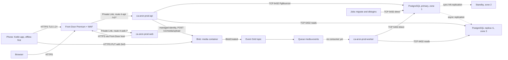
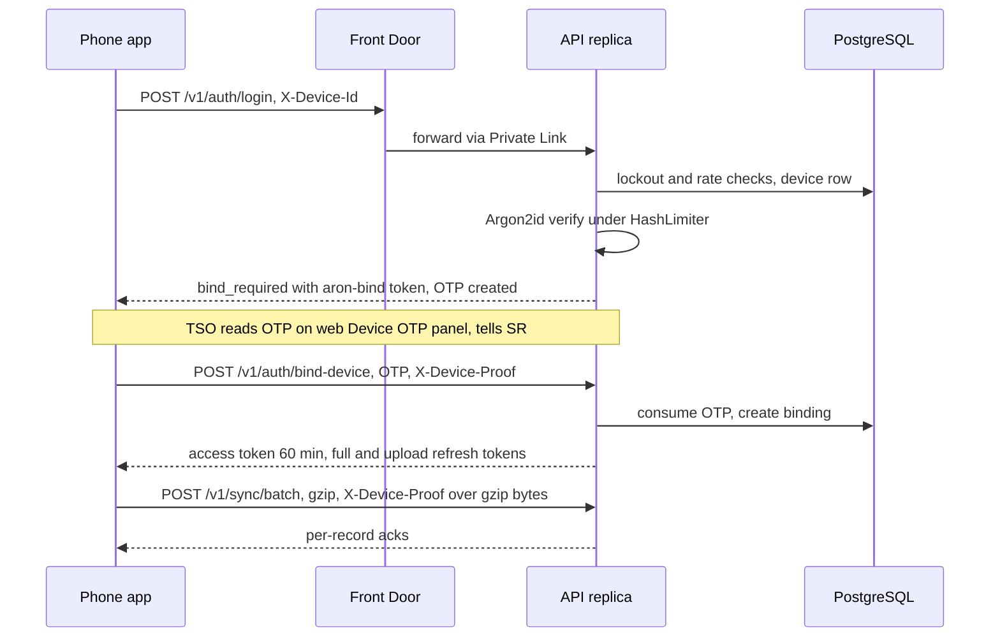
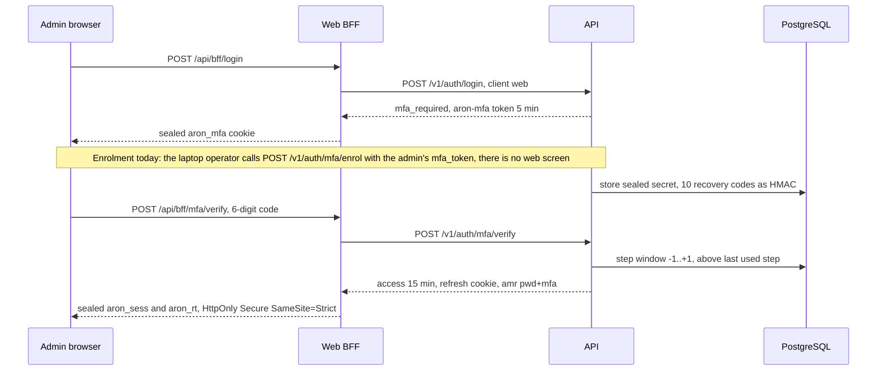
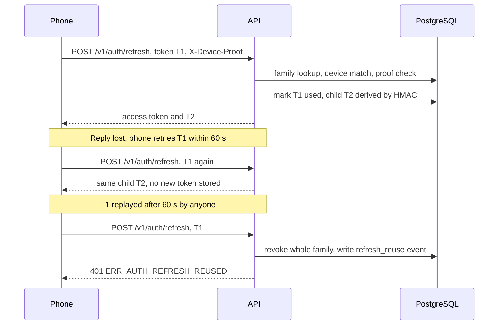
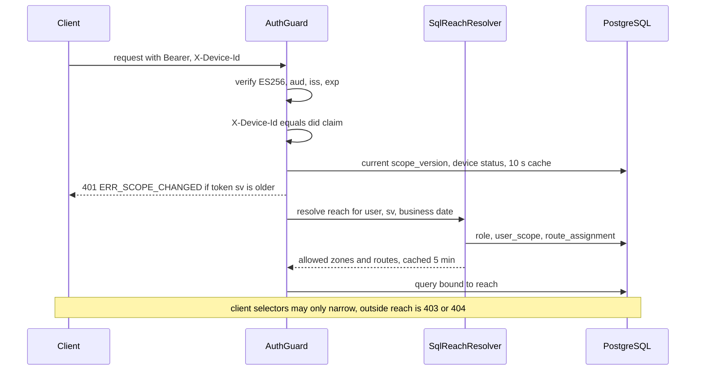
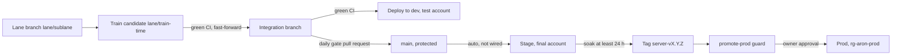

# Part B: Low-Level Design, Platform and Operations

**System:** Aron, AKTCL's field-sales platform (native Android apps for SR, AMO and TSO; web dashboards and admin portal; one API; one database).
**Scope of this part:** the FINAL Azure account (profiles `prod` and `stage`), sized for 8,500 SRs and about 9,850 app users.
**Evidence base:** repository commit `26cfb26a` (integration branch). Code and infrastructure templates outrank documents.

## How to read this document

In plain words: every statement carries a status tag. Only **[IN_REPO]** means "written and present in the code or templates on this commit". It never means "proven for 8,500 users". That proof can only run in the final Azure account, which does not exist yet.

| Tag | Meaning |
|---|---|
| **[IN_REPO]** | Implemented in code or infrastructure templates on this commit. Not proven at fleet scale. |
| **[DESIGNED]** | Specified in documents only (mostly `docs/18`). Nothing in code or templates. |
| **[PLANNED]** | A backlog row (`docs/25-build-backlog.csv`, `docs/status/*.csv`) not built yet. |
| **[DEFERRED]** | Sponsor-deferred: target, loyalty, every discount or promotion programme. Apsis data migration and cutover are out of scope. |
| **[ASSUMPTION]** | A figure or choice made for this document that no source states. |
| **[OPEN DECISION]** | A choice that has not been made. |
| **[UNKNOWN]** | Could not be established from the repository. |

**Final versus test.** The Azure subscription used today is a temporary TEST account (profiles `dev` and `dev-lite`, 5 to 10 users). The templates are shared; only parameter files (`infra/params/*.bicepparam`) differ. Only dev-shaped resources have ever been deployed. Every "prod" value below is a parameter on this commit, not a running system.

**Stack as built.** Native Kotlin Android apps, one Ktor (Kotlin, JVM 21) backend image with roles `api`, `worker` and `migrate`, PostgreSQL 16, a Next.js 16 web app, Azure Container Apps, Bicep, GitHub Actions. Older documents (`CLAUDE.md`, `docs/02`, `docs/13`, parts of `docs/16` to `docs/19`) still say Flutter and Node.js/NestJS. The code wins. Conflicts found while writing this part are listed in section B13.4.

**Units.** Cigarettes in sticks, lighters in pieces, matches in dozens. Money in integer milli-taka. Timestamps in UTC plus an Asia/Dhaka business date.

---

## B1 Azure resource catalogue

In plain words: this is the shopping list of everything the final Azure account will contain, with the size and setting of each item. It is all written down in templates; none of it has been created yet at final size.

### B1.1 Layout rules

- **[IN_REPO]** One Azure region: Southeast Asia (Singapore, three availability zones). There is no Azure region in Bangladesh. The region comes from the deployment parameter `location`, defaulting to the resource group's location; `prod.bicepparam` falls back to `southeastasia` when `AZURE_LOCATION` is empty (`infra/params/prod.bicepparam:24`). Region choice D-05 is still MUST-CONFIRM and data residency (Q19) is open.
- **[IN_REPO]** One existing resource group per environment. The Bicep is resource-group scoped only: it creates no resource group, no subscription-scope resource and no policy (`infra/main.bicep:11`, `infra/README.md:3-6`). The final production group is `rg-aron-prod`, named only in `docs/setup/move-to-final-account.md:29,33,70` and passed to the pipeline as GitHub variable `AZURE_RESOURCE_GROUP`. The stage group name is **[UNKNOWN]** (not defined anywhere).
- **[IN_REPO]** Two deployment stages: `infra/main.bicep` (platform) then `infra/apps.bicep` (apps, jobs, Front Door origins and routes). Migrations must finish before any app revision changes.
- **[IN_REPO]** All names come from `infra/lib/naming.bicep`. Suffix `<s>` is `take(uniqueString(resourceGroup().id),6)` unless `ARON_NAME_SUFFIX` is set.
- **[IN_REPO]** Tags on everything: `project=aron`, `environment`, `owner=aktcl`, `managed-by=bicep` (`infra/main.bicep:104`). The design (`docs/18` s2.9) also wants `cost-center` and `data-class`: partly met.
- **[DESIGNED]** East Asia as paired DR region: no resource exists in the templates (see B12.4).

### B1.2 Catalogue

Parameter columns show the value in `prod.bicepparam` / `prod.apps.bicepparam` versus `dev.bicepparam` (the rehearsal profile). Stage differs from prod only where noted, but see the high-severity gap in B13.2 row 35: the backend rejects `ARON_ENV=stage`, so stage is not a parameter-file-only twin until that is fixed. "RG" is the resource group `rg-aron-prod` for every row.

| # | Resource | Type | Name pattern (prod) | SKU / tier | Redundancy | Key parameters | Bicep module | Prod versus dev | Status |
|---|---|---|---|---|---|---|---|---|---|
| 1 | Virtual network | `Microsoft.Network/virtualNetworks` | `vnet-aron-prod` | n/a | regional | `10.40.0.0/16`; `snet-aca` `10.40.0.0/23`; `snet-pg` `10.40.2.0/28` | `modules/network.bicep` | prod `10.40.0.0/16`, stage `10.41.0.0/16`, dev `10.51.0.0/16` (aca /24); dev-lite has no VNet | **[IN_REPO]** |
| 2 | Network security groups | `Microsoft.Network/networkSecurityGroups` | `vnet-aron-prod-snet-pg-nsg`, `...-snet-aca-nsg` | n/a | n/a | pg NSG: 3 rules (B2.3); aca NSG: Azure defaults only | `modules/network.bicep` | same shape in dev | **[IN_REPO]** |
| 3 | Private DNS zone | `Microsoft.Network/privateDnsZones` | `aron-prod-<s>.private.postgres.database.azure.com` + link `vnet-link` | n/a | global | only zone that exists | `modules/postgres.bicep` | not in dev-lite | **[IN_REPO]** |
| 4 | Log Analytics workspace | `Microsoft.OperationalInsights/workspaces` | `log-aron-prod` | PerGB2018 | regional | retention 90 d, daily cap 8 GB | `modules/monitoring.bicep` | dev 30 d / 1 GB; dev-lite 30 d / 0.5 GB; stage 30 d / 8 GB | **[IN_REPO]** |
| 5 | Application Insights | `Microsoft.Insights/components` | `appi-aron-prod` | workspace-based, kind java | regional | local auth on; Java agent 3.7.10 | `modules/monitoring.bicep` | same | **[IN_REPO]** |
| 6 | Ops workbook | `Microsoft.Insights/workbooks` | "Aron operations" | n/a | n/a | six KQL tiles + release annotations | `modules/monitoring.bicep` | same | **[IN_REPO]** |
| 7 | Action group | `Microsoft.Insights/actionGroups` | `ag-aron-prod` | n/a | global | e-mail receivers from `ARON_ALERT_EMAILS`; the `alerts@aron.invalid` fallback is a compile-time placeholder (see below) | `modules/monitoring.bicep` | same | **[IN_REPO]** |
| 8 | Alert rules | scheduledQueryRules, metricAlerts, activityLogAlerts | see B9 | n/a | n/a | log-search alerts on in prod/stage, off in dev-lite | `modules/alerts.bicep`, `apps.bicep` | dev-lite: log alerts off | **[IN_REPO]** |
| 9 | Budget | `Microsoft.Consumption/budgets` | `budget-aron-prod` | n/a | n/a | USD 7,000 per month (stage 2,500) unless `ARON_BUDGET_AMOUNT` | `modules/budget.bicep` | dev 130; dev-lite 70 | **[IN_REPO]** |
| 10 | PostgreSQL Flexible Server (primary) | `Microsoft.DBforPostgreSQL/flexibleServers` 2024-08-01 | `psql-aron-prod-<s>` | GeneralPurpose `Standard_D8ds_v5`, PostgreSQL 16 | ZoneRedundant HA (zone 1 primary, zone 2 standby) + geo-redundant backup | Premium SSD v2 1,024 GiB, 12,000 IOPS, 300 MB/s, autoGrow Disabled, backup 35 d | `modules/postgres.bicep` | dev `Standard_D2ds_v5`, 128 GiB, 3,000 IOPS, 125 MB/s, backup 7 d; dev-lite Burstable B1ms, 32 GiB SSD v1, no HA, no geo backup, public endpoint | **[IN_REPO]** |
| 11 | PostgreSQL read replica | same | `psql-aron-prod-<s>-r1` | same SKU and storage as primary | in-region, zone 3 | own PgBouncer settings (parameters are not replicated) | `modules/postgres.bicep` | dev: none | **[IN_REPO]** template; creating it on the second deploy would be refused by `whatif-guard.py` as it stands (B13.2 rows 36 and 37) |
| 12 | Database | `.../databases` | `aron` | n/a | n/a | UTF8, `en_US.utf8` | `modules/postgres.bicep` | same | **[IN_REPO]** |
| 13 | Key Vault | `Microsoft.KeyVault/vaults` | `kv-aron-prod-<s>` | Standard | regional (zone-resilient by platform) | RBAC authorization, soft delete 90 d, purge protection ON, public network enabled | `modules/keyvault.bicep` | purge protection OFF in stage and dev | **[IN_REPO]** |
| 14 | Container Registry | `Microsoft.ContainerRegistry/registries` | `craronprod<s>` | Premium | zoneRedundancy Enabled | admin user off; public access enabled; untagged retention 30 d | `modules/registry.bicep` | Basic in dev and dev-lite | **[IN_REPO]** |
| 15 | Storage account | `Microsoft.Storage/storageAccounts` | `staronprod<s>` (24 chars max) | StorageV2 Standard_RAGZRS, Hot | read-access geo-zone-redundant | TLS 1.2, shared key off, blob public access off; containers `media`, `bundles`; queue `media-events` | `modules/storage.bicep` | stage ZRS; dev ZRS; dev-lite LRS | **[IN_REPO]** |
| 16 | Event Grid system topic | `Microsoft.EventGrid/systemTopics` | `evgt-aron-prod-storage` | n/a | regional | BlobCreated for `media/` to queue `media-events`, 30 attempts, event TTL 1,440 min | `modules/storage.bicep` | same | **[IN_REPO]** |
| 17 | Container Apps environment | `Microsoft.App/managedEnvironments` 2025-07-01 | `cae-aron-prod` | workload profile Consumption only | zoneRedundant true | VNet-injected into `snet-aca`, publicNetworkAccess Disabled with Private Link, peer traffic encryption on | `modules/containerenv.bicep` | dev: zone-redundant, public access enabled | **[IN_REPO]** |
| 18 | Container App `api` | `Microsoft.App/containerApps` | `ca-aron-prod-api` | 1.0 vCPU / 2 GiB | zone-redundant environment | replicas 3 to 30; Multiple revisions | `apps.bicep` | dev 1 to 2 replicas, 0.5 vCPU / 1 GiB, Single mode | **[IN_REPO]** |
| 19 | Container App `worker` | same | `ca-aron-prod-worker` | 1.0 vCPU / 2 GiB | same | replicas 1 to 10; no ingress; no rule | `apps.bicep` | dev 1 replica, 0.25 vCPU / 0.5 GiB | **[IN_REPO]** |
| 20 | Container App `web` | same | `ca-aron-prod-web` | 0.5 vCPU / 1 GiB | same | replicas 2 to 6 (stage 1 to 6) | `apps.bicep` | dev 0 to 1, 0.25 vCPU / 0.5 GiB | **[IN_REPO]** |
| 21 | Job `migrate` | `Microsoft.App/jobs` | `caj-aron-prod-migrate` | 0.5 vCPU / 1 GiB | n/a | manual trigger, replicaTimeout 1,800 s, retry 0 | `apps.bicep` | same | **[IN_REPO]** |
| 22 | Job `dblogins` | same | `caj-aron-prod-dblogins` | 0.25 vCPU / 0.5 GiB | n/a | manual trigger, timeout 300 s, `tools/postgres` image (psql 16) | `apps.bicep` | same | **[IN_REPO]** |
| 23 | User-assigned identities | `Microsoft.ManagedIdentity/userAssignedIdentities` | `id-aron-prod-api`, `-worker`, `-migrate`, `-web` | n/a | n/a | four identities (B7) | `modules/identities.bicep` | same | **[IN_REPO]** |
| 24 | Front Door profile | `Microsoft.Cdn/profiles` | `afd-aron-prod` | Premium_AzureFrontDoor | global | originResponseTimeoutSeconds 60 | `modules/frontdoor.bicep` | dev Standard; dev-lite none | **[IN_REPO]** |
| 25 | Front Door endpoint | `.../afdEndpoints` | `fde-aron-prod-<s>` | n/a | global | default `*.azurefd.net` host; no custom domain | `modules/frontdoor.bicep` | same | **[IN_REPO]** |
| 26 | WAF policy | `Microsoft.Network/FrontDoorWebApplicationFirewallPolicies` | `wafaronprod` | Premium | global | Prevention; managed rules in Log (B3) | `modules/frontdoor.bicep` | dev: custom rules only, backstop 20,000 | **[IN_REPO]** |
| 27 | Origin groups, origins, routes | `.../originGroups`, `.../routes` | `og-api`, `og-web`, `rt-api`, `rt-web` | n/a | n/a | Private Link shared resource `managedEnvironments` | `apps.bicep` | dev: no Private Link | **[IN_REPO]** |
| 28 | Diagnostic settings | `Microsoft.Insights/diagnosticSettings` | one per service | n/a | n/a | allLogs + AllMetrics to `log-aron-prod` for Key Vault, ACR, PostgreSQL, Container Apps env and Front Door; allLogs + `Transaction` metrics for Storage blob and queue (`storage.bicep:175-193`); none for the Event Grid topic (its delivery failures are not in Log Analytics) | each module | same | **[IN_REPO]** |
| 29 | Role assignments | `Microsoft.Authorization/roleAssignments` | generated | n/a | n/a | matrix in B7.2 | `modules/identities.bicep` | same | **[IN_REPO]** |

**Resources that do NOT exist in the templates** (all appear in `docs/18`):

| Designed item | Status | Note |
|---|---|---|
| Azure Managed Redis | **[DESIGNED]** | Ruling: the as-built architecture has no Redis (`docs/24-build-spec.md:1467`, D24-20 and D24-58). The docs/18 USD 120 line is superseded unless a new decision reinstates it. |
| Separate `auth` Container App | **[DESIGNED]** | Login runs inside `api`; hash limiter is `ARON_HASH_CONCURRENCY`. |
| East Asia DR region (VNet, replica, ACR geo-replica, second vault, DR Front Door origin) | **[DESIGNED]** | `docs/18:740-799`. |
| Private endpoints and private DNS for Key Vault, ACR, Blob | **[PLANNED]** | Open follow-up (`infra/README.md:159`). No `snet-pe` subnet exists. |
| NAT gateway, Azure Firewall, peering | **[DESIGNED]** | `docs/18:388`: NAT only if a partner needs an allow-listed IP. |
| Custom domains and managed certificates | **[OPEN DECISION]** | Domain unknown (OI-18-05). |
| Azure Policy, resource locks, Defender for Cloud | **[DESIGNED]** | Needs a subscription-scope step by the final-account owner. |
| Azure Load Testing resource | **[PLANNED]** | Not in Bicep; final account only. |
| Second Log Analytics workspace (ops plus sync) | **[DESIGNED]** | One workspace as built. |
| Second storage account (evidence WORM versus content) | **[DESIGNED]** | One account as built. |

**Parameter fallbacks are compile-time placeholders that the deploy path overrides** (**[IN_REPO]**): `alertEmails` falls back to `alerts@aron.invalid` (`prod.bicepparam:33`), `budgetStartDate` to `2026-10-01` (`:37`) and `backendImage` to a quickstart image (`prod.apps.bicepparam:17-18`, which says it exists only so the file compiles offline). `deploy.sh:34` (`need ARON_ALERT_EMAILS`) and `deploy.yml:128-134` fail the run when the alert address is empty, `deploy.sh:305-309` always exports the budget start date (the existing budget's date, or the first of the month) and `deploy.sh:414` always exports the real backend image. The real remaining item is that `ARON_ALERT_EMAILS` must be set (as an environment-scoped variable for `azure-prod`) to a monitored address. Separately, no stage or prod resource group name, custom domain or `ARON_PROD_API_BASE_URL` is set in the repo.

**Proof status.** Premium Front Door with Private Link, a public-access-Disabled Container Apps environment, D8ds_v5 on SSD v2 1,024 GiB, the read replica and Multiple-revision fallback have never run at any size. Dev ran the zone-redundant, VNet-injected shape with public access enabled (`infra/README.md:149-152`, `docs/28-environment-profiles.md:22`).

Evidence: `infra/main.bicep:11,104,221-234`; `infra/lib/naming.bicep:7-33`; `infra/params/prod.bicepparam`; `infra/params/stage.bicepparam`; `infra/params/dev.bicepparam`; `infra/params/prod.apps.bicepparam`; `infra/README.md:3-6,149-167`; `docs/18-scale-reliability-azure.md:263-272`; `docs/28-environment-profiles.md`; `docs/setup/move-to-final-account.md:29,33,70`.

---

## B2 Network

In plain words: the database lives in a private network that nothing on the internet can reach. Phones and browsers talk only to Front Door, which passes requests privately to the application containers, which in turn talk to the database. Storage, the vault and the registry still have public addresses protected by identity or one-time links rather than by network walls.

### B2.1 Address plan

| Item | Prod | Stage | Dev | Status |
|---|---|---|---|---|
| VNet | `10.40.0.0/16` | `10.41.0.0/16` | `10.51.0.0/16` | **[IN_REPO]** |
| `snet-aca` (Container Apps, delegated `Microsoft.App/environments`) | `10.40.0.0/23` | `10.41.0.0/23` | `/24` inside `10.51.0.0/16` | **[IN_REPO]** |
| `snet-pg` (PostgreSQL, delegated `Microsoft.DBforPostgreSQL/flexibleServers`) | `10.40.2.0/28` | `10.41.2.0/28` | same pattern | **[IN_REPO]** |
| `snet-pe` (private endpoints) | not present | not present | not present | **[PLANNED]** |
| `snet-gw` (gateway) | not present | not present | not present | **[DESIGNED]** |
| DR VNet (East Asia) | not present | not present | n/a | **[DESIGNED]** |

Conflict with `docs/18:382-383` (ACA `/26`, `snet-pe /27`, `snet-gw /28`, DR `10.41/16`, staging `10.50/16`): the code wins. The stage VNet `10.41.0.0/16` collides with the DR address plan in docs/18 if a DR region is ever built in the same plan. **[OPEN DECISION]** Renumber stage or DR before building private endpoints or DR.

**[ASSUMPTION]** The `/28` PostgreSQL subnet holds 16 addresses, of which Azure reserves 5. A primary, a standby and the in-region replica use a small number of them; headroom for a cross-region replica is not needed in this VNet because a DR replica would sit in its own VNet.

### B2.2 Private access and DNS

- **[IN_REPO]** PostgreSQL primary and replica are VNet-injected into `snet-pg` with `publicNetworkAccess Disabled`. Name resolution is by the single private DNS zone `aron-prod-<s>.private.postgres.database.azure.com` linked to the VNet (`infra/modules/postgres.bicep:67-82`).
- **[IN_REPO]** The Container Apps environment is injected into `snet-aca` (`internal: false`), with `publicNetworkAccess Disabled` when Front Door Private Link is on (the prod and stage setting) and peer traffic encryption on (`infra/modules/containerenv.bicep:14-31`).
- **[IN_REPO]** Key Vault (`publicNetworkAccess Enabled`, `defaultAction Allow`, bypass AzureServices; `keyvault.bicep:33-36`), ACR (`registry.bicep:18`) and Storage (`storage.bicep:33-36`) keep public endpoints. Storage is public by design because phones PUT photos directly with a SAS URL. Access control is Entra RBAC (vault, registry) and user-delegation SAS or Entra (storage), with shared keys disabled.
- **[DESIGNED]** Deny-public-access Azure Policy (`docs/18:386,389`).

### B2.3 Network security groups

| NSG | Priority | Direction | Rule | Status |
|---|---|---|---|---|
| `snet-pg` | 100 | inbound allow | TCP 5432 and 6432 from the `snet-aca` prefix | **[IN_REPO]** |
| `snet-pg` | 110 | inbound allow | `snet-pg` to itself (HA replication) | **[IN_REPO]** |
| `snet-pg` | 4000 | inbound deny | `VirtualNetwork` to the postgres subnet | **[IN_REPO]** |
| `snet-aca` | none | n/a | no custom rules (Azure default rules only) | **[IN_REPO]** |

### B2.4 Egress

- **[IN_REPO]** There is no NAT gateway, user-defined route, Azure Firewall or peering. Outbound traffic from Container Apps (FCM and Google for Play Integrity decode; Azure control and data plane: Key Vault, Blob and Queue, Entra, ACR pull) uses the platform default outbound path. Docker Hub (the psql image import, `infra/deploy.sh:401-409`) and Maven (the Application Insights agent jar, `infra/docker/backend.Dockerfile:19-21`) are reached from the GitHub runner or ACR at deploy time, not from Container Apps. The web BFF calls only the API; Maps is called from browsers.
- **[UNKNOWN]** The exact outbound IP behaviour of a VNet-injected, public-access-Disabled environment was not examined.
- **[PLANNED]** A NAT gateway is added only if a partner needs an allow-listed IP; none does today.
- Consequence: egress is not restricted by the network. Restriction depends on application behaviour only.

### B2.5 Traffic flow from a phone to the database

Legend: solid lines are request paths that exist in the templates; dotted lines are replication or a path with no consumer. The queue consumer in the worker does not exist (**[PLANNED]**, see B6.2 step 5).

### B2.6 Flow table

| Hop | From to | Protocol and port | Controls on the hop | Status |
|---|---|---|---|---|
| 1 | Phone/browser to Front Door | HTTPS 443, TLS 1.2+ at the edge; no certificate pinning (D24-61) | WAF custom rules, managed rules (Log), HTTP redirected to HTTPS | **[IN_REPO]** |
| 2 | Front Door to Container Apps environment | Private Link (`managedEnvironments`), approved by `approve-private-link.sh` | environment public access Disabled; backend also 403s any `/v1` request except `/v1/health*` without `X-Azure-FDID` equal to `ARON_FRONT_DOOR_ID` (`Http.kt:103`) | **[IN_REPO]** |
| 3 | `api` to PostgreSQL | TCP 6432 (PgBouncer transaction mode, `prepareThreshold=0`) | NSG allow from `snet-aca` only; TLS (`sslmode=require`) | **[IN_REPO]** |
| 4 | `worker` and `migrate` to PostgreSQL | TCP 5432 direct (advisory locks, Flyway lock) | same NSG | **[IN_REPO]** |
| 5 | `api` reads to replica | TCP 6432 on `-r1` host | same NSG | **[IN_REPO]** template; replica creation blocked by the what-if guard today (B13.2 row 36) |
| 6 | Phone to Blob | HTTPS PUT, write-only one-blob SAS valid 15 min | shared key off; CORS PUT only from the Front Door origin (browser admin uploads) | **[IN_REPO]** |
| 7 | `web` BFF to API | HTTPS to the same Front Door host (`ARON_API_BASE_URL`), so WAF also sees BFF traffic | `X-Aron-Api: 1` marker check on every response | **[IN_REPO]** |
| 8 | Containers to Key Vault | HTTPS, Key Vault references by managed identity | RBAC Secrets User | **[IN_REPO]** |
| 9 | Phone or browser to `api` to Blob (small feedback and support JPEGs) | `POST /v1/media/upload` (multipart, JPEG only, at most 307,200 bytes) through Front Door; the API writes the blob with its managed identity (Storage Blob Data Contributor) | idempotent ledger `app.media_upload` (V0061); see B6.2 | **[IN_REPO]** |

Evidence: `infra/modules/network.bicep:14-110`; `infra/modules/postgres.bicep:55-82`; `infra/modules/containerenv.bicep:14-31`; `infra/apps.bicep:450-529`; `infra/scripts/approve-private-link.sh:1-23`; `backend/platform/src/main/kotlin/com/aktcl/aron/backend/platform/Http.kt:103`; `infra/modules/keyvault.bicep:33-36`; `infra/modules/registry.bicep:18`; `infra/modules/storage.bicep:33-36`; `infra/README.md:159`; `docs/18-scale-reliability-azure.md:382-389`.

---

## B3 Edge

In plain words: Front Door is the single front gate. It terminates TLS, filters obviously bad traffic, sends API calls to the API container and everything else to the web container, and never exposes the containers directly. In the first weeks the filter only writes down what it would block, so that a false alarm cannot stop reps from syncing sales.

### B3.1 Front Door profile

| Setting | Value | Status |
|---|---|---|
| Profile | `afd-aron-prod`, `Premium_AzureFrontDoor` (Standard in dev; none in dev-lite) | **[IN_REPO]** |
| Endpoint | `fde-aron-prod-<s>`, default `*.azurefd.net` host | **[IN_REPO]** |
| Origin response timeout | 60 s (API's own request timeout is 25 s, so the API answers first with its own envelope: `RequestIsolation.kt:32`) | **[IN_REPO]** |
| Diagnostics | allLogs (access and WAF) to `log-aron-prod` | **[IN_REPO]** |
| Config propagation | up to about 15 min per change; `smoke.sh` waits up to 2,700 s on `azurefd.net` hosts | **[IN_REPO]** |
| Exercised in Premium plus Private Link | never, at any size | **[UNKNOWN]** result |

### B3.2 Hostnames and TLS

- **[IN_REPO]** Phones, the web app and the BFF all use `https://<endpoint host>.azurefd.net`. Front Door's default certificate is used. HTTP is redirected to HTTPS; origin forwarding is `HttpsOnly`.
- **[DESIGNED]** `api.`, `app.` and `dl.` custom hostnames with managed certificates (`docs/18:296`). **[OPEN DECISION]** The company domain is not decided (OI-18-05). Because the Android app embeds the API base URL (`ARON_PROD_API_BASE_URL`) and there is no certificate pinning, choosing a custom domain before the first fleet enrolment avoids re-provisioning phones later. **[ASSUMPTION]** Changing the host after enrolment would need new enrolment QR codes; the repository does not state this explicitly.
- No certificate pinning in the apps: Front Door certificates rotate and a pin would strand offline phones (D24-61).

### B3.3 WAF policy `wafaronprod`

| Element | Setting | Status |
|---|---|---|
| Mode | Prevention | **[IN_REPO]** |
| Managed rule set 1 | `Microsoft_DefaultRuleSet` 2.1, action **Log** in prod and stage (`wafManagedRuleSetAction='Log'`) until pilot traffic shows no false positive on `/v1/sync` | **[IN_REPO]** |
| Managed rule set 2 | `Microsoft_BotManagerRuleSet` 1.1 | **[IN_REPO]** |
| Custom rule `IpBackstop` | priority 100, `RateLimitRule`, window 5 min, threshold 60,000 per socket IP, action Block, matches any `RequestUri` (dev threshold 20,000) | **[IN_REPO]** |
| Custom rule `AllowedMethodsOnly` | priority 200, block any method other than GET, HEAD, POST, PUT, PATCH, DELETE, OPTIONS | **[IN_REPO]** |
| Request body check | Enabled (gzip bodies are not inspected) | **[IN_REPO]** |
| Block response | HTTP 403 with no `X-Aron-Api` header, so a phone or the BFF reads it as a transport failure and never as an API answer | **[IN_REPO]** |
| Attachment | security policy `waf` bound to the endpoint for `/*` | **[IN_REPO]** |
| Per-path thresholds, per-version hold rules (`cfg.ops.sync_hold_by_version`), body-inspection exclusions for `/sync` and `/media` | specified in `docs/18` s2.4 | **[DESIGNED]** |
| Switching managed rules from Log to Block | requires evidence from pilot traffic | **[OPEN DECISION]** (who decides and on what evidence) |

Why the IP rule is only a backstop: carrier-grade NAT puts thousands of phones behind one address. The real per-device limits are in the API (120 per minute per device, 300 per minute per user; B8).

### B3.4 Origins, routes and health probes

| Item | `og-api` / `rt-api` | `og-web` / `rt-web` |
|---|---|---|
| Route patterns | `/v1/*`, `/v1` | `/*` (declared after the API route) |
| Origin | `ca-aron-prod-api` ingress | `ca-aron-prod-web` ingress |
| Connection | Private Link, group `managedEnvironments`, request message `aron-frontdoor` | same |
| Probe | `HEAD /v1/health` over HTTPS every 60 s | `HEAD /` over HTTPS every 100 s |
| Load-balancing | sampleSize 4, successfulSamplesRequired 3, additionalLatency 50 ms | same |
| Session affinity | off | off |
| Caching | none (no `cacheConfiguration`) | none |
| Forwarding | HttpsOnly, HTTPS redirect, linkToDefaultDomain | same |
| DR origin | none | none |

- **[IN_REPO]** With `frontDoorPrivateLink=true`, Front Door creates a pending private endpoint connection on the Container Apps environment. `infra/scripts/approve-private-link.sh` approves it, looping up to 10 minutes until one or two connections are approved. The approval is automated in the deploy; it has never been run against Premium.
- **[UNKNOWN]** Whether Front Door counts the web origin's `307` redirect to `/login` on `HEAD /` as healthy was not verified (the deploy smoke test hits `/login` instead).
- **[UNKNOWN]** Whether `Cache-Control: no-store` from `next.config.ts` also applies to `/_next/static` was not verified.
- **[DESIGNED]** Edge caching of `dl/*`, web static assets and `GET /config/public` (`docs/18:300`).

### B3.5 Rate limiting and edge hardening summary

| Layer | Control | Status |
|---|---|---|
| Front Door | IP backstop 60,000 per 5 min; method allow-list; bot ruleset; managed ruleset (Log) | **[IN_REPO]** |
| Container Apps | Environment refuses public traffic when Private Link is on | **[IN_REPO]** |
| API | `X-Azure-FDID` gate; per-device 120 per minute, per-user 300 per minute, login and refresh limits; admission control (64 batches in flight per replica, 429/503 with `Retry-After`) | **[IN_REPO]** |
| Web | CSP with per-request nonce and `strict-dynamic`, HSTS one year, `X-Frame-Options: DENY`, `nosniff`, `Referrer-Policy`, `Permissions-Policy`, `Cache-Control: no-store`, same-origin check on BFF handlers | **[IN_REPO]** |

Limits in the API are held in memory per replica, so the effective limit is the configured value times the replica count (3 to 30). There is no shared counter (no Redis).

Evidence: `infra/modules/frontdoor.bicep:14-129`; `infra/apps.bicep:450-529`; `infra/params/prod.bicepparam:64-69`; `infra/scripts/approve-private-link.sh:1-23`; `infra/scripts/smoke.sh:9-18`; `backend/platform/src/main/kotlin/com/aktcl/aron/backend/platform/Http.kt:103`; `backend/platform/src/main/kotlin/com/aktcl/aron/backend/platform/RequestIsolation.kt:32`; `web/src/lib/security-headers.ts:15-42`; `docs/18-scale-reliability-azure.md:296-306`; `docs/24-build-spec.md:602`.

---

## B4 Compute

In plain words: the application runs as three always-on services (API, background worker, web) plus two short-lived jobs that prepare the database before a new version goes live. All of them come from just two container images, and a new version is always started by its exact fingerprint (digest), never by a name that could be re-pointed.

### B4.0 Environment and images

- **[IN_REPO]** Environment `cae-aron-prod`: Container Apps, workload profile `Consumption` only, zone-redundant (a creation-time choice that requires the VNet), VNet-injected, peer traffic encryption on, logs to Log Analytics through an Azure Monitor diagnostic setting. There are no dedicated (D-series) workload profiles; the per-replica ceiling is the Consumption maximum (4 vCPU / 8 GiB per `docs/18:312`).
- **[IN_REPO]** Images (both in `craronprod<s>`): `aron-backend` (eclipse-temurin 21.0.12_8 JRE pinned by digest, App Insights Java agent 3.7.10 pinned by SHA-256, `JAVA_TOOL_OPTIONS=-javaagent... -XX:MaxRAMPercentage=75 -XX:+ExitOnOutOfMemoryError`, user 10001, port 8080, `TZ=UTC`), `aron-web` (node:22-bookworm-slim pinned by digest, Next.js standalone, user `node`, port 3000), and `tools/postgres` (psql 16, imported by digest, used only by `dblogins`). `ARON_ROLE` selects `api`, `worker` or `migrate` inside the one backend image.
- **[IN_REPO]** Tags are pushed once per commit and then locked (write disabled). Apps run by digest.

### B4.1 `ca-aron-prod-api`

| Item | Value | Status |
|---|---|---|
| Image / role | `aron-backend@sha256:...`, `ARON_ROLE=api` | **[IN_REPO]** |
| Size | 1.0 vCPU / 2 GiB | **[IN_REPO]** |
| Ingress | external, target port 8080, `allowInsecure=false` (reachable only through Private Link) | **[IN_REPO]** |
| Replicas | min 3, max 30 | **[IN_REPO]** |
| Scale rule (HTTP) | 50 concurrent requests per replica (untested at fleet scale; S1 to S10 in the final account must validate it) | **[IN_REPO]** |
| Scale rules (cron, Asia/Dhaka) | `prescale-morning` 06:15 to 10:00 and `prescale-evening` 16:45 to 20:00, desired 8 replicas | **[IN_REPO]** |
| Startup probe | `GET /v1/health`, initial delay 5 s, period 5 s, failure threshold 30 | **[IN_REPO]** |
| Liveness probe | `GET /v1/health`, period 10 s, threshold 3 (process only; a database failover never restarts replicas) | **[IN_REPO]** |
| Readiness probe | `GET /v1/health/ready` (pings the write pool within 2 s; 503 while draining or database unreachable), period 10 s, threshold 3 | **[IN_REPO]** |
| Revisions | `activeRevisionsMode=Multiple`, `maxInactiveRevisions=5` (stage and prod; Single in dev) | **[IN_REPO]** |
| Identity | `id-aron-prod-api` | **[IN_REPO]** |
| Termination | readiness 503 at once, in-flight drain up to 15 s, Netty grace 3 s and cap 25 s; termination grace must stay at least 30 s | **[IN_REPO]** |
| Request handling | each non-probe call on a bounded dispatcher (9 concurrent blocking calls), 25 s timeout | **[IN_REPO]** |

Environment variables (names only): `ARON_ROLE`, `ARON_ENV`, `ARON_BUILD` (commit), `PORT`, `ARON_BLOB_ACCOUNT`, `ARON_BLOB_CONTAINER_MEDIA`, `ARON_BLOB_CONTAINER_BUNDLES`, `ARON_MEDIA_EVENTS_QUEUE`, `ARON_FRONT_DOOR_ID`, `ARON_PUBLIC_API_URL`, `ARON_ATTESTATION_ROOTS`, `ARON_DB_POOL_MAX` (10), `ARON_DB_READ_POOL_MAX` (10), `ARON_HASH_CONCURRENCY` (default 4), `AZURE_CLIENT_ID`, `APPLICATIONINSIGHTS_CONNECTION_STRING`.

Secret references (Key Vault, names only): `db-url` (pooled 6432), `db-read-url`, `jwt-signing-key`, `jwt-kid`, `fcm-service-account`, `play-integrity-service-account`, `mfa-key`. Mapped to Key Vault secrets in B7.4.

Connection budget: each replica holds a write pool of 10, a read pool of 10 and one security-event connection. At 30 replicas that is up to about 630 client connections (21 x 30) against PgBouncer's pool of 20 per (user, database) pair. `max_connections` is not set in Bicep; `docs/18-scale-reliability-azure.md:337` says to leave the default (Learn lists 1,718 for D4; the D8 value of 3,437 is unverified) or lower it to 400, so the D8ds_v5 figure is **[UNKNOWN]** as a verified number.

### B4.2 `ca-aron-prod-worker`

| Item | Value | Status |
|---|---|---|
| Role | `ARON_ROLE=worker`, same image, no ingress | **[IN_REPO]** |
| Size / replicas | 1.0 vCPU / 2 GiB, min 1, max 10 | **[IN_REPO]** |
| Scale rules | none; the replica count stays at the minimum | **[IN_REPO]** (gap) |
| KEDA on outbox depth (target 200 per replica) and photo queue (target 100) | specified in `docs/18:316` | **[DESIGNED]** |
| Probes | none declared; checked after deploy by `worker-check.sh` | **[IN_REPO]** |
| Revisions | Single | **[IN_REPO]** |
| Identity | `id-aron-prod-worker`; no JWT signing key (AUD-SEC-07) | **[IN_REPO]** |
| Database | direct URL (5432), secret `db-direct-url` (or `aron-db-jobs-direct-url` when per-app logins are on) | **[IN_REPO]** |

The worker starts six in-process scheduled jobs and blocks: aggregation (every 5 s), risk signals (15 min), route-day planning (5 min, after 00:05 Dhaka), geo re-check sweep (10 min), retention (6 h), outlet-request lapse (60 min). There is no leader election; each job is idempotent or uses `FOR UPDATE SKIP LOCKED`. Not in the worker today: bundle pre-generation, export jobs, media-event queue draining (all **[PLANNED]**), and FCM sending (done by the API process).

`worker-check.sh` blocks a deploy unless the latest revision runs the deployed image, a replica is Running with 0 restarts, held for 90 s.

### B4.3 `ca-aron-prod-web`

| Item | Value | Status |
|---|---|---|
| Image | `aron-web@sha256:...` (Next.js 16 standalone, `node server.js`) | **[IN_REPO]** |
| Size / replicas | 0.5 vCPU / 1 GiB; prod 2 to 6, stage 1 to 6 | **[IN_REPO]** |
| Ingress | external, target port 3000, `allowInsecure=false` | **[IN_REPO]** |
| Scale rule | HTTP, 50 concurrent requests per replica; no cron pre-scale (docs/18 plans 3 to 6 at 16:45) | **[IN_REPO]** / **[DESIGNED]** |
| Probes | none declared; Front Door probes `HEAD /` | **[IN_REPO]** |
| Revisions | Single (no weight-based rollback; roll back by redeploying a prior digest) | **[IN_REPO]** |
| Identity | `id-aron-prod-web` | **[IN_REPO]** |

Environment variables: `NODE_ENV`, `PORT`, `HOSTNAME`, `ARON_ENV`, `ARON_API_BASE_URL` (`https://<Front Door host>`), `ARON_BLOB_ORIGIN`, `APPLICATIONINSIGHTS_CONNECTION_STRING` (set, but no code in `web/` consumes it). Secret reference: `ARON_SESSION_SECRET` from Key Vault `aron-web-session-secret`.

**[IN_REPO] gap:** `MAPS_WEB_KEY` is not set in `apps.bicep`; the code reads a runtime `MAPS_WEB_KEY` server-side only, and the image bakes only `NEXT_PUBLIC_MAPS_WEB_KEY`, which the code deliberately ignores. Expect maps to fall back to a pin list in Azure until a runtime secret is wired (B13).

### B4.4 Jobs `caj-aron-prod-migrate` and `caj-aron-prod-dblogins`

| Item | `migrate` | `dblogins` |
|---|---|---|
| Purpose | Flyway forward-only migrations (V0001 to V0073 on this commit: 72 files, V0019 was never used) | create least-privilege logins from `infra/sql/runtime-logins.sql` |
| Trigger | manual, started by `deploy.sh` | manual, started by `deploy.sh` |
| Size | 0.5 vCPU / 1 GiB | 0.25 vCPU / 0.5 GiB |
| Timeout / retry | `replicaTimeout` 1,800 s, retry 0; deploy polls up to 20 min and stops it if still running; one repeat only after a first-connection failure | 300 s |
| Image | `aron-backend`, `ARON_ROLE=migrate`, direct URL, 2-connection pool, `connectRetries` 10 at 15 s | `tools/postgres` (psql 16) |
| Identity | `id-aron-prod-migrate` (both jobs) | same |
| Status | **[IN_REPO]** | **[IN_REPO]** |

`dblogins` creates `app_api` (member of `api_rw`, plus `pii_reader` and `support_ro` with INHERIT FALSE), `app_worker` (`worker_rw`, created but used by no container) and `app_jobs` (`jobs_rw`, the login the worker container uses). Passwords are at least 24 characters, from Key Vault `aron-db-pw-app-*`. **High-severity gap:** `dbPerAppLogins=false` in `prod.apps.bicepparam` and `stage.apps.bicepparam`, so api and worker connect as the PostgreSQL administrator login `aronadmin` until the owner flips it (dev runs it as true and proven). **[OPEN DECISION]** Flip before the first real user; the dev note says "after a clean dev week".

### B4.5 Revisions, canary and rollback

| Mechanism | Behaviour | Status |
|---|---|---|
| Image pinning | run by digest; tag locked | **[IN_REPO]** |
| Multiple-revision mode (api) | after a failed health gate, `deploy.sh` moves all api traffic to the previous serving revision that ran a different `ARON_BUILD`; after a green gate it keeps the new and the previous revision active and deactivates older ones | **[IN_REPO]** |
| Manual rollback | `az containerapp ingress traffic set --revision-weight <prev>=100` (seconds), or `deploy.yml` dispatch with `rollback_sha` (no build, no migrations, digest reuse; fails if the image was purged) | **[IN_REPO]** |
| Weighted canary 10 / 50 / 100 with auto-abort | `docs/18:313`, `docs/20` s5.4 | **[DESIGNED]** (needs per-revision backend metrics that are not emitted) |
| Retained previous api revision | keeps its own minimum replicas (3) at 0 % traffic: unquantified steady cost and core use | **[UNKNOWN]** (derived; confirm on stage) |

In Multiple mode the ingress `traffic` block still declares `latestRevision=100`; `deploy.sh` changes weights only on a failed gate. Rollback has never been drilled (`docs/runbooks/rollback-bad-deploy.md` says "dev drill not yet run").

Evidence: `infra/apps.bicep:36-621`; `infra/modules/containerenv.bicep:14-31`; `infra/params/prod.apps.bicepparam:26-41`; `infra/docker/backend.Dockerfile:1-37`; `infra/docker/web.Dockerfile:1-33`; `infra/deploy.sh:339-370,424-536,609-655`; `infra/scripts/worker-check.sh:1-25`; `infra/sql/runtime-logins.sql:1-124`; `backend/app/src/main/kotlin/com/aktcl/aron/backend/app/Main.kt:38-124`; `backend/platform/src/main/kotlin/com/aktcl/aron/backend/platform/Drain.kt:19-62`; `docs/runbooks/rollback-bad-deploy.md:33-45`; `docs/18-scale-reliability-azure.md:312-322`.

---

## B5 Database platform

In plain words: one PostgreSQL database holds everything. It is copied live to a second building (zone) so that a server failure costs about half a minute, keeps 35 days of history so mistakes can be rewound, and has a read-only copy that serves dashboards so that reports never slow down selling. What has been tested so far is one failover on a small test server; rewinding (restore) has not been tested at all.

### B5.1 SKU ladder and chosen SKU

| Step | Compute | Storage | Where used | Status |
|---|---|---|---|---|
| Dev-lite | Burstable `Standard_B1ms`, no HA, no PgBouncer, no Query Store | 32 GiB Premium SSD v1 | test account, 5 to 10 users | **[IN_REPO]** |
| Dev (rehearsal) | GeneralPurpose `Standard_D2ds_v5`, zone-redundant HA | Premium SSD v2 128 GiB, 3,000 IOPS, 125 MB/s | test account, kept by sponsor exception (review date 2026-10-10 has passed; outcome **[UNKNOWN]**) | **[IN_REPO]** |
| Stage and Prod (chosen) | GeneralPurpose `Standard_D8ds_v5`, PostgreSQL 16, zone-redundant HA | Premium SSD v2 1,024 GiB, 12,000 IOPS, 300 MB/s, autoGrow Disabled | final account | **[IN_REPO]** parameters; never created |
| Next step up | D16ds_v5 or higher | grow to 2,048 GiB | trigger rules in B11.6 | **[DESIGNED]** |

D8ds_v5 caps at 12,800 IOPS and 290 MiB/s (`docs/18:330`), so the 12,000 IOPS setting leaves about 6 percent headroom. Premium SSD v2 has no autogrow; the first disk grow to 2,048 GiB is planned by month 6 of full-fleet running, done by hand, with an alert at 70 percent (`alerts.bicep:109`). Design growth is about 2.8 GB per day (app 1.66, dw 1.18) (`docs/18:182`, `docs/16:1980`); year one is about 1.0 TB excluding the out-of-scope Apsis import. Row widths are an **[ASSUMPTION]** until backlog row T-1-150 measures them.

### B5.2 Configuration

| Setting | Value | Status |
|---|---|---|
| High availability | `ZoneRedundant`; primary zone 1, standby zone 2. `deploy.sh` reads the live zones and passes `ARON_PG_PRIMARY_ZONE` and `ARON_PG_STANDBY_ZONE` because a failover swaps them | **[IN_REPO]** |
| Network | delegated subnet `snet-pg`, private DNS zone, public access Disabled | **[IN_REPO]** |
| Authentication | password auth Enabled, Entra auth Disabled; admin login `aronadmin`; password in Key Vault `aron-db-admin-password` | **[IN_REPO]** |
| Backup | 35 days in prod (7 in stage, dev, dev-lite); PITR from the platform | **[IN_REPO]** |
| Geo-redundant backup | Enabled in prod, stage, dev; Disabled in dev-lite; settable only at creation | **[IN_REPO]** |
| Maintenance window | custom, Friday 01:00 to 02:00 Dhaka (`dayOfWeek 4`, `startHour 19` UTC) | **[IN_REPO]** |
| Read replica | `psql-aron-prod-<s>-r1`, same SKU and storage, zone 3, own PgBouncer settings. The templates intend the first prod deploy to set `ARON_PG_READ_REPLICA=false` (SSD v2 needs its first backup before a replica can be created) and the second to add it (`prod.bicepparam:59-61`). The pipeline has no input for that variable: nothing in `.github`, `infra/deploy.sh` or `infra/scripts` sets or forwards `ARON_PG_READ_REPLICA` (`deploy.yml:81-95` env block does not carry it), so the first `promote-prod` run would try to create the replica. In addition, `infra/scripts/whatif-guard.py:49-51` fails any Create of a `flexibleServers` resource while another server exists, and the replica is such a resource (`postgres.bicep:142`); `infra/tests/check_infra.py:518` pins that behaviour with no replica exception | **[IN_REPO]** template; creation path not working (B13.2 rows 36 and 37) |
| Cross-region replica (East Asia) | RTO 4 h / RPO 15 min target (D-127, MUST-CONFIRM); wave 1 relies on geo-restore instead | **[DESIGNED]** |
| Diagnostics | allLogs and AllMetrics to Log Analytics | **[IN_REPO]** |

Server parameters written one at a time by the template:

| Parameter | Value | Reason |
|---|---|---|
| `pgbouncer.enabled` | true | built-in pooling on 6432 |
| `pgbouncer.default_pool_size` | 20 | per (user, database) pair |
| `pgbouncer.query_wait_timeout` | 5 | seconds before a queued client is refused |
| `azure.extensions` | `BTREE_GIST,PGCRYPTO,PG_STAT_STATEMENTS,PG_TRGM,POSTGIS` | allow-list |
| `log_min_duration_statement` | 500 | slow-query log (ms) |
| `track_io_timing` | on | I/O observability |
| `idle_in_transaction_session_timeout` | 30000 | ms |
| `pg_qs.query_capture_mode` | top | Query Store |

Extensions actually created by migrations: `btree_gist` (V0001, exclusion constraints) and `pg_trgm` (V0068). PostGIS and pgcrypto are allow-listed but unused (nearby search is a lat/lng index plus haversine in the API). Not set in Bicep: `max_connections`, `pgbouncer.max_prepared_statements`, autovacuum tuning (the JDBC URL uses `prepareThreshold=0` instead). Role-level timeouts come from migrations (V0020 `apply_login_limits`), not Bicep.

### B5.3 Pooling

- **[IN_REPO]** `api` uses the pooled URL (6432, PgBouncer transaction mode): no `SET`, no session advisory locks, no named prepared statements. `worker` and `migrate` use the direct URL (5432) because run-once jobs take advisory locks and Flyway takes its own lock.
- **[IN_REPO]** Application pools: write 10, read 10 per api replica, one extra connection for security events. Hikari: connection timeout 5 s, validation 2 s, minimumIdle 1, `initializationFailTimeout -1` (the API starts while the database is down).
- Read traffic (dashboards, reports, team views, sync health, media read URLs, device lists) uses `ARON_DB_READ_URL`, the replica on port 6432 (the primary host when no replica exists).
- **[UNKNOWN]** Replica re-attachment behaviour after an HA failover (`docs/18:344`, spike G-18-11).

### B5.4 Runtime logins and privileges

| Login | Member of | Rights | Status |
|---|---|---|---|
| `aronadmin` | server admin | everything; today used by api and worker in prod and stage | **[IN_REPO]** (in use, high-severity gap) |
| `app_api` | `api_rw` (+ `pii_reader`, `support_ro` with INHERIT FALSE and SET TRUE) | SELECT and INSERT; UPDATE except append-only tables; DELETE only on `auth_lockout`, `password_history`, `route_planned`, `user_scope` and `mfa_secret` (`V0029__api_rw_admin_grants.sql:17-19`, `V0040__password_history.sql:43`); SELECT on dw | **[IN_REPO]**, switched OFF in prod |
| `app_worker` | `worker_rw` | read app (credentials excluded), full write on dw, named table UPDATEs | created by `dblogins` but used by no container (`infra/sql/runtime-logins.sql:7-10`); **[IN_REPO]**, switched OFF |
| `app_jobs` | `jobs_rw` (inherits `worker_rw` + `app.ensure_partitions`) | the login the worker container uses (scheduled jobs, partition maintenance; secret `aron-db-jobs-direct-url`) | **[IN_REPO]**, switched OFF |
| `auth_rw`, `web_ro`, `bi_reader` | NOLOGIN privilege roles only | `web_ro` and `bi_reader` read `dw.v_*` stable views only | roles **[IN_REPO]**; logins **[PLANNED]** |

Session limits (V0020): api 15 s (lock 3 s), auth 5 s, worker 10 min, jobs 30 min, web 60 s, bi 10 min. No superuser, CREATEROLE or BYPASSRLS login. **No PostgreSQL row-level security exists** (**[DESIGNED]** only); scope is enforced in the API.

### B5.5 Failover protocol (RB-02)

1. Alert `pg-not-alive` (Sev1) or the resource-health alert e-mails the action group.
2. Azure promotes the standby in the other zone. Server name and DNS do not change; open connections drop.
3. `api` readiness (`/v1/health/ready`) returns 503 while liveness stays 200, so replicas are not restarted. Pools reconnect by themselves.
4. Phones keep selling offline and retry with the same client UUIDs (idempotent sync).
5. If readiness stays 503 for more than 3 minutes: restart the active api and worker revisions.
6. The next `deploy.sh` reads the live zones so that `main.bicep` does not try to move the server back; the what-if guard refuses any change to a live PostgreSQL server.

Measured: forced failover on the dev rehearsal server (D2ds_v5) on 2026-10-07: the Azure call returned after 429 s, the user-visible outage was about 30 s, the API reconnected without restart. The runbook reports only the measured figures (`docs/runbooks/database-failover.md:5-6`); the documented expectation at fleet size of 60 to 120 s is in `docs/18-scale-reliability-azure.md:280` and `:679` (FM-15: can exceed 120 s if WAL recovery is behind). Failover at 8,500-user load: **[UNKNOWN]** until the final account.

### B5.6 Restore protocol

| Case | Procedure | Status |
|---|---|---|
| Bad migration or data loss | Every migrating deploy prints the PITR restore point in the run summary. Prefer a forward-fix migration (migrations are forward-only and checksum-locked). With owner approval: `az postgres flexible-server restore` into a NEW server at the restore time (35 days in prod), repair by copying rows back or repoint by rewriting `aron-db-url`, `aron-db-direct-url` and `aron-db-read-url` and redeploying; devices re-send rows ACKed after the restore point; delete the restored server | **[IN_REPO]** runbook RB-14; never run |
| Assumed RTO | 2 hours | **[ASSUMPTION]** (design figure, not drilled) |
| Region outage | geo-restore of the geo-redundant backup (RB-52), RPO about 1 h, RTO unmeasured | runbook **[PLANNED]**; not written |
| Generation lineage | `app.server_generation` (created, failover, pitr_restore; `db/migrations/V0008__sync_ingest_events.sql:135`) lets phones detect a restore and re-send; `GET /v1/sync/generation` | **[IN_REPO]** |
| Move from the test account | `pg_dump --format=custom --no-owner --no-privileges` then `pg_restore` through a job inside the VNet. Gap: this does not re-run `app.apply_db_role_grants()` or reset outbox consumers | **[IN_REPO]** document; defect noted in B13 |

### B5.7 Drills

| Drill | Mechanism | Result so far |
|---|---|---|
| HA failover | `drill.yml` mode `failover`, phrase "lead approved failover drill" | ran once on dev 2026-10-07: about 30 s outage |
| PITR restore | `drill.yml` mode `pitr`, phrase "owner approved restore drill": restore to a temporary server, compare row counts of every app table from inside the VNet, delete the copy in the same run (about USD 0.3) | **not run** (waiting for the owner's phrase) |
| Geo-restore (RB-52) | none | **[PLANNED]**, final account only |
| Replica lag, WAL replay, 1.5 times fleet load | Azure Load Testing | **[PLANNED]**, final account only |

`drill.yml` is bound to GitHub environment `azure-dev` and the dev group, so it must be re-pointed for stage and prod.

Evidence: `infra/modules/postgres.bicep:55-166`; `infra/params/prod.bicepparam:46-62`; `infra/params/dev.bicepparam`; `infra/sql/runtime-logins.sql`; `db/migrations/V0014__database_roles.sql`; `db/migrations/V0020__roles_auth_pii_support_limits.sql`; `docs/runbooks/database-failover.md:1-41`; `docs/runbooks/rollback-bad-migration.md:1-48`; `infra/scripts/drill.sh:26-136`; `.github/workflows/drill.yml:1-62`; `docs/status/infra.md:453-461`; `docs/18-scale-reliability-azure.md:182,329-345,435`; `docs/setup/move-to-final-account.md:62-72`.

---

## B6 Storage, registry and cache

In plain words: photos normally go from the phone straight into a storage account without passing through the API (a small server-side path exists for feedback and support pictures, B6.2); the container registry holds the program images; there is no cache server. Storage and the registry are reachable on the internet but only with an identity or a short-lived one-photo link.

### B6.1 Storage account `staronprod<s>`

| Setting | Value | Status |
|---|---|---|
| Kind / SKU | StorageV2, `Standard_RAGZRS` (stage ZRS, dev ZRS, dev-lite LRS), Hot | **[IN_REPO]** |
| Security | TLS 1.2 minimum, HTTPS only, `allowSharedKeyAccess=false`, `allowBlobPublicAccess=false`, `defaultToOAuthAuthentication`, public endpoint reachable (SAS or Entra only) | **[IN_REPO]** |
| Containers | `media` (photos), `bundles` (created and passed to apps, but no code writes to it); both `publicAccess=None` | **[IN_REPO]** |
| Queue | `media-events` | **[IN_REPO]** |
| Soft delete | blobs and containers 14 days | **[IN_REPO]** |
| Versioning, immutability (WORM), Archive tier | none | **[DESIGNED]** |
| CORS | only if `uploadOrigins` is set: PUT from the Front Door origin, headers `x-ms-blob-type` and content-type, max age 3,600 s | **[IN_REPO]** |
| Private endpoint | none | **[PLANNED]** |
| Diagnostics | blob and queue services to Log Analytics | **[IN_REPO]** |

Lifecycle rules:

| Prefix | Rule | Status |
|---|---|---|
| `media` | Cool at 30 days and Cold at 90 days since modification; no delete rule (the 730-day photo retention of `docs/21` is not implemented) | **[IN_REPO]** |
| `bundles` | delete after 3 days | **[IN_REPO]** |
| `apk/`, `thumbs/`, `content/`, `support/`, audit-export containers | specified in `docs/18:367-372` | **[DESIGNED]** |

Design volume: 150,000 photos per day at 150 KB is 22.5 GB per day and 8.2 TB per year (`docs/18:33,186`). Photo lifecycle cost at that volume is not costed in the extracts (**[UNKNOWN]**, see B11).

### B6.2 Photo upload path

1. Phone commits the referencing record, then calls `POST /v1/media/sas` (up to 10 items, JPEG only, at most 307,200 bytes each).
2. The API signs a one-blob, create-and-write, HTTPS-only user-delegation SAS valid 15 minutes for `photos/{business_date}/{device_uuid}/{media_uuid}.jpg`, using `id-aron-prod-api` (Storage Blob Delegator). The delegation key is cached 2 days and renewed with 25 hours left.
3. Phone PUTs the blob directly.
4. Event Grid system topic `evgt-aron-prod-storage` (system-assigned identity with Queue Data Message Sender) delivers `BlobCreated` for `media/` to queue `media-events` (30 attempts, event TTL 1,440 min, message TTL 7 days).
5. **[PLANNED]** A worker consumer that marks `app.media` rows `stored` and verifies size and SHA-256 does not exist. Rows stay `pending_blob`, the sync-health pending-photo figure cannot clear and the seven-day pending-photo flag misfires. This is a high-severity gap.
6. Supervisors read through `GET /v1/media/{uuid}/read-url`, a five-minute one-blob read SAS issued only if the photo is in the caller's reach.

**Second, server-side upload path** (**[IN_REPO]**). `POST /v1/media/upload` (`backend/media/.../MediaModule.kt:84`, `MediaUpload.kt:36-47`, contract `contract/openapi.yaml:3437`) takes one small feedback or support JPEG (multipart, JPEG only, at most 307,200 bytes) when the SAS path is not usable, including web admin uploads. The API writes the blob itself with its managed identity through `AzureBlobSasIssuer.kt:64-73` (`putBytes`), at `photos/{business_date}/{device_uuid}/{media_uuid}.jpg` or `photos/{business_date}/web-{user_id}/{media_uuid}.jpg` for a web caller. It is idempotent through the ledger table `app.media_upload` (migration V0061; one uuid is one purpose). This is why `id-aron-prod-api` holds Storage Blob Data Contributor in B7.2, and it means some photo bytes do pass through the API.

### B6.3 Azure Container Registry `craronprod<s>`

| Setting | Value | Status |
|---|---|---|
| SKU | Premium, `zoneRedundancy=Enabled`, admin user off, public network access enabled | **[IN_REPO]** |
| Retention | untagged manifests 30 days | **[IN_REPO]** |
| Repositories | `aron-backend`, `aron-web`, `tools/postgres` (`aron-devseed` in dev only) | **[IN_REPO]** |
| Tag policy | one tag per commit, locked; apps run by digest | **[IN_REPO]** |
| Purge | `acr-purge.yml` (Fridays 03:17 Dhaka, cron `17 21 * * 4` UTC) keeps the newest 30 per repository, anything younger than 3 days and anything running. It runs in `azure-dev` against `AZURE_RESOURCE_GROUP` only, so the final registry has **no scheduled purge until the workflow is re-pointed** | **[IN_REPO]** with gap |
| Geo-replication to East Asia | | **[DESIGNED]** |
| Image signing (cosign), provenance | none | **[DESIGNED]** |

CI builds and Trivy-scans an image, but the deploy rebuilds from the same commit; "build once, promote the CI digest" (AUD-DG-06) is planned for the move.

### B6.4 Redis

**There is no Redis in the as-built architecture.** No Gradle dependency, Kotlin source or Bicep file references it (the `Microsoft.Cache` provider is registered by bootstrap only). Rate limits are in memory per replica; lockout state is in PostgreSQL; scope version and device status are cached for 10 s in each replica; batch replay copies are in `app.sync_batch`. The docs/18 s2.7 design (Azure Managed Redis Balanced B3 HA, about USD 120 per month) is **[DESIGNED]** and superseded unless a later decision reinstates it. **[OPEN DECISION]** Whether per-replica limits (which multiply by up to 30 replicas) are acceptable at fleet scale, or whether a shared counter is needed, is to be decided from the final-account load test.

### B6.5 Consequences of public endpoints

Key Vault, ACR and Storage rely on identity and short-lived links rather than network isolation. **[PLANNED]** Private endpoints for Key Vault and ACR; **[OPEN DECISION]** whether Storage stays public (phones need it) with a private path for the worker only.

Evidence: `infra/modules/storage.bicep:19-173`; `infra/modules/registry.bicep:11-24`; `infra/scripts/acr-purge.sh:1-63`; `.github/workflows/acr-purge.yml:1-50`; `infra/deploy.sh:339-370`; `backend/media/src/main/kotlin/com/aktcl/aron/backend/media/MediaModule.kt:67-138`; `backend/app/src/main/kotlin/com/aktcl/aron/backend/app/AzureBlobSasIssuer.kt:19-100`; `db/migrations/V0007__field_transactions.sql:1519-1530`; `docs/24-build-spec.md:1467,1505`; `docs/18-scale-reliability-azure.md:33,186,348-372`; `infra/README.md:159-167`.

---

## B7 Identity, RBAC and secrets

In plain words: no program in Azure holds a password to Azure. Each container has its own identity, and the pipeline logs in to Azure with a short-lived token instead of a stored key. Secrets such as the token-signing key live in one vault, and the containers read them by reference. The weak points are that every container identity can read every vault secret, and that the signing key is an ordinary exported secret rather than a locked-in hardware key.

### B7.1 Managed identities

| Identity | Used by | Purpose | Status |
|---|---|---|---|
| `id-aron-prod-api` | `ca-aron-prod-api` | pull image, read secrets, write photos, mint user-delegation SAS | **[IN_REPO]** |
| `id-aron-prod-worker` | `ca-aron-prod-worker` | pull image, read secrets, blob access, drain the media queue (consumer not built) | **[IN_REPO]** |
| `id-aron-prod-migrate` | `caj-aron-prod-migrate` and `caj-aron-prod-dblogins` | pull image, read DB secrets | **[IN_REPO]** |
| `id-aron-prod-web` | `ca-aron-prod-web` | pull image, read `aron-web-session-secret` | **[IN_REPO]** |
| Event Grid topic system identity | `evgt-aron-prod-storage` | deliver events to the queue | **[IN_REPO]** |
| GitHub deploy principal | app registration `sp-aron-github-prod` (final) | deploy | **[IN_REPO]** template; identity not yet created |

PostgreSQL does not use managed identities: password authentication only (Entra authentication Disabled). The Entra-only design of `docs/21` is **[DESIGNED]**.

### B7.2 RBAC role-assignment matrix

| Principal | AcrPull | AcrPush | Key Vault Secrets User | Key Vault Secrets Officer | Storage Blob Data Contributor | Storage Blob Delegator | Storage Queue Data Message Processor | Storage Queue Data Message Sender |
|---|---|---|---|---|---|---|---|---|
| `id-aron-prod-api` | registry | | vault | | account | account | | |
| `id-aron-prod-worker` | registry | | vault | | account | | account | |
| `id-aron-prod-migrate` | registry | | vault | | | | | |
| `id-aron-prod-web` | registry | | vault | | | | | |
| Event Grid topic identity | | | | | | | | account |
| GitHub deploy principal | | registry | | vault | | | | |

All rows **[IN_REPO]** (`infra/modules/identities.bicep:26-110`). Scope in each cell: "registry", "vault" or "account" is the whole resource.

**Caveat (medium severity).** `infra/README.md:106` implies each app reads only the secrets it references, but Secrets User is assigned at vault scope, so any app identity could read every secret, including the JWT signing key from the worker. The restriction exists only because each app's template references only its own secrets. Per-secret RBAC scoping is a final-account item (**[PLANNED]**).

GitHub deploy principal subscription rights: Contributor plus a conditional RBAC Administrator on the resource group only. The condition (ABAC) limits what it may assign to eight role GUIDs: AcrPull, AcrPush, Key Vault Secrets User, Key Vault Secrets Officer, Blob Data Contributor, Blob Delegator, Queue Message Processor, Queue Message Sender. It never holds Owner. **[IN_REPO]** (`infra/bootstrap-azure.ps1:44-167`).

### B7.3 GitHub OIDC federation

- **[IN_REPO]** Passwordless login: `azure/login` v3.1.0 with `id-token: write` in `deploy.yml`, `drill.yml`, `reset.yml`, `acr-purge.yml` and `cost-report.yml` (workflow level) and on the `deploy` job of `promote-prod.yml` (job level, `promote-prod.yml:102`). The repository secrets `AZURE_CLIENT_ID`, `AZURE_TENANT_ID` and `AZURE_SUBSCRIPTION_ID` (written by `gh secret set` in `infra/bootstrap-azure.ps1:168-170`) hold identifiers, not credentials: no password or key exists. `AZURE_RESOURCE_GROUP`, `AZURE_LOCATION` and `ARON_ALERT_EMAILS` are repository variables.
- **[IN_REPO]** `bootstrap-azure.ps1` is idempotent: registers resource providers (including `Microsoft.LoadTestService`, `Cache`, `ServiceBus`, `EventGrid`), creates the group and an empty `rg-aron-scope-probe`, creates the app registration and two federated credentials per environment (classic subject and ID-qualified subject). The pull-request credential is removed.
- **[IN_REPO]** `scope-check.sh` runs on every deploy and proves that a deployment to the probe group is denied, group creation is denied and no other visible group accepts deployments.
- Final account steps (`docs/setup/move-to-final-account.md:67-81`): run bootstrap with `-SubscriptionId <final> -ResourceGroup rg-aron-prod -Environment azure-prod -AppName sp-aron-github-prod`; GitHub environments `azure-stage` (branch `main`) and `azure-prod` (owner as required reviewer, tags `server-v*`) are created by `tools/github-governance.ps1`.
- **[PLANNED]** The `azure-stage` and `azure-prod` identities do not exist yet. Caution: bootstrap also writes its default integration-branch policy onto whichever environment it is given, while `azure-prod` must accept tags only. **[OPEN DECISION]** Order of operations to avoid a prod environment that accepts the integration branch.

### B7.4 Key Vault `kv-aron-prod-<s>` secret inventory

Standard SKU, RBAC authorization, soft delete 90 days, purge protection ON in prod (OFF in stage and dev), public network access enabled, audit logs to Log Analytics. Values are never shown here.

| Secret name | Purpose | Written by | Read by | Rotation | Status |
|---|---|---|---|---|---|
| `aron-jwt-signing-key` | ES256 (P-256) PKCS#8 PEM that signs access tokens; also the root of derived keys (refresh-rotation HMAC, device-OTP seal, fallback MFA seal) | `seed-secrets.sh`, created once (only when absent) | api only is wired (worker holds the role but has no wiring) | **not safely rotatable** until refresh and OTP keys are split from it (BC-52a); the code has a JWKS overlap hook (`ARON_JWT_NEXT_PUBLIC_KEY`, `ARON_JWT_NEXT_KID`: `Settings.kt:109-110`, `JwtKeys.kt:60-62`) that is not wired in `apps.bicep`; no rotation drill; never copied to the final account, so all users sign in again once | **[IN_REPO]** |
| `aron-jwt-kid` | key id published in JWKS | seed script | api | with the key | **[IN_REPO]** |
| `aron-mfa-key` | 32 bytes base64, seals TOTP secrets (AES-256-GCM) | seed script, created once | api | `docs/runbooks/rotate-mfa-key.md`: three deploys using `aron-mfa-key-previous` during the window; that secret, its `seed-secrets.sh` step and its `apps.bicep` wiring do not exist yet (the runbook's Deploy A adds them); not drilled | secret **[IN_REPO]**; rotation procedure **[DESIGNED]** (app-side key ring **[IN_REPO]**) |
| `aron-web-session-secret` | 48 random chars, seals BFF cookies | seed script, once | web | no dual-key window: rotating signs every web user out | **[IN_REPO]** |
| `aron-fcm-service-account` | Firebase service account JSON for push | seed script (`{}` until the GitHub secret is set; re-written from the GitHub secret on every deploy that has it set) | api and worker | replaced by the owner when the Firebase key changes; schedule **[UNKNOWN]** | **[IN_REPO]** |
| `aron-play-integrity-service-account` | Play Integrity decode credential | seed script (one-space placeholder; re-written from the GitHub secret on every deploy that has it set) | api | owner action 13 (link Google Cloud project and Play Console app); schedule **[UNKNOWN]** | **[IN_REPO]** |
| `aron-db-admin-password` | PostgreSQL admin password | Bicep | break-glass, migrate | password-only login; rotation procedure **[UNKNOWN]** | **[IN_REPO]** |
| `aron-db-url` | pooled JDBC URL (6432) | Bicep | api | follows server or login change | **[IN_REPO]** |
| `aron-db-direct-url` | direct JDBC URL (5432) | Bicep | worker, migrate | same | **[IN_REPO]** |
| `aron-db-read-url` | replica pooled URL | Bicep | api and worker (the worker reads `aron-db-jobs-read-url` instead when `dbPerAppLogins` is on, `infra/apps.bicep:106`) | same | **[IN_REPO]** |
| `aron-db-pw-app-api`, `-app-worker`, `-app-jobs` | passwords of the three runtime logins (at least 24 chars) | Bicep | `dblogins` job | delete the secret and redeploy | **[IN_REPO]** (unused while `dbPerAppLogins=false`) |
| `aron-db-api-url`, `aron-db-api-read-url`, `aron-db-jobs-direct-url`, `aron-db-jobs-read-url` | per-app URLs with embedded credentials | Bicep | api / worker | same | **[IN_REPO]** |
| `aron-dev-seed-password`, `aron-dev-smoke-device-key` | dev only | seed script | dev smoke | n/a | dev profile only |

The database URL secrets embed credentials. Container Apps read every secret by Key Vault reference with the app's identity. Nothing is stored in templates or images.

**Not provisioned (all **[DESIGNED]**):** a non-exportable Key Vault key for JWT signing in a separate `kv-sign`, `kv-pii` and a DR vault (D-574, `docs/18:385`); Key Vault keys for PII DEK wrapping, support-bundle RSA decryption and OTP wrapping; a pepper for password hashes; a secret for BFF client-IP forwarding (`aron-bff-ip-hmac`).

### B7.5 Signing key, Maps and Firebase keys

| Material | Where it lives | Handling | Status |
|---|---|---|---|
| Android release signing key | GitHub secrets `ANDROID_SIGNING_KEYSTORE_BASE64`, `ANDROID_SIGNING_KEYSTORE_PASSWORD`, `ANDROID_SIGNING_KEY_ALIAS`, `ANDROID_SIGNING_KEY_PASSWORD` (generated by `tools/make-signing-key.ps1`) | decoded to the runner temp directory, used by `apksigner`, deleted by trap; never enters Gradle. The same key must be kept for the final account, because a signer change needs a factory reset of device-owner phones, and the enrolment QR pins the signer checksum | **[IN_REPO]** |
| Maps Android key | GitHub secret `MAPS_ANDROID_KEY` | restricted by package and certificate | **[IN_REPO]** |
| Maps web key | GitHub secret `MAPS_WEB_KEY` (build) | baked as `NEXT_PUBLIC_MAPS_WEB_KEY`; the server code reads a runtime `MAPS_WEB_KEY` instead and ignores the public one: not wired in Azure | **[IN_REPO]** with gap |
| Firebase client config | GitHub secret `GOOGLE_SERVICES_JSON` | optional at build; removed from the workspace after build | **[IN_REPO]** |
| FCM server credential | GitHub secret `FCM_SERVICE_ACCOUNT_JSON` then Key Vault `aron-fcm-service-account` | seeded into the vault | **[IN_REPO]** |
| JWT key | Key Vault only | generated fresh in the final account | **[IN_REPO]** |

The signing key sits on the CI runner while it signs; `docs/21` asks for Play App Signing or a signing service off the runner. **[OPEN DECISION]**. Final-account Maps and Firebase values must be new (new Google project, referrer-restricted web key).

### B7.6 The MFA key and its rotation

The TOTP secret of each admin is sealed with AES-256-GCM (AAD `mfa_secret:<userId>`) under a key ring: `ARON_MFA_KEY` (from `aron-mfa-key`), `ARON_MFA_KEY_PREVIOUS` (present only during rotation), then a fallback derived from the JWT secret. The application key ring is **[IN_REPO]** (`Settings.kt:116`). The rotation is the documented three-deploy procedure (add the previous key, swap, remove it) and is **[DESIGNED]**: no `aron-mfa-key-previous` secret, no `seed-secrets.sh` step and no `ARON_MFA_KEY_PREVIOUS` wiring exist in `infra/`; the runbook's first deploy must add them (`docs/runbooks/rotate-mfa-key.md:29-31`). **It has never been drilled** (**[PLANNED]**, T-7-71 key rotation drill).

Evidence: `infra/modules/identities.bicep:1-110`; `infra/modules/keyvault.bicep:22-82`; `infra/lib/naming.bicep:38-70`; `infra/scripts/seed-secrets.sh:1-111`; `infra/bootstrap-azure.ps1:44-167`; `infra/scripts/scope-check.sh:1-49`; `tools/github-governance.ps1:98-108`; `docs/setup/move-to-final-account.md:3.7,54-81,97-101`; `docs/runbooks/rotate-mfa-key.md`; `.github/workflows/ci.yml:456-492`; `.github/workflows/release-app.yml:1-142`; `web/src/lib/maps/guard.ts:26-40`; `DECISIONS.md` BC-52.

---

## B8 Security architecture detail

In plain words: the phone is treated as hostile. The server recomputes anything that matters (prices, totals, whether the rep was at the shop, what the rep is allowed to see). A stolen password alone cannot attach a new phone to an account, and a copied token is useless on another phone. Most of this is written and unit-tested, but nobody outside the team has attacked it yet: no penetration test, restore drill or key-rotation drill has run, and the legal opinion on data protection is still missing.

### B8.1 Authentication: password plus device proof

Legend: the password step never issues a session on an unbound phone; the OTP and a Keystore-signed proof are both required. Batch proofs are over the exact gzip bytes plus batch id and attempt number.

**[IN_REPO]** details:
- Password: Argon2id m=19 MiB, t=2, p=1, 16-byte salt, 32-byte hash, PHC string. A dummy hash is verified for unknown users. `HashLimiter` per replica: 4 concurrent, queue 32, wait 3 s, then 503 with `Retry-After` 2 to 10 s; the web limiter is separate (1 concurrent, queue 8). Phone offline verifier: Argon2id m=32 MiB, t=2, p=1, valid 7 days. No pepper (**[DESIGNED]**).
- Policy: field roles at least 8 characters plus a deny list; web roles at least 12 with upper, lower and digit; history 10; minimum age 24 h; temporary passwords force change.
- Lockout: default key username + device + IP class (IPv4 /24 or IPv6 /48 of `X-Azure-ClientIP`, trusted only when `X-Azure-FDID` matches); 10 failures in 15 min lock for 15 min, doubling to a 2 h cap; stored in PostgreSQL.
- OTP: 4 digits, TTL 120 min, 5 attempts, sealed AES-256-GCM, up to 4 bind ordinals per user, 10 OTPs issued per user per hour; every panel view is an audit row.
- Proof: `aron-proof-v1|refresh|device|sha256(token)|bucket`, `...|bind|...`, `...|batch|device|sha256(gzip)|batch_uuid|attempt`; ES256 raw r||s; bucket = floor(unix_s/300), current and previous accepted. No server replay cache for refresh and bind proofs (bounded by token rotation and OTP single use).
- Enrolment: single-use 256-bit token (SHA-256 stored), attestation chain of 1 to 6 certificates to four pinned Google roots (`infra/params/attestation-roots.json`), challenge SHA-256(token), package and signer digest checked, verified boot state 0, hardware-backed key (prod lockdown level).

### B8.2 Admin MFA enrolment and verification

Legend: the browser never holds a token; the MFA token lives in the sealed `aron_mfa` cookie held by the BFF, and `/auth/mfa/enrol` accepts a full session or the login's `mfa_token` (audience `aron-mfa`, `AuthModule.kt:102-107`). The enrolment screen in the web does not exist, so the first enrolment of ADMIN, SUPERADMIN or SUPPORT is a manual API call by the laptop operator (**[PLANNED]**, `docs/requests/backend-core-mfa-enrol-web.md`).

**[IN_REPO]** details: MFA roles ADMIN, SUPERADMIN, SUPPORT (`cfg.auth.mfa_required_roles`); DMO, WM and TOP are not required by default. TOTP SHA-1, 6 digits, 30 s. Wrong codes feed the same lockout. A confirmed enrolment can be reset only by an ADMIN. Enrolment is trust-on-first-use: an attacker who knows an admin password before the admin enrols could enrol their own authenticator (medium gap). Web session: idle 30 min, absolute 7 days for MFA roles and 30 days otherwise; remember-me never for MFA roles; the BFF forwards no client IP, so web lockout is keyed on the BFF's IP class (**[PLANNED]** fix).

### B8.3 Token refresh family

Legend: tokens are opaque 32 random bytes with only SHA-256 stored; the child is derived from the parent so a retry needs no plaintext storage. The "upload" grant (idle 7 days, no absolute end) survives logout, password change and user disable so captured rows can always be delivered; it may call only sync, media SAS, refresh and logout.

**[IN_REPO]** limits: 20 refreshes per hour per proven device, 600 per minute per IP class (per replica). Full grant: sliding 30 days inside an absolute 90 days plus or minus 15 per family. Password change revokes other full-grant families.

### B8.4 Scope derivation

Legend: the token carries a scope version (`sv`), not the scope itself; reach is recomputed on the server. Enforcement is in application code only: PostgreSQL row-level security does not exist.

**[IN_REPO]** details: SR sees own routes on the date plus cover; AMO and TSO their zones; DMO a division; WM a wing; TOP, ANALYST, SUPPORT, ADMIN, SUPERADMIN national. Ingest re-checks reach on each record's business date and quarantines `scope_out_of_reach` or `no_assignment_on_date`. Guard order and limits: device status refusal within about 10 s, 120 requests per minute per device and 300 per user (per replica). Proof of enforcement: `RouteInventoryTest` walks the production routing tree; 150 guarded routes: 51 with a scope test, 33 exempt with a reason, 66 known gaps (47 backend-admin, 19 backend-reports) frozen in `scope-gaps-baseline.txt`; `ScopeLeakTest` runs 200 randomised queries with zero cross-scope rows. Observation: no code path sets `pii=true` or a non-empty `perm` claim in minted tokens.

### B8.5 Device attestation and Play Integrity

- **[IN_REPO]** Key attestation at enrolment (above). Production lockdown level also requires device owner, locked device and a hardware-backed key.
- **[IN_REPO]** Play Integrity (standard request): nonce from `POST /v1/devices/nonce`, `requestHash = hex SHA-256(nonce + lower-case device_uuid)`, fresh within 15 min, `MEETS_DEVICE_INTEGRITY` is a pass; un-bindable evidence is `unevaluated`, never a fail. Ingest gate (step 5b): unenrolled phones' attendance, memo, void and dues records are quarantined `device_not_enrolled` while `cfg.device.require_enrolled` (true in prod); with `cfg.device.require_integrity` on, enrolled phones without a pass are quarantined `device_integrity_failed`.
- **Not effective yet:** verdicts stay `unevaluated` until the owner links the Google Cloud project and the Play Console app (owner action 13); the registry default `require_integrity` is false and no production seed exists that sets it true (D24-18 expects true). **[OPEN DECISION]** Create a production seed and decide the day it flips on.
- **[IN_REPO]** Record signatures: mode `cfg.sec.record_signature_mode` defaults to `record` (a missing or bad signature is accepted and flagged `DEVICE_INTEGRITY_FAIL`); `enforce` quarantines; it is `record` in every environment today.

### B8.6 Data protection

| Topic | As built | Not built or unknown |
|---|---|---|
| In transit | Front Door TLS; HTTPS-only origins; storage TLS 1.2; `sslmode=require` JDBC; Container Apps peer encryption; no certificate pinning (accepted, RR-10) | `require_secure_transport` default on PostgreSQL assumed **[ASSUMPTION]** |
| At rest | Azure platform-managed keys on PostgreSQL, Storage, ACR; phone: SQLCipher 4.19.1 with a random 32-byte key wrapped by a non-exportable Keystore AES-256-GCM key, one database per user, `allowBackup=false` | no customer-managed keys; PII envelope encryption **[DESIGNED]** (schema columns `nid_enc`, `tin_enc`, `trade_license_enc` and `app.pii_key` exist; no code uses them) |
| On the phone | offline unlock 7 days, 10 failures then doubling cool-down; system CAs only; cleartext off | rooted phone with the app running defeats the Keystore wrap; tamper evidence comes from record signatures |
| Web | sealed cookies (AES-256-GCM, HKDF from `ARON_SESSION_SECRET`), nonce CSP | `style-src` keeps `unsafe-inline`; logout cannot revoke a copied cookie before its 15-minute access token expires |
| Retention | `app.retention_policy` months hot / keep: transaction 13/84, fix 6/24, telemetry 3/12, quarantine 12/24, audit never leaves primary, event_fact 25/84 (84 months is an **[ASSUMPTION]**; statutory period **[UNKNOWN]**) | archive/drop job **[PLANNED]**; no photo deletion rule; registry pruning **[PLANNED]** |

### B8.7 PII

Classification tags (`secret`, `sensitive`, `personal`) are in every column comment and enforced by `DataDictionaryTest`. Outlet phone and owner name remain plaintext pending counsel. `contact_number` is returned only when the token has `pii=true`, which is never minted. Registry keys `cfg.pii.list_rows_per_hour` (2,000) and `cfg.pii.export_rows_per_day` (5,000) and tables `app.pii_read_budget` and `app.report_export` exist but no code enforces the budget (**[DESIGNED]**). Audit writer redacts PII keys. Logs carry pseudonymous ids (first 16 hex of SHA-256) and route templates only; no pattern scrubber for phone numbers or SAS query strings exists. Employee location: on-demand fixes only; breadcrumbs off by default; consent records sync; notice wording needs HR and legal approval (**[OPEN DECISION]**). Bangladesh data-protection law, localisation (Singapore region), NID rules and breach-notification duty are **[UNKNOWN]**; eight counsel questions are open (`docs/21` s4.6); a 72-hour internal breach target is an **[ASSUMPTION]**.

### B8.8 Audit and security events

- **[IN_REPO]** `app.audit_log`: hash chain (`chain_seq`, `prev_hash`, `row_hash` assigned by trigger under `pg_advisory_xact_lock(7322841001)`); UPDATE, DELETE and TRUNCATE refused; `app.audit_verify()` returns the first broken id. Every admin write must name an actor.
- **[IN_REPO]** `app.security_event` (append-only): `login_failure`, `lockout`, `refresh_reuse`, `device_proof_invalid`, `device_state_refused`, `scope_changed`, `password_change`, `force_logout`, `mfa_enrol`, `mfa_verify_failure`. Best-effort bounded queue on its own one-connection pool.
- **[PLANNED]** Scheduled chain verification, daily export to an immutable Blob container, an external anchor of the chain head, alert rules on security events, pgaudit. A database administrator could rewrite the chain and the trail (high severity). Log Analytics retention in prod is 90 days against the 1 year asked in `docs/21`.

### B8.9 Anti-spoofing pipeline

1. **Phone:** one on-demand fused fix (balanced power, timeout 15 s, no cached fix); `is_mock` stored (API 31+ `Location.isMock()`), GNSS summary, root, hook, clone and mock-app hints, developer options and auto-time state, device-owner state.
2. **On-device verdict:** shared Kotlin function (`shared:rules`) against the downloaded outlet pin; policy `cfg.geo.mock_policy` default `block_sale`; a mocked fix is never `sale_allowed`; Force Sale needs a reason and a compressed photo.
3. **Server re-check:** on first store the same function runs with the radius in force at capture; a difference of more than 10 m raises `GEO_DEVICE_SERVER_MISMATCH`; the visit is never refused.
4. **Risk signals (every 15 min):** implemented codes (weight): `GEO_MOCK` (100), `GEO_TELEPORT` (40; at least 500 m and over 60 km/h), `GEO_ZERO_JITTER` (40), `GEO_ROUTE_SINGLE_POINT` (40), `GEO_DEVICE_SERVER_MISMATCH` (40), `GEO_GNSS_INCONSISTENT` (30), `GEO_OUT_OF_BOUNDS`, `CONFIG_STAMP_REGRESS` (20), `DEVICE_INTEGRITY_FAIL` (30). Suspicious user-day threshold 50. Shown to AMO, TSO and above; the SR sees only the mock warning. Per the backend extract only 9 of 19 catalogue codes are computed; the other codes are listed but not computed.
5. **Sync integrity:** idempotent upsert by client UUID; content fingerprint (regenerated UUIDs quarantined `content_duplicate`); ownership stamped from the token; 7-day backdate window; 10-minute clock-skew flag.

Honest limits: RF GNSS simulators, an in-app hook feeding cell-consistent fixes, shared credentials and colluding confirmers remain (RR-1 to RR-4, RR-12). Money-side fraud signals FS-01 to FS-34 are **[DESIGNED]** (credit share, edits after sale, ghost outlets, dues skimming, cash variance, photo reuse); loyalty-related signals are **[DEFERRED]**. The server does not use the batch's time anchors, so the phone's business date is trusted inside the 7-day window.

### B8.10 Threat model

| Threat | Control | Status | Residual risk |
|---|---|---|---|
| Fake GPS app or mock provider | `isMock` flag, block_sale policy, server re-check, risk signals, mock-app hints | **[IN_REPO]** | RF simulator or hooked app defeats per-fix checks (RR-1, RR-3); device checks D-05 not run |
| Stolen or lent password | OTP device binding, device-bound refresh, key attestation, lockout | **[IN_REPO]** | shared credentials (RR-2); 4-digit OTP (RR-9); no held-bind or second-person approval |
| Credential stuffing | pre-hash rate limits, Argon2 limiter, uniform 401, lockout | **[IN_REPO]** | limits are per replica (multiply by up to 30); rotating IP class evades lockout key; fleet-lockout alert not built |
| Stolen phone | SQLCipher + Keystore, device suspend/revoke within about 10 s, offline unlock 7 days | **[IN_REPO]** | upload grant still accepts captured rows for up to 7 days idle; no remote wipe; lost-device runbook **[DESIGNED]** |
| Replay or duplicate upload | client UUID registry, JCS payload hash, batch replay 48 h, convergence fuzz test (12 runs per CI push) | **[IN_REPO]** | designed 100,000-run nightly does not exist |
| Forged or edited record | record signature (mode `record`), batch proof | **[IN_REPO]** flag-only | accepted and flagged, not blocked, until `enforce` |
| Scope escape (read another territory) | token `sv`, server reach, scope tests | **[IN_REPO]** | no RLS; 66 routes lack a scope test |
| Over-privileged database credential | role groups and logins | **[IN_REPO]** off in prod | api and worker run as `aronadmin` until flipped |
| Token-signing key theft | Key Vault secret, only api wired, purge protection | **[IN_REPO]** | exportable PEM in process memory; vault-wide Secrets User; no rotation drill |
| Insider tampering with audit | hash chain, append-only triggers | **[IN_REPO]** | a DB administrator can rewrite chain; no WORM export |
| Admin account takeover | TOTP, recovery codes, 7-day absolute session, CSRF check, CSP | **[IN_REPO]** | TOFU enrolment; no web enrolment screen |
| Edge attack (bots, floods) | Front Door WAF, backstop, Private Link, FDID gate | **[IN_REPO]** | managed rules only log; Private Link/WAF never proven |
| Supply chain (CI) | OIDC, SHA-pinned actions, gitleaks, OSV, Semgrep, Trivy, CodeQL, scope check | **[IN_REPO]** | no cosign/provenance; deploy rebuilds image; APK key on runner; repo public until complete |
| PII exposure | role gating, masking, pseudonymous logs | partly **[IN_REPO]** | envelope encryption, budgets, scrubber **[DESIGNED]**; legal position **[UNKNOWN]** |
| Photo fraud (reuse, oversize) | camera-only evidence, 150 KB compression, SAS limits | partly **[IN_REPO]** | server verification and perceptual-hash reuse **[PLANNED]** |
| Region or platform outage | zone-redundant services, geo backup | **[IN_REPO]** | no DR region (B12) |

No penetration test, DAST run, adversary lab, SDR test, restore drill, key-rotation drill or wave-day auth storm test has run (**[PLANNED]**: T-7-70, T-2-73, T-2-10, T-2-11, T-7-71). No compliance certification is claimed.

Evidence: `backend/auth/src/main/kotlin/com/aktcl/aron/backend/auth/{LoginService,PasswordHasher,RefreshService,Mfa,DeviceBinding,TokenIssuer,AuthModule}.kt`; `backend/platform/src/main/kotlin/com/aktcl/aron/backend/platform/{AuthGuard,DeviceProof,PlayIntegrity,JwtKeys,RateLimiter,AuditLog,SecurityEvents}.kt`; `backend/analytics/src/main/kotlin/com/aktcl/aron/backend/analytics/devices/{DeviceService,KeyAttestation}.kt`; `backend/sync/src/main/kotlin/com/aktcl/aron/backend/sync/{IngestService,GeoRecheck,GnssRule}.kt`; `backend/masterdata/src/main/kotlin/com/aktcl/aron/backend/masterdata/{RiskSignals,SqlReach,ReachCalculator}.kt`; `backend/app/src/test/resources/scope-gaps-baseline.txt`; `db/migrations/{V0010,V0049,V0051,V0054,V0070}*.sql`; `web/src/lib/auth/{cookies,seal,limits}.ts`; `web/src/lib/security-headers.ts`; `android/core-session/src/main/kotlin/com/aktcl/aron/core/session/{DatabaseKeys,PasswordVerifier}.kt`; `docs/21-security-privacy.md:13-56,439-464,845-885,933-1064`; `docs/24-build-spec.md:715-765,1465-1467`; `docs/status/owner-actions.md`.

---

## B9 Observability and SLOs

In plain words: the platform records what every request did, and e-mails the team when sales uploads fail, the database is unwell or money is being spent faster than planned. What is missing is the faster, louder alarm (SMS or voice) and the alarms that watch the promised service levels directly. Today an e-mail is the only way the system calls for help.

### B9.1 Telemetry plan

| Signal | Source | Destination | Status |
|---|---|---|---|
| Request log line (request id, method, route template, status, duration, pseudonymous user and device, problem code, app version, revision; never paths with ids, query, bodies or tokens) | Logback JSON on stdout of api, worker | Container Apps console logs to `log-aron-prod` | **[IN_REPO]** |
| Traces, dependencies, exceptions | Application Insights Java agent 3.7.10 (pinned by SHA-256), auto-instrumentation | `appi-aron-prod` | **[IN_REPO]** |
| Platform diagnostics | allLogs + AllMetrics for Key Vault, ACR, PostgreSQL, Container Apps env, Front Door (access and WAF); allLogs + `Transaction` metrics for Storage (blob, queue); none for the Event Grid topic | `log-aron-prod` | **[IN_REPO]** |
| Custom metrics (`aron_http_requests_total` and similar), `/metrics` endpoint, Micrometer or OpenTelemetry instrumentation | none; only in-memory `AdmissionControl` counters | none | **[PLANNED]** |
| Security events | `app.security_event` rows and `aron.security` JSON lines | PostgreSQL and logs; no alert rule | **[IN_REPO]** (no alerts) |
| Web telemetry | none: no SDK, RUM or Web Vitals in `web/` | | **[PLANNED]** |
| Phone crash and performance telemetry | no crash SDK in the version catalogue | | **[PLANNED]** |
| Release markers | `release-marker.sh` writes an Application Insights annotation after every passing deploy or rollback | workbook | **[IN_REPO]** |

Log Analytics prod: PerGB2018, retention 90 days, daily cap 8 GB (design budget 5.5 GB per day at USD 2.99 per GB, about USD 490 per month). Application Insights has local auth enabled and no sampling configuration in IaC. Adaptive sampling and the PII scrub test of `docs/18:886-905` are backend items (**[DESIGNED]**).

### B9.2 Dashboards

| Dashboard | Content | Status |
|---|---|---|
| Workbook "Aron operations" | six KQL tiles: sync batches per 5 min, p50/p95 latency, errors by logger, aggregation failures, slowest endpoints, latest errors; release/rollback annotations | **[IN_REPO]** |
| Business sync-health screen (web `/v1/dashboards/sync-health`) | reads PostgreSQL, not logs: config ack percentage, pending photos, quarantine backlog, by zone; dead dirty keys via `app.v_dirty_key_dead` | **[IN_REPO]** |
| Traffic, database, edge (Front Door/WAF), cost and quota workbooks, device-lookup workbook | `docs/18` s6 | **[DESIGNED]** |

### B9.3 Alert rules and action groups

Action group `ag-aron-prod`: e-mail receivers from `ARON_ALERT_EMAILS`, common alert schema. It is the only action group. Delivery by e-mail only. The pipeline refuses to run when `ARON_ALERT_EMAILS` is empty (`deploy.sh:34`, `deploy.yml:128-134`), so the `alerts@aron.invalid` template fallback is not reached through the pipeline (**[OPEN DECISION]** who receives the prod alerts).

| Alert | Type | Condition | Severity | Status |
|---|---|---|---|---|
| `batch5xx` | log search (App Insights) | more than 1 % 5xx on `/v1/sync/batch` over 5 min, at least 20 requests | Sev1 | **[IN_REPO]** |
| `batchP95` | log search | p95 above 3 s over 10 min | Sev2 | **[IN_REPO]** |
| `dashboardsP95` | log search | p95 above 1 s over 10 min | Sev3 | **[IN_REPO]** |
| `syncErrors` | log search, evaluated every 1 min | any `aron.sync.*` error in 5 min | Sev2 | **[IN_REPO]** |
| `aggregationStuck` | log search | at least 3 `aron.analytics.worker` errors in 15 min | Sev2 | **[IN_REPO]** |
| `pg-cpu` | metric | above 80 % for 15 min | Sev2 | **[IN_REPO]** |
| `pg-storage` | metric | above 70 % for 30 min | Sev2 | **[IN_REPO]** |
| `pg-connections-failed` | metric | above 10 in 5 min | Sev2 | **[IN_REPO]** |
| `pg-not-alive` | metric | `is_db_alive` below 1 for 5 min | Sev1 | **[IN_REPO]** |
| `api-5xx` | metric (apps.bicep) | above 10 in 5 min | Sev1 | **[IN_REPO]** |
| `api-restarts`, `worker-restarts`, `web-restarts` | metric | `RestartCount` above 2 in 15 min (counted per replica over its life, so it clears when the replica is replaced) | Sev1, Sev2, Sev3 | **[IN_REPO]** |
| `api-no-replica`, `worker-no-replica` | metric | no running replica for 5 min when the profile keeps a minimum above 0 | Sev1, Sev2 | **[IN_REPO]** |
| `resource-health`, `resource-health-recovered` | activity log | Unavailable or Degraded on the group, and recovery | | **[IN_REPO]** |
| Service Health alert | activity log | module exists but `enableServiceHealthAlert` defaults false and `main.bicep` does not pass it; needs subscription scope the deploy identity lacks | | **[PLANNED]** |
| Budget alerts | budget | 50 %, 90 %, 100 % actual and 100 % forecast; skipped with a warning where cost policy is off (as in the test account) | | **[IN_REPO]** |

Seeded-failure testing of the alerts is only partial (open in AUD-REL-04).

**[DESIGNED] only:** SMS and voice Sev1 paging (`ag-sev1/2/3`), SLO burn-rate alerts, replica-lag, cross-region lag, Front Door origin-health, quota-usage and storage 60/90 % alerts, security-event alerts (refresh reuse, lockout storms, proof failures), the fleet lockout alert (500 usernames in 10 min). Severity targets: Sev1 acknowledge in 5 min, Sev2 in 15 min, Sev3 ticket. On-call: two engineers plus the business owner on wave days and one engineer 07:00 to 21:00 otherwise, which is an **[ASSUMPTION]** for a team of 8 to 10 (`docs/18:981-1022`).

### B9.4 SLOs (all **[DESIGNED]**; none is measured by the application today)

Window 07:00 to 21:00 Dhaka on working days.

| SLI | Target | Source |
|---|---|---|
| Availability of `/v1/auth`, `/v1/sync`, day | 99.9 % (0.1 % is 25.2 min per month) | `docs/18:852` |
| Sync batch, trickle (up to 50 rows) ack p95 | 1.5 s | `docs/18:852-875` |
| Sync batch, catch-up (200 rows) ack p95 | 8 s | same |
| Bundle p95 | 2 s server; 10 s end-to-end on 3G | same |
| Dashboards p95 | 1.0 s | same |
| Sync-health page p95 | 1.5 s | `docs/31` |
| Reports p95 | 5 s; export 120 s for 100,000 rows | `docs/31` |
| Sync success within 3 attempts | 99.5 % | same |
| Reconciliation mismatch | 0.1 % of route-days or less | same |
| Aggregation lag | p95 60 s, p99 5 min | same |
| Photos arriving | 95 % within 24 h | same |

Burn-rate rules (**[DESIGNED]**): fast 14.4 times over 1 h and 5 min pages Sev1; medium 6 times over 6 h and 30 min is Sev2; slow 3 times over 1 d and 2 h is a ticket; budget 1 times over 3 d and 6 h. Feature deploys freeze if half the monthly budget (12.6 min) is spent in one week. None exists in Bicep; the alerts that exist are simple thresholds. The application does not emit the metrics those SLIs need (B13).

### B9.5 Sync-health view and device visibility

- **[IN_REPO]** Per-batch acks (accepted, duplicate, rejected, quarantined) and `server_totals` per touched date let each phone reconcile its count against the server. The digest (`POST /v1/sync/digest`, 16 buckets) detects missing acks. `app.sync_rejected`, `app.sync_quarantine` and the quarantine admin page give supervisors a queue. A stuck aggregation shows as dead dirty keys.
- **[IN_REPO]** Device visibility: `app.device` and status reports, admin pages for devices, device OTPs, enrolment, releases, adoption by version (aggregates at most 5,000 devices of about 9,850), risk signals for supervisors, security events.
- **[PLANNED]** Device-lookup workbook for support (find by username, device id, last sync, last error), crash-free rate by app version.
- Support model (**[DESIGNED]**, unstaffed): tier 0 SR, 1 AMO, 1.5 TSO, 2 helpdesk of 8 to 12 Bangla agents 07:00 to 21:00, 3 engineering on-call; P1 response 15 min, workaround 2 h.

### B9.6 Runbook index

| ID | Runbook | File | State |
|---|---|---|---|
| RB-01 | Roll back a bad deploy | `docs/runbooks/rollback-bad-deploy.md` | written; dev drill not run |
| RB-02 | Database failover | `docs/runbooks/database-failover.md` | written; measured about 30 s on dev |
| RB-14 | Roll back a bad migration (PITR) | `docs/runbooks/rollback-bad-migration.md` | written; restore drill not run |
| n/a | Rotate the MFA key | `docs/runbooks/rotate-mfa-key.md` | written; not drilled |
| RB-52 | Geo-restore / region outage | none | **[PLANNED]** |
| RB-03 to RB-54 (about 50 others) | including lost device, credential leak, key compromise, PII export misuse, spoofing ring, replace phone, held bind, signing outage | specified in `docs/18` s7.6 and `docs/21` s4.9, not written | **[DESIGNED]** |

Many alert descriptions name runbooks that do not exist (4 of about 54 written).

Evidence: `infra/modules/monitoring.bicep:15-100`; `infra/modules/alerts.bicep:16-219`; `infra/apps.bicep:536-621`; `infra/main.bicep:265-276`; `infra/modules/budget.bicep:11-49`; `infra/scripts/release-marker.sh:1-31`; `infra/docker/backend.Dockerfile:12-30`; `backend/platform/src/main/kotlin/com/aktcl/aron/backend/platform/Http.kt:218-241`; `backend/analytics/src/main/kotlin/com/aktcl/aron/backend/analytics/AdmissionControl.kt:36-37`; `docs/18-scale-reliability-azure.md:850-1022,1148-1220`; `docs/runbooks/README.md:1-15`; `docs/status/web-config.md:29`.

---

## B10 CI/CD and release

In plain words: nothing reaches Azure except through one audited pipeline that logs in without a stored password, checks it will not touch the database by accident, starts the exact tested build, and goes back to the previous version if the health check fails. Production is reachable only by tagging a tested version and getting the owner's approval. Two links in that chain are not connected yet: there is no way to deploy the staging environment, so the production promotion cannot currently pass its own guard.

### B10.1 Workflows

All third-party actions are pinned by commit SHA; no `pull_request_target`; default token permission `contents: read`.

| Workflow | Trigger | Jobs and gates | Permissions and environment | Status |
|---|---|---|---|---|
| `ci.yml` | push to `main`, `lane/**`, `claude/**` (docs-only pushes skip), pull request, dispatch; one concurrency group per ref, only PRs cancel | `changes` (5 min), `gates` (20), `jvm` (45), `jvm-app` (45), `android` (45), `android-release` (30), `web` (30), `images` (30), `infra` (15) | `contents: read` | **[IN_REPO]** |
| `deploy.yml` | `workflow_run` on green CI of an integration-branch push; `workflow_call` from `promote-prod`; dispatch (inputs `environment`, `run_migrations`, `force_infra`, `rollback_sha`); concurrency `deploy-<env>`, never cancelled | OIDC login, scope check, `infra/deploy.sh <profile>`; timeout 90 min | `id-token: write`; environment `azure-dev` (prod via `azure-prod`) | **[IN_REPO]** |
| `promote-prod.yml` | dispatch from a `server-vX.Y.Z` tag, input `staging_run_id`, `soak_hours` default 24 | guard (see B10.3) then calls `deploy.yml` with environment prod | `azure-prod` required reviewer = owner; inert until `ARON_FINAL_ACCOUNT=true` | **[IN_REPO]** inert |
| `release-app.yml` | tag `app-vX.Y.Z` | three release APKs (R8) against `ARON_PROD_API_BASE_URL`, `apksigner`, size gate, `SHA256SUMS`, requires `docs/releases/<tag>.md`, GitHub Release | needs 4 `ANDROID_SIGNING_*` secrets; inert until `ARON_FINAL_ACCOUNT=true` | **[IN_REPO]** inert |
| `codeql.yml` | pull request to `main`, nightly 21:17 UTC (03:17 Dhaka), dispatch; never on push | java-kotlin (manual build) and javascript-typescript, `security-extended`; never blocks the deploy | `security-events: write` | **[IN_REPO]** |
| `drill.yml` | dispatch; phrase gates | `failover` ("lead approved failover drill"), `pitr` ("owner approved restore drill"); timeout 120 min | `id-token: write`; `azure-dev` | **[IN_REPO]**; needs re-pointing |
| `reset.yml` | dispatch; "owner approved reset" | deletes only resources whose creation-time settings differ from the profile; dev-lite only | `id-token: write`; `azure-dev` | **[IN_REPO]** (test account only) |
| `acr-purge.yml` | Fridays 03:17 Dhaka | see B6.3 | `azure-dev` | **[IN_REPO]**; needs re-pointing |
| `cost-report.yml` | daily 08:05 Dhaka (cron `5 2 * * *` UTC) | month-to-date cost per day and resource, read-only | `azure-dev` | **[IN_REPO]**; needs re-pointing |
| Dependabot | weekly Monday 03:00 Dhaka | grouped minor/patch for gradle, npm, github-actions, docker; majors ignored; max 3 PRs per ecosystem | | **[IN_REPO]** |

CI measured: 22.3 min wall for 9 of 9 jobs (split run 37682155791); target 15 min is not met; long pole is "Shared, db and backend" at 22.1 min.

CI gates (`gates` job): self-tests of the gates (32), gitleaks over full history, OSV-Scanner on the web lockfile (high/critical in production dependencies fail), wall-clock-in-tests scan (report-only, blocking from 2026-10-09), npm install-scripts review, Semgrep 1.179.0 diff-aware, dependency-review on PRs, migration checks (shipped migration unchanged by git blob id, unique increasing versions, squawk on new files), oasdiff contract-breaking check, slice-contract check, Redocly lint (0 errors, 0 warnings). `images` job: boots api, worker, web against PostgreSQL 16, Trivy (fixable CRITICAL fails), Syft SPDX SBOM kept 90 days. `infra` job: Bicep 0.47.16 build and lint (warnings are errors), build-params for every parameter file including all-optional-variables-empty, `check_infra.py` (95 tests), actionlint, shellcheck.

Not present: Kotlin static analysis (detekt/ktlint), coverage floors, mutation testing, cosign, DAST, emulator `androidTest` (SQLCipher/Keystore tests never run in CI), nightly workflow, contract test of the running API, Gradle dependency verification.

### B10.2 Environments and promotion path

Legend: solid steps exist as workflows; "auto, not wired" is the stage deploy that `deploy.sh` and `deploy.yml` cannot perform today. No gate pull request has been opened yet (CLAUDE.md rule 11: none until the owner approves the flow).

| Environment | GitHub environment | Branch/tag policy | Deploys from | State |
|---|---|---|---|---|
| local, CI | n/a | any | n/a | live |
| dev (test account) | `azure-dev` | integration branch only | automatic after green CI | live |
| device lab | n/a | n/a | owner's phones, signed dev APKs from CI artifacts | protocol only; no recorded results |
| stage (final account) | `azure-stage` | branch `main` | `main` automatically | **[PLANNED]**: parameter files exist, but parameter files alone cannot deploy stage; the backend also rejects `ARON_ENV=stage` (B13.2 row 35) |
| prod (final account) | `azure-prod` | tags `server-v*`, owner as required reviewer | `promote-prod` | **[IN_REPO]** inert |

### B10.3 `deploy.sh` stages and guards

1. **Lock:** RG tag `aron-deploy-lock`, heartbeat 60 s, stale after 900 s, wait up to 80 min.
2. **Ordering guard:** never replace the deployed commit with an ancestor; skip when nothing under `shared`, `db`, `backend`, `web`, `infra` changed. Optional freeze window `ARON_DEPLOY_FREEZE_DHAKA` ("HH:MM-HH:MM"; unset until real users exist; rollbacks always allowed).
3. **Infra stage** (`main.bicep`) only when infra paths or compiled parameters changed since the RG tag `aron-infra-sha`. **What-if guard** (`whatif-guard.py`): refuses any PostgreSQL delete, create-next-to-existing, or change of SKU, storage, HA, backup, network, version, zones or admin login.
4. **Seed Key Vault** (`seed-secrets.sh`: JWT key and kid, web session secret and MFA key are created once; the FCM and Play Integrity credentials are re-written from their GitHub secrets on every deploy that has them set, and kept or given a placeholder otherwise), **images** built once per commit, tag locked, run by digest; psql tool image imported by digest.
5. **PITR restore point** written to the run summary; **migrate** job (20-min cap); **dblogins** job.
6. **Apps** (`apps.bicep`, includes Front Door origins and routes), **Private Link approval**.
7. **Health gate** (`smoke.sh`): `GET`/`HEAD /v1/health` must be 200 with `X-Aron-Api: 1` and `build` equal to the commit (up to 600 s on Container Apps hosts, 2,700 s behind `azurefd.net`); `/v1/health/ready` 200 (6 tries x 10 s); web `/login` 200 (600 s). The SR slice smoke (login, bundle, sale uploaded twice, void) runs only in dev (`devSeed = true`).
8. **Worker check**, **release marker**, **budget check**.
9. Timings: first prod run 30 to 45 min (zone-redundant PostgreSQL); later runs 6 to 8 min after CI; Front Door propagation up to 15 min per change.

`promote-prod` guard, in order: ref is `server-vX.Y.Z`; commit is an ancestor of `origin/main`; a successful `ci.yml` run on that SHA; `staging_run_id` is a `deploy.yml` run of the same SHA whose job "Deploy to stage" succeeded and is older than `soak_hours`; then the `azure-prod` reviewer approves. `deploy.yml` itself refuses prod unless `ARON_FINAL_ACCOUNT=true`, the caller is `promote-prod` and the ref is `refs/tags/server-v*`. `docs/20` asks for two reviewers and a 72-hour soak for sync/ingest changes; not implemented (one human owner).

**High-severity gap:** `deploy.sh` accepts only `dev|dev-lite|prod`; `deploy.yml` dispatch offers only `dev` and `dev-lite`; `check_infra.py` asserts "must not offer stage yet". The "Deploy to stage" job `promote-prod` requires can therefore never exist. **[PLANNED]** The infra lane must wire `stage` into `deploy.sh`, `deploy.yml` and bootstrap (`docs/30` s5 item 2). A second blocker sits in the backend: `Settings.kt:77-80` accepts only `ARON_ENV` of `dev` or `prod` (`enum ServerEnv { DEV, PROD }`, `:12`), while `apps.bicep:120,429` sets `ARON_ENV` to `environmentName`, which is `stage` in `stage.apps.bicepparam:13`. Every stage api, worker and migrate replica would exit at startup, and `cfg.device.require_enrolled` would not default to true (`ServerConfig.kt:44` keys it on PROD).

### B10.4 Canary and rollback

See B4.5. Summary: digest pinning plus Multiple-revision fallback plus `rollback_sha` are **[IN_REPO]**; weighted 10/50/100 canary with auto-abort is **[DESIGNED]**; `/canary` (gstack) is the planned post-promotion check. Release markers record each deploy and rollback in Application Insights.

### B10.5 Mobile release and staged rollout

- **[IN_REPO]** Android apps are built as APKs (not AAB), distributed by device-owner provisioning (the QR carries an HTTPS download URL and the signer checksum), not through Google Play. Three APKs (`com.aktcl.aron.sr`, `.amo`, `.tso`), minSdk 26, targetSdk 36, R8 on. Size gate: 30 MB per ABI download, 70 MB installed estimate, warn +5 %, fail +15 % against baseline (SR universal 12,090,081 bytes).
- **[IN_REPO]** CI builds: `versionCode` = run number, `versionName` = `0.<1+run/1000>.<run%1000>`; integration-branch pushes sign with the release key when the four secrets exist (artifact `aron-release-signed-dev-<run>` plus `release-manifest.json`, 30 days). Release builds: `versionCode = X*10000 + Y*100 + Z`, so use `app-v1.0.0` or later to stay above CI run-number codes (inference, low severity).
- **[IN_REPO]** Policy server: `GET /v1/app/update-check` returns `update_available`, `blocked`, `min_version_code`, latest release, `prompt_policy` (silent, prompt, force_after_date) and `wifi_only`; exposure = SHA-256(`release_id:device_uuid`) first two bytes modulo 100 below `rollout_pct`. `cfg.release.min_version_code {sr,amo,tso}` may only increase; below it, login and a bundle for a new business date return 426 while uploads continue; `blocked_version_codes` stops new captures only; never wipes data; no downgrade (bad build: roll-forward rescue within 24 h).
- **[PLANNED]** Backend `POST/PATCH /v1/admin/releases` and the release-store upload (N-064) are not served, so no release record is created from CI; `docs/releases/<tag>.md` does not exist.
- **[DESIGNED]** Rings: owner's three phones, 20 to 50 pilot SRs, fleet by `rollout_pct` in steps 1/10/50/100 % over at least 3 trading days; automatic pause when crash-free falls below 99.0 % (`cfg.sla.crash_free_min_pct`). No crash telemetry exists to drive it.
- **[UNKNOWN]** Whether the wired update path installs silently on a production device-owner phone (the silent `ManagedUpdater` is built but not constructed by any app).
- AMO and TSO apps are login-plus-placeholder shells (AMO 1 of 40 and TSO 0 of 22 Android rows built, `docs/status/forecast.md:81,83`); they cannot be released as functional apps from this commit (**[PLANNED]**).

### B10.6 Branch and merge policy

- **[IN_REPO]** Lanes commit `F-XXX-nnn: summary` and push only `lane/<sublane>`. The integrator merges ready heads into `lane/train-<yyyymmddThhmm>`, waits for the candidate's own green CI, then fast-forwards the integration branch with `git merge-base --is-ancestor` in the same command. Red candidate: bisect by lane halves.
- **[IN_REPO]** `main` is protected: pull request required, strict up-to-date, 0 required approvals (one human), conversation resolution, no force-push or deletion, admins not enforced. Required checks by `tools/github-governance.ps1`: Repository gates; Shared, db and backend; Backend app tests; Android debug APKs; Release APKs and APK size gate; Web; Container images; Infra validation. Whether the live protection was re-applied after "Contract lint" was folded into "Repository gates" is **[UNKNOWN]**.
- **[IN_REPO]** Daily gate: CI green on the integration head, owner's 10-minute check, sampled Opus audit of about 10 % of T2 diffs, tag `gate-dayN-YYYYMMDD`, pull request to `main` (merge commit). First gate pull request and gate tags: not yet. Hotfix branches `hotfix/*` from `main`. CODEOWNERS is the owner for everything. Secret scanning and push protection are on. The repository is public until the product is complete, then private after the owner sets an Actions spending limit; CodeQL and secret scanning then need GitHub Advanced Security.

Evidence: `.github/workflows/{ci,deploy,promote-prod,release-app,codeql,drill,reset,acr-purge,cost-report}.yml`; `.github/dependabot.yml:1-44`; `.github/CODEOWNERS:11`; `infra/deploy.sh:31,41-50,64-325,339-370,424-536,606-712`; `infra/scripts/{smoke,whatif-guard,worker-check,scope-check,release-marker}.*`; `infra/tests/check_infra.py:539-542`; `tools/github-governance.ps1:60-110`; `tools/ci/apk-size-gate.py`; `tools/ci/apk-size-baseline.json`; `backend/config/src/main/kotlin/com/aktcl/aron/backend/config/ConfigPublic.kt:44-84`; `docs/30-environments-git-release.md:5-66`; `docs/26-lane-playbook.md:36-57`; `docs/20-test-strategy.md:1054-1113`; `docs/status/infra.md:50-70`.

---

## B11 Capacity, quotas and cost

In plain words: the sizes were chosen from a written model of a normal selling day, not from a measured one. They are large enough on paper for 8,500 reps, but only a load test in the final account can show whether they are right. Costs below are list prices from the design document; the real bill is unknown until the account runs.

### B11.1 Load model behind the sizing (**[DESIGNED]**; assumptions, not measurements)

| Parameter | Value | Source |
|---|---|---|
| Users | 8,500 SRs, 1,051 AMOs, 291 TSOs = 9,842 app users; about 1,490 concurrent dashboard readers 17:00 to 19:00 | `docs/18:23,95` |
| Daily volume | 450,000 successful calls, 500,000 visits, 3.0 million rows, 350 rows per SR-day | `docs/18:19-34` |
| Peak design points | 400 req/s morning (ST-01); 160 req/s and 3,000 rows/s (ST-06); 200 req/s and 4,500 rows/s (ST-06b); gate 8,000 rows/s | `docs/18:99-111,163-173` |
| Photos | 150,000 per day at 150 KB = 22.5 GB per day | `docs/18:33` |
| Growth | about 2.8 GB per day in the database | `docs/18:182` |
| Pass criteria for the final-account test S4 | 8,500 x 350 rows in 30 min, ramp to 8,000 rows/s and 12,750 users, primary CPU at most 80 %, data IOPS at most 7,200 of 12,000, ack p95 at most 8 s (12 s at 8,000 rows/s) | `docs/18:1237-1290` |

Dashboard traffic model (about 117,500 requests per hour) assumes 60-second tile refresh while a tab is visible. The web code has no such refresh (only the enrolment page auto-refreshes), so the model overstates today's web load (**[DESIGNED]** feature).

### B11.2 SKU ladder summary

| Component | Dev-lite | Dev | Stage / Prod (chosen) | Next step | Status |
|---|---|---|---|---|---|
| PostgreSQL | B1ms, 32 GiB | D2ds_v5, 128 GiB SSD v2 | D8ds_v5, 1,024 GiB SSD v2, 12,000 IOPS | larger vCore SKU; 2,048 GiB disk | **[IN_REPO]** / **[DESIGNED]** |
| API | 0 to 2 replicas | 1 to 2, 0.5 vCPU / 1 GiB | 3 to 30, 1 vCPU / 2 GiB, pre-scale 8 | raise max or per-replica size (Consumption ceiling 4 vCPU / 8 GiB) | **[IN_REPO]** |
| Worker | 1 | 1, 0.25 vCPU / 0.5 GiB | 1 to 10, 1 vCPU / 2 GiB, no scale rule | add KEDA rules | **[IN_REPO]** / **[DESIGNED]** |
| Web | 0 to 1 | 0 to 1 | 2 to 6, 0.5 vCPU / 1 GiB | cron pre-scale, larger size | **[IN_REPO]** |
| Front Door | none | Standard | Premium | n/a | **[IN_REPO]** |
| ACR | Basic | Basic | Premium zone-redundant | geo-replica | **[IN_REPO]** / **[DESIGNED]** |
| Storage | LRS | ZRS | RA-GZRS | n/a | **[IN_REPO]** |

### B11.3 Quota requests to make (final account only)

Quota requests are WITHDRAWN for the test account (`docs/setup/azure-quota-request.md:1-5`) and apply to the final subscription only. The two documents disagree; this table uses the larger figure for the layout actually built.

| Quota | docs/18 | Operational request doc | Derived for as-built layout | Recommendation |
|---|---|---|---|---|
| PostgreSQL General Purpose Ddsv5 vCores, Southeast Asia, with zonal access | 64 (one subscription) | 40 (24 steady + 8 drill + 8 headroom) | prod 8 + 8 standby + 8 replica = 24; stage the same 24 in a test window; PITR drill server 8 more; stage + prod + drill = 56 | **[OPEN DECISION]** request 40 if stage is deployed in a separate subscription or only during windows; request 64 if stage and prod share one subscription |
| Container Apps Managed Environment Consumption cores | 64 / 128 | 100 per environment | at replica maxima: api 30 + worker 10 + web 3 + migrate 0.5 = 43.5 vCPU; a retained previous api revision adds 3; a revision swap can briefly double the api | request 100 per environment (as the operational doc) |
| Container Apps environments | n/a | 2 | stage + prod | 2 |
| Storage accounts | 4 | n/a | 1 per environment as built | n/a |
| Azure Load Testing engines | 40 concurrent / 40 per run / 24 h | same | n/a | needed for S1 to S14; resource not in Bicep |

Quota lead time is up to a week; docs/18 plans four weeks. The move itself is about two working days (`docs/setup/move-to-final-account.md:9-10`).

### B11.4 Autoscale and pre-scale rules

| Rule | Value | Status |
|---|---|---|
| API HTTP scale | 50 concurrent requests per replica, 3 to 30 replicas | **[IN_REPO]** |
| API cron pre-scale (Asia/Dhaka) | 8 replicas 06:15 to 10:00 and 16:45 to 20:00 | **[IN_REPO]** |
| Web | HTTP only; docs/18 pre-scale 3 to 6 at 16:45 | **[IN_REPO]** / **[DESIGNED]** |
| Worker | none (1 replica) | **[IN_REPO]**; KEDA **[DESIGNED]** |
| Launch-day pre-scale at 06:15 | docs/18: api 8, worker 3, web 4, auth 6; IaC covers api 8 only | **[DESIGNED]** for the rest |
| PgBouncer pool | 20 per (user, database) | **[IN_REPO]** |

HTTP concurrency of 50 per replica against 9 concurrent blocking handler slots per replica (`writePool - 1`) is an untested relationship: requests queue on the dispatcher and answer 503 after 25 s rather than being refused earlier. **[OPEN DECISION]** Tune from test S1 to S10.

### B11.5 Cost per month by component at final size

List prices (USD, Southeast Asia) from `docs/18` s3.3, which assumes the full designed fleet. "Built?" shows whether the line exists in the templates.

| Component | docs/18 list USD per month | Built? | Note |
|---|---|---|---|
| PostgreSQL primary D8, HA, 1,024 GiB SSD v2 | 1,780 | yes | D8 compute 0.976 USD/h; SSD v2 0.138 USD/GiB-month |
| PostgreSQL in-region read replica | 850 | template yes; creation blocked by the what-if guard (B13.2 row 36) | |
| PostgreSQL cross-region replica | 850 | no | **[DESIGNED]** |
| Container Apps compute | 1,000 | yes | |
| Container Apps fixed fees | 350 | about half | |
| Azure Managed Redis | 120 | no | superseded |
| Front Door Premium | 430 | yes | |
| BI (Fabric or data gateway) | 400 | no | **[DESIGNED]** |
| Blob Storage | 190 | yes | photos grow 22.5 GB per day |
| ACR Premium | 100 | yes | |
| Log Analytics | 490 | yes | 5.5 GB per day at 2.99 USD per GB; daily cap 8 GB |
| Miscellaneous | 60 | yes | |
| **Total as stated** | **about 6,630** (lines sum to 6,620) | | `infra/README.md:128` says 5,500 to 6,500 |

**Derived, unverified:** removing the lines the IaC does not build (DR replica 850, Redis 120, BI 400, half the Container Apps fixed fees 175, total about 1,545) gives about 5,100 USD per month for what the templates would create. Stage costs additional money when it is running (docs/status rehearsal topology of dev costs about USD 16.5 to 22 per day, about 560 per month, at much smaller sizes); no stage cost figure exists (**[UNKNOWN]**). Photo lifecycle cost at 8.2 TB per year is not separately costed (**[UNKNOWN]**). The prod budget default is USD 7,000 per month (stage 2,500) with e-mail at 50, 90 and 100 percent plus forecast.

Reservations: a one-year reservation saves about 40 percent and a three-year about 60 percent on PostgreSQL compute; buy only after 30 stable days (**[DESIGNED]**).

### B11.6 When to move to the next SKU

The repository states pass criteria and alert thresholds, not formal upgrade rules. The triggers below combine them; none is a measured result.

| Component | Trigger | Basis |
|---|---|---|
| PostgreSQL compute | primary CPU above 80 percent for 15 min (alert exists) or above 80 percent in test S4; data IOPS above 7,200 of 12,000 in test | `alerts.bicep`, `docs/18:1237-1290` |
| PostgreSQL storage | warn at 60 %, grow at 70 % (alert exists, 30 min), read-only at 95 %; first grow to 2,048 GiB by month 6 | `docs/18` s1.9 |
| PostgreSQL connections | failed connections above 10 per 5 min (alert exists) | `alerts.bicep` |
| API | replicas at 30 for more than a sustained peak, or 5xx above 1 % of batches | **[ASSUMPTION]** |
| Replica | lag above 60 s switches dashboards to degraded mode (rule **[DESIGNED]**, alert not built) | `docs/18` |
| Redis | add only if per-replica rate limits prove insufficient | **[OPEN DECISION]** |

Evidence: `docs/18-scale-reliability-azure.md:17-34,95-111,163-190,329-345,451-491,1237-1290`; `docs/setup/azure-quota-request.md:1-5,23-28`; `docs/28-environment-profiles.md:19-22`; `infra/apps.bicep:36-71,245-260`; `infra/params/prod.apps.bicepparam:31-41`; `infra/modules/budget.bicep:11-49`; `infra/README.md:128`; `docs/status/infra.md:617-628,777-790`.

---

## B12 Resilience and operations

In plain words: the design goal is that a rep can always sell, because the phone works without the network and re-sends everything safely later. Servers and databases are spread over three buildings (zones) in one region. If the whole Singapore region fails, there is today no ready replacement environment; recovery would be a slow rebuild from backups.

### B12.1 Failure modes and what each dependency failure does

| Dependency fails | Effect on the field | Platform behaviour | Recovery | Status |
|---|---|---|---|---|
| One api replica or zone | none visible | zone-redundant environment, minimum 3 replicas, readiness removes it | automatic | **[IN_REPO]**, unproven |
| PostgreSQL primary (zone) | selling continues offline; uploads fail for about 30 s on dev, 60 to 120 s documented at size | `/v1/health/ready` 503, liveness 200, pools reconnect; family transactions retry 3 times then park rows retryable | zone-redundant HA failover; restart revisions if still 503 after 3 min | **[IN_REPO]**; 30 s measured on dev only |
| PgBouncer saturation | slow or 503 | `query_wait_timeout` 5 s; admission control sheds reads first | scale replicas or raise pool | **[IN_REPO]** |
| Read replica | dashboards stale or failing | reads fall back only if the replica URL equals the primary; lag alert and degraded mode **[DESIGNED]** | recreate replica | **[IN_REPO]** / **[DESIGNED]** |
| Front Door | no connectivity to API/web | none designed | wait; phones keep selling offline | global service dependency |
| WAF false positive | uploads blocked with 403 and no `X-Aron-Api` header; phone treats it as a transport failure and retries | managed rules in Log mode to avoid this | adjust rule | **[IN_REPO]** |
| Private Link connection not approved | edge cannot reach containers | `approve-private-link.sh` in the deploy; health gate fails the deploy | approve manually | **[IN_REPO]** |
| Key Vault unavailable | new revisions cannot start (secrets are resolved at start); running replicas continue | no per-request vault call | wait or restart | **[IN_REPO]** by design; not tested |
| Blob Storage unavailable | photo PUT fails; photos retry on Wi-Fi; evidence fallback to mobile after 6 h | SAS issue does not depend on a Blob data call except delegation key renewal | wait; RA-GZRS gives read access to the secondary | **[IN_REPO]** |
| Event Grid or queue | photo status never advances | no consumer exists anyway | n/a | **[PLANNED]** |
| ACR unavailable | new revisions cannot pull; running ones continue | zone-redundant Premium | wait | **[IN_REPO]** |
| FCM unavailable | no push nudges | phones sync by their own triggers; pushes never upload | none needed | **[IN_REPO]** |
| Log Analytics or App Insights | alerts blind | request logs buffered by the platform | restore | **[IN_REPO]** |
| Worker down | aggregates stale, risk signals late, route days not planned | `api-no-replica`/`worker-no-replica` alert | restart | **[IN_REPO]** |
| GitHub Actions down | cannot deploy | production keeps running | wait | n/a |

### B12.2 Thundering-herd handling

The 07:00 login/bundle wave, the 17:00 check-out wave and the hourly token expiry are spread by jitter on both sides:

| Mechanism | Value | Status |
|---|---|---|
| Access token lifetime jitter | 60 min plus U(0,10) min | **[IN_REPO]** |
| Login/bundle jitter | `cfg.sync.login_jitter_s` 120 s | **[IN_REPO]** (phone) |
| Check-out upload jitter | 0 to 90 s, within 10 min after 17:00 Dhaka, cap 120 s | **[IN_REPO]** (phone) |
| Resync after failover or restore | jittered 0 to 900 s | **[IN_REPO]** |
| Push pull delay | `pull_after_s` 0 to 120 s (urgent 0 to 20 s) | **[IN_REPO]** |
| Phone backoff | `min(300 s, 2 s x 2^(n-1)) x U(0.5,1.0)`; `Retry-After` x U(0.8,1.2) capped 900 s; server `hold_s` 0 to 900 | **[IN_REPO]** |
| Password-hash gate | 4 concurrent per replica, queue 32, 3 s wait, then 503 with `Retry-After` | **[IN_REPO]** |
| Pre-scale | api 8 replicas at 06:15 and 16:45 | **[IN_REPO]** |
| Bundle pre-generation (22:00 snapshots in Blob) | not built; each bundle request (even a 304) is built live from 10 to 40 queries | **[PLANNED]** (F-SYS-067) |

Weak point: the delta cursor fingerprints live in a per-replica LRU of 1,024 snapshots, so with 3 to 30 replicas and no session affinity most delta requests answer 410 and fall back to the full live bundle, which amplifies the live-build load at the morning peak (high severity).

### B12.3 Load shedding

Order of shedding in the API (**[IN_REPO]**): (1) reads (dashboards, reports, team) are refused with 429 and `Retry-After` 30 to 60 s when 50 percent of ingest slots are busy or the database pool has waiters, at most 16 concurrent reads per replica; (2) sync batches: 64 in flight per replica, 750 ms queue wait, then 429 with `Retry-After` 5 to 60 s (a second 64-permit semaphore in the sync module answers 503); (3) every call has a 25 s timeout answered by the API, not the edge. The overall design is that sales ingest is protected first. Two separate 64-slot limiters read the same key but behave differently (low severity).

### B12.4 Region-failure stance and DR protocol

**Stance.** **[IN_REPO]** survives a zone failure. **Not built:** a region failure. RTO 4 hours and RPO 15 minutes (D-127) are MUST-CONFIRM targets that need a cross-region replica, planned before wave 2 (**[DESIGNED]**). For wave 1 the position (D-569) is geo-redundant backup only: geo-restore with RPO about 1 hour and an RTO that must be measured by drill T-4-174 (**[PLANNED]**; runbook RB-52 not written).

**Designed protocol (not executable today):**
1. Declare the incident after Service Health, Resource Health and probes agree for 15 minutes (RB-13).
2. Forced promotion of the East Asia replica, or for wave 1 geo-restore of the geo-redundant backup (RB-52).
3. Wait for Premium SSD v2 disk hydration, scale D4 to D8, then enable HA.
4. Mint a new server generation (`app.server_generation`, `restore_point_utc`) so phones re-send rows ACKed after the restore point (**[IN_REPO]** mechanism).
5. Scale East Asia apps from minimum 0, pull images from an ACR geo-replica, enable the DR Front Door origin (none of these resources exists).

Sync remains safe across any restore because every record is idempotent by client UUID and phones hold unacknowledged rows. Data written after the restore point and already deleted from a phone's outbox is the residual loss risk, bounded by `cfg.app.outbox_keep_days` (default 3).

### B12.5 Rollback per change type

| Change | Rollback | Time (design) | Status |
|---|---|---|---|
| API image | `traffic set` to previous revision, or dispatch `rollback_sha` | seconds (Multiple mode, final account) / 8 to 15 min (dispatch) | **[IN_REPO]**, not drilled |
| Worker or web image | redeploy a prior digest (Single mode) | minutes | **[IN_REPO]** |
| Migration | forward-fix migration (expand/contract; older image must run on newer schema); PITR to a new server only as last resort | fix-forward minutes; PITR 2 h assumed | **[IN_REPO]** runbook; not drilled |
| Infra change | what-if guard blocks PostgreSQL changes; revert the template commit and redeploy | one deploy | **[IN_REPO]** |
| Configuration value | new config version (rollback always creates a new version); C0 and C1 apply at once, C2 scheduled and cancellable, C3 needs a second SUPERADMIN | minutes | **[IN_REPO]** |
| Android release | none by downgrade; raise `min_version_code`, block versions, ship a roll-forward rescue release within 24 h | up to 24 h | **[IN_REPO]** policy; release store incomplete |
| Key or secret | MFA key three-deploy procedure (**[DESIGNED]**; IaC wiring of the previous key must be added first); JWT key not safely rotatable | n/a | **[DESIGNED]** / gap |

### B12.6 Change freeze and kill switches

| Control | Effect | Status |
|---|---|---|
| `ARON_DEPLOY_FREEZE_DHAKA` ("HH:MM-HH:MM") | blocks deploys in selling hours; rollbacks bypass it; unset until real users | **[IN_REPO]** |
| Config freeze windows | block class C3 changes (`cfg.sys.c3_max_per_hour` cap) | **[IN_REPO]** |
| `cfg.ops.read_only_mode` | 503 `ERR_READ_ONLY_MODE` on `POST /v1/sync/batch` only; admin, day and upload paths are not blocked (medium gap) | **[IN_REPO]** partial |
| Version hold `cfg.ops.sync_hold_by_version` | 429 `ERR_SYNC_HOLD` (also a WAF per-version rule designed) | **[IN_REPO]** in API; WAF rule **[DESIGNED]** |
| `cfg.ops.push_enabled`, `cfg.notify.task_push_enabled` | stop FCM nudges | **[IN_REPO]** |
| `cfg.release.min_version_code`, `blocked_version_codes` | block login for a new day / new captures for a bad build; uploads never blocked | **[IN_REPO]** |
| `cfg.sec.record_signature_mode` (off, record, enforce) and `cfg.device.require_integrity` | switch device evidence from flag to quarantine; defaults are not to be changed without the owner (BC-83) | **[IN_REPO]** |
| `cfg.geo.mock_policy` (silent_flag, warn_rep, block_sale) | relax geo blocking if it harms selling | **[IN_REPO]** |
| `cfg.flag.new_app_login_enabled` and wave-control rows | dropped (F-SYS-041, F-ADM-031) | **[DEFERRED]**/dropped |

Device suspension takes effect within about 10 s (guard cache); scope changes within the 10 s cache plus token refresh. Applying a C2 config change is done lazily on admin reads or phone config delta, not by a worker (medium gap); replicas converge by a 30 s cache because nothing listens to `pg_notify`.

### B12.7 Launch-day operating model (**[DESIGNED]**, none staffed or exercised)

Apsis parallel run, delta imports and re-key rollback are out of scope (sponsor rule 3). Reusable parts:
- **Waves (design):** pilot 10 to 20 routes; wave 1 about 390 routes (about 290 SRs, or 1,000 SRs if Q51 says so); wave 2 +1,880; wave 3 +3,400; wave 4 +5,670 (11,336 routes). Start Sunday to Tuesday, not near month end, Eid or holidays, not Thursday; next wave after 3 stable trading days; T-1 pre-bind day on Wi-Fi.
- **Day timeline (Dhaka):** T-1 14:00 pre-snapshot, 19:00 readiness, 23:30 go/no-go; 04:30 bundle coverage at least 99 percent; 06:15 pre-scale; 07:00 war room opens and change freeze 07:00 to 09:30; 09:00 login check (below 70 percent of baseline is Sev1); 16:30 freeze; 16:45 pre-scale; 17:00 to 19:00 read submit and mismatch after settle; 21:30 day close.
- **Next-wave gates** (thresholds are an **[ASSUMPTION]**): login at least 95 percent of baseline by day 3; reconciliation mismatch at most 0.1 percent of route-days; sync success within 3 attempts at least 99.5 percent; crash-free at least 99.5 percent; install success at least 95 percent; P1 tickets 0. Rollback triggers: mismatch above 2 percent of routes, sync success below 97 percent for an hour, crash above 2 percent, any data-corruption bug.
- **Roles:** incident commander, infra/DB lead, API and sync lead, app lead, data lead, business owner, support lead, scribe, two break-glass holders per shift. Helpdesk 8 to 12 Bangla agents; on-call engineers.
- **Not built:** SMS/voice paging, status page, per-wave readiness tooling, crash telemetry (the crash-free gate cannot be measured), AMO and TSO apps. Rollout waves cannot be run with AMO and TSO shells.

Evidence: `docs/18-scale-reliability-azure.md:631-640,740-799,981-1150`; `docs/runbooks/{database-failover,rollback-bad-deploy,rollback-bad-migration}.md`; `backend/platform/src/main/kotlin/com/aktcl/aron/backend/platform/{RequestIsolation,Drain,DbServerConfig}.kt`; `backend/analytics/src/main/kotlin/com/aktcl/aron/backend/analytics/AdmissionControl.kt:30-91`; `backend/sync/src/main/kotlin/com/aktcl/aron/backend/sync/{SyncApi,BundleDelta,ServerGeneration}.kt`; `android/core-sync/src/main/kotlin/com/aktcl/aron/core/sync/SyncRules.kt:79-95`; `infra/deploy.sh:41-50`; `docs/20-test-strategy.md:1360-1405`; `DECISIONS.md:179,646`; `CLAUDE.md` rule 3.

---

## B13 Gaps and open decisions in the platform

In plain words: this section lists, in one place, what stands between the templates in the repository and a final Azure system that is ready for 8,500 reps. The most important point is that nothing here has run at final size: every item marked in the repository is a design that compiles, not a system that has been tested under load.

### B13.1 What can be proven only in the final account

Per sponsor rule 1 and `docs/28`, the following cannot be proven in the test account and have not been proven anywhere:

- Premium Front Door with Private Link, a public-access-Disabled Container Apps environment, direct-origin refusal, WAF managed-rule false positives on `/v1/sync` and the switch from Log to Block.
- D8ds_v5 on Premium SSD v2 1,024 GiB / 12,000 IOPS, the read replica, replica lag and replica re-attachment after failover.
- The 8,500-user load (S1 to S14, 1.5 times fleet, 17:00 spike, soak), autoscale behaviour, the login/hash storm, failover under load, PITR restore, geo-restore (RB-52), Multiple-revision fallback and canary, `promote-prod`, stage soak, per-secret Key Vault RBAC, Service Health alert.
- Not proven even in the test account: the rollback drill, the PITR drill, the MFA key rotation, installed-upgrade of a signed APK on enrolled phones, device-lab budgets (battery, cold start, print, outdoor legibility; about 30 DEVICE-PENDING marks).

### B13.2 Gap register

| # | Gap | Severity | Where | Status of fix |
|---|---|---|---|---|
| 1 | `dbPerAppLogins=false` in prod and stage: api and worker run as `aronadmin`; per-role timeouts not applied; logins for `auth_rw`, `web_ro`, `bi_reader` not created | high | `prod.apps.bicepparam:25`, `stage.apps.bicepparam:27` | **[PLANNED]** flip after a clean dev week and drill |
| 2 | Staging cannot be deployed (`deploy.sh` rejects `stage`; the backend also rejects `ARON_ENV=stage`, row 35); `promote-prod` requires a job that cannot exist; `azure-stage`/`azure-prod` identities and a stage group name missing | high | `deploy.sh:31`, `promote-prod.yml:84-87` | **[PLANNED]** |
| 3 | No DR: no East Asia VNet, replica, ACR geo-replica, second vault or DR origin; RB-52 not written; RTO unmeasured | high | `docs/18:740-799` | **[DESIGNED]** |
| 4 | Nothing in the final topology has run at size; PITR drill never run even in dev; no Load Testing resource or scripts; QA lane 0 of 20 rows built | high | `infra/README.md:149-152`, `docs/25-build-backlog.csv:N-054,N-058,N-059` | **[PLANNED]** |
| 5 | Bundle built live on every request (including 304); delta fingerprints in a 1,024-entry per-replica LRU, so most deltas answer 410 across 3 to 30 replicas | high | `BundleService.kt:72-160`, `BundleDelta.kt:132-148` | **[PLANNED]** F-SYS-067 |
| 6 | No consumer of the `media-events` queue: photos stay `pending_blob`; server never verifies photo size or SHA-256 | high | `storage.bicep:128-170` | **[PLANNED]** |
| 7 | JWT signing key is an exportable Key Vault secret held in api memory; refresh, OTP and fallback MFA keys derive from it; the JWKS overlap hook exists in code but is not wired in IaC and rotation stays unsafe (BC-52a); no drill | high | `JwtKeys.kt:60-75`, BC-52 | **[PLANNED]** T-7-71 |
| 8 | No PostgreSQL row-level security; 66 of 150 guarded routes have no scope test | high | `scope-gaps-baseline.txt` | **[DESIGNED]** |
| 9 | Audit durability below design: no scheduled `audit_verify`, no WORM export, no chain-head anchor; Log Analytics 90 days | high | `V0010`, `storage.bicep` | **[PLANNED]** |
| 10 | Legal and privacy position unknown (Bangladesh law, localisation to Singapore, NID rules, breach duty) | high | `docs/21:439-454` | **[OPEN DECISION]** |
| 11 | AMO and TSO apps are shells (AMO 1 of 40 and TSO 0 of 22 Android rows built, QA 0 of 20; `docs/status/forecast.md:83`); Android 12+ QR provisioning not declared in any manifest | high | `android/feature-amo`, `feature-tso`, `docs/requests/android-geo-dpc-provisioning-activities.md` | **[PLANNED]** |
| 12 | Paging and incident tooling absent: e-mail-only action group, no burn-rate rules, no custom metrics, no crash SDK, 4 of about 54 runbooks | high | `monitoring.bicep:86-100` | **[DESIGNED]** |
| 13 | Key Vault Secrets User at vault scope for all four identities; Key Vault, ACR, Storage public with no private endpoints; no Policy, locks, Defender; outbound unrestricted | medium | `identities.bicep:50-58` | **[PLANNED]** |
| 14 | Worker has no scale rule or probe; KEDA rules not built; single worker is a single point for aggregation | medium | `apps.bicep:360-386` | **[DESIGNED]** |
| 15 | `drill.yml`, `acr-purge.yml`, `cost-report.yml`, `reset.yml` hard-wired to `azure-dev`; final registry has no scheduled purge | medium | `.github/workflows` | **[PLANNED]** |
| 16 | Weighted canary and auto-abort not built; per-revision metrics not emitted | medium | `apps.bicep:278,414` | **[DESIGNED]** |
| 17 | Service Health alert cannot be enabled by parameter; edge has no custom domain, caching, per-path rate limits or version-hold rules | medium | `alerts.bicep:14`, `apps.bicep:484-529` | **[PLANNED]** |
| 18 | Quota arithmetic inconsistent (64 versus 40 vCores; 64/128 versus 100 cores); stage + prod in one subscription needs about 56 vCores | medium | `docs/18:455`, `azure-quota-request.md:23-28` | **[OPEN DECISION]** |
| 19 | Move runbook restores with `--no-privileges` without re-running `app.apply_db_role_grants()` or resetting outbox consumers | medium | `move-to-final-account.md:62-72` | **[PLANNED]** |
| 20 | Ingest registry, `sync_batch`, `device_nonce`, `bundle_snapshot` pruning not implemented; archive export/drop job and legal-hold table not built | medium | `RetentionJob.kt:19` | **[PLANNED]** |
| 21 | Nine capture tables remain unpartitioned until a pre-staging batch; the nine are not named in the repository | medium | `DECISIONS.md:1069` | **[PLANNED]** |
| 22 | Maps web key not wired in Azure; daily Maps cap is per instance; BFF forwards no client IP; in-session password change does not forward `aron_rt` | medium | `apps.bicep:421-436`, `docs/requests/backend-core-bff-client-ip.md` | **[PLANNED]** |
| 23 | No TOTP enrolment screen; MFA enrolment is trust-on-first-use | medium | `docs/requests/backend-core-mfa-enrol-web.md` | **[PLANNED]** |
| 24 | Play Integrity not live (owner action 13); no production seed sets `require_integrity=true`; record signatures only flagged | medium | `docs/status/owner-actions.md` | **[OPEN DECISION]** |
| 25 | Savepoint per record inside family transactions (families up to about 175 rows) conflicts with the docs/18 limit of 64 subtransactions; untested at the 17:00 wave | medium | `IngestService.kt:280-300` | **[UNKNOWN]** impact |
| 26 | Server ignores batch time anchors; only 9 of 19 risk-signal codes computed; money-side fraud signals not built | medium | `RiskSignals.kt` | **[DESIGNED]** |
| 27 | Parked retryable rows never become final after the TTL; `pg_notify` has no listener; C2 config applied lazily; `read_only_mode` only on sync batch | medium | `IngestService.kt:862-882`, `ConfigService.kt` | **[PLANNED]** |
| 28 | Supply chain: no cosign/provenance; CI-scanned image differs from deployed bytes; APK signing key on the runner; branch protection requires 0 approvals; repository public | medium | `infra/README.md:164-167` | **[PLANNED]** AUD-DG-06 |
| 29 | CI wall time 22.3 min against 15 target; fuzz test 12 runs per push against 10,000 designed | medium | `docs/status/infra.md:50-60` | **[PLANNED]** |
| 30 | Async exports and PDF unavailable (503/404/413 paths) | medium | `ReportApi.kt:36-47` | **[PLANNED]** F-SYS-064 |
| 31 | Release path incomplete: admin release routes and store upload not served; release notes folder missing; crash-free auto-pause has no data source | medium | `release-app.yml:136-142` | **[PLANNED]** N-064 |
| 32 | Template parameter fallbacks (`alerts@aron.invalid`, budget start date, quickstart image) are compile-time placeholders the deploy path overrides; remaining item is to set `ARON_ALERT_EMAILS` for `azure-prod` to a monitored address | low | `prod.bicepparam:24,33,37` | set `ARON_ALERT_EMAILS`; see B1.2 |
| 33 | Stage VNet `10.41.0.0/16` collides with docs/18 DR plan | low | `stage.bicepparam:30-32` | **[OPEN DECISION]** |
| 34 | Retained previous api revision keeps 3 replicas at 0 % traffic (cost and core use unquantified); no resource locks; App Insights local auth on | low | `deploy.sh:648-655` | confirm on stage |
| 35 | The backend rejects `ARON_ENV=stage`: `Settings.kt:77-80` allows only `dev` or `prod`, but `apps.bicep:120,429` sets `ARON_ENV` to the environment name, `stage` for the stage profile. Every stage api, worker and migrate replica would exit at startup (exit code 2), and `cfg.device.require_enrolled` would not default to true (`ServerConfig.kt:44`). Fix: either map stage to prod semantics in `Settings.kt` (`ServerEnv.STAGE` behaving as PROD) or set `ARON_ENV=prod` for the stage profile | high | `backend/platform/.../Settings.kt:12,77-80`, `infra/apps.bicep:120,429`, `stage.apps.bicepparam:13` | **[PLANNED]** (not in any backlog row found) |
| 36 | `whatif-guard.py` would refuse the read replica: it fails any Create of a `flexibleServers` resource while another server exists (`whatif-guard.py:49-51`; `deploy.sh:317` passes the primary in `EXISTING_POSTGRES_IDS`), and the replica is a second `flexibleServers` resource (`postgres.bicep:142`). `check_infra.py:518` pins "second server next to one" as exit 1 with no replica exception. Needs a replica exception (a Create whose id is the declared `-r1` replica name) plus a test before the second prod deploy | medium | `infra/scripts/whatif-guard.py:49-51`, `infra/tests/check_infra.py:518` | **[PLANNED]** |
| 37 | The pipeline has no input for `ARON_PG_READ_REPLICA`: it is read only through `readEnvironmentVariable` in `prod.bicepparam` and `stage.bicepparam` (default true); nothing in `.github`, `deploy.sh` or `infra/scripts` sets or forwards it, and a repository variable alone is not an environment variable of the job. The first `promote-prod` run would try to create the replica and fail on SSD v2. Fix: a workflow variable plus env mapping in `deploy.yml`, or a `deploy.sh` rule "no replica until the server has a completed backup" | medium | `deploy.yml:81-95`, `prod.bicepparam:59-61` | **[PLANNED]** |

### B13.3 Open decisions

Identifiers OD-1 to OD-15 are local to Part B. Part A uses OD-01 to OD-18 and Part C uses OD1 to OD16 for overlapping questions; the executive summary (`00-executive-summary.md`) groups them as D1 to D14 and gives the mapping. Gap numbers in B13.2 and G numbers in C10.1 are likewise separate series; rows 35 to 37 here correspond to G31 (stage) in Part C.

| # | Decision | Needed by |
|---|---|---|
| OD-1 | Final Azure region confirmation (D-05) and data-residency stance with counsel (Q19, OI-21-08/25) | before any real data |
| OD-2 | Custom domain and managed certificates for `api.`, `app.` and `dl.` (OI-18-05) | before first fleet enrolment |
| OD-3 | When to switch WAF managed rules from Log to Block, and on what evidence | after pilot traffic |
| OD-4 | When to flip `dbPerAppLogins` to true in stage and prod, and the drill that proves it | before first real user |
| OD-5 | Whether a Redis or other shared counter is needed given per-replica limits that multiply by up to 30 replicas | after final-account load test |
| OD-6 | RTO 4 h / RPO 15 min (D-127) and whether a cross-region replica is bought before wave 2 (D-420, D-522, D-569) | before wave 2 |
| OD-7 | Quota size: 40 or 64 PostgreSQL vCores, 100 or 128 Container Apps cores, and whether stage shares the prod subscription | before the quota request |
| OD-8 | Who receives prod alerts, the paging channel (SMS/voice) and the on-call rota | before wave 1 |
| OD-9 | Private endpoints for Key Vault, ACR and Storage, per-secret RBAC, a separate signing vault with a non-exportable key | final-account hardening |
| OD-10 | Renumber the stage VNet or the DR VNet | before DR or private endpoints |
| OD-11 | Order of GitHub environment creation so `azure-prod` accepts tags only | final-account move |
| OD-12 | Production seed: when `require_integrity` and `record_signature_mode=enforce` go live | before wave 1 |
| OD-13 | Statutory data retention period (84 months is assumed) and employee-location consent wording | before real data |
| OD-14 | Whether Storage stays publicly reachable for phones with a private path for the worker only | final-account hardening |
| OD-15 | Rollout design without the Apsis parallel run (pilot selection, readiness tooling, helpdesk staffing) | before wave 1 |

### B13.4 Conflicts recorded between documents and code (and the ruling)

| Topic | Documents say | Code says | Ruling |
|---|---|---|---|
| Stack | `CLAUDE.md`, `docs/02`, `docs/13`, parts of `docs/16-19`: Flutter, Node.js/NestJS, Prisma/Kysely | native Kotlin apps; Ktor 3.6.0 on JVM 21; JDBI + Flyway; Next.js 16 web | Code wins |
| Auth app | `docs/18:315` separate `auth` app 2 vCPU / 4 GiB | login in `api`; `ARON_HASH_CONCURRENCY` | As built |
| Redis | `docs/18:348-361` Managed Redis B3 HA required before wave 1 | none; D24-20 | No Redis; USD 120 line superseded |
| Health paths | `/healthz/startup`, `/live`, `/ready` | `/v1/health`, `/v1/health/ready`, `X-Aron-Api` | Code wins |
| API autoscale | 30 req/s per replica; min 1/2/3, max 3/10/30 | 50 concurrent per replica; prod min 3, max 30, cron 8 | Code wins; untested |
| Storage accounts | two (evidence WORM, content ZRS) | one RA-GZRS account, containers `media` and `bundles` | Code wins |
| Key Vault layout | `kv-sign`, `kv-pii`, DR vault, non-exportable key | one vault, exportable PEM secret | Code wins |
| Network plan | ACA /26, `snet-pe` /27, `snet-gw` /28, DR 10.41, staging 10.50 | ACA /23, `snet-pg` /28, stage 10.41 | Code wins |
| Front Door features | custom hostnames, caching, per-path rules, DR origin, probe `/healthz/live` | default host, no caching, one backstop rule | Code wins |
| Budget thresholds | `infra/README.md:100` 80 % and 100 % | 50 %, 90 %, 100 % actual + 100 % forecast | Code wins |
| Resource names | `crarondev<suffix>` in README | `craronprod<s>`, `staronprod<s>` for prod | Code wins |
| Quota | 64 vCores, 64/128 cores | 40 vCores, 100 cores, withdrawn in test | Use the larger for the layout built (B11.3) |
| Origin lockdown | README "can reject" without `X-Azure-FDID` | enforced when `ARON_FRONT_DOOR_ID` is set | Code wins |
| Staging | `promote-prod` and `docs/30` assume a "Deploy to stage" job | `deploy.sh` rejects `stage`; `Settings.kt:77-80` rejects `ARON_ENV=stage` | Stage is parameter files only today and cannot deploy or start without the fixes in B13.2 rows 2 and 35 |
| Folder layout | `infra/bicep/modules`, `policy/`, load-test workflow, `dr.bicepparam` | `infra/main.bicep`, `apps.bicep`, `modules/`, `params/`; no policy, load-test or DR files | Code wins |
| PostgreSQL settings | `max_prepared_statements 0`, per-role `statement_timeout`, autovacuum tuning | extensions, logging, Query Store, pool 20, idle-in-transaction 30 s; role timeouts from V0020 | Code and migrations win |
| Password hash | Argon2id m=64 MiB, t=3, pepper | m=19 MiB, t=2, p=1, no pepper | Code wins; pepper **[DESIGNED]** |
| JWKS path and claims | `/.well-known/jwks.json`, `scv/sct/cfv` | `/v1/auth/jwks`, `sv/uname/amr/flv/perm/pii` | Code wins |
| Database auth | Entra managed identities | password auth, Entra Disabled | Code wins |
| Row-level security | RLS on 14 tables | none | Code wins |
| Lockout key | never IP | `username_device_ipclass` | Code and `docs/24` win |
| Audit export | daily immutable export, 1-year logs | none; 90 days | IaC wins |
| Schemas | `app`, `cfg`, `dw`, `stg` | `app`, `dw`, empty `stg`; config in `app.cfg_*` | Code wins |
| Ingest registry | 64 hash partitions | 16 | Code wins |
| Bundle snapshots | worker pre-builds at 22:00 into Blob | built on request | Code wins; **[PLANNED]** |
| Savepoints | one savepoint per batch with bisection | one per record in a family transaction | Code wins; risk logged |
| Test and release pipeline | `pr.yml`, `nightly.yml`, merge queue, 2 reviewers, 72 h soak | one path-filtered `ci.yml`, no nightly, no merge queue, one reviewer | `docs/30` and code win |
| Alert routing | SMS and voice `ag-sev1/2/3` | one e-mail action group | Code wins |
| Rollout | Apsis parallel run, delta imports, re-key rollback | out of scope (rule 3); wave-control rows dropped | Standing rule wins |
| Web session | access 15 min, idle 30 min, absolute 7 days (admin) | same plus 30 days for non-admin roles | Consistent; documented |
| Maps key | injected as `NEXT_PUBLIC_MAPS_WEB_KEY` | server reads runtime `MAPS_WEB_KEY` | Code wins |

### B13.5 Single-sentence honest status

**[IN_REPO]**: a complete, validated set of Azure templates, deploy scripts, backend, web and SR-app code for the final architecture, deployed and exercised only at small test sizes (one measured database failover of about 30 s). **[PLANNED] or [DESIGNED]**: everything needed to prove, harden and operate it for 8,500 users, including staging, load tests, restore drills, paging, disaster recovery and the AMO and TSO apps.

Evidence: all sources cited in B1 to B12; `docs/status/forecast.md:83` (363 of 490 BUILD rows built by lead tally at 2026-10-08 06:50 UTC, with AMO 1/40, TSO 0/22, QA 0/20; the 00:50 UTC entry with 357 rows is `forecast.md:81`; later state **[UNKNOWN]**), `docs/status/hold-notes.md`, `docs/28-environment-profiles.md`, `docs/setup/move-to-final-account.md`.
