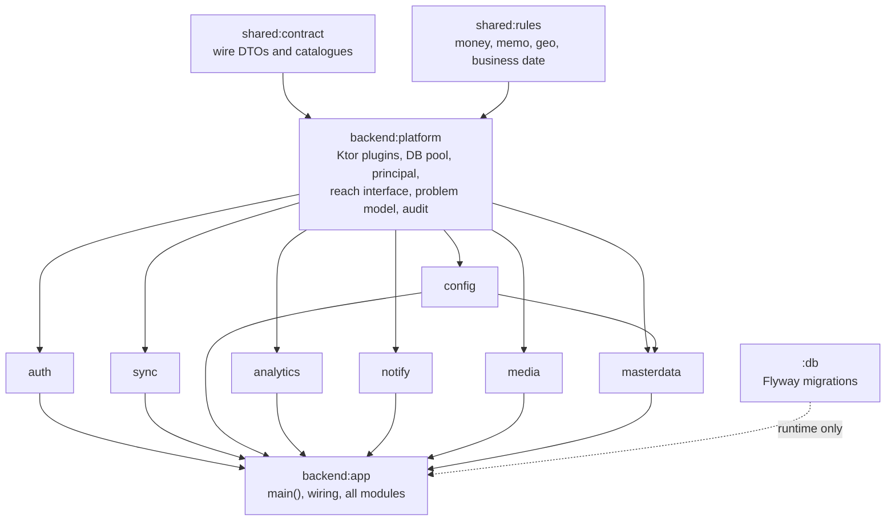
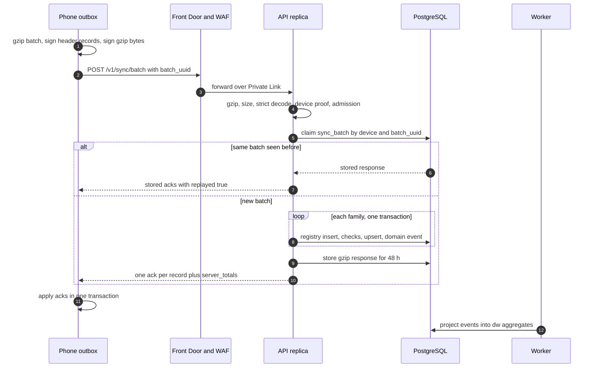
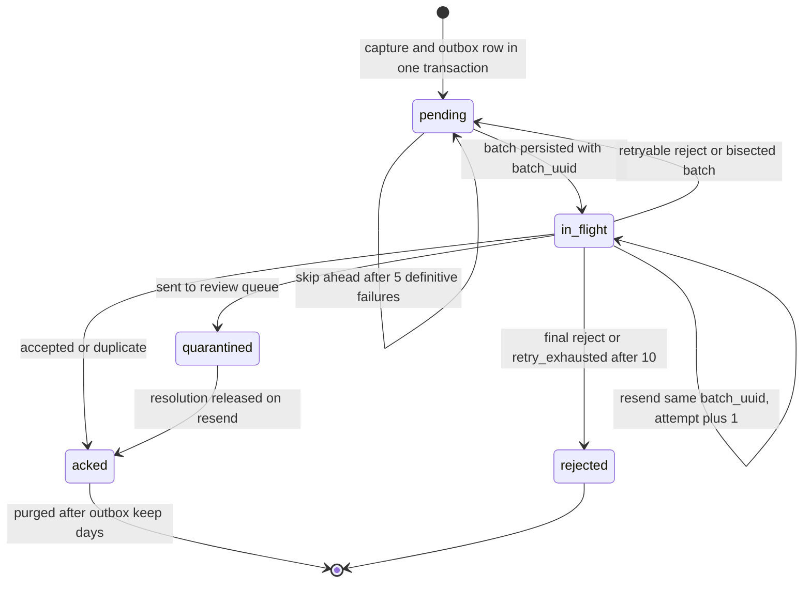
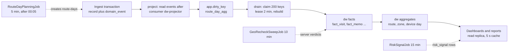
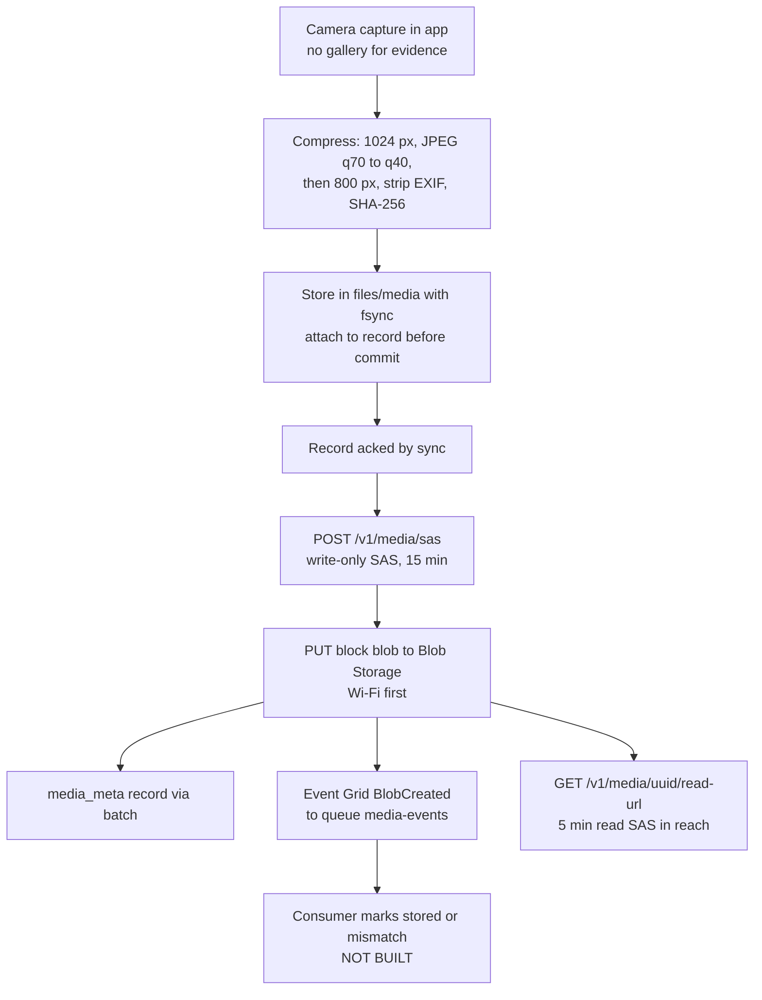
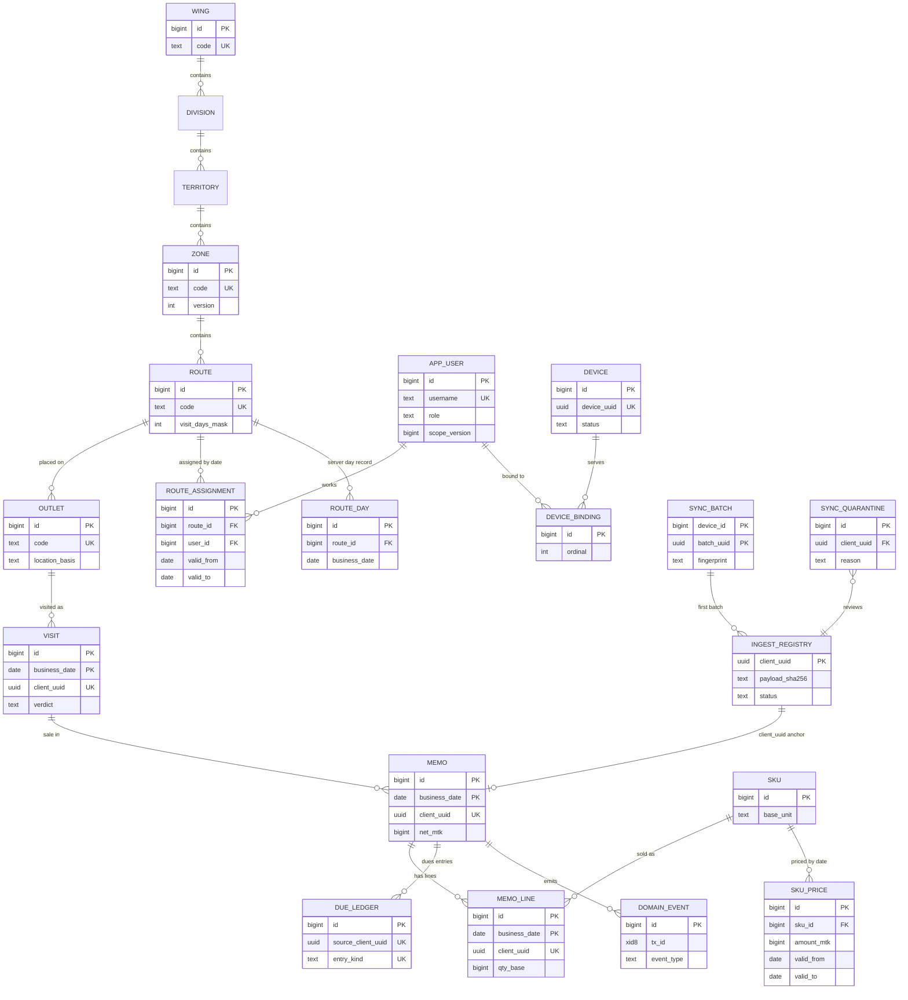
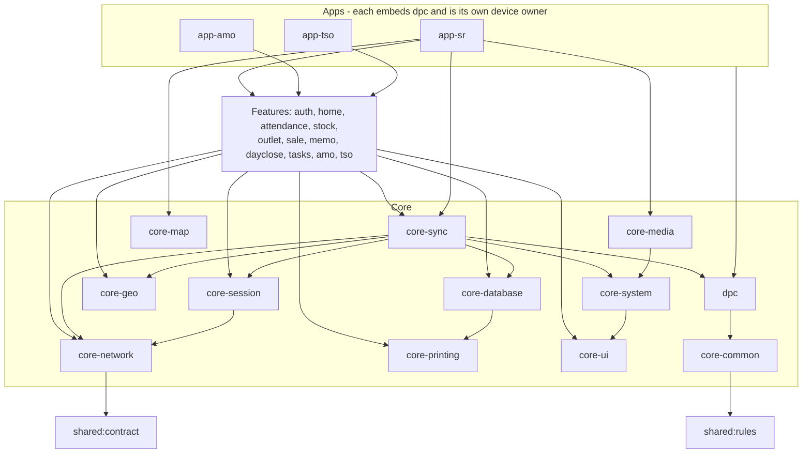
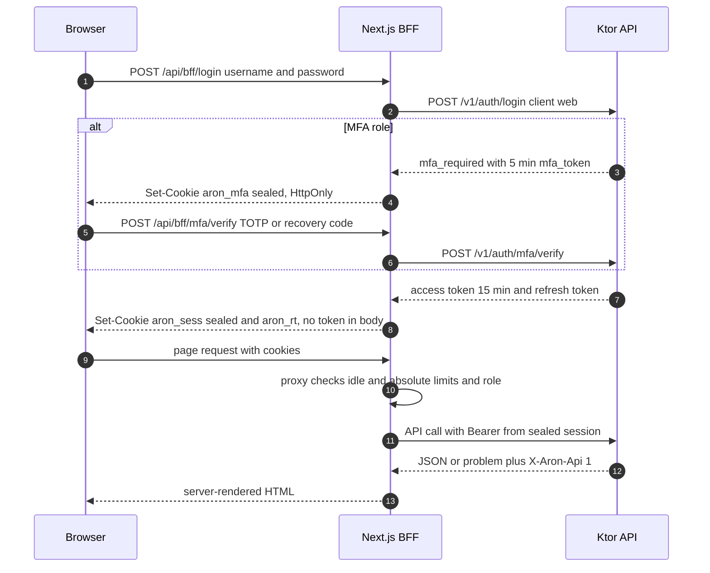

# Part C: Low-Level Design, Application and Data

**Scope.** This part describes how the Aron application layer and the data layer are built inside the final Azure account (profiles prod and stage, sized for 8,500 SRs and about 9,850 app users). It covers the backend, the sync engine, jobs and reporting, media and notifications, the database, the Android apps, the web portal, the data contracts and the test architecture.

**Evidence base.** Repository commit 26cfb26a (integration branch). Evidence ranking applied: code and infrastructure templates first, then `docs/status/*`, then `docs/00` to `docs/32`, then older planning evidence. Paths are relative to the repository root.

**How to read the tags.** Every component or claim carries a status:

| Tag | Meaning |
|---|---|
| **[IN_REPO]** | Implemented in code or infrastructure templates on this commit. It does not mean proven at 8,500 users. |
| **[DESIGNED]** | Specified in documents only. |
| **[PLANNED]** | A backlog row that is not built yet. |
| **[DEFERRED]** | Sponsor-deferred programme: target, loyalty, every discount or promotion programme. Apsis data migration and cutover are out of scope. |
| **[UNKNOWN]** | Could not be established from the evidence. |
| **[ASSUMPTION]** | A working assumption made in this document. |
| **[OPEN DECISION]** | An unresolved choice that needs an owner or lead decision. |

**Honesty rules.** Designed is not built. Built is not proven at 8,500 users. The 8,500-user proof (load, chaos, failover, restore drills) can only run in the final account, and none of that evidence exists yet. The only measured fleet-relevant fact is one forced PostgreSQL failover on the small dev rehearsal server (about 30 seconds user-visible outage, 2026-10-07).

**Stack ruling (applies to the whole part).** The code and templates outrank older documents. As built: native Kotlin Android apps (SR, AMO, TSO), a Ktor 3.6.0 (Kotlin 2.4.20, JVM 21) backend, PostgreSQL 16, a Next.js 16 web app, Azure Container Apps, Bicep, GitHub Actions. Statements in `CLAUDE.md`, `docs/02`, `docs/13` and parts of `docs/16` to `docs/19` that name Flutter, Node.js, NestJS, Prisma or Kysely are superseded. Section C10 lists every conflict found and the ruling applied.

---

## C1 Backend: modules, process roles, request pipeline, endpoints

**In plain words:** The backend is one program that can start in three modes: an API that answers phones and browsers, a worker that does background jobs, and a one-shot migrator that updates the database. All three come from the same container image, so what is tested is what runs.

### C1.1 Stack and module structure

**[IN_REPO]** The backend is a modular monolith: nine Gradle modules under `backend/`, plus shared Kotlin Multiplatform modules that the phone also uses, plus the `:db` module that packages Flyway migrations.

| Item | As built | Evidence |
|---|---|---|
| Language and framework | Kotlin 2.4.20, Ktor 3.6.0 on Netty, bytecode target 17, runtime `eclipse-temurin` JRE 21.0.12_8 (digest-pinned) | `gradle/libs.versions.toml:9-45`, `infra/docker/backend.Dockerfile:1-37` |
| Serialization | kotlinx.serialization 1.11.0, snake_case wire names | `gradle/libs.versions.toml` |
| Database access | JDBI 3.55.0 with hand-written SQL (bind parameters only), HikariCP 7.1.0, PostgreSQL JDBC 42.7.13. No ORM, no jOOQ, no code generation | `gradle/libs.versions.toml:23-27` |
| Migrations | Flyway 13.9.0 from `classpath:db/migration`, forward-only | `backend/platform/.../Database.kt:60-79` |
| Dependency injection | None. Objects are wired by hand in `Wiring.production()` | `backend/app/.../Wiring.kt:147-300` |
| Auth libraries | nimbus-jose-jwt 10.10 (ES256), argon2-jvm 2.12 (Argon2id) | `gradle/libs.versions.toml:28-35` |
| Cloud libraries | azure-sdk-bom 1.3.8 (storage-blob, identity), firebase-admin 9.11.0, fastexcel 0.20.2 | `gradle/libs.versions.toml` |
| Logging and telemetry | Logback 1.6.5 JSON, one object per line to stdout; Application Insights Java agent 3.7.10 attached with `-javaagent` | `backend/app/src/main/resources/logback.xml`, `backend.Dockerfile` |
| JVM flags | `-XX:MaxRAMPercentage=75 -XX:+ExitOnOutOfMemoryError`, user id 10001, port 8080, `TZ=UTC` | `backend.Dockerfile` |
| Size | about 23,200 lines in `src/main`, 833 test methods in `backend/*/src/test` | counted on this commit |

**Module graph and dependency rules.**

*Legend: arrows point from a dependency to the module that uses it. Every feature module depends only on `platform`; `masterdata` additionally depends on `config`. Only `backend:app` sees all modules and holds `main()`; it also pulls in `:db` at runtime so Flyway finds the migrations.*

Cross-module behaviour goes through interfaces owned by `platform`: `ReachResolver`, `ServerConfig`, `AuthGuardDeps`, `RecordHandler`, `Nudger`, `BlobSasIssuer`. The ingest extension point is `Wiring.recordHandlers()` (`Wiring.kt:138-144`), which lists `ConfigAckHandler`, `DomainEventProducer`, `DataVoidBarrierHandler`, `GeoRecheckHandler` and `ConsentRecords`; production adds `TaskRecords`, `RiskReviewRecords` and `OutletRequestVerificationHandler`.

Module placement in code differs from the `docs/24` section 6.2 table: device enrolment and policy live in `analytics/devices`, tasks in `sync`, risk rules and the risk job in `masterdata`, and push is sent from the API process by `notify`. Code placement is the ruling.

### C1.2 Process roles from one image

**[IN_REPO]** One image `aron-backend` (entry `bin/aron-backend`, class `MainKt`). The environment variable `ARON_ROLE` selects the role at start. A configuration error exits with code 2 and never prints a secret.

| Role | Container Apps resource | What it does | Notable limits |
|---|---|---|---|
| `api` | app `ca-aron-prod-api` | Ktor on port 8080. Installs the core plugin, admission control, drain, request isolation, then the `/v1` routes. The only role that holds `ARON_JWT_SIGNING_KEY` (finding AUD-SEC-07). | final: 1.0 vCPU, 2 GiB, 3 to 30 replicas |
| `worker` | app `ca-aron-prod-worker` | No HTTP port. Starts six scheduled in-process jobs and blocks (see C3). Uses the direct database URL (port 5432). | final: 1.0 vCPU, 2 GiB, 1 to 10 replicas, no scale rule and no probes in the template |
| `migrate` | Container Apps Job `caj-aron-prod-migrate` | Runs Flyway with a 2-connection pool, 30 s connect timeout, 10 connect retries at 15 s, `validateOnMigrate`; exits 0 or 1. | replica timeout 1,800 s, 0.5 vCPU, 1 GiB |

Evidence: `backend/app/src/main/kotlin/com/aktcl/aron/backend/app/Main.kt:38-72`, `backend/platform/.../Settings.kt:69-119`, `infra/apps.bicep:150-200`.

**Settings and secrets.** **[IN_REPO]** `Settings.load()` reads environment variables, with a `<NAME>_FILE` mounted-secret fallback and a `Secret` wrapper that never prints. Secret values arrive as Container Apps secrets that reference Key Vault. Key Vault secret names used by the backend (values never in the repository): `aron-jwt-signing-key`, `aron-jwt-kid`, `aron-fcm-service-account`, `aron-play-integrity-service-account`, `aron-mfa-key`, `aron-db-url`, `aron-db-direct-url`, `aron-db-read-url`; per-app variants `aron-db-api-url`, `aron-db-jobs-direct-url` exist for the least-privilege logins. Non-secret settings: `ARON_ENV` (`dev` or `prod` only: `Settings.load` throws a `SettingsException` for any other value and `Main` exits with code 2, `Settings.kt:77-81`; `infra/apps.bicep:120,177,429` pass `ARON_ENV = environmentName`, and `infra/params/stage.apps.bicepparam:13` sets `environmentName = 'stage'`, so **the stage profile as templated cannot boot**, gap G31), `ARON_BUILD`, `ARON_DB_POOL_MAX` (10), `ARON_DB_READ_POOL_MAX` (10), `ARON_HASH_CONCURRENCY` (4), `ARON_HASH_QUEUE_MAX` (32), `ARON_FRONT_DOOR_ID`, `ARON_BLOB_ACCOUNT`, `ARON_PUBLIC_API_URL`, `ARON_ATTESTATION_ROOTS`. `ARON_ENV=prod` makes `ARON_DB_URL` mandatory and sets the in-code fallback for `cfg.device.require_enrolled` (used when the registry cannot be read) to true (`ServerConfig.kt:44`); the registry default itself is already true (`db/migrations/V0006`, see C2.4 step 6).

**Database access.** **[IN_REPO]** `Database(write, read)` holds two JDBI instances. The read pool exists only when `ARON_DB_READ_URL` is set and serves dashboards, reports, team and app-home, sync-health and media read URLs. Pool settings: connection timeout 5 s, validation timeout 2 s, minimum idle 1, `initializationFailTimeout -1` (the API starts even when the database is down). Session state is forbidden because the final account uses PgBouncer transaction mode: no `SET`, no session advisory locks, only `pg_advisory_xact_lock`. A third one-connection pool (`aron-security`) serves the security-event writer.

### C1.3 Request pipeline

**In plain words:** Every request passes through the same ordered checks: tag it, limit it, prove who the caller is and which phone it came from, work out what data they may see, then run it with a time limit. Errors always come back in one standard shape.

**[IN_REPO]** Interceptor order (`Main.kt:97-108`): core plugin (request id, marker headers, edge gate, request log), content negotiation, response compression, status pages, admission control, drain, request isolation, then the route-scoped authentication guard.

| Stage | Behaviour | Numbers | Evidence |
|---|---|---|---|
| Marker headers | Every response carries `X-Aron-Api: 1`, `X-Request-Id` (client UUID v4 echoed, else minted), `X-Server-Time`, `X-Config-Version`, `X-Server-Generation`. A response without `X-Aron-Api` is an edge failure, never a business answer. | | `Http.kt:77-196` |
| Edge gate | If `ARON_FRONT_DOOR_ID` is set, any non-health request without a matching `X-Azure-FDID` gets 403. | | `Http.kt:103` |
| Strict request decoding | Unknown keys, duplicate members, wrong types and NUL characters are rejected with JSON-Pointer errors. | JSON body cap 256 KiB (also after gunzip) | `Requests.kt:17-40` |
| Compression | Responses gzip from 1,024 bytes. | | `Http.kt` |
| Admission control | Batch ingest has 64 slots per replica with a 750 ms queue wait, else 429 with `Retry-After` 5 to 60 s. Dashboards, reports, app-home and team reads are limited to 16 concurrent per replica and are shed first (429, `Retry-After` 30 to 60 s) when half of the ingest slots are busy or the database pool has waiters. | | `AdmissionControl.kt:30-91` |
| Drain | On stop, readiness answers 503 at once, in-flight calls get up to 15 s, `Connection: close` while draining. Netty grace 3 s, hard timeout 25 s. | Container Apps termination grace must stay at least 30 s | `Drain.kt:19-63`, `Main.kt:84-85` |
| Request isolation | Every non-probe call runs on `Dispatchers.IO.limitedParallelism(writePool-1)` (9 by default) under a 25 s timeout, shorter than the 60 s Front Door timeout, so a phone sees an API envelope, not an edge page. | 25 s | `RequestIsolation.kt:32-62` |
| Authentication guard | Route-scoped. Bearer parse, signature, issuer, audience, expiry with no leeway (a 60 s grace applies only on `sync/batch` and `media/sas`), not-before with 5 s leeway (`Principal.kt:55-57`, `SyncApi.kt:91`, `MediaModule.kt:76`), `X-Device-Id` must equal the token's device claim, scope-version check (401 `ERR_SCOPE_CHANGED` if the user's current version is newer; read through a per-replica cache of 10 s), temporary-password check (same 10 s cache), device status check (suspended, revoked, replaced or missing is refused within the 10 s cache), then rate limit. | | `AuthGuard.kt:48-84`, `auth/.../JdbiStores.kt:23-71` |
| Rate limit | In-memory fixed window per replica: phones 120 per minute per device, web 300 per minute per user. Never per source IP (carrier NAT). 429 `ERR_RATE_LIMITED` with `Retry-After` and `RateLimit-*` headers. Effective limit is value times replica count. | max 200,000 keys | `RateLimiter.kt:15-71` |
| Scope (reach) | Resolved per request from role plus assignments, never read from the token body. | cache 5 min per (user, scope version, business date), 50,000 entries | `SqlReach.kt:15-80` |
| Idempotency | Batch: (device, `batch_uuid`) replay for 48 h; record: `client_uuid` registry. Admin config: optional `Idempotency-Key`. Admin edits: `If-Match` row versions. Details in C2 and C5. | | `SyncApi.kt`, `ConfigApi.kt` |
| Error model | RFC 9457 `application/problem+json`: `type=urn:aron:problem:<code>`, `code`, `request_id`, `retryable`, `retry_after_s`, `message_key=problem.<code minus ERR_, lower case>`, `errors[]`, `context`. 72 problem codes; HTTP status comes only from the catalogue. Transient database failures (SQLSTATE class 08, 57P01 to 57P03, 53300, 40001, 40P01, 55P03, 25006, pool timeout) become 503 with jittered `Retry-After` 5 to 30 s. Statement timeout 57014 is 503 and logged as error. Anything else unhandled is 500 `ERR_INTERNAL`. | 72 codes | `Http.kt:198-209` (SQLSTATE set, 57014), `Problems.kt:56-59` (`type()`, `messageKey()`) |

**Token model (summary).** **[IN_REPO]** ES256 access tokens. Claims: `iss=aron`, `aud` in {`aron-api`, `aron-upload`, `aron-bind`, `aron-mfa`, `aron-pwchange`}, `sub`, `uname`, `role`, `sv` (scope version), `did`/`dvu` (device), `flv` (sr, amo, tso, web), `perm`, `pii`, `amr`, `jti`, `iat`, `nbf`, `exp`. The token carries no zone or route ids: it carries a scope version, and the server recomputes reach per request. Phone access tokens last 60 min plus 0 to 10 min jitter; web 15 min; bind 10; MFA 5; password change 10. Refresh tokens are opaque, hashed at rest, rotate on use with reuse detection (60 s grace returns the same child; later reuse revokes the family). Full grant: sliding 30 days inside an absolute 90 plus or minus 15 days. Upload grant (phones): idle 7 days, survives logout, password change and user disable, and can call only `sync/batch`, `media/sas`, refresh and logout. JWKS is served at `GET /v1/auth/jwks`; the next key is published before it signs. Security controls are described in the security part of the solution architecture; here the token matters because it defines the pipeline.

**[ASSUMPTION]** The phrase "scope encoded in the token" in `CLAUDE.md` rule 4 is read as "scope version in the token, reach computed on the server". The intent (the client never supplies scope; a changed scope is refused) is met with a delay: a changed scope is refused within at most 10 s, not within one call, because each replica caches `scope_version`, `must_change_password` and device status for 10 s (`JdbiStores.kt:24,50,71`), so with 3 to 30 replicas a stale `sv` can be accepted for up to 10 s per replica. Reach itself is recomputed per request, and its cache key includes the scope version (`SqlReach.kt:61`).

### C1.4 Endpoint catalogue

**[IN_REPO]** The production routing tree serves 162 method-and-path pairs under `/v1`: 150 guarded and 12 public. About 89 are `/v1/admin/*`. `RouteInventoryTest` walks the real routing tree and fails if a route is unguarded without being in the pinned public set, and a line in `backend/app/src/test/resources/scope-cases.txt` exists for each of the 150 guarded routes. The OpenAPI contract has 209 operations on 168 paths; 51 operations are not routed (see C8).

The 12 public routes: `GET`/`HEAD /health`, `GET /health/ready`, `GET /config/public`, `POST /auth/login`, `POST /auth/refresh`, `POST /auth/mfa/verify`, `GET /auth/jwks`, `POST /devices/enrol`, `POST /devices/nonce`, `GET /devices/me/policy`, `POST /devices/me/status`. The last three device routes authenticate by `X-Device-Proof`, not by bearer token.

Paths below are relative to `/v1`. "Reach" means the data is limited by the server-computed reach of the caller.

**Authentication, devices, identity**

| Path | Method | Auth and scope | Purpose | Status |
|---|---|---|---|---|
| `/auth/login` | POST | public; lockout and rate limits | Credentials to status ok, bind_required, password_change_required or mfa_required; tokens | **[IN_REPO]** |
| `/auth/refresh` | POST | refresh token; phones need device proof | Rotate refresh token (body or `aron_rt` cookie) | **[IN_REPO]** |
| `/auth/bind-device` | POST | bind token plus device proof | Bind a phone to a user with the 4-digit OTP | **[IN_REPO]** |
| `/auth/mfa/verify`, `/auth/mfa/enrol` | POST | MFA token; enrol needs api+mfa | TOTP or recovery code; first enrolment | **[IN_REPO]** |
| `/auth/change-password`, `/auth/logout`, `/me` | POST, POST, GET | api+pwchange; api+upload; api | Password change, logout, own profile and menus | **[IN_REPO]** |
| `/auth/jwks` | GET | public | Public signing keys | **[IN_REPO]** |
| `/devices/enrol`, `/devices/nonce` | POST | public with enrolment token or device key | Attested enrolment, Play Integrity nonce | **[IN_REPO]** |
| `/devices/me/policy`, `/devices/me/status` | GET, POST | device proof | Device-owner policy (ETag), status report | **[IN_REPO]** |
| `/devices/me/push-token` | PUT | bearer | Register FCM token | **[IN_REPO]** |

**Sync and day**

| Path | Method | Auth and scope | Purpose | Status |
|---|---|---|---|---|
| `/sync/bundle` | GET | phone token; own routes | Day bundle, ETag, 304 | **[IN_REPO]** |
| `/sync/bundle/page` | GET | phone token | Page of a paged section | **[IN_REPO]** |
| `/sync/delta` | GET | phone token | Changes since a cursor; 304, 409, 410 | **[IN_REPO]** |
| `/sync/batch` | POST | api or upload grant; device proof | Idempotent gzip batch of up to 500 records | **[IN_REPO]** |
| `/sync/digest`, `/sync/generation`, `/sync/totals` | POST, GET, GET | phone token | Reconciliation, database lineage, server column of Sales Submit | **[IN_REPO]** |
| `/config/delta` | GET | phone token | Resolved config changes for the caller; 304/410 | **[IN_REPO]** |
| `/day/sales-submit` | POST | own route-day; idempotent by `client_uuid` | Online sales submit | **[IN_REPO]** |
| `/day/final-submit`, `/day/final-submit/preview` | POST, GET | TSO, DMO, ADMIN, SUPERADMIN within reach | Once per zone and date | **[IN_REPO]** |

**Field and supervision reads and writes**

| Path | Method | Auth and scope | Purpose | Status |
|---|---|---|---|---|
| `/memos`, `/outlets`, `/outlets/nearby`, `/routes`, `/routes/{id}/assignments` | GET | reach; selectors only narrow | Lists and lookups (nearby is a bounding box plus in-JVM haversine, not PostGIS) | **[IN_REPO]** |
| `/tasks` (3), `/visit-plans` (2), `/leave` (3), `/feedback` (3), `/outlet-requests` (6), `/tutorials`, `/risk-signals` (2), `/team/*` (2), `/app/*` (2) | mixed | reach | Task, leave, plan, feedback, outlet-request workflows and team/app-home reads | **[IN_REPO]** |
| `/media/sas`, `/media/upload`, `/media/{id}/read-url` | POST, POST, GET | own paths from token; read needs reach on the photo's date | Photo SAS, small multipart, supervisor read | **[IN_REPO]** |
| `/client-errors`, `/support/pda-upload` | POST | bearer | Phone error telemetry, support bundle upload | **[IN_REPO]** |

**Dashboards and reports**

| Path | Method | Auth and scope | Purpose | Status |
|---|---|---|---|---|
| `/dashboards/summary`, `/geo-validation`, `/daily-tracking`, `/daily-tracking/actions`, `/sync-health`, `/login-submit` | GET/POST | reach; read replica; shed first | Scoped KPI reads from `dw` | **[IN_REPO]** |
| `/reports`, `/reports/{key}/query` | GET, POST | role set per handler plus reach | 29 of 42 report keys have handlers (the other 13 answer 404 `unknown report`, see C3.5 and gap G32); json, xlsx, print | **[IN_REPO]** |
| `/report-exports`, `/report-exports/{id}` | GET | role | Export log and async job status | **[IN_REPO]** list; id route always 404 until jobs exist **[PLANNED]** |

**Admin (about 89 routes under `/admin`)**

| Path group | Count | Auth and scope | Purpose | Status |
|---|---|---|---|---|
| `/admin/config/*` | 16 | CONFIG_READERS read; C0 to C3 write rules; SUPERADMIN for C3 | Registry, values, changes, decisions, rollback, resolve, what-if, blast radius, reach, calibration | **[IN_REPO]** |
| Master data: geography (4), clusters (3), routes (4), route-assignments (3), outlets (5), users (7), product nodes (3), SKUs (3), prices (4), calendar (2), code lists (2), content, surveys, rubrics, tutorials, print templates, assets (15) | 55 | MASTER_READERS / MASTER_WRITERS; TSO limited to own zones; `If-Match` | CRUD with optimistic concurrency and audit | **[IN_REPO]** |
| Devices, enrolment tokens, device OTPs, permissions, quarantine, data void, notifications | 18 | SUPPORT, ADMIN, SUPERADMIN; TSO for own-zone OTPs; data void TSO/ADMIN within reach | Fleet and exception operations | **[IN_REPO]** |
| Contract operations with no route: releases (4), audit list (1), dues adjustments (3), sales plans (2), web-entry and entry unlocks (9), device policy preview (1), day cover/exceptions/reopen/route-days/submit-void (6) | 26 | n/a | Held or dropped backlog rows | **[PLANNED]** |
| Programmes, gifts, offers, targets, Astha/loyalty | 25 | n/a | Sponsor-deferred | **[DEFERRED]** |

Four routes exist in code that the contract does not list: `GET /routes/{id}/assignments`, `POST /feedback`, `POST /visit-plans`, `POST /leave`. **[OPEN DECISION]** Add them to the contract or remove them (owner: backend-core with contract owner).

### C1.5 Config and admin service

**In plain words:** Every operating setting is stored as data with limits, a risk class and a version, so staff change settings in the admin portal, not in code. Risky changes need a second person.

**[IN_REPO]** `backend:config` provides the registry (`app.cfg_key`, 226 keys listed in `docs/24` section 9.5; about 244 key insert rows counted in migrations, so the exact registry count is **[UNKNOWN]** until queried), scoped values (`app.cfg_value`) resolved by precedence global, role, wing, division, territory, geo class, zone, route, outlet, user, device, and a change workflow with classes C0 to C3.

| Class | Behaviour | Evidence |
|---|---|---|
| C0, C1 | Apply at once | `ConfigService.kt:30-110` |
| C2 | Scheduled after `cfg.sys.c2_delay_min`, cancellable | `ConfigService.kt:311-323` |
| C3 | Needs a second SUPERADMIN (`ERR_CFG_SELF_APPROVAL`), blocked in freeze windows, capped by `cfg.sys.c3_max_per_hour` | `ConfigService.kt:260,286` |

Applying a change takes one global advisory lock, closes superseded rows (values are never updated in place), inserts under a new monotonic `config_version`, writes the hash-chained audit log and issues `pg_notify('cfg_changed')`. Server-side reads use `DbServerConfig`: global values with a 30 s per-replica cache, single-flight refresh, back-off 2 s doubling to 30 s, registry fallbacks when cold and the database is down. Phones learn of a change from the `X-Config-Version` header and pull `GET /v1/config/delta` (ETag, 304, 410). `GET /v1/config/public` responds with `Cache-Control: public, max-age=60` for clients (`ConfigPublic.kt:100`); Front Door does not cache it (`rt-api` in `infra/apps.bicep:484-498` has no cache configuration and states that nothing under `/v1` is cached at the edge), so every replica serves the registry read.

Known behaviour limits: scheduled C2 changes are applied lazily when an admin reads changes or a phone calls config delta, not by a worker; `pg_notify` is emitted but nothing listens, so replicas converge by the 30 s cache. **[IN_REPO]** with these limits, recorded as gaps in C10.

**Master-data admin.** **[IN_REPO]** Updates use `PATCH` with `If-Match: "<version>"` (412 `ERR_PRECONDITION_FAILED`); creates are protected by natural codes (409 `ERR_MASTER_DUPLICATE_CODE`). Price batches above `cfg.price.max_change_pct` need a second approver. Outlet requests need three distinct people (requester, verifier, approver; `ERR_SEPARATION_OF_DUTIES`). Every write goes through `AuditLog.write`, a SHA-256 hash chain with UPDATE, DELETE and TRUNCATE refused by trigger.

### C1.6 Health and readiness

**[IN_REPO]** `GET /v1/health` is liveness: it reads cached values only and never touches the database, so a database failover does not restart replicas. `GET /v1/health/ready` pings the write pool within 2 s and answers 503 with `Retry-After: 5` while draining or when the database is unreachable. Container Apps probes: startup `/v1/health` (5 s period, 30 failures allowed), liveness `/v1/health` (10 s, 3), readiness `/v1/health/ready` (10 s, 3). Front Door probes `HEAD /v1/health` every 60 s. The worker has no HTTP port and no probes **[IN_REPO]** as a gap; the post-deploy `worker-check.sh` requires the new revision to run the deployed image, a Running replica, 0 restarts, held 90 s.

**Not built.** **[PLANNED]** No Micrometer or OpenTelemetry custom metrics and no `/metrics` endpoint exist; the metric names and SLIs in `docs/18` section 6 are not emitted, and there are no SLI dashboards or burn-rate alerts. Admission-control counters stay in memory.

**Alerts that exist.** **[IN_REPO]** as templates (deployed state in the final account not observed). Log-search rules are enabled by `enableLogAlerts = true` in `prod.bicepparam` and `stage.bicepparam`; platform-metric rules are always deployed.

| Alert | Condition | Severity | Evidence |
|---|---|---|---|
| `batch5xx` | `sync/batch`: more than 1 % 5xx over 5 min (at least 20 requests) | 1 | `infra/modules/alerts.bicep:17-27` |
| `batchP95` | `sync/batch`: p95 above 3 s over 10 min (at least 20 requests) | 2 | `alerts.bicep:28-38` |
| `dashboardsP95` | dashboards and app home: p95 above 1 s over 10 min | 3 | `alerts.bicep:39-52` |
| `syncErrors` | any error logged by `aron.sync.*` in 5 min | 2 | `alerts.bicep:53-64` |
| `aggregationStuck` | 3 or more errors from `aron.analytics.worker` in 15 min (an error count, not an aggregation-freshness SLI) | 2 | `alerts.bicep:65-76` |
| `api-5xx` | more than 10 API 5xx in 5 min | 1 | `infra/apps.bicep:536-548` |
| `api`, `worker`, `web` restarts | `RestartCount` above 2 in 15 min | 1, 2, 3 | `apps.bicep:549-589` |
| `api`, `worker` no replica | fewer than 1 replica for 5 min (only where the profile keeps a minimum above 0) | 1, 2 | `apps.bicep:549-589` |
| `pg-cpu`, `pg-storage`, `pg-connections-failed`, `pg-not-alive` | CPU above 80 % for 15 min; storage above 70 %; failed connections above 10; database not alive for 5 min | 2, 2, 2, 1 | `alerts.bicep:107-113` |

There is no replica-lag alert and no 60 % storage alert (C5.1, G23).

Evidence: `backend/platform/src/main/kotlin/com/aktcl/aron/backend/platform/{Http,Requests,Problems,RequestIsolation,Drain,RateLimiter,AuthGuard,Database,Settings}.kt`, `backend/analytics/.../AdmissionControl.kt:30-91`, `backend/app/src/main/kotlin/com/aktcl/aron/backend/app/{Main,Wiring}.kt`, `backend/config/.../ConfigService.kt`, `backend/masterdata/.../AdminKit.kt:169-175`, `backend/app/src/test/kotlin/com/aktcl/aron/backend/app/RouteInventoryTest.kt:35-60,230-247`, `backend/app/src/test/resources/scope-cases.txt`, `infra/apps.bicep:150-200,262-345,383-386`, `settings.gradle.kts:45-54`, `docs/24-build-spec.md:609-617`.

---

## C2 Sync engine

**In plain words:** The sync engine is how a rep's phone and the server agree on what happened during the day. Each sale carries a unique number made on the phone, so sending it twice, out of order, or after a crash can never create a second sale. Nothing sent is silently dropped: every record gets an answer, and records that look wrong go to a review queue instead of being lost.

### C2.1 Bundle download (morning pull)

**[IN_REPO]** `GET /v1/sync/bundle?for=<date>` builds the rep's day bundle live on every request. `for` may be today or the next working day (a pre-fetch never marks the rep as logged in).

| Aspect | As built | Evidence |
|---|---|---|
| Content | Meta (version, date, cursor, `is_prefetch`, `paged_sections`), user (bind ordinal, memo sequence block size clamped 100 to 999, consents), resolved config chain (role, wing, division, territory, zone, user, device) including scheduled values within `cfg.sys.schedule_horizon_days`, code lists, product tree and SKUs, prices, calendar, routes with outlets (resolved `radius_m` and `max_accuracy_m`, frozen `target_outlets`), open memos, tasks, surveys, content, reason texts, `device_policy_version` | `BundleService.kt:72-160` |
| Versioning | `bundle_version = "<date>:<snapshot_seq>"`. `snapshot_seq` comes from `app.bundle_snapshot`, a row inserted under a per-(user, date) advisory lock only when the content SHA-256 changed. The version is the ETag. | `BundleService.kt:162-215` |
| Conditional fetch | `If-None-Match` equal to the version returns 304. The login side effects (create `route_day` rows, freeze `target_outlets`, mark `logged_in`) still happen on the first non-prefetch bundle of a day, also on 304 and delta. Header `X-Bundle-Version-Current` tells the phone it is behind. | `BundleService.kt:250-268` |
| Compression | Response gzip (platform plugin). The cap `cfg.bundle.max_gz_kb` (2,048 KiB) is **not enforced** in code. | `BundleDelta.kt:206-213` |
| Paging | Sections outlets, prices, offers, tasks above `cfg.bundle.page_threshold_rows` (2,000; clamp 500 to 10,000) are paged at `cfg.bundle.page_rows` (1,000; 200 to 2,000) and fetched at `GET /v1/sync/bundle/page`; 410 if content moved on. `open_memos` and content are never paged. | `BundleService.kt:104-118` |
| Delta | `GET /v1/sync/delta?since=<cursor>` compares per-row 64-bit fingerprints held in a per-replica LRU of 1,024 snapshots; caps 20 routes, 40 day states, 5,000 rows; returns 304 when unchanged, 409 for a cursor of an older date, 410 when older than `cfg.bundle.delta_max_age_h` (72 h; 24 to 168) or unknown to this replica, which makes the phone fetch a full bundle. | `BundleDelta.kt:132-148,206-246`, `SyncApi.kt:256-292` |
| Deferred content | `offers[]` empty, `programmes`, targets and achievement null: **[DEFERRED]**. Supervisor section and `my_outlet_requests` are not sent. | `BundleService.kt:25-29,117` |
| Pre-generation | The designed 22:00 D+1 snapshots in Blob (`F-SYS-067`) are **[PLANNED]**. The `bundles` container exists in infrastructure but nothing writes to it. | `docs/25-build-backlog.csv:F-SYS-067` |

**Honest scale position.** The live build is the least-proven path for 8,500 users: each bundle request, including ones answered 304, builds the bundle live plus the snapshot transaction; `docs/18-scale-reliability-azure.md:636` estimates 10 to 40 scoped queries per live bundle (a design estimate, not counted or measured on this build). Because delta fingerprints live only in each replica's memory and the API runs 3 to 30 replicas without session affinity, many delta requests will answer 410 and fall back to a full bundle. The phone spreads the morning pull with a login jitter (`cfg.sync.login_jitter_s`, 120 s). **[OPEN DECISION]** Build F-SYS-067 pre-generation and durable fingerprints before the final-account load test, or accept live build and prove it in the test. Owner: backend-core lead and sponsor.

### C2.2 Batch upload

**[IN_REPO]** `POST /v1/sync/batch` is the only write path for field records.

| Limit | Value | Source of the value |
|---|---|---|
| Encoding | gzip mandatory (415 otherwise) | `SyncApi.kt:147-204` |
| Compressed size | 1,024 KiB (`cfg.api.max_batch_body_kb`) | registry |
| Decompressed size | 8 MiB (`cfg.api.max_batch_decompressed_mb`) | registry |
| Records per batch | 1 to 500 (`cfg.api.max_batch_rows`) | registry |
| In flight | 64 per replica (admission 429 after a 750 ms wait; a second semaphore answers 503) | `AdmissionControl.kt`, `SyncApi.kt:38-48` |
| Schema version | at most 1 | `SyncApi.kt` |
| Phone batch size | at most 200 rows and 256 KiB raw, families kept whole, at most 25 batches per run | `android/core-sync/.../SyncRules.kt:9-24` |

Request headers: `Authorization` (api or upload grant; up to 60 s past expiry, no scope-version check), `X-Device-Id`, `X-Device-Proof` over the gzip bytes when the device has a key, `X-Batch-Attempt`, `X-Pending-Rows`, `X-App-Version`, `X-Last-Sync-Error`. Telemetry from these headers is written at most once per 10 minutes per device.

### C2.3 Sequence of a normal upload

*Legend: the stored response lets a lost answer be replayed without reprocessing. Each family of related records commits as one transaction. The worker updates dashboards afterwards, never inside the upload.*

### C2.4 Ingest algorithm, step by step

**[IN_REPO]** (`SyncApi.postBatch`, `IngestService.ingest`; `IngestService.kt:140-560`)

**Batch level**

1. Check read-only mode (503 `ERR_READ_ONLY_MODE`; this switch guards only this endpoint) and version hold (429 `ERR_SYNC_HOLD`).
2. Check gzip, compressed and decompressed size, strict JSON decode, `batch_uuid`, record count, trigger, and that `device_uuid` equals the token's device.
3. Verify the device proof over the gzip bytes when the device has a key (401 `ERR_DEVICE_PROOF_INVALID` fails the whole batch).
4. Admission: 64 in-flight batches per replica.
5. `replayOrClaim`: insert into `app.sync_batch` with `ON CONFLICT DO NOTHING`. Same set (fingerprint equal) with a stored response returns it with `replayed: true`. A different set under the same `batch_uuid` is 409 `ERR_SYNC_BATCH_UUID_REUSED`.
6. Group records by `family_uuid`. Families that contain only `config_ack` run first.
7. Each family is one database transaction with a savepoint per record. On a transient database error the whole family is retried up to 3 times within 10 s (20 to 100 ms jitter). If it still fails, the family's records are parked as `rejected(server_error)`, retryable.

**Record level, in order**

| Step | Check | Result if it fails |
|---|---|---|
| 1 | Shape against the generated `PayloadShapes` (42 record types; unknown members refused) | rejected `schema_invalid`, final |
| 2 | Registry: `app.ingest_registry` insert under an advisory lock on `client_uuid` | same hash: duplicate; different hash: quarantined `payload_conflict` |
| 3 | Business-date window (see C2.7) | quarantined `business_date_out_of_window` |
| 4 | Reference existence (route, outlet, SKU) | rejected `unknown_route`, `unknown_outlet`, `unknown_sku`, final |
| 5 | Scope: reach on the record's business date; cover check for `acting_for_user_id` | quarantined `scope_out_of_reach` or `no_assignment_on_date` |
| 6 | Device gate on attendance, memo, memo void, due collection | `device_not_enrolled` (while `cfg.device.require_enrolled` is on, the prod default) or `device_integrity_failed` (only when `cfg.device.require_integrity` is on): quarantined, held for review; with the switch off the record is accepted and flagged (`IngestService.kt:420-433`) |
| 7 | Record signature, `cfg.sec.record_signature_mode` = off, record (default), enforce | `record`: accept and raise `DEVICE_INTEGRITY_FAIL`; `enforce`: quarantine |
| 8 | Content fingerprint (same content under regenerated UUIDs) | quarantined `content_duplicate`, first copy stands |
| 9 | Memo arithmetic (net, rounding, paid plus due) | quarantined `arithmetic_mismatch`, whole family |
| 10 | Record handlers: config ack, consents, tasks, risk review, outlet request verification, data-void barrier | per handler |
| 11 | Parents: child waits for its parent | parked `parent_missing` (retryable); child of a quarantined parent is held with it |
| 12 | Visit-kind policy, dues ledger (advisory lock per memo) | rejected or quarantined by rule |
| 13 | Store: `RecordWriter` upsert via `jsonb_populate_record` | uniqueness violations resolve to duplicate |
| 14 | Day-state hook, geo recheck, GEO_OUT_OF_BOUNDS and GNSS signals, domain event in the same transaction | flags only; never refuses |

Handlers run inside the record's savepoint (`checkEarly`, `check`, `sameAs`, `afterStored`); push nudges run after commit (`afterCommit`).

### C2.5 Idempotency by client UUID

**[IN_REPO]** Every device-originated record has a UUID v4 made on the phone. The server upserts by it. Four layers enforce the rule, from batch down to row:

1. **Batch layer:** `app.sync_batch` primary key (`device_id`, `batch_uuid`), request fingerprint (SHA-256 of sorted `client_uuid:hash` lines), gzip response kept `cfg.retention.sync_batch_response_h` (48 h; 24 to 72).
2. **Registry layer:** `app.ingest_registry` primary key `client_uuid`, `payload_sha256` computed over the RFC 8785 (JCS) form of the record without its `sig`, so a later-signed copy is the same record.
3. **Table layer:** `UNIQUE (client_uuid, business_date)` on partitioned parents, `UNIQUE (client_uuid)` on plain tables, and a statement-level trigger that refuses the same UUID under another business date.
4. **Natural keys:** memo number per date, one attendance per user-date-kind, one memo void, one final submit per zone-date, dues ledger unique on (source UUID, entry kind).

Database detail is in C5.

### C2.6 Ordering, partial failure and acknowledgement

**Ordering.** Records may arrive in any order and in any batch split. A child before its parent is parked (`parent_missing`) and accepted on a later resend; families are the unit of atomicity. A reference to a quarantined parent keeps the child with it. The phone resends parked rows until they are accepted or exhausted.

**Acknowledgement.** Exactly one ack per record, in request order. The partition invariant is accepted + duplicate + rejected + quarantined = records sent. Outcomes:

| Outcome | Meaning | Phone action |
|---|---|---|
| accepted | stored | mark acked |
| duplicate | already stored, same content | mark acked |
| rejected, retryable | parked in `app.sync_rejected` with `parked_until`: `scope_stale`, `config_version_unknown`, `parent_missing`, `outlet_pending_approval`, `price_list_unknown`, `server_error` | back to pending; counted only as definitive failures |
| rejected, final | stored in `sync_rejected`: `schema_invalid`, `unknown_record_type`, unknown SKU/outlet/route, `memo_no_invalid`, `edit_not_allowed`, `chain_too_deep`, `voided_by_admin`, `lines_exceed_max`, `qty_invalid`, `attendance_duplicate` | terminal on the phone |
| quarantined | stored in `app.sync_quarantine` for human review | terminal on the phone; later `resolutions[]` come back in responses |

36 outcome codes exist in the contract. The response also carries `server_totals` for each touched date plus today (counts and money in integer milli-taka, quantities in sticks, pieces, dozens), `day_states`, `resolutions`, `hold_s` (0 to 900), `config_version` and `generation`.

**Quarantine reasons (15 codes).** `arithmetic_mismatch`, `memo_no_duplicate`, `content_duplicate`, `checkout_too_early`, `payload_conflict`, `business_date_out_of_window`, `scope_out_of_reach`, `no_assignment_on_date`, `device_integrity_failed`, `device_not_enrolled`, `user_disabled`, `device_revoked`, `app_version_blocked`, `after_month_close`, `programme_inactive`. Quarantine has a maker-checker resolution (approver differs from resolver); a quarantined row is released automatically on resend while its review item is open.

**Safety posture (decisions BC-53 and BC-83).** In prod `cfg.device.require_enrolled` defaults to true (registry default in `db/migrations/V0006:47`, in-code fallback `ServerConfig.kt:44` is `env == PROD`), so attendance, memos, voids and collections from a phone that is not enrolled or has no usable key are quarantined `device_not_enrolled`: held for review, never rejected or lost, and released on resend while the review item is open. A development database may override it (`DECISIONS.md:1115` records that the owner decides between a dev-only `require_enrolled = false` and enrolling the phone). `cfg.device.require_integrity` defaults to false, so only a genuine Play Integrity `fail` is flagged. Record signatures follow `cfg.sec.record_signature_mode` (off, record, enforce; default `record`, flag only; decision BC-53, `DECISIONS.md:1084`). Consequence for the cutover: every phone must be enrolled (and Android 12 and later phones cannot be enrolled by QR yet, gap G2) before its sales are accepted rather than held. `BC-83` (`DECISIONS.md:1115`) is a different matter: a deferred low-severity flag for an unchecked Play Integrity verdict. Do not change these defaults without the owner.

**Reconciliation and repair.**

- `POST /v1/sync/digest`: for each (date, type) the phone sends 16 buckets (first hex digit of `client_uuid`) with count and hash (sum of the first 8 bytes big-endian modulo 2^64, 16 hex digits). The server compares with registry rows accepted or voided for that user and device inside the backdate floor and answers `resend[]` for differing buckets.
- `GET /v1/sync/generation`: every response carries a generation UUID from `app.server_generation`. After a failover or point-in-time restore the generation changes (`kind` initial, failover or pitr, with `restore_point_utc` and `lost_after_utc`); the phone then resends rows acknowledged in the lost window with a jitter of 0 to 900 s. Resync batches get a late-window allowance (`resync_late` flag).

### C2.7 Business date, time and window rules

**[IN_REPO]** Every transaction stores UTC timestamps and an Asia/Dhaka `business_date`. The phone derives the business date from a trusted clock (one server-time estimate per boot from `X-Server-Time`, plus boot count and elapsed milliseconds), so changing the phone clock cannot move a sale to another day. The server accepts the phone's `business_date` inside the window `cfg.sync.max_backdate_days` (7 days; or working days), rejects records more than 10 minutes in the future (`cfg.sync.max_clock_skew_min`), and gives resync and digest-resend batches a late allowance. Reach is judged on the record's business date.

**Gap [IN_REPO] but incomplete.** The server does not use the batch `time_anchors`: no `CLOCK_SKEW` signal and no re-derivation of the capture instant or business date at ingest. The phone's business date is trusted inside the 7-day window. Recorded in C10.

### C2.8 Server geo re-check and anti-spoofing flags

**In plain words:** The phone decides on the spot whether the rep is at the outlet. The server later repeats the same arithmetic with the same rules and flags disagreements. It never cancels a sale because of it.

**[IN_REPO]** On first store of a visit, `GeoRecheckHandler` recomputes the verdict with the shared `GeoVerdicts` function (the same code the phone uses, from `shared:rules`) against the outlet pin and the radius, accuracy and mock policy in force at capture (config accept window `cfg.sys.config_accept_window_h`, 48 h). It stores `server_verdict`, `server_distance_m`, `server_radius_m`, `server_max_accuracy_m`. A sweep job (every 10 min, 7 days back, 200 rows per tick) fills rows that failed. A database CHECK ensures a mocked verdict is never `sale_allowed`.

Signals computed on this commit (9 of 19 catalogue codes): `GEO_MOCK`, `GEO_TELEPORT`, `GEO_ZERO_JITTER`, `GEO_ROUTE_SINGLE_POINT`, `GEO_DEVICE_SERVER_MISMATCH` (job every 15 min over today and yesterday), `GEO_OUT_OF_BOUNDS` (latitude 20.5 to 26.7, longitude 88.0 to 92.7, inline at ingest), `GEO_GNSS_INCONSISTENT` (fewer than 4 satellites used, or C/N0 standard deviation under 1.0 dBHz with at least 6 used, or mean above 48 dBHz), `CONFIG_STAMP_REGRESS`, `DEVICE_INTEGRITY_FAIL`. The other 10 codes are catalogue entries only (**[PLANNED]**): `PERFECT_ACCURACY`, `SAME_POINT`, `STALE_FIX`, `GNSS_TIME_SKEW`, `SHORT_VISIT_GAPS`, `DEVICE_NOT_OWNER`, `DEBUG_ENABLED`, `MOCK_APP_PRESENT`, `POLICY_DRIFT`, `CLOCK_SKEW`.

**Honest limits.** RF-level GNSS simulators and a hidden hook beside the real serving cell defeat per-fix checks; a rooted phone that hides root defeats the phone hints. Server statistics and the Play Integrity verdict (not yet live: owner action 13) are the remaining defences.

### C2.9 Device-side life of a queued record

*Legend: states are the `outbox.state` values in the phone's Room database. Transport errors, 429, 503, 403 and 426 keep the batch and resend it identically; 500 and 413 bisect by halves down to the failing family.*

Phone rules **[IN_REPO]**: persisted batch membership; same `batch_uuid` with `X-Batch-Attempt` + 1 on resend; backoff `min(300 s, 2 s x 2^(n-1)) x U(0.5, 1.0)`; `Retry-After` honoured with a 0.8 to 1.2 factor, capped at 900 s; server `hold_s` pauses automatic triggers; `outbox.attempts` counts definitive failures only; a record signature that fails twice holds the batch up to 30 minutes, then the phone sends unsigned and the server quarantines `device_integrity_failed`.

### C2.10 Failure cases and resulting behaviour

| Case | Result | Status |
|---|---|---|
| Response lost, phone resends same batch | Stored response replayed, `replayed: true`, no reprocessing | **[IN_REPO]** |
| Same `batch_uuid`, different record set | 409 `ERR_SYNC_BATCH_UUID_REUSED`, nothing stored | **[IN_REPO]** |
| Same record in two different batches | Second is `duplicate`; counts do not double | **[IN_REPO]** |
| Same UUID, different content | First stays; copy quarantined `payload_conflict` | **[IN_REPO]** |
| Regenerated UUID, same content | Quarantined `content_duplicate`; first copy stands | **[IN_REPO]** |
| Child arrives before parent | Parked `parent_missing`; accepted on resend | **[IN_REPO]** |
| Phone killed between commit and send | Outbox row exists; sent on next trigger | **[IN_REPO]** (host-tested; real SIGKILL on device not proven) |
| Database failover mid-batch | Transient error; family retried up to 3 times in 10 s; then `rejected(server_error)` retryable; API answers 503 + `Retry-After` 5 to 30 s | **[IN_REPO]**; dev drill about 30 s outage |
| Failover or restore loses acknowledged rows | Generation changes; phone resends rows acked in lost window; digest closes gaps | **[IN_REPO]** (not drilled at scale) |
| Ingest overload | 429/503 with `Retry-After` 5 to 60 s; phone backs off with jitter | **[IN_REPO]** |
| Read-only mode on | 503 `ERR_READ_ONLY_MODE` on this endpoint only; other write paths are not blocked | **[IN_REPO]** with limit |
| Phone app below minimum version | 426 on login and new-day bundle; upload never blocked | **[IN_REPO]** |
| Record after final submit | Accepted and flagged; never reopens the day | **[IN_REPO]** |
| Rows voided by admin before final submit | Late rows rejected `voided_by_admin` | **[IN_REPO]** |
| Parked rows older than `cfg.sync.parked_ttl_days` (7) | `parked_until` is written but no job turns them final | gap; **[PLANNED]** |
| Family with about 175 rows plus extra savepoints | One savepoint per record contradicts the `docs/18` rule of at most 64 subtransactions per transaction; behaviour under the 17:00 wave untested | gap, **[UNKNOWN]** at scale |

### C2.11 Property and fuzz test strategy

**[IN_REPO]** `SyncConvergenceFuzzTest` (Ktor test host plus real PostgreSQL 16) builds random days of work (sale families with credit, collections, voids) and delivers them under shuffled order, children before parents, random batch splits, whole-batch replays, duplicated records, two concurrent batches and dropped tails. The oracle is a reference model: each record stored once, the memo ledger equals the in-order balance, a replay returns the same acks. Defaults: 12 runs per CI push (`ARON_FUZZ_RUNS`, cap 100,000), seed fixed unless `ARON_FUZZ_SEED`. A mutation check by an Opus checker killed 6 of 6 injected mutants. The phone side has a 40-seed property test (lost answers, kills before and after the server, 500/503, retryable rejects, tiny batches, replays by a second path) that ends with exactly one memo and one set of lines per sale. Supporting suites: `IngestRetryTest`, `DatabaseOutageTest`, `RequestIsolationTest`, `ScopeLeakTest`.

**Gaps.** `docs/17` and `docs/20` target 10,000 runs per pull request and 100,000 nightly; no nightly workflow exists, so those cadences are **[PLANNED]**. Memo edit chains and 0 to 2 collections per memo are only partly modelled. Real process-kill and chaos hooks on the phone are not built.

Evidence: `backend/sync/src/main/kotlin/com/aktcl/aron/backend/sync/{SyncApi,IngestService,BundleService,BundleDelta,GeoRecheck,GnssRule,SyncDigest,ServerGeneration,TypeRules}.kt`, `backend/platform/.../RecordHandler.kt:32-94`, `backend/masterdata/.../RiskSignals.kt:49-177`, `backend/app/src/test/kotlin/com/aktcl/aron/backend/app/SyncConvergenceFuzzTest.kt:48-70`, `db/migrations/V0008__sync_ingest_events.sql`, `android/core-sync/src/main/kotlin/com/aktcl/aron/core/sync/{SyncRules,SyncWork}.kt`, `docs/24-build-spec.md:263-266,327-476`, `docs/17-sync-engine.md:336,1330`, `docs/18-scale-reliability-azure.md:546,631-640`, `docs/status/android-core.md:26-52`, `DECISIONS.md` (BC-53, BC-83).

---

## C3 Jobs, outbox, aggregation and reporting

**In plain words:** Uploads are fast and simple. A background worker then turns the stored sales into the numbers managers see on dashboards. If the worker is slow or restarts, nothing is lost; the dashboards simply lag until it catches up.

### C3.1 Job inventory and schedules

**[IN_REPO]** The worker role starts six jobs, each a single-thread scheduler with a fixed delay between runs (`scheduleWithFixedDelay`, daemon threads). All run inside one worker process (`Main.kt:59-70`).

| Job | Cadence | Work | Locking model | Evidence |
|---|---|---|---|---|
| `AggregationWorker` | every 5 s | Project outbox events into dirty keys; drain up to 200 keys per kind and rebuild facts and aggregates; refresh dimensions every 10 min | consumer row `FOR UPDATE`; keys claimed with `FOR UPDATE SKIP LOCKED`, 2-minute lease | `AggregationWorker.kt:22-195` |
| `RiskSignalJob` | every 15 min (first run +1 min) | Evaluate risk rules over today and yesterday; upsert per (code, subject, date) | idempotent upsert | `RiskSignals.kt:166` |
| `RouteDayPlanningJob` | every 5 min | After 00:05 Dhaka create missing route-days for today; `settleExpired()` settles sales-submit deadlines (`cfg.day.submit_settle_timeout_min`, 30) | idempotent, guarded updates | `RouteDayPlanning.kt:100-138` |
| `GeoRecheckSweepJob` | every 10 min | Fill missing server geo verdicts: 7 days back, 200 rows per tick in batches of 20, random order | idempotent | `GeoRecheck.kt:195-230` |
| `RetentionJob` | every 6 h | `app.ensure_partitions()` (3 months ahead), alert on rows in default partitions, insert `planned` archive manifest rows, purge `client_error` rows (max 10,000 per run). It never exports or drops a partition. | `SECURITY DEFINER` function, role `jobs_rw` | `RetentionJob.kt:28-106` |
| `OutletRequestLapseJob` | every 60 min | Outlet requests pending or verified for more than 30 days become lapsed | guarded update | `OutletRequestLapseJob.kt:20-47` |

No job uses leader election or advisory-lock gating. Safety with several worker replicas rests on idempotency, `SKIP LOCKED` and guarded updates. The worker uses the direct (non-PgBouncer) database URL.

**Not in the worker (as built):** bundle pre-generation (**[PLANNED]**, F-SYS-067), export jobs (**[PLANNED]**, F-SYS-064), parked-row expiry (**[PLANNED]**), media-event queue draining (**[PLANNED]**), pruning of the ingest registry, `sync_batch`, `device_nonce` and `bundle_snapshot` (**[PLANNED]**; the worker role has `DELETE` grants but no code issues the deletes). FCM push is sent from the API process, not the worker.

### C3.2 Job dependency picture and deadlines

**[DESIGNED]** `docs/18` describes ten cron jobs J1 to J10 in a dependency DAG on Container Apps Jobs with 04:30 bundle coverage checks and a nightly 02:15 reconcile. **[IN_REPO]** none of that exists; the as-built picture is a data flow, not a scheduled DAG:

*Legend: solid arrows are the data path that feeds dashboards; dotted arrows are independent jobs that write rows other parts read. There is no cross-job ordering enforcement; each step is safe to repeat.*

| Deadline or target | Value | Status |
|---|---|---|
| Aggregation freshness | p95 at most 60 s, p99 at most 5 min (SLO in `docs/18`) | **[DESIGNED]**; not measured; worker is a single replica at the 17:00 spike. The only related alert is an error count (`aggregationStuck`, C1.6), not a freshness SLI |
| Dashboard summary read | p95 at most 1.0 s | **[DESIGNED]** |
| Route-day creation | after 00:05 Dhaka each trading day | **[IN_REPO]** |
| Sales-submit settle | 30 min after submit | **[IN_REPO]** |
| Day-end repair | `requestRebuild(date)`; the designed nightly 02:15 reconcile is not a job | tool **[IN_REPO]**; schedule **[PLANNED]** |

### C3.3 Outbox and domain events

**[IN_REPO]** Ingest writes `app.domain_event` rows in the same transaction as the stored record (`DomainEventProducer`): `memo.created`, `memo.voided`, `visit.closed`, `stock.moved`; the data-void API also writes `memo.voided` (`DataVoidApi.kt:125`). Those are the only inserts into the table in `src/main` (grep of `domain_event`). The catalogue has 11 types, so 7 are catalogued without a producer **[PLANNED]**: `route_day.state_changed` (named in a comment, `DomainEventProducer.kt:13`, and the catalogue row `V0017:99`, but no code writes it), `due.collected`, `outlet.changed`, `risk_signal.changed`, `day_exception.decided`, `tracking_action.created` and `target.revised`. `docs/data-events.md` lists all 11 as current. The table is partitioned monthly, append-only, with `tx_id xid8` defaulting to `pg_current_xact_id()`. Eleven v1 event types are catalogued in `app.domain_event_type` (JSON Schema per type and version); an insert trigger refuses an uncatalogued type or version or a non-object payload. Required keys are enforced only when `enforce_required` is true (it is false for all types today), so consumers must read the source row. Payloads carry ids, codes and amounts, no personal data.

Projector behaviour: every 5 s read events after the consumer position (`app.event_consumer`, consumer `dw-projector`, up to 1,000 events per pass) by id with gap tracking and a 60 s grace for out-of-order ids, and mark `route_day_agg` keys dirty. It does not use the commit-order horizon (`tx_id` below `app.outbox_horizon()`), which exists in V0033 for new consumers. Because rebuilds are by key, duplicate or replayed events are harmless. Only memo, visit and stock events can drive the projector today; this limits what a Phase-2 consumer can reuse (gap G33).

### C3.4 Rollups and dirty-key rebuild

**[IN_REPO]** `drain()` claims up to 200 keys per kind (`route_day_agg`, `device_day_agg`, `zone_day_agg`) with `FOR UPDATE SKIP LOCKED` and a 2-minute lease, rebuilds the route-day facts (`dw.fact_visit`, `fact_memo`, and others) and aggregates by delete and upsert inside one transaction, cascades to the zone-day and device-day keys, and deletes the key only if its `dirty_count` is unchanged since the claim. Failing keys back off and become dead after repeated attempts; `app.v_dirty_key_dead` feeds the sync-health screen. Late or voided data dirties its own business date.

Domain events (`app.domain_event`) are thin change notices for the projector and integrations (type, keys, business date), not the reuse feed: the lake and every outside consumer read the `dw.v_*` views and the capture partitions, and catalogue types without a producer are to be marked `planned` in `docs/data-events.md` (D-DATA-OUTBOX-ROLE-01; that file is generated, so the marking waits for the db lane's renderer change). Of the 11 catalogue types four have a producer today (`memo.created`, `memo.voided`, `visit.closed`, `stock.moved`); a 12th, `memo.superseded`, is planned and not yet catalogued. The accepted-memo to dashboard path is 5 s worker delay plus one pass, and the dashboard API cache is 5 s (D-BC-FRESH-01).

Aggregate tables: `dw.agg_daily_route`, `agg_daily_route_sku`, `agg_daily_route_brand`, `agg_daily_route_segment`, `agg_daily_zone`, `agg_daily_outlet`, `agg_hourly_zone`, `agg_daily_screen_use`. Many `docs/16` objects (line-grain facts, dues ageing, month aggregates, programme and target KPIs) are not built (see C5).

### C3.5 Dashboards, reports and read paths

**[IN_REPO]**

| Surface | Read path | Behaviour | Evidence |
|---|---|---|---|
| `GET /v1/dashboards/summary`, `/geo-validation` | read replica (`ARON_DB_READ_URL`), `dw` aggregates | scope hash in cache key, 5 s TTL (D-BC-FRESH-01), 2,000 cache entries, at most 92 days | `DashboardApi.kt:100-140` |
| Daily tracking, actions, sync health, login-submit | read replica | per-zone views; sync health from Postgres tables, not logs | `DailyTrackingApi.kt`, `OpsApi.kt:127-351` |
| `POST /v1/reports/{key}/query` | read replica | 29 handlers registered of 42 report keys (`ReportHandlers.all`, `ReportHandlersA.kt:294-298`); role set per handler; geo selectors only narrow (403 outside); formats json, xlsx, print; page sizes 10, 25, 50, 100, 500; period at most 366 days; total-ordered paging | `ReportEngine.kt:60-220` |
| Excel and print | streamed by the API | PII columns masked and unsortable without the `pii` claim; every xlsx or print export logged to the hash-chained audit log (entity `report_export`); inline up to `cfg.ops.report_sync_max_rows` (10,000), refusal above `cfg.ops.report_export_max_rows` (200,000) | `ReportApi.kt:36-150` |
| PDF and large Excel | async export job | `ExportJobs` is wired to `UNAVAILABLE` (503); `GET /v1/report-exports/{id}` always 404; table `app.report_export` exists (V0030) but nothing writes it | **[PLANNED]** (F-SYS-064) |
| Programme, target and loyalty reports | none | 6 of the 13 keys without a handler are deferred programme and target reports: `target-allocation`, `astha`, `astha-gift-choice`, `campaign-gift-redemption`, `diamond-league`, `superstar-campaign` | **[DEFERRED]** |
| Unbuilt, not deferred | none | 7 keys without a handler: `attendance`, `sync-health`, `dues-ageing`, `stock-summary`, `retailer-list`, `sku-list`, `geofence-calibration`. `ReportEngine.handler` answers 404 `unknown report` (`ReportEngine.kt:67`). The web pages `/reports/retailers`, `/reports/skus` and `/reports/geofence-calibration` call `retailer-list`, `sku-list` and `geofence-calibration` (`web/src/lib/reports/catalog.ts:48,49,74`) and will therefore 404 in the real stack | **[PLANNED]**, gap G32 |
| Backend `discount` report | read replica (report engine) | `DiscountReport` is registered although discounts are sponsor-deferred (`docs/27`) and the web Discount page is deferred (F-WEB-023); whether it should stay is an open point for the owner | `ReportHandlersA.kt:297`, backlog N-051; handler **[IN_REPO]** |

Reads are shed first under load (C1.3), so batch ingest outranks dashboards. The stable `dw.v_*` views are the data contract for BI and later products, but no in-repo consumer reads them yet; the backend reads `dw` tables directly (C5, C8).

Evidence: `backend/app/src/main/kotlin/com/aktcl/aron/backend/app/Main.kt:59-70`, `backend/analytics/src/main/kotlin/com/aktcl/aron/backend/analytics/{AggregationWorker,Aggregator,DashboardApi,ReportApi,ReportEngine,OpsApi}.kt`, `backend/masterdata/.../DomainEventProducer.kt:1-41`, `backend/sync/.../{RetentionJob,RouteDayPlanning,GeoRecheck}.kt`, `db/migrations/V0011__aggregates_dirty_keys.sql`, `db/migrations/V0017__domain_event_versions.sql`, `db/migrations/V0033__outbox_commit_order_dead_letter.sql`, `docs/data-events.md`, `docs/18-scale-reliability-azure.md:316-317,886-922`.

---

## C4 Media and notifications

**In plain words:** Photos go straight from the phone to cloud storage using a short-lived, single-file permission slip issued by the server, so the server never carries the image bytes. Push messages are tiny nudges that tell the phone to ask the server for news; they never carry business data.

### C4.1 Photo pipeline

**[IN_REPO]** (phone side) and **[IN_REPO]** (server issue and read side); the middle verification step is **[PLANNED]**.

*Legend: boxes are steps; the consumer box is not implemented, so `app.media.status` stays `pending_blob` today. The pending-photo health figure therefore cannot clear.*

| Aspect | Value | Evidence |
|---|---|---|
| Capture | CameraX 1.6.2, in-app only, camera permission only (no microphone), `cfg.media.evidence_camera_only` true | `core-media` |
| Compression budget | 150 KB (`cfg.media.photo_max_kb`), long edge 1,024 px, JPEG quality 70 stepping to 40 by 10, then edge 800, then shrinking by a fifth to a 320 px floor; orientation applied, all EXIF removed; SHA-256 and 64-bit dHash; temp file, fsync, rename; capture refused under 200 MB free | `PhotoCompressor.kt:30-48` |
| Upload order | record acked, then SAS request (upload grant allowed), PUT with SHA-256 re-check, then `media_meta` | `MediaWork.kt:30-53` |
| Network rule | UNMETERED job first; evidence photos get a CONNECTED fallback after `cfg.media.evidence_mobile_fallback_h` (6 h); FAILED after 3 refusals; mobile data budget for photos 3 MB per day | `MediaWork.kt`, `docs/24-build-spec.md:594` |
| SAS issue | up to 10 items per call, JPEG only, at most 307,200 bytes each, path `photos/{business_date}/{device_uuid}/{media_uuid}.jpg` (device from the token), create plus write on one blob, HTTPS only, valid 15 min, start 5 min in the past; `already_uploaded` flag when a blob with the same SHA-256 exists | `MediaModule.kt:67-138` |
| Credentials | User-delegation SAS minted with the API's managed identity (role Storage Blob Delegator); delegation key cached 2 days and renewed with 25 h left; storage shared-key access is off | `AzureBlobSasIssuer.kt:29-100`, `infra/modules/storage.bicep` |
| Small multipart fallback | `POST /v1/media/upload` for feedback and support: access token only, JPEG magic bytes and SHA-256 verified, advisory lock per UUID, ledger `app.media_upload` (V0061), idempotent by (`media_uuid`, purpose), at most 300 KB | `MediaUpload.kt:1-120` |
| Read | `GET /v1/media/{uuid}/read-url`: 5-minute read SAS, only if the photo is in the caller's reach on the photo's date, `no-store`; asset and tutorial read SAS 24 h | `MediaRead.kt:1-87` |
| Storage lifecycle | `media` container Cool at 30 days, Cold at 90 days; no deletion rule (the 730-day photo retention in `docs/21` is not implemented); blob soft delete 14 days | `storage.bicep:92-125` |

**Gaps.** No consumer reads the `media-events` queue (infrastructure passes `ARON_MEDIA_EVENTS_QUEUE` but no code uses it). Consequences: size and SHA-256 of uploaded blobs are never verified server-side, photo-reuse detection (perceptual hash) is not implemented, and the 7-day pending-photo flag cannot clear. **[PLANNED]**. Design volume for sizing: 150,000 photos per day at 150 KB is about 22.5 GB per day (**[ASSUMPTION]** from `docs/18`).

### C4.2 Notifications (FCM)

**[IN_REPO]** Data-only Firebase Cloud Messaging through the FCM HTTP v1 API (`firebase-admin` 9.11.0), sent from the API process (`PushNotifier`, `Nudger`, `PushRoutes`, `Notifications`). The feature is off when no service account is configured.

| Aspect | Design as built | Evidence |
|---|---|---|
| Topics | None. Messages go to individual device tokens, registered with `PUT /v1/devices/me/push-token`. **[UNKNOWN]** whether FCM topics are planned; the code does not use them. | `Push.kt:40-140` |
| Payloads | Data-only, HIGH priority, TTL 30 min, no visible body. Kinds: `sync_nudge` (with `reason`), `announcement`, `config_pull`, `bundle_pull`; admin broadcasts carry `pull_after_s` jitter. Phone delay before pulling 0 to 120 s (urgent 0 to 20 s). A push never causes an upload. The only visible text is a fixed notice for an assigned task. | `PushMessage.kt:1-60` |
| Eligibility | Only active, still-bound phones of active users holding a live full refresh grant; switches `cfg.ops.push_enabled` and `cfg.notify.task_push_enabled` resolved in the assignee's scope | `Push.kt:75-140` |
| Pools | Nudge pool: 4 threads, queue 2,000, discard policy, coalescing one nudge per user. Broadcast pool: 2 threads, queue 200, abort policy. FCM connect and read timeouts 5 s. | `notify/.../Push.kt:84-94` (pool construction; `Wiring.kt:232-252` builds the `PushNotifier`) |
| Failure handling | `UNREGISTERED` tokens are revoked; queue overflow drops the nudge (the phone's own triggers still sync); FCM errors never fail the request | `Push.kt` |
| Admin broadcast | `POST /v1/admin/notifications` by ADMIN, SUPERADMIN, TOP, WM, DMO, TSO within reach; 409 `ERR_PUSH_DISABLED` when off | `Notifications.kt:72-110` |
| Secret | Key Vault `aron-fcm-service-account` (placeholder `{}` until the GitHub secret is set); Firebase config in the apps comes from the `GOOGLE_SERVICES_JSON` build secret | `infra/apps.bicep`, `app-sr/build.gradle.kts` |

The final account needs its own Firebase project, FCM service account and `google-services.json`; test-account values are not reused. **[OPEN DECISION]** whether fleet-wide pushes need server-side fan-out rate control: a broadcast to about 9,850 phones will cause a synchronized pull, which the 0 to 120 s phone jitter spreads but which has not been load-tested.

Evidence: `backend/media/src/main/kotlin/com/aktcl/aron/backend/media/{MediaModule,MediaUpload,MediaRead}.kt`, `backend/app/.../AzureBlobSasIssuer.kt`, `backend/notify/src/main/kotlin/com/aktcl/aron/backend/notify/{Push,Notifications}.kt`, `android/core-media/src/main/kotlin/com/aktcl/aron/core/media/{PhotoCompressor,MediaWork}.kt`, `android/core-sync/.../push/PushMessage.kt`, `infra/modules/storage.bicep:92-173`, `db/migrations/V0007__field_transactions.sql:1519-1530`, `db/migrations/V0061__media_upload_ledger.sql`, `docs/status/infra.md:976`, `docs/requests/backend-admin-blob-sas.md`.

---

## C5 Database

**In plain words:** One PostgreSQL database holds everything. Money is stored as whole numbers (milli-taka), every sale carries its Dhaka business date, and the database itself refuses to store a duplicate or to let a synced record be rewritten. Reports read from a separate analytics area (`dw`) so managers' screens do not slow the field.

### C5.1 Engine and topology in the final account

**[IN_REPO]** as templates and parameters; **not proven at fleet scale**. Same Bicep for test and final; only parameter files differ.

| Item | Final (prod; stage identical except backup and network) | Evidence |
|---|---|---|
| Service | Azure Database for PostgreSQL Flexible Server, version 16, database `aron` (UTF8, `en_US.utf8`) | `infra/modules/postgres.bicep:91` |
| Compute | General Purpose `Standard_D8ds_v5` | `infra/params/prod.bicepparam:47` |
| Storage | Premium SSD v2, 1,024 GiB, 12,000 IOPS, 300 MB/s, no autogrow (grow by hand at 70%; first planned grow to 2,048 GiB by month 6 of full running) | `prod.bicepparam:47-48`, `alerts.bicep:109` |
| High availability | Zone-redundant (primary zone 1, standby zone 2; live zones read by `deploy.sh` because a failover swaps them) | `prod.bicepparam:50` |
| Backup | 35-day point-in-time restore in prod (7 days in stage); geo-redundant backup (creation-time only) | `prod.bicepparam:57-58` |
| Network | Delegated subnet `10.40.2.0/28`, private DNS zone, public access disabled | `postgres.bicep:55-82` |
| Authentication | Password auth only; Entra auth disabled in Bicep; runtime passwords in Key Vault | `postgres.bicep:94` |
| Pooling | Built-in PgBouncer, port 6432, transaction mode, pool size 20 per (user, database), `query_wait_timeout` 5 s. The API uses the pooled URL; the worker and the Flyway job use direct port 5432. | `postgres.bicep:117-121` |
| Read replica | In-region replica, same SKU and storage, zone 3, own PgBouncer. The templates intend the first deploy to set `ARON_PG_READ_REPLICA=false` (SSD v2 needs its first backup) and the second to add the replica; the pipeline cannot do this as written (nothing sets the variable and the what-if guard refuses a second PostgreSQL server, Part B `lld-platform.md` B13.2 rows 36 and 37, G36 below). Replica-lag alert is not in `alerts.bicep`. | `prod.bicepparam:61`, `postgres.bicep:141-166` |
| Extensions allow-listed | `BTREE_GIST`, `PGCRYPTO`, `PG_STAT_STATEMENTS`, `PG_TRGM`, `POSTGIS`. Migrations create only `btree_gist` (V0001) and `pg_trgm` (V0068). PostGIS and pgcrypto are allow-listed but unused. | `postgres.bicep:123` |
| Other parameters | `log_min_duration_statement` 500 ms, `track_io_timing` on, `idle_in_transaction_session_timeout` 30 s, Query Store capture `top` | `postgres.bicep` |
| Maintenance window | Friday 01:00 to 02:00 Dhaka (Thursday 19:00 UTC) | `postgres.bicep:106-107` |
| Cross-region DR replica (East Asia) | Not built. Wave 1: geo-redundant backup and geo-restore into East Asia; RPO about 1 h (`docs/18-scale-reliability-azure.md:435`), RTO **[UNKNOWN]** until the timed drill T-4-174 is run (runbook RB-52 is not written, `docs/runbooks/README.md:14`). The 4 h RTO and 15 min RPO targets (D-127) belong to the cross-region replica planned before wave 2, not to geo-restore; they are MUST-CONFIRM. | **[DESIGNED]** `docs/18-scale-reliability-azure.md:742` |
| Server `max_connections` for D8 | Not set in Bicep; value **[UNKNOWN]** | `docs/18` |

**Connection arithmetic.** API replicas (up to 30, each with up to 10 write plus 10 read plus 1 security connection) go through PgBouncer (pool size 20 per user and database, transaction mode). Worker replicas (up to 10, each with a write pool of 10 on the direct URL, `workerDbPoolMax`) and the migrate job use port 5432 and count against the server `max_connections` directly (`infra/modules/keyvault.bicep:43,59-62`, `infra/apps.bicep:374-375`); the worker's read pool (also up to 10, `workerDbReadPoolMax`) uses the pooled read URL on port 6432. The value of `max_connections` for the D8 SKU is **[UNKNOWN]** (not set in Bicep), so whether this fits is untested and must be tested in the final account.

### C5.2 Schemas and purpose

| Schema | Content | Size on this commit | Status |
|---|---|---|---|
| `app` | Master data, configuration (`app.cfg_*`), field transactions, sync, identity, devices, audit, work queues | 148 relations (140 tables, 7 partitioned tables, 1 view), 2,564 documented columns | **[IN_REPO]** |
| `dw` | Dimensions, facts, aggregates, stable `v_*` views; written only by the worker role | 33 relations (20 tables, 5 partitioned facts, 8 views), 512 columns | **[IN_REPO]** |
| `stg` | Staging for the Apsis importer | created empty in V0001 | **[DEFERRED]** (import out of scope) |
| `cfg` | Specified in `docs/16`, not created; config lives in `app.cfg_*` | none | **[DESIGNED]** only |

The data dictionary (`docs/data-dictionary.md`) counts 181 relations. Capture classes: OFFLINE 41, ONLINE 69, REFERENCE 11, SERVER 60. Personal-data classes: none 148, personal 24, secret 7, sensitive 2. Every table and column carries a comment of the form `owner | capture | retention | pii`; `DataDictionaryTest` fails the build if a comment is missing or the generated dictionary differs from the file.

### C5.3 Entity-relationship diagram (core tables)

*Legend: `PK`, `FK`, `UK` mark keys. `valid_from` and `valid_to` are plain date columns; the `daterange(valid_from, valid_to, '[)')` appears only inside the exclusion constraints (V0002, V0003). A memo with zero sales has no lines (`line_count` 0 to 60, V0007), so the memo-to-line link is optional. Links between partitioned capture tables (visit, memo, memo line) are by `client_uuid`, not by database foreign keys, because partitioned parents cannot be foreign-key targets under the re-routing design. Arrows are logical relationships.*

### C5.4 Key tables

| Area | Tables and keys | Notable columns and rules |
|---|---|---|
| Geography | `wing`, `division`, `territory`, `house`, `zone`, `cluster`: identity PK, `code` unique with regex CHECK, `external_ref varchar(64)` unique | `version` int bumped by trigger `app.touch_master`; status instead of delete |
| Routes | `route` (+ `route_planned`, `route_zone_history`) | `visit_kind` daily/3f/2f must agree with `visit_days_mask` (bit 0 = Saturday .. bit 6 = Friday; daily = 127); gist no-overlap on planned ranges |
| People | `app_user` (unique lower username, `role` FK to `role_def`, Argon2id hash, `scope_version`), `user_scope` (national/wing/division/territory/zone, effective-dated, gist exclusion), `route_assignment` (primary/cover) | two exclusions: one primary per route and date; no overlap per route, user and kind; 10 roles in `role_def` |
| Outlets | `outlet` (`code`, `location_basis` master/provisional/placeholder/none, confirmed flag, `*_enc` bytea), `outlet_placement_history`, `outlet_location_history` (append-only), `outlet_change_request` | trigram GIN on name and code (V0068); partial lat/lng btree for confirmed active routed outlets (V0062) |
| Products and prices | `product_node` (category > segment > brand > variant), `sku` (`base_unit` stick/piece/dozen), `sku_price`, `price_batch`, `sales_plan`, offers | five price types; `EXCLUDE (sku_id, price_type, daterange)`; `publish_batch_uuid` for idempotent publish; offers are empty hooks (**[DEFERRED]**) |
| Capture (partitioned) | `visit`, `memo`, `memo_line`, `geo_fix`, `geo_breadcrumb` | monthly RANGE on `business_date`; PK (`id`, `business_date`); UNIQUE (`client_uuid`, `business_date`) |
| Capture (plain) | `attendance_event`, `stock_movement`, `due_collection`, `memo_discount`, `qc_entry(_line)`, `print_event`, `survey_response`, `visit_skip`, `memo_void`, `task`, `media`, `activity_log`, `user_consent`, and others (42 record types in all) | `client_uuid` UNIQUE; natural keys listed in C5.7 |
| Day control | `route_day` (UNIQUE route, date; server-created), `supervisor_day`, `final_submit`, `route_day_void_barrier`, `day_exception`, `web_entry_*` | `final_submit` one live row per zone and date |
| Dues | `due_ledger` | append-only; UNIQUE (`source_client_uuid`, `entry_kind`); signed amounts by CHECK |
| Sync | `ingest_registry`, `sync_batch`, `sync_rejected`, `sync_quarantine`, `server_generation`, `bundle_snapshot` | see C2 and C5.7 |
| Devices | `device`, `device_binding`, `device_nonce`, `device_status_report`, `device_policy`, `device_directive`, `enrolment_token`, `app_release`, `push_token` | `device_uuid` unique; one record per Keystore key; binding unique per (user, ordinal) and per (device, user) while active; enrolment token expiry at most 168 h |
| Config | `cfg_key`, `cfg_value`, `cfg_version`, `cfg_change`, `cfg_ack`, `code_list(_item)`, `calendar_holiday` | see C5.9 |
| Audit and security | `audit_log`, `security_event`, `report_export`, `pii_read_budget`, `risk_signal`, `client_error` | append-only; hash chain on `audit_log` |
| Outbox | `domain_event`, `domain_event_type`, `event_consumer`, `dirty_key` | see C3 |
| Programmes | `programme`, `gift`, `loyalty_ledger`, `redemption`, `astha_target`, `target_*`, `offer*` | empty hooks, not to be edited: **[DEFERRED]** |

### C5.5 Identity, money, unit and date conventions

- **Ids.** Server surrogate keys are `bigint GENERATED ALWAYS AS IDENTITY`. Device-originated rows add `client_uuid uuid` (v4, made on the phone) and `family_uuid`; the server keys on the UUID, never on the surrogate. User, device and business date come from the token or server, never the body. `external_ref` columns hold cross-walk ids.
- **Money.** `bigint` milli-taka in columns named `*_mtk` (1 Tk = 1,000 mtk). Memo CHECKs: net = gross - offer discount - DRP discount - QC deduction + rounding adjustment; rounding adjustment between -5 and 5; net divisible by 10 (whole paisa); paid + due = net; `is_credit` = (due > 0). Line CHECK: gross = `app.div_half_up(qty_base * base_price_mtk, price_per_qty)`. The offer-discount column exists but stays zero (**[DEFERRED]**).
- **Units.** `qty_base` is an integer in the SKU's base unit: cigarettes in sticks, lighters in pieces, matches in dozens. `unit_entered` is stick, piece, dozen or pack with `pack_factor`; `qty_base = qty_entered * (pack_factor if pack else 1)` by CHECK. A memo has at most 60 lines. Quantities of different units are never added.
- **Time.** `timestamptz` in UTC plus `business_date` (Asia/Dhaka date via `app.dhaka_date`, IMMUTABLE, cutoff 00:00). `business_date_device` is kept when the server re-dated a row. Clock evidence columns: `captured_elapsed_ms`, `boot_count`, `clock_offset_ms`, `bundle_stale`, `config_version`. The `docs/16` columns `business_date_server` and trusted-time columns are not built.

### C5.6 Partitioning and retention

**[IN_REPO]** `app.partition_policy` registers 11 range-partitioned parents, each with a `retention_class`: `app.visit`, `memo`, `memo_line` (transaction), `app.geo_fix`, `geo_breadcrumb` (fix), `app.domain_event` (audit), `dw.fact_visit`, `fact_memo`, `fact_device_integrity` (event_fact), `dw.fact_geo_fix` (fix), `dw.fact_activity` (telemetry). `app.ingest_registry` is HASH-partitioned on `client_uuid` into 16 partitions (not 64 as in `docs/16`). Partitions were pre-created for 2026-01 to 2027-12; `app.ensure_partitions()` (SECURITY DEFINER, run every 6 h by `RetentionJob` as `jobs_rw`) keeps 3 months ahead and a `<parent>_default` partition; rows that land in a default partition are re-routed when their month is created and trigger an alert via `app.default_partition_rows()`.

| Retention class | Hot months | Keep months (archive) | Note |
|---|---|---|---|
| transaction | 13 | 84 | 84 months = 7 years is an **[ASSUMPTION]** (statutory period **[UNKNOWN]**) |
| fix | 6 | 24 | |
| telemetry | 3 | 12 | |
| quarantine | 12 | 24 | |
| audit | never leaves primary | never deleted | includes `domain_event` as configured |
| event_fact | 25 | 84 | |

**Not built.** **[PLANNED]** The archive export, verify and drop job (the manifest state machine planned > exported > verified > dropped > restored exists; the first partitions reach the 13-month hot window about 2027-11); the legal-hold table `app.retention_hold`; pruning of the ingest registry (45 days by `cfg.retention.ingest_registry_days`), `sync_batch`, `device_nonce` and `bundle_snapshot` (7 days). Without registry pruning the design estimate of about 135 M rows and 12 GB steady state does not hold. Nine further high-volume capture tables stay unpartitioned until a pre-staging batch (decision D-DB-PART-01); which nine is **[UNKNOWN]** because the referenced ruling file is absent. Domain events are class audit, so they never archive; their growth is not estimated in `docs/16`.

### C5.7 Constraints and indexes that enforce idempotency and immutability

**[IN_REPO]**

| Mechanism | What it guarantees |
|---|---|
| `ingest_registry` PK `client_uuid`, `payload_sha256`, partial index (`user_id`, `record_type`, `content_fp`) | A UUID registers once; same hash is a replay; different hash goes to quarantine; same content under new UUIDs is detected |
| `sync_batch` PK (`device_id`, `batch_uuid`) | Batch-level replay with stored gzip response |
| `UNIQUE (client_uuid, business_date)` on partitioned parents and `UNIQUE (client_uuid)` on plain tables | Row-level duplicate refusal |
| Statement-level trigger `app.client_uuid_once_rows` (V0021) | One UUID never appears under two business dates (error 23505). Replaced a per-row trigger: measured p95 per 200-row batch fell from 66 to 79 ms to 8 to 16 ms. |
| Natural keys: `memo_no_unique (memo_no, business_date)`, `memo_line_no`, `attendance_event_once (user, date, kind)`, `memo_void_once`, `final_submit_once (zone, date)`, `due_ledger (source_client_uuid, entry_kind)`, `route_day (route_id, business_date)` | One business fact, one row |
| `sync_rejected` UNIQUE (`client_uuid`, `payload_sha256`); `sync_quarantine` with `resolution_uuid` unique and approver different from resolver | Rejected and quarantined payloads are kept, never duplicated |
| `app.guard_synced_row` (named mutable and write-once columns), `guard_transition` (allowed state edges, e.g. memo active > voided or superseded), `deny_mutation` | Synced rows cannot be rewritten; a correction is a new row, a tombstone (`voided_at`) or an event |
| Capture context (zone, cluster, channel, geo class) stamped by trigger and write-once (V0042) | History does not change when a route moves; a device cannot choose its context |
| CHECK: mocked verdict is never `sale_allowed` | Server-side backstop of the anti-spoofing rule |
| `app.server_generation` with exactly one current row | Lineage for failover and restore recovery |

### C5.8 Roles and privileges

**[IN_REPO]** Privilege roles are `NOLOGIN NOINHERIT` groups, never superuser or `BYPASSRLS`. Grants are generated from data (`app.db_role_grant` through `app.apply_db_role_grants()`, called by every table-creating migration); limits come from `app.db_role_limit` through `apply_login_limits()`.

| Role | Rights | Session limits |
|---|---|---|
| `api_rw` | select/insert; update except append-only tables; no delete on transactional tables; select `dw` | statement 15 s, lock 3 s |
| `auth_rw` | login path | statement 5 s, lock 3 s |
| `worker_rw` | read all of `app` except credentials; full write `dw`; update on named worker tables | statement 10 min |
| `jobs_rw` | `worker_rw` plus `ensure_partitions` | statement 30 min |
| `web_ro`, `bi_reader` | `dw.v_*` views only (web_ro also code lists); no coordinates | web 60 s, bi 10 min |
| `pii_reader`, `support_ro` | column grants on outlet PII; device tables; reachable only by `SET LOCAL ROLE` | |

Idle-in-transaction limit 30 s everywhere. Runtime logins `app_api`, `app_worker`, `app_jobs` are created by `infra/sql/runtime-logins.sql` (Container Apps job `dblogins`). **Critical finding:** the switch `dbPerAppLogins` is true in dev (proven in a deploy) but **false in the prod and stage parameter files**, so in the final account as templated the API and worker would connect with the administrator login and the role limits above would not apply. **[OPEN DECISION]** flip to true in `prod.apps.bicepparam` and drill; owner: infra lead. No logins exist yet for `auth_rw`, `web_ro`, `bi_reader`. Row-level security is not implemented: **[DESIGNED]** only; scope is enforced in the API (C1, C10). `DbRolesTest` proves positive and negative privilege matrices with real `SET ROLE`.

### C5.9 Reference data and configuration versioning

- **Prices:** effective-dated with exclusion constraints; each memo line stores `price_list_date`, `base_price_mtk`, `price_per_qty`, `price_type`, so a printed total is reproducible from the row. Publishing is idempotent by `publish_batch_uuid`; a batch above the allowed change percentage is maker-checker.
- **Config:** `cfg_key` (kind S/T/O, value type, bounds, scope levels, risk class 0 to 3, effect, delivery server/device/both, editor permission, `retired_at`; never deleted), `cfg_value` (scoped, effective-dated, gist exclusion, close-only trigger), `cfg_version` (global monotonic; no row = version 0), `cfg_change` (pending/scheduled/applied, approver differs from requester). Every transaction row stamps the `config_version` it was made under.
- **Code lists:** `code_list` and `code_list_item` (immutable code, labels en/bn, `valid_to` to retire); AKTCL must still confirm authored lists and supply Bangla labels where `label_bn` is null.
- **Dimensions:** SCD2 history tables `dw.dim_geo_version`, `dim_outlet_version`, `dim_product_version`, `dim_user_version` (V0043) kept by trigger, with `*_key_on(id, date)` lookups so reports can ask "as of" a date.

### C5.10 `dw` layer and views

**[IN_REPO]** Dimensions `dim_date` (2026 to 2030; extend with `dw.build_dim_date`), `dim_geo`, `dim_outlet`, `dim_product`, `dim_user`; facts `fact_visit`, `fact_memo`, `fact_geo_fix`, `fact_attendance`, `fact_device_day`, `fact_device_integrity`, `fact_activity`, `fact_consent`; aggregates as in C3.4. Stable views (the data contract, C8; the list is regenerated from `db/migrations` on each new view, lead 2026-10-24): V0015 `dw.v_daily_route`, `v_daily_sr`, `v_daily_outlet`, `v_daily_sku`, `v_collections`, `v_attendance`, `v_geo_integrity`; V0020 `v_outlet_masked`; V0097 `v_calendar`, `v_calendar_month`, `v_working_day`, `v_route_monthly_target`; V0101 `v_final_submit_log`; V0102 `v_device_command`; V0111 `v_memo_flags` (memos carrying `server_flags`, per D-FLAGS-SURFACE-01; lane db, on its way to INT). `dw` carries no person names (dim_user rule): readers resolve names from `app.app_user` by `user_id`. `dw.pct()` returns NULL for a zero denominator. `fact_geo_fix` and `fact_attendance` hold coordinates and are excluded from `web_ro` and `bi_reader`.

### C5.11 Migration policy and inventory

**Policy [IN_REPO].** Flyway 13.9.0, forward-only, files `V####__snake_case.sql`, `validateOnMigrate`, versions unique and increasing. CI (`tools/ci/migrations-check.sh`) refuses a changed or removed shipped migration (git blob checksum), runs squawk on new files, and the `db` test module applies all migrations to an empty PostgreSQL 16, applies them a second time as a no-op, and proves an edited or removed migration is refused. Each new migration sets `lock_timeout = '5s'`, adds constraints `NOT VALID` and validates them in the next migration (pairs V0025/26, V0037/38, V0044/45, V0049/50, V0051/52, V0056/57, V0059/60, V0063/64, V0065/66, V0070/71, V0072/73), and carries a justified `squawk-ignore` where a non-concurrent index build is acceptable because tables are empty in a new account. The migrate job runs before any app revision changes; a bad migration is fixed forward or recovered by point-in-time restore into a new server with owner approval. V0019 is absent without explanation.

**Inventory by area (72 files V0001 to V0073).**

| Area | Migrations |
|---|---|
| Foundation and reference | V0001 foundation, V0002 geography/routes/people, V0003 products/prices/offers, V0004 outlets, V0005 config/calendar/code lists/targets, V0006 and V0009 config registry, V0012 config defaults and menus, V0024, V0028, V0034, V0053, V0055, V0058, V0067 config keys, V0027 system code lists, V0044/45 outlet location basis, V0062 outlet lat/lng index, V0068 trigram search |
| Field transactions and sync | V0007 field transactions, V0008 sync ingest and events, V0021 set-based UUID guard, V0022 tracking action, V0037/38 task columns, V0039 web entry tables, V0041 breadcrumbs, V0042 capture context, V0046 and V0065/66 route-day, V0056/57 and V0059/60 registry flags, V0061 media upload ledger, V0069 client error |
| Devices, identity, security | V0010 devices/releases/audit, V0013 and V0072/73 refresh family, V0020 roles/auth/PII/support, V0025/26 device integrity, V0035 definer search path, V0040 password history, V0054 and V0070/71 security events, V0063/64 device last sync error |
| Roles and PII | V0014 roles, V0029 api_rw admin grants, V0049/50 outlet PII envelope |
| Analytics and events | V0011 aggregates and dirty keys, V0015 stable views, V0017/18 event catalogue, V0030 report export log, V0031 dw device/consent facts, V0032 bundle snapshot, V0033 outbox commit order, V0036 report indexes, V0043 SCD2, V0047 index hygiene, V0048 `dim_date` |
| Admin and content | V0023 back-office content |
| Retention | V0051/52 retention policy and archive manifest |
| Documentation | V0016 data dictionary comments |

### C5.12 Seed data and performance tests

**[IN_REPO]** `db/seed` (five SQL files, 42-SKU catalogue) is for dev and test only and is never packaged for production. `db/perf/generate.sql` and `ingest_batches.sql` build a generated database of 10 wings, 291 territories, 1,051 zones, 11,336 routes, about 735,000 outlets and 7 trading days (about 2.0 M visits, 1.7 M memos, 2.8 M lines, 25 partitions) for plan checks. Measured: 200-row visit + memo + 2-line batch p95 66 to 79 ms with the per-row trigger, 8 to 16 ms after V0021; `dayStates` plan 0.03 ms versus 0.40 ms at 120,000 route-days after V0046. These are database-side probes on a generated volume, not fleet-scale load evidence. DB module tests: 161 `@Test` methods in `db/src/test` (the status file reports 226; counting basis not reconciled).

**Sizing (design, [ASSUMPTION] until the final-account measurement T-1-150).** 3.0 M business rows per day (500,000 visits, 450,000 memos, 1.125 M lines), about 2.8 GB per day (app 1.66, dw 1.18), about 1.0 TB in year 1, about 1.6 TB steady state after month 25. Apsis import volume is excluded (out of scope). At this rate the 1,024 GiB disk reaches the 60% warning after about 6 months at full-fleet rate; a 60% storage alert is not yet in Bicep (only 70%).

### C5.13 Moving test data to the final account

**[DESIGNED]** (`docs/setup/move-to-final-account.md`). The final database is created empty and migrated by the pipeline; pilot data is moved with `pg_dump --format=custom --no-owner --no-privileges` and `pg_restore` through a job inside the VNet; row counts and per-day money totals are reconciled; outbox consumers are reset to (NULL, last id) because `xid8` values may be lower after a logical restore. **Gap:** the runbook restores with `--no-privileges` and does not re-run `app.apply_db_role_grants()`; privileges would be missing on restored objects. Secrets and the JWT key are not copied.

Evidence: `infra/modules/postgres.bicep`, `infra/params/prod.bicepparam`, `db/migrations/V0001` to `V0073`, `docs/data-dictionary.md:12`, `docs/16-data-platform.md:143,152,2837`, `docs/status/db.md:66,206,252,318-376`, `DECISIONS.md:1069`, `tools/ci/migrations-check.sh`, `infra/sql/runtime-logins.sql`, `infra/params/prod.apps.bicepparam:25`, `db/src/test/kotlin/com/aktcl/aron/db/{MigrationApplyTest,DataDictionaryTest,DbRolesTest,RetentionPolicyTest,OutboxCommitOrderTest}.kt`, `db/perf/generate.sql`, `docs/setup/move-to-final-account.md:62-72`.

---

## C6 Android

**In plain words:** There are three Android apps for three roles (SR, AMO, TSO). The SR app, the one the 8,500 reps use for selling, is built end to end on the development machine. The AMO and TSO apps today only log in and show a placeholder home screen. Nothing has yet been proven on a real phone: battery, speed, printing and device lock-down checks are all still waiting for a phone and the owner.

### C6.1 Build and module graph

**[IN_REPO]** One root Gradle build (Kotlin 2.4.20, Android Gradle Plugin 9.4.1, KSP 2.3.12, JVM target 17, `compileSdk` 37, `targetSdk` 36, `minSdk` 26 = Android 8.0), Compose BOM 2026.09.00, Hilt 2.60.1 (app modules only), Room 2.8.5, WorkManager 2.12.0, OkHttp 5.5.0, SQLCipher 4.19.1. 29 Android modules (3 apps, 11 feature, 11 core, `dpc`, plus the test-only `core-ui-testing`, `ui-screenshots` and `benchmark`). There are no product flavours: `app-sr`, `app-amo`, `app-tso` each set `BuildConfig.ARON_ROLE`. The release type uses R8 and resource shrinking, with `localeFilters` limited to `en` and `bn`. A release build refuses a non-https `aron.apiBaseUrl`. The `minSdk` of 26 rests on a sponsor answer in `docs/23` (Q4); a fleet device census was not found (**[UNKNOWN]**).

*Legend: arrows read "depends on". `core-geo` and `core-session` are used by one feature each (`feature-outlet`, `feature-auth`); `core-sync` is used by `feature-dayclose`, `core-printing` by `feature-sale` and `feature-memo`, `core-network` by `feature-home`. `core-media`, `core-map` and `core-sync` are linked by the app modules directly (`app-sr/build.gradle.kts`), not by features; the app edges are drawn for `app-sr` only. `shared:contract` (wire types) and `shared:rules` (money, memo math, geo verdict, business date) are the same code the server uses, so the phone and server compute identical totals and distances.*

Test-only modules (no APK cost): `core-ui-testing`, `ui-screenshots` (Roborazzi), `benchmark` (macrobenchmark). Written rule: a feature never depends on another feature or an app. Known exceptions: `feature-attendance` depends on `feature-outlet`; `core-database` exposes `core-printing` as `api`; `core-sync` depends on `dpc`, `core-geo` and `core-system`. No automated dependency-direction test exists (**[PLANNED]**). Navigation is a state enum (`SrScreen`, 23 values), not Navigation Compose, which departs from `docs/24` section 5.1.

### C6.2 Feature scope: built versus planned

| App | Status | What exists | What is missing | Evidence |
|---|---|---|---|---|
| **SR** (`com.aktcl.aron.sr`) | **[IN_REPO]**, host-tested only | Login with password, device OTP bind, enrolment gate, first-bundle screen, offline day start with stale-bundle banner, Home tile grid and KPI strip, attendance check-in and check-out (press and hold), stock load and tracker, outlet list with sort by distance, visit open with geo check, Force Sale with photo, GPS refresh, sale entry by stick, piece, dozen or pack, DRP slide, credit with partial payment, product QC, zero sale, review, memo menu and reprint, sale edit (supersedes), due collection, Sales Submit, summary print, outlet requests, tasks, settings (language, PDA upload to Support, logout, update), identity confirmation on a shared phone | 56 of 57 SR rows built by the lead tally (`docs/status/forecast.md:83`): 54 are finished in the status CSVs and F-SR-020/021 (AV, KV, POSM survey) are built but not yet recorded there; F-SR-048 tutorial list waits for backend F-API-027; 6 print rows host-proven only | `docs/status/android-sr-a.md`, `forecast.md:75` |
| **AMO** (`com.aktcl.aron.amo`) | **[PLANNED]** | Shell: enrolment gate, login, OTP bind, home placeholder, logout, update, push. `feature-amo` holds one placeholder composable. | 1 of 40 Android BUILD rows built, 39 remaining (control and joint calls, verification, team, dashboards, Update Base, zone-wide bundle host); the backlog CSV also holds 1 DEFERRED row (Astha); wave 2 had not started at the last forecast (2026-10-08 06:50 UTC); later state **[UNKNOWN]** | `AmoPlaceholder.kt`, `docs/status/forecast.md:79-83` |
| **TSO** (`com.aktcl.aron.tso`) | **[PLANNED]** | Same shell as AMO; depends on auth, home, tasks features only; logout refused while rows are unsent | 0 of 22 Android rows built (dashboard, Final Submit, leave, visit plans, team map, feedback); 2 DEFERRED (Target Status, Astha gift choice); 3 web-admin rows done | `TsoPlaceholder.kt`, `docs/08-tso-app.md` |

Sponsor-deferred on the phone: offers auto-apply, Astha, Diamond League, outlet points, SKU target, eligibility dots (**[DEFERRED]**). The Final Submit action is deliberately online-only on the TSO side and also exists on the web.

### C6.3 Local store and encryption

**[IN_REPO]** Room 2.8.5 over SQLCipher 4.19.1, schema version 5 (32 entity tables, schemas 1 to 5 exported, `AutoMigration` 1-2, 2-3, 3-4, 4-5, destructive migration forbidden). One file per user on a shared phone: `aron-u<userId>.db`, WAL mode, new files with `auto_vacuum = INCREMENTAL`. The 32-byte database key is random per user, wrapped by a non-exportable Android Keystore AES-256-GCM key, and passed to SQLCipher as a raw key (no PBKDF2) so opening the database on a low-end phone stays fast (AUD-PERF-05). A key that cannot be unwrapped is an error; it is never silently replaced. `allowBackup=false`, data-extraction rules exclude cloud backup and device transfer. Tokens at rest are Keystore-encrypted.

Tables include route, outlet, sku, price, config_value, bundle_section, geo_fix, attendance_event, stock_movement, visit, visit_close, memo, memo_line, memo_discount, qc_line, due_collection, visit_skip, day_submit, outlet_change_request, task, task_event, memo_counter, print_event, print_job, content and survey tables, `outbox` and `sync_meta`. A capture and its outbox rows commit in one Room transaction; rows are immutable after commit (edits are new rows). Memo numbers are `<username>-<yyMMdd>-<seq3>` from a server-issued block, then overflow, then `MemoSeqExhausted`; a failed save burns its number. Local purge keeps `cfg.app.local_history_days` (7; 1 to 30) and `cfg.app.outbox_keep_days` (3; 1 to 14), never past the digest purge cutoff. The device database `aron-device.db` named in `docs/24` is **not built**: the DPC keeps policy, blocking and enrolment state as files under `noBackupFilesDir/dpc`, and printer pairing is in shared preferences.

Offline unlock (`core-session`): Argon2id verifier (memory 32 MiB, 2 passes, 1 lane), valid 7 days since the last online login (`cfg.auth.offline_unlock_max_days`, 1 to 14), 10 failures then a doubling cool-down measured on `elapsedRealtime` with a high-water clock against rollback.

### C6.4 Sync client

Behaviour is described in C2 (batching, resend with the same `batch_uuid`, bisection, backoff, digest, generation re-sync). Scheduling **[IN_REPO]** via WorkManager 2.12.0 with unique work per user: debounced main sync (5 s, connected), manual, a 17:00 window with 0 to 90 s jitter (capped 120 s, within 10 minutes after 17:00 Dhaka), retry, a periodic 15-minute job that exists only while rows are pending (connected, battery not low), and resync. `ConnectivityFlush` reacts to a default-network change after 5 s quiet and a `HEAD /v1/health`. There is no foreground service, no alarm and no timer under 60 s; `NoPollingLintTest` fails the build otherwise. Config checks use response headers: one conditional `GET /v1/config/delta` when the last contact of the boot is older than 5 minutes, at most 24 per business date plus 4 urgent. The HTTP client is OkHttp with kotlinx.serialization (no Retrofit, no Ktor client): connect 15 s, read 30 s, write 30 s, call 60 s; it detects edge pages by the missing `X-Aron-Api` header. Host tests: about 247 `@Test` methods in `core-sync` on this commit (grep count; the status file figure is not reconciled).

### C6.5 Geo and anti-spoofing on the device

**[IN_REPO]** On demand only; no continuous GPS. `FixManager.take(purpose)` uses `FusedLocationProviderClient.getCurrentLocation` with balanced power by default (`cfg.geo.fix_accuracy_mode`), `maxUpdateAge` 0, timeout `cfg.geo.fix_timeout_s` (15 s); phones without Play services fall back to `LocationManager`. A fix may be reused only inside one purpose cycle, at most `cfg.geo.fix_reuse_max_age_s` old and 30 m accurate; warm-up fixes are capped at 8 unused per business date. Budget: 80 fixes and 15 GPS minutes per SR-day. Each stored fix records purpose, status, coordinates, accuracy, provider, `is_mock` (`Location.isMock()` on API 31+), reuse and refresh count, a GNSS summary (satellites, constellations, C/N0 statistics) and device facts (device owner, developer options, adb, auto time, mock app present).

The offline verdict is the shared `shared:rules` function (haversine, Earth radius 6,371,008.8 m) against the outlet pin and the per-outlet `radius_m` and `max_accuracy_m` shipped in the bundle. Order: no fix, mocked, no outlet location, accuracy too low, in range, out of range. Policy `cfg.geo.mock_policy` (silent_flag, warn_rep, block_sale; registry default `block_sale`); a mocked fix is never `sale_allowed`. After `cfg.geo.refresh_max` (3) refreshes the rep may use Force Sale with a reason and a compressed outlet photo; `geo_validated` and `photo_validated` stay separate. Mock-app detection uses `QUERY_ALL_PACKAGES` (acceptable because apps are installed outside Play); root hints cover su paths, Magisk/KernelSU/APatch, Xposed/LSPosed and clone apps and are weights, never a hard block. Breadcrumbs (a batched request every 30 minutes) are built but **no app shell constructs `BreadcrumbController`**, and they stay off unless `cfg.geo.breadcrumbs_enabled`. Radio-environment capture is off by default. Server-side counterpart: C2.8.

### C6.6 Photos

Described in C4.1. On the phone: CameraX in-app capture, the compressor budget (150 KB), an upload queue that is UNMETERED first with a CONNECTED fallback after 6 hours for evidence photos, and no gallery picker for evidence. **[IN_REPO]** (host-tested).

### C6.7 Bluetooth printing and the memo format

**In plain words:** The printer cannot print Bangla letters by itself, so the app draws each receipt as a picture and sends the picture. The printed amounts always come from the stored sale, never from a recalculation.

**[IN_REPO]** (host-tested; **no physical MP-58N run and no sponsor-sample comparison yet**, checks N-020, D-P1, D-P2a/b).

| Aspect | As built |
|---|---|
| Printer | 58 mm Bluetooth Classic SPP (UUID `00001101-0000-1000-8000-00805F9B34FB`), MP-58N / RPP02N class, PIN 0000, 384 dots per line |
| Rendering | Own pure-Kotlin OpenType reader (cmap, glyf, GDEF, GSUB, GPOS) and Indic shaper with an integer rasteriser so the JVM and ART produce the same bits; `ShaperOracleTest` equals the JVM HarfBuzz on 4,880 strings per weight; golden files in `src/test/resources` |
| ESC/POS | `ESC @`, `ESC 3 0`, `GS v 0` raster in 24-row bands, 512-byte chunks paced against a 3,072 B and 300 rows per second model, `DLE EOT 4` paper checks, trailing white rows trimmed, feed 3 |
| Connection | On demand; idle release after 120 s (`cfg.print.disconnect_idle_s`); reader-based drop detection (no polling); reconnect backoff 2, 5, 15 s while held |
| Safety | Memo is committed first; print is never required unless `cfg.sale.require_printer_before_sale`; a `print_job` is saved before the printer call and recovered at start; paper-out leaves Print enabled |
| Templates | JSON schema 1; embedded `memo.json` (kinds cash, credit, offer, drp, zero, edited), `stock_slip`, `day_summary`, `void_slip`, `due_receipt`; a valid bundle template wins (`cfg.print.template_version`) |
| Memo layout | Company, kind title, optional duplicate marker and `পুনর্মুদ্রণ #n`, "supersedes" line, memo number, date and time, outlet, SR, route, line table (SKU 48, quantity 22, value 30 percent width), totals, discounts (zero while deferred), QC and rounding lines, paid and due |
| Values | Printed from stored milli-taka columns; amounts that are not a whole paisa print with 3 decimals; quantities of different units are never added; digits default to Latin (decision AP-02) |
| Reprints | Limit `cfg.memo.reprint_max` (5); confirmation "ছাপা ঠিক আছে?" (`cfg.print.confirm_after_print`); failed prints never count as copies |

### C6.8 Device owner, DPC and lock-down

**[IN_REPO]** The `dpc` library is embedded in each app; each app is its own device owner (admin component `com.aktcl.aron.<flavour>/com.aktcl.aron.dpc.AronDeviceAdminReceiver`) and a phone serves one flavour. 17 main files, 68 `@Test` methods in `android/dpc/src/test` (grep count on this commit).

| Topic | Design as built |
|---|---|
| Lockdown levels | **dev**: adb enabled, uninstall allowed, install apps allowed, permissions granted then released. **prod** (fleet): no debugging, no unknown sources, no install apps (lifted only for the app's own update, at most 10 min), no factory reset, no safe boot, no add user, no config date/time, no USB file transfer, no config location; adb off, auto time required, location on, uninstall blocked, user control disabled (API 30+), permission grants pinned (location, camera, Bluetooth, notifications; audio denied). Prod can be left only by a recovery-mode wipe. |
| Policy | Contract `DevicePolicy` fetched from `GET /v1/devices/me/policy` (ETag = `policy_version`) at enrolment, login and when a config delta says `policy_changed`; stored under `noBackupFilesDir/dpc`; reapplied at boot (`DpcBootReceiver`) and app start; an older policy cannot loosen the phone; apply is idempotent and one failing call never blocks the others |
| Scheduled app blocking | `BlockingEngine` suspends configured apps (blocklist or allowlist mode) from committed check-in to committed check-out or the 20:00 Dhaka hard end, offline. The hard-end alarm is inexact (`setAndAllowWhileIdle`) and re-armed at every evaluation, boot and app start. A write-ahead suspended list prevents a crash from stranding a suspension. Default blocked: Facebook, Instagram, TikTok, YouTube, Snapchat, Free Fire, PUBG; always allowed: WhatsApp, Messenger, dialer, messaging, Maps, Settings, camera, keyboard, launcher. Wired in the SR app only (`SrDay` calls `onCheckInCommitted` and `onCheckOutCommitted`). Real-phone behaviour (airplane mode, reboot) is device-pending. |
| Enrolment token and QR | Admin portal mints a single-use token (256-bit, regex `^[A-Za-z0-9_-]{43,64}$`, SHA-256 stored server-side, expiry at most 168 h) and a provisioning QR carrying `aron.enrolment_token`, `aron.api_base_url` (bare https origin), `aron.env`, `aron.flavour`, `aron.lockdown_level`, `aron.zone_code`, the APK download location and the signer checksum. `EnrolmentCoordinator` creates the attested key (challenge = SHA-256 of the token), calls `POST /v1/devices/enrol`, applies the returned policy before login and forgets the token. Only `ERR_ENROLMENT_*` refusals are final; retries reuse the same device UUID and key. Normally installed phones enrol through `EnrolmentGate` (Google code scanner or pasted token). |
| Bind OTP | After a password login on an unbound phone the server returns `bind_required`; the TSO reads a 4-digit OTP (valid 120 min) in the web Device OTP panel; the SR types it; `POST /v1/auth/bind-device` carries a device proof. AMO and TSO wire the same step. |
| Status report | Sent on enrolment, policy applied, check-in, check-out, boot, integrity change, app update and at most hourly: online `POST /v1/devices/me/status`, offline as a `device_status` record |

**Gaps.** (1) **Android 12 and later QR provisioning cannot work**: `GetProvisioningModeActivity` and `PolicyComplianceActivity` exist in code but are in no manifest and not on the `AppCoexistenceTest` allowlist; only Android 11 and below QR provisioning (via `onProfileProvisioningComplete`) and the adb `dpm` path work (request `docs/requests/android-geo-dpc-provisioning-activities.md`). (2) `BatteryExemption.requestIfNeeded` has no caller, so the battery-optimisation exemption is reported but not requested. (3) `ManagedUpdater` (silent device-owner install) is built and tested but not constructed by any app; the wired update path is `core-system` with a PackageInstaller, and whether it installs silently on a prod phone is **[UNKNOWN]**.

### C6.9 Device identity and attestation

**[IN_REPO]** An EC P-256 key in the Android Keystore (StrongBox, then TEE, then TEE without attestation), alias `aron-device-key-<uuid>`, created per enrolment; the old key is deleted only after the server accepts the new one. `X-Device-Proof` is an ES256 raw `r||s` base64url signature over a domain-separated string (`aron-proof-v1`, kind, device UUID, SHA-256 of the token, OTP or gzip body, a 300 s time bucket or the batch UUID and attempt). Header records (visit, memo, attendance_event, stock_movement, due_collection, memo_void, outlet_change_request, and others) carry a `sig` over `aron-sig-v1|type|client_uuid|sha256(JCS(record without sig))`, stored once in `outbox.sig`. Play Integrity: standard requests (library 1.6.0), nonce from `POST /v1/devices/nonce`, `requestHash` = lower-case hex SHA-256(nonce + device UUID); the result is evidence, never awaited in a sale. It is **not live**: `aron.playIntegrityProjectNumber` defaults to 0 and the app is not linked in Play Console (owner action 13). Open: key rotation and a shared JCS test vector with the backend (F-SYS-072, parts b and c). FCM handling is in C4.2.

### C6.10 Localization

**[IN_REPO]** Bangla at first run with a persistent language switch (`AppLocale`, `LanguageSwitch`); `localeFilters` `en` and `bn`; Bengali digits with South Asian grouping for dates and numbers, never for identifiers (`LocaleDigits`). All user-visible strings are in resource files; `HardcodedStringScanTest` fails the build on prose literals and on any string without a `values-bn` twin. Server texts arrive as message keys. Fonts bundled in `core-ui/res/font`: Noto Sans Bengali Regular, Medium, Bold and Noto Sans Latin Regular, Bold (Bangla body and caption use weight 500 in all themes so conjuncts stay readable in sunlight). The print renderer uses the same font files.

### C6.11 UI kit and Sunlight mode

**[IN_REPO]** "Calm Glass" (`docs/32`) in `core-ui`: `AronCard` (opaque), `GlassSurface` (chrome only), tiles, stepper, press-and-hold, dialogs, `StatusChip`. Three tiers: A (full glass, Android 12+ with 4 GB or more RAM; **no blur library is bundled, so tier A has no real blur yet**), B (glass-lite, the field default), C (solid; forced by battery saver, reduce transparency, high contrast, a failed frame probe, `cfg.app.ui_glass=off`, or Sunlight). Outdoor-first rule: any surface that carries a number, price, quantity, outlet name, status or primary action is opaque. Three modes: Light (default), Dark, Sunlight (one tap, remembered per user; forces tier C, 2 dp hairlines, higher contrast, larger type). Contrast targets: key figures 7:1 (10:1 in Sunlight), body 7:1 on tier B, secondary 4.5:1; `TokenContrastTest` computes every token pair. 13 Roborazzi goldens (360 x 640 dp, tier B and Sunlight, font scale 1.3). Touch targets 48 dp, primary 56 dp; minimum type 14 sp. Outdoor legibility on a real phone (D-UI-01) is pending.

### C6.12 Budgets and how they are gated

| Budget | Value | Gate | State |
|---|---|---|---|
| APK size | 30 MB per ABI download, 70 MB installed estimate; warn +5%, fail +15% vs `tools/ci/apk-size-baseline.json` (SR universal 12,090,081 B; arm64 5,746,196 B; AMO and TSO universal 11,272,192 B) | `tools/ci/apk-size-gate.py` in CI release job | **[IN_REPO]**; SR grew 5.6 to 7.1% per ABI (warn level); single universal APK, per-ABI splits not enabled |
| Cold start | median of 5 process-cold launches under 2,500 ms on the A06 (2 s is a target in `docs/24`) | macrobenchmark `coldStartMeetsTheGate` | gate built; **no number recorded** (D-PERF-04) |
| Memo save | 300 ms, never waits for network | instrumented test | host only |
| Battery | app non-screen drain at most 6% of a 5,000 mAh battery over the scripted 8-hour day | N-060 | **[PLANNED]** |
| Data | sync and bundle at most 5 MB per SR-day; photos at most 3 MB per day on mobile | upload assertions, data run | host assertions only |
| Location | 80 fixes, 15 GPS minutes per day | telemetry count | counted, not measured on a device |
| No polling, no continuous sensors | zero foreground services (except printing and a user-triggered sync) | `NoPollingLintTest`, `NoAlwaysOnMapTest`, `ManifestPermissionAuditTest` | **[IN_REPO]** |
| Strings, contrast, coexistence | | `HardcodedStringScanTest`, `TokenContrastTest`, `AppCoexistenceTest` | **[IN_REPO]** |

A baseline-profile seed ships; the generated profile must replace it after D-PERF-04, otherwise field builds start slower. Emulator `androidTest` (SQLCipher, Keystore on a real device) is not run in CI.

### C6.13 Release signing and distribution

**[IN_REPO]** The Gradle build stays unsigned. CI signs release APKs with `apksigner` using four GitHub secrets (`ANDROID_SIGNING_*`), key never in Gradle, on integration-branch pushes (`aron-release-signed-dev-<run>`). `release-app.yml` (tag `app-vX.Y.Z`) builds against the final API origin, signs, runs the size gate, requires `docs/releases/<tag>.md` (folder does not exist yet), and publishes a GitHub Release with `SHA256SUMS`. It is **inert** until the repository variable `ARON_FINAL_ACCOUNT=true`, `ARON_PROD_API_BASE_URL` and the four secrets exist. `versionCode` for releases is X*10000 + Y*100 + Z, so the first tag should be `app-v1.0.0` or later to stay above CI run-number codes. Distribution is APK by device-owner provisioning (the QR pins the signing-certificate digest), not Google Play; in-place updates need the same signing certificate. **The final signing key must be fixed before any fleet phone is enrolled**, because a signer change requires a factory reset of device-owner phones. Release records (rollout percentage, minimum version) are served by `GET /v1/app/update-check` (see C1); the backend `POST/PATCH /v1/admin/releases` routes are not served (**[PLANNED]**).

Evidence: `settings.gradle.kts:42-80`, `gradle/libs.versions.toml:7-14,55`, `android/app-sr/build.gradle.kts`, `android/app-sr/src/main/kotlin/com/aktcl/aron/sr/SrApp.kt:76`, `android/feature-amo/.../AmoPlaceholder.kt`, `android/core-database/.../AronDatabase.kt:42-95`, `android/core-session/.../PasswordVerifier.kt:15`, `android/core-geo/.../AndroidLocation.kt:25-64`, `shared/rules/.../Geo.kt:15-110`, `android/core-printing/.../escpos/EscPos.kt`, `android/dpc/src/main/kotlin/com/aktcl/aron/dpc/{policy/PolicyApplier,blocking/BlockingEngine,enrolment/EnrolmentModel}.kt`, `android/core-ui/.../Glass.kt:24-55`, `tools/ci/apk-size-gate.py`, `.github/workflows/{ci,release-app}.yml`, `docs/status/{android-core,android-geo-dpc,android-print,android-sys,android-sr-a,device-checks,forecast}.md`, `docs/24-build-spec.md:545-602,717-765,1109-1180`, `docs/32-design-system.md:13-21`, `docs/requests/android-geo-dpc-provisioning-activities.md`.

---

## C7 Web and admin portal

**In plain words:** The web is one website for managers and the back office: dashboards, reports, and an admin portal where every setting and master record is edited. The browser never holds a login token; the website's own server holds it and talks to the API on the browser's behalf. All 69 pages are written and tested against a simulated API, but none has run against the real API in a test, and none has been load-tested. Several pages in the Operations group and the web-entry pages call backend routes that do not exist yet, so they cannot work end to end (see C7.5 and gap G34).

### C7.1 Stack and hosting shape

**[IN_REPO]** One Next.js 16.3.8 App Router application (React 19.3.0, TypeScript 5.9.3 strict, Tailwind 4.3.3, Node 22 or later), output `standalone`, one container image (`node:22-bookworm-slim` pinned by digest, user `node`, port 3000). Pages render on the server, dynamically on every request (cookies and headers are read on every page); there is no incremental static regeneration, no `use cache` and no client data-cache library. Small client islands handle forms, grids, the map and the language switch. The web has no database access: every read and write is a server-side call to the Ktor API.

| Hosting item (final) | Value | Evidence |
|---|---|---|
| Container App | `ca-aron-prod-web`, Consumption profile, 0.5 vCPU, 1 GiB, ingress port 3000, `allowInsecure` false, single revision | `infra/apps.bicep:398-445` |
| Replicas | prod 2 to 6, stage 1 to 6; HTTP scale rule 50 concurrent requests per replica; **no cron pre-scale** for web (api has one) | `prod.apps.bicepparam:40-41` |
| Edge | Front Door route `rt-web` for `/*` (api route `/v1/*` is declared first), HTTP to HTTPS redirect, no edge caching, origin over Private Link, probe `HEAD /` every 100 s (the app answers an unauthenticated `/` with a redirect to `/login`; whether Front Door counts that as healthy was not verified) | `apps.bicep:500-529` |
| Configuration | `ARON_API_BASE_URL` = `https://<Front Door host>` (so web-to-API traffic also passes the WAF), `ARON_SESSION_SECRET` (Key Vault secret `aron-web-session-secret`, 48 random characters, one secret shared by all replicas), `ARON_BLOB_ORIGIN`, `APPLICATIONINSIGHTS_CONNECTION_STRING` (set, but nothing in `web/` consumes it) | `apps.bicep:417-436` |
| Gaps in wiring | `MAPS_WEB_KEY` and `MAPS_DAILY_CAP` are not set in Bicep; the code reads the key only at run time on the server, so maps are expected to fall back to a pin list in Azure until the key is provisioned as a runtime secret; no custom domain or certificate in Bicep (domain unknown, OI-18-05) | `web/src/lib/maps/guard.ts`, `infra/deploy.sh:379-381` |
| Rollback | Single revision mode: a bad web image rolls back only by redeploying an earlier digest (no traffic-weight rollback in code) | `apps.bicep:407` |

### C7.2 Backend-for-frontend (BFF) and direct API calls

**[IN_REPO]** There is a BFF inside the Next.js server. The browser calls only pages and `/api/bff/*` (26 route handlers); it never calls `/v1/*` directly. Server components and BFF handlers call the API with the user's access token from a sealed cookie, through a typed client (`openapi-fetch`, generated types) that rejects any response missing `X-Aron-Api: 1` as a transport failure (so a WAF or edge page is never read as a business answer). Only two cases bypass the BFF: browser uploads of tutorial and asset files go straight to Blob Storage with a write-only SAS URL (CSP `connect-src` allows the single `ARON_BLOB_ORIGIN`, storage CORS allows PUT from the Front Door origin), and the Google Maps script.

BFF handlers: `login`, `mfa/verify`, `login/change-password`, `session/refresh`, `logout`, `locale`, `password`, `maps/load`, `reports/[slug]/export`, `admin-op`, `team-op`, `master-op`, `risk-review`, `tracking-action`, `leave-decision`, `admin-export/audit`, and the generic `admin/[entity]` family (list/create, item, action, definitions, code lists, tutorials, assets, wholesale marking). Every handler runs the request guard: same-origin check (`Sec-Fetch-Site` must be same-origin or none; `Origin` host equals `X-Forwarded-Host` or `Host`), session read, inline token refresh inside 60 s of expiry, role gate; a 5xx or outage answers 503 with `Retry-After` and keeps the cookies.

### C7.3 Session and MFA flow

*Legend: the sealed cookies are readable only by the BFF. Within 60 s of expiry the BFF refreshes the access token with the `aron_rt` cookie, re-reads `/v1/me` and re-seals the session, so role or scope changes apply within 15 minutes.*

**[IN_REPO]** Cookies (all HttpOnly, Secure, SameSite=Strict, path `/` except the locale cookie): `aron_sess` (AES-256-GCM sealed session: access token, expiry, user, scope), `aron_rt` (opaque refresh token set by the API and re-set by the BFF), `aron_mfa` (5 min), `aron_pwc` (10 min, forced password change), `aron_locale` (readable, SameSite=Lax, 365 days). Sealing uses HKDF-SHA256 from `ARON_SESSION_SECRET` (at least 32 characters; the server throws in production without it) with the cookie's purpose as authenticated data, so one cookie cannot be replayed as another. Session cookies by default; "Remember me" is never allowed for MFA roles and is capped at 30 days. Limits (`lib/auth/limits.ts`, enforced in `proxy.ts`): idle 30 minutes (`ARON_WEB_IDLE_MIN`, 1 to 480), absolute 7 days for MFA roles (SUPPORT, ADMIN, SUPERADMIN) and 30 days for other web roles, idle clock slides at most once per 60 s. MFA roles are ADMIN, SUPERADMIN and SUPPORT (`cfg.auth.mfa_required_roles`). SR and AMO get `no_web_access`. Web password policy: 12 to 128 characters with upper, lower and digit; the server owns history (10) and the 24-hour minimum age.

**Known limits.** The session is stateless: a copied sealed cookie works until its access token expires, and logout cannot revoke it; rotating `ARON_SESSION_SECRET` signs everyone out (no key id or dual-key window). The BFF forwards no client IP to the API, so web login lockout is keyed on the BFF's IP class and one guessed username can lock an account for everyone (request `backend-core-bff-client-ip`, **[PLANNED]**). The in-session password change does not forward the `aron_rt` cookie. **The TOTP enrolment screen does not exist** (`/api/bff/mfa/enrol` absent, **[PLANNED]**): a first-time admin cannot complete login without an API call by the laptop operator.

### C7.4 Role-based views

**[IN_REPO]** One pure function `accessFor(role, pathname)` is used in the edge proxy (login redirect, real HTTP 403 page or problem response, never a silent redirect), in server layouts and in every BFF handler. Menus are data: a static menu is filtered by role, then items that carry a `menuId` (`final_submit`, `web_entry`, `qc_entry`, `warehouse_qc`, `device_otp`) are filtered by `GET /v1/me .menus` from `cfg.web.menu_by_role`, edited at `/admin/permissions` (SUPERADMIN writes, a C3 change). The menu only hides entries; the server enforces.

| Role | Dashboards | Admin portal |
|---|---|---|
| TSO | yes; Device OTP, Final Submit, data void; Web Entry and QC and warehouse QC entry pages exist in web code, but their backend routes (`POST /v1/web-entry/route-day`, `/v1/web-entry/qc`) are not served, so they are unusable end to end **[PLANNED]** | `/admin/team`, `/admin/radius` (TSO only), outlet requests (read) |
| DMO, WM | yes; Final Submit (DMO), leave decisions | outlet requests (act) |
| TOP, ANALYST | yes (read) | outlet requests (read); ANALYST has no other portal access, **[OPEN DECISION]** against `docs/24` section 8.5 which gives ANALYST audit read |
| SUPPORT | yes | yes, read-heavy; device OTP, enrolment; entry unlocks and paper backfill pages exist but their backend routes are not served **[PLANNED]** |
| ADMIN | yes | yes (C0 to C2 config, master data, quarantine); release draft page exists but `/v1/admin/releases` is not served **[PLANNED]** |
| SUPERADMIN | yes | everything the served routes allow, plus permission matrix and C3 approvals. The release publish and dues checker operations are defined in web code but their backend routes are not served, so they are **not available** capabilities today **[PLANNED]** |

The API repeats every check and derives data reach from the token; the client never sends scope ids. The UI shows the server's scope badge.

### C7.5 Page and route inventory

69 `page.tsx` files: 18 in the dashboards group, 50 under `/admin`, 1 login. Web code and mock-backed tests are **[IN_REPO]** for all of them. Pages and BFF operations whose backend route is not served are "web code **[IN_REPO]**, backend route **[PLANNED]**: not usable end to end": `/entry/web`, `/entry/qc`, `/entry/warehouse-qc` (`/v1/web-entry/*`), releases (`/v1/admin/releases`), entry unlocks, paper backfill (`/v1/admin/data-entry`), dues (`/v1/admin/dues-adjustments`), supervisor targets (`/v1/admin/supervisor-targets`), sales plan (`/v1/admin/sales-plans`), the generic audit list (`/v1/admin/audit`) and the day reopen operation (`/v1/day/reopen`). None of these has a line in `backend/app/src/test/resources/scope-cases.txt` and C1.4 lists them as unrouted (gap G29, G34).

| Group | Routes and pages | Backlog note |
|---|---|---|
| Dashboards | `/` home, `/daily-tracking`, `/tso-daily-tracking`, `/final-submit` (+ `/submit`), `/sync-health`, `/exceptions`, `/leave`, `/routes`, `/tutorial`, `/credentials`, `/products/{category,segment,brand,variant,tree}`, `/device-otp`, `/entry/{web,qc,warehouse-qc}` | web-dashboard: 49 of 50 BUILD rows built by the lead tally (`forecast.md:83`; the backlog CSV shows 49 BUILD and 7 DEFERRED rows in this lane) |
| Reports | `/reports/[slug]` for 27 reports (24 have a backend handler; `retailers`, `skus` and `geofence-calibration` call report keys the API does not serve and will 404, gap G32): retailers, skus, task-planner, geo-capture, std-memo, sr-efficiency, route-std, data-entry-log, final-submit-log, cpr-bsr, by-outlet, gigo, by-outlet-by-day, online-offline, free-sample, tso-top-sheet, sr-outlets, leaderboard, suspicious-location, ds-rrs, amo-call, dss, route-memo, qc, route-qc, memo-number-gaps, geofence-calibration | Astha, discount, target, loyalty reports not present in the web (**[DEFERRED]**); the backend still registers a `discount` handler (C3.5) |
| Master data (17 generated entities) | wings, divisions, territories, houses, zones, clusters, routes, route-assignments, users, categories, segments, brands, variants, skus, outlets, outlet-requests, feedback; each has list with filters, create, edit with audit history; plus `/admin/master-data` hub | web-admin: 24 rows done, 8 DEFERRED; F-ADM-065 (SKU image) waits for a contract member |
| Other admin | prices, sales plan, user scope, SR transfer, SR lifecycle wizard, tutorials, surveys, rubrics, content, code lists, wholesale marking, radius, team, audit | |
| Configuration console | `/admin/config` home, keys, rules, switches, changes, history, reach, geofence, flags, day, sync-health, quarantine, app-block, audit | web-config: 40 rows done; F-ADM-036 (dues) waits for the backend ledger |
| Operations | devices (+ replace wizard), device-otps, enrolment (QR), calendar, print templates, export log, permissions: web code and backend routes both exist. Releases, data entry (paper backfill), entry unlocks, supervisor targets and dues: web code only, backend route **[PLANNED]** | enrolment QR verified in tests only |
| Login | `/login` (+ forced password change) | |
| Not built | P8 programme setup, P10 targets (**[DEFERRED]**); P17 Apsis import (out of scope); P19 support desk, P20 replay console, waves, emergency-widen lane, retention-hold tab, held-binds queue (backlog DROP) | |

Of 128 backlog rows in the two web lanes, 113 BUILD rows carry code and tests and 15 are DEFERRED. The web lanes have been on hold since 2026-10-07 for usage reasons; outstanding items include contract v1.3 request stubs (create-time reason storage on six entities, acting-scope end date, sub-channel ids, tutorial asset id, feedback filters) and design v1.

### C7.6 Configuration portal design

**In plain words:** Each setting is a row in a registry. The portal shows it with its limits, who may change it, how risky it is and its history. A risky change waits for a second person; any change can be rolled back to a past version.

**[IN_REPO]** The web is a thin client over the server registry (C1.5). `GET /v1/admin/config/keys` returns, per key: area, kind, value type (int, number, bool, time, text, url, pct, money_mtk, enum, list, json), bounds, scope levels, risk class 0 to 3, effect, delivery, acknowledgement requirement, restrictive direction, editor permission and Bangla and English descriptions. The key registry page lists keys by area and shows the global values of the latest version and their reach. The form pre-validates the typed value against registry bounds (for example radius 10 to 5,000; hard-end time 12:00 to 23:59) for speed only; the server is the authority. A change is `POST /v1/admin/config/changes` with a reason of 10 to 500 code points; the server answers applied, scheduled or pending approval from the effective class (dynamic escalation applies: a radius above 150 m becomes C3). Approve, reject, cancel and adopt go through `config.decide`; rollback (`config.rollback`) always creates a new version. History, reach and acknowledgement views and the audit viewer read the hash-chained audit log. All admin writes use a whitelist of 23 operation keys plus 4 team operation keys (`lib/admin/ops.ts`; some of them, listed in C7.5, point at routes the backend does not serve): the browser names an operation, never a path; each entry fixes method, path template, allowed roles, the body member that carries the mandatory reason, `If-Match`, and forbidden values (for example publishing a release would need SUPERADMIN, data void scope "all" is refused). The master-data generator creates list, create and edit pages from one metadata file per entity; updates use `PATCH` with `If-Match` and a change reason. Create-time reason cannot be stored on six entities because the contract has no reason member there (request `web-admin-create-reason`).

Design target in `docs/19` is 649 keys across 15 scope levels (C0 60, C1 238, C2 253, C3 96); the repository seeds about 244 key names, so the UI will list far fewer keys than the design (**[DESIGNED]** for the remainder). Approval cooling periods and break-glass flows are not built.

### C7.7 Generated API types, i18n, accessibility, security headers

- **Generated types [IN_REPO].** `web/src/contract/openapi.d.ts` (14,547 lines, 168 `/v1` paths) is generated by `openapi-typescript` 7.13.0 from `contract/openapi.yaml`. `tests/contract-drift.test.ts` regenerates and diffs; the CI `generate` step fails on a stale file; a contract rename breaks `tsc`.
- **i18n [IN_REPO].** Default locale `bn`, switch via `/api/bff/locale`, typed `MessageKey`, about 2,470 lines of catalogues; `tests/i18n.test.ts` asserts English and Bangla parity; a custom ESLint rule `local/no-hardcoded-text` runs in `prebuild`, so a hard-coded string fails `npm run build`. Bengali digits via `bn-BD-u-nu-beng`, Dhaka dates, bundled Noto Sans Bengali Variable (no font CDN). Money is formatted from integer milli-taka with BigInt maths, three decimals, never floats.
- **Headers [IN_REPO].** Per-request nonce CSP with `strict-dynamic`, HSTS one year, `X-Frame-Options: DENY`, `nosniff`, strict referrer policy, Permissions-Policy (no geolocation, camera, microphone), `Cache-Control: no-store` on every response; `style-src` keeps `'unsafe-inline'`. Whether `/_next/static` is still cacheable under the global `no-store` header was not verified.
- **Accessibility [IN_REPO] partly.** `@axe-core/playwright` runs on 29 configuration pages in light and dark; contrast unit tests check token pairs. Dashboards and reports are not in the axe list; no skip link or keyboard shortcut layer was found.
- **Design.** The code carries Calm Glass v0 tokens (`globals.css`, 122 lines; solid tier is the default, glass only on fine-pointer desktops that allow transparency). Design v1 (`docs/design/web-glass.md`: tokens.css, glass.css, density, theme toggle, Ctrl+K search, side sheets) is **[DESIGNED]**, awaits owner approval and is not applied.

### C7.8 Performance budgets

**[DESIGNED]** only; no measurement and no CI gate exists. Targets: CSS at most 40 KB gzip, LCP at most 2.5 s (p75), INP at most 200 ms, interaction feedback at most 100 ms (`docs/design/web-glass.md:452`); API: dashboards p95 at most 1.0 to 1.5 s, interactive reports p95 at most 5 s (`docs/31`, `docs/18`). Load model: about 1,500 concurrent readers at 17:00 to 19:00 with 60-second live-tile refresh and web pre-scale to 3 to 6 replicas at 16:45 (`docs/18` s1.3b, s3). **As built the web has no live refresh** (only the enrolment page auto-refreshes) **and no web cron pre-scale**, so the 2 to 6 replica rule is untested against that model. The adoption-by-version view aggregates at most 5,000 devices (fleet about 9,850); pending approvals are capped at one page of 100; reference selects load at most 10,000 rows: fine at pilot size, need API aggregates at final size.

Observability: logs go to Log Analytics (90 days in prod); the only web alert is replica restarts (RestartCount above 2 in 15 minutes, severity 3). There is no Application Insights SDK, structured logging, web-vitals collection, or alert on 5xx, latency or login failures. The deploy gate requires `/login` to return 200.

Evidence: `web/package.json`, `web/next.config.ts`, `web/src/proxy.ts:26-94`, `web/src/lib/auth/{cookies,seal,limits,roles,complete-login,service}.ts`, `web/src/lib/api/{client,raw,guard}.ts`, `web/src/lib/admin/{ops,op-server,config}.ts`, `web/src/lib/menu/menu.ts`, `web/src/lib/reports/catalog.ts`, `web/src/lib/security-headers.ts`, `web/src/app/globals.css`, `web/src/app/admin/_entities/registry.ts`, `web/e2e/config-a11y.spec.ts`, `infra/apps.bicep:398-529`, `infra/docker/web.Dockerfile`, `docs/19-admin-config.md:232-262,1261-1275,1734-1775`, `docs/status/{web-dashboard,web-config,web-admin,hold-notes}.md`, `docs/design/web-glass.md:452`, `docs/18-scale-reliability-azure.md:81-92`.

---

## C8 Data contracts and events

**In plain words:** The contract is the single written agreement between the phones, the website and the server about every message and every code. A test fails the build if any side drifts from it. The same idea applies to analytics: other products will read stable, versioned views, not raw tables.

### C8.1 OpenAPI contract and slices

**[IN_REPO]** `contract/openapi.yaml` is OpenAPI 3.1.0, version 1.3.0, 13,020 lines, 209 operations on 168 paths in 33 tags, split for editing into 496 schema slices (`contract/slices/INDEX.md`). The routed service covers 158 of the 209 operations plus four routed operations the contract does not list (C1.4); 51 operations are unrouted (25 deferred programme operations, 26 held or dropped rows). Catalogues in the contract and in code: 72 problem codes with HTTP status, 36 record outcome codes, 42 record types, 42 report keys (29 with handlers).

### C8.2 Shared modules

**[IN_REPO]** `shared:contract` (Kotlin Multiplatform, used by phone and server) holds the wire DTOs, enums and catalogues. `shared:rules` holds `Money`, `Memo` maths, `Geo` verdict and `BusinessDate`, so totals and distances are computed by the same code everywhere. The web consumes the contract through generated TypeScript types. `PayloadShapes.kt` (record payload validation on ingest) is generated from the contract.

### C8.3 Contract lint and the contract-change rule

**[IN_REPO]** The repository-gates CI job runs Redocly lint (0 errors and 0 warnings required), `oasdiff` breaking-change detection against the base (`tools/ci/contract-breaking.sh`) and `slice-contract.py --check` that slices and the full file agree. Drift tests keep Kotlin enums equal to the YAML: `ContractDriftTest`, `WireDtosDriftTest`, `SpecCrossCheckTest`; `JcsTest` fails when the contract moves under the generated shapes; the web `contract-drift` test fails on stale generated types.

The change rule: lanes do not edit the contract unilaterally. A lane that needs a contract change writes `docs/requests/<lane>-<name>.md`; the contract owner applies it, additive within version 1.x; a breaking change is blocked by `oasdiff` and needs a new version. **[ASSUMPTION]** the rule is read from the lane playbook (`docs/26`) and the practice visible in `docs/requests/`; a formal written change-control board does not exist (one human owner).

### C8.4 Domain-event outbox and event documents

**[IN_REPO]** See C3.3. Eleven v1 event types are documented in `docs/data-events.md`: `memo.created`, `memo.voided`, `visit.closed`, `route_day.state_changed`, `outlet.changed`, `stock.moved`, `target.revised`, `day_exception.decided`, `due.collected`, `risk_signal.changed`, `tracking_action.created`. Only four of them are emitted by code (`memo.created`, `memo.voided`, `visit.closed`, `stock.moved`); the other seven have no producer **[PLANNED]** although `docs/data-events.md` lists all eleven as current (C3.3, G33). Payload shapes are target shapes (`enforce_required` false for all), so a new consumer must read the source row. Consumer rule: read events with `tx_id` below `app.outbox_horizon()` ordered by (`tx_id`, `id`) and store the pair in `app.event_consumer`; `outbox_horizon_lag()` is the alert for long transactions. The only consumer built is the aggregate projector. Phase 2 consumers: **[PLANNED]**, none built.

### C8.5 `dw` views and data dictionary

**[IN_REPO]** Eight stable views (C5.10) are additive-only; a breaking change ships as a `v2` view. They expose no coordinates or accuracy and mask phone numbers (`01*****NNN`). `docs/data-dictionary.md` (181 relations, 3,076 documented columns) is generated from database comments and checked by `DataDictionaryTest` in CI, and uploaded as a build artifact on main pushes. **Consumers:** no in-repo consumer reads the views yet; a BI path (VNet data gateway or Fabric), the `bi_reader` login and BI row-level scope are not built (**[PLANNED]**). Many `docs/16` warehouse objects are deferred (line-grain facts, dues ageing, month aggregates, programme and target KPIs, most capture facts).

### C8.6 Versioned reference data

**[IN_REPO]** Prices and configuration are effective-dated and versioned (C5.9); every transaction stamps the `config_version` and price list date it used; the bundle version is a content hash (C2.1); code lists are immutable by code and retired by `valid_to`; SCD2 dimension history supports "as of" reporting. Release records carry version code and rollout percentage; the version gate is an integer `versionCode` per flavour in `cfg.release.min_version_code`, which may only increase.

Evidence: `contract/openapi.yaml:1-60`, `contract/slices/INDEX.md:1-8`, `shared/contract/src/commonMain/kotlin/com/aktcl/aron/contract/{ContractCatalogues,ContractEnums}.kt`, `shared/rules/src/commonMain/kotlin/com/aktcl/aron/rules/`, `tools/ci/{contract-breaking.sh,slice-contract.py}`, `.github/workflows/ci.yml:128-230`, `docs/data-events.md`, `docs/data-dictionary.md:12`, `db/migrations/V0015__dw_stable_views.sql`, `db/migrations/V0017__domain_event_versions.sql`, `db/migrations/V0033__outbox_commit_order_dead_letter.sql`, `docs/16-data-platform.md:2856`, `docs/26-lane-playbook.md`.

---

## C9 Test architecture

**In plain words:** Tests are layered from small checks on single functions up to full-stack rehearsals. Today the layers up to a small test environment are real and automatic. The layers that prove 8,500 users (heavy load, breaking things on purpose, restoring backups) do not exist yet and can only be run in the final account.

### C9.1 Tests per layer

| Layer | What exists on this commit | Status |
|---|---|---|
| Unit | Backend: 833 `@Test` methods (app 331, masterdata 165, analytics 112, platform 77, config 60, auth 45, sync 30, media 13), JUnit Jupiter BOM 6.1.3, mockk 1.14.11. About 2,494 `@Test` annotations in the whole repository (backend, android, db, shared). Android: JVM and Robolectric host tests (`@Test` grep on this commit: core-sync about 247, core-database about 141, core-geo about 84, core-map 20, dpc 68, app-sr 19; the status files report other figures, not reconciled). Web: Vitest 5.0.3, 90 test files, about 680 to 695 cases (count depends on the counting pattern). | **[IN_REPO]** |
| Property and fuzz | `SyncConvergenceFuzzTest` (backend, real PostgreSQL), 40-seed property test of the phone sync engine, `ScopeLeakTest`/`ScopeLeakHttpTest` (200 randomised queries, zero cross-scope rows) | **[IN_REPO]**; nightly high-run cadence **[PLANNED]** |
| Contract | `ContractDriftTest`, `WireDtosDriftTest`, `SpecCrossCheckTest`, `JcsTest`, web `contract-drift.test.ts`, Redocly lint, `oasdiff` breaking-change gate, slice check | **[IN_REPO]**; contract test of the *running* API against `openapi.yaml` (AUD-TP-2) not built |
| Migration | `db` module: apply on empty database, second run no-op, edited or removed migration refused, naming, roles matrix, retention policy, data dictionary, event catalogue, SCD2, PII, outbox commit order (161 `@Test` in source; status file reports 226) | **[IN_REPO]** |
| Integration | Ktor test host against PostgreSQL 16 (`ARON_TEST_PG_URL` or Testcontainers 2.0.5): `RouteInventoryTest` walks the production routing tree (every route guarded unless the contract says public; pinned public set of 12; widened-guard set of 6; 401 without token); scope registry gives each of the 150 guarded routes a line (51 with a scope test case, 33 exempt with reason, 66 frozen known gaps: 47 backend-admin, 19 backend-reports); `DatabaseOutageTest`, `RequestIsolationTest`, `IngestRetryTest` | **[IN_REPO]**; 66 routes lack a scope test |
| Security structure | `NoSecretsInRepoTest`, gitleaks over history, Semgrep diff-aware, OSV, dependency review, CodeQL (nightly and on pull requests to main), Trivy and SBOM on images | **[IN_REPO]**; external penetration test (T-7-70), DAST and adversary lab **[PLANNED]** |
| End to end | Web: Playwright 1.63 (21 spec files, 91 tests) against a contract-typed mock API; the web has never been tested against the real Ktor API. Deploy-time: `slice-smoke.py` in dev only (login with signed proof, bundle, one sale uploaded twice, replay, memo read, totals, dashboard tile, void). | **[IN_REPO]** (mock and dev only) |
| Device lab | Protocol and check cards in `docs/status/device-checks.md` (D-ENR, D-04, D-05, D-UI-01, D-PERF-04, D-P1, D-P2a/b, others) for the owner's Galaxy A06, A07, Honor X5c Plus and an MP-58N printer. About 30 marks are DEVICE-PENDING; no result is recorded. The Dhaka rack (Redmi 9A class, Samsung A03 Core class, Android 8 phone) is **[DESIGNED]** and an **[ASSUMPTION]** until a fleet census. | **[PLANNED]** results |
| Performance (component) | Macrobenchmark cold-start gate, APK size gate, database probes on a generated volume (C5.12), `SeededDayLoadTest` and `StockLoadTest` on the JVM | gate **[IN_REPO]**; no on-device number |
| Load and chaos | None in the repository: no Azure Load Testing resource, Locust or k6 script, or synthetic fleet generator. QA lane: 0 of 20 BUILD rows built (N-054 generator, N-058 load and chaos, N-059 failover and restore reconciliation, N-060 battery, N-061 security). Scenarios S1 to S14 with numeric pass criteria are written in `docs/18` s8.2. | **[PLANNED]** |
| Drills | One forced PostgreSQL failover on the dev rehearsal server (2026-10-07: Azure call 429 s, about 30 s user-visible outage). Point-in-time restore drill workflow exists, waits for the owner phrase, never run. Rollback drill never run. Geo-restore RB-52 not written. | partly **[IN_REPO]** |

### C9.2 Gates

| Gate | Where | What it blocks |
|---|---|---|
| CI `ci.yml`, 9 jobs: changes (path filter against the last green head), gates, jvm, jvm-app, android, android-release, web, images, infra | every push to main, `lane/**`, `claude/**` and pull requests | merge to the integration branch (integrator fast-forwards only a candidate whose own CI is green) |
| Required checks on `main` (8, per `tools/github-governance.ps1`) | daily gate pull request | promotion to main; whether live protection matches the script is **[UNKNOWN]** |
| Gates job | every push | secrets (gitleaks), vulnerable web dependencies (OSV), new Semgrep findings, migration immutability and squawk, oasdiff, Redocly, wall-clock-in-tests scan (report-only until 2026-10-09, then blocking) |
| Data dictionary test | jvm job | schema change without comments or dictionary update |
| APK size gate | android-release job | +15% size growth or over budget |
| Images job | pull request and push | fixable CRITICAL vulnerabilities (Trivy); boots api, worker and web without Azure and migrates twice |
| Infra job | every push | Bicep build and lint (warnings are errors), all parameter files, `check_infra.py` (95 tests), actionlint and shellcheck |
| Deploy gates | deploy to dev | what-if guard (never recreate PostgreSQL), health gate (build must equal commit, readiness 200), worker check, slice smoke |
| Promotion to prod | `promote-prod.yml` | tag on main, CI green on that commit, staging deploy older than the soak, owner approval; **inert until `ARON_FINAL_ACCOUNT=true`**, and the staging deploy path is not wired (C10) |

Measured CI: a green split run took 22.3 minutes wall (long pole: shared, db and backend jobs at 22 minutes; backend app tests 8.9 minutes; web 4.8 minutes), against a 15-minute target in `docs/31`. The target is not met.

### C9.3 What is proven at which scale

| Claim | Proven where | Evidence |
|---|---|---|
| Duplicate, reordered, split and replayed uploads create one sale | host and CI, seeded harness, 12 runs per push; mutation check 6 of 6 | `SyncConvergenceFuzzTest` |
| Scope: no cross-reach rows | host and CI, 200 randomised queries, 84 of 150 guarded routes have a scope case or a documented exemption | scope registry |
| Memo math and distance identical on phone and server | host (shared code) | `shared:rules` tests |
| Database migrates from empty, second run no-op | CI on PostgreSQL 16 | `MigrationApplyTest` |
| Ingest cost per 200-row batch | generated 726k-outlet database, DB-side probe only | `docs/status/db.md:66` |
| Failover recovers without restart | dev rehearsal server at pilot load, once | `docs/runbooks/database-failover.md` |
| Full stack deploys and serves one rep's slice | dev account, 5 to 10 user scale | deploy run 37687665680 |
| Phone battery, cold start, print, spoofing apps, outdoor legibility, device-owner prod policy | **Not proven anywhere** (device-pending) | `device-checks.md` |
| Web against the real API, web load, 1,500 readers | **Not proven anywhere** | `docs/status/web-dashboard.md` |
| 8,500-user load, 17:00 spike, morning bundle storm, failover and restore at scale, WAF Prevention, Private Link, canary steps, promote-prod | **Final account only; none run** | `docs/28-environment-profiles.md` |

The test account may run only a small smoke (tens of virtual users); it has no load-testing resource by design (`docs/28`).

Evidence: `backend/app/src/test/kotlin/com/aktcl/aron/backend/app/{SyncConvergenceFuzzTest,RouteInventoryTest,DatabaseOutageTest}.kt`, `backend/app/src/test/resources/{scope-cases.txt,scope-gaps-baseline.txt}`, `db/src/test/kotlin/com/aktcl/aron/db/`, `.github/workflows/{ci,deploy,promote-prod,codeql,drill}.yml`, `tools/ci/`, `infra/validate.sh`, `infra/tests/check_infra.py`, `web/playwright.config.ts`, `docs/20-test-strategy.md`, `docs/31-quality-bar-and-data-standards.md:9-27`, `docs/status/{infra,device-checks,forecast,train}.md`, `docs/18-scale-reliability-azure.md:1225-1290`, `docs/25-build-backlog.csv` (N-054, N-058, N-059, N-060, N-061).

---

## C10 Gaps and open decisions in the application and data layers

**In plain words:** The application and database designs are largely written as code and pass their automatic tests. What is missing falls into four groups: pieces that are designed but not built, switches that are built but left off in the final settings, parts that exist only for the SR app, and everything that must be proven with real phones and real load.

### C10.1 Gap register

Severity is the assessed risk to the cutover or to correctness. Every gap is open on this commit.

| # | Gap | Layer | Severity | Status of the fix |
|---|---|---|---|---|
| G1 | AMO app (1 of 40 Android rows built) and TSO app (0 of 22) are login-plus-placeholder shells; wave 2 not started at last forecast | Android | high | **[PLANNED]** |
| G2 | Android 12+ QR provisioning impossible: provisioning activities in no manifest | Android | high | **[PLANNED]** (request filed) |
| G3 | No device proof run: battery, cold start, print on MP-58N, spoofing apps, prod lock-down, outdoor legibility, SQLCipher on device | Android | high | **[PLANNED]** |
| G4 | Bundle built live on every request; 22:00 pre-generation (F-SYS-067) not built; delta fingerprints per replica only, so many 410 fallbacks to full bundle | Sync | high | **[PLANNED]** |
| G5 | Blob-created event consumer missing: photos stay `pending_blob`, size and hash never verified, pending-photo flag cannot clear | Media | high | **[PLANNED]** |
| G6 | Least-privilege database logins off in prod and stage parameters (`dbPerAppLogins=false`); role limits not applied at runtime | Data | high | built but **off**; flip and drill needed |
| G7 | No restore proof: PITR drill never run, geo-restore not drilled, no cross-region replica, failover drilled only on a small server | Data | high | **[PLANNED]** |
| G8 | 8,500-user load, chaos and failover proof absent; no load tool or fleet generator in repo | Test | high | final account only |
| G9 | Server does not use batch `time_anchors`; no `CLOCK_SKEW`; business date trusted inside the 7-day window | Sync | medium | **[PLANNED]** |
| G10 | Only 9 of 19 risk-signal codes computed; money-side fraud signals FS-01..34 mostly not built | Sync / security | medium | **[DESIGNED]** |
| G11 | Parked retryable rows never turn final after the 7-day TTL | Sync | medium | **[PLANNED]** |
| G12 | Savepoint per record inside a family (families up to about 175 rows) conflicts with the 64-subtransaction rule; untested under the 17:00 wave | Sync / data | medium | **[UNKNOWN]** at scale |
| G13 | Read-only mode honoured only by `POST /sync/batch` | Backend | medium | **[PLANNED]** |
| G14 | Scheduled C2 config changes applied lazily; `pg_notify` has no listener; replicas converge by 30 s cache | Config | medium | **[PLANNED]** |
| G15 | No custom metrics, SLI dashboards or burn-rate alerts; the SLO and sync-health SLIs of `docs/18` are not emitted. Request- and log-based alerts do exist (C1.6): `sync/batch` 5xx and p95, dashboards p95, sync errors, aggregation-worker errors, API 5xx, restarts, no replica and PostgreSQL CPU, storage, connections, liveness | Backend / ops | medium | **[PLANNED]** (metrics); alerts **[IN_REPO]** |
| G16 | Worker has no scale rule and no probes; one worker at the 17:00 spike; aggregation freshness unproven | Backend | medium | **[PLANNED]** |
| G17 | Async exports and PDF not available (503 above 10,000 rows, 413 above 200,000; export status route always 404) | Reports | medium | **[PLANNED]** (F-SYS-064) |
| G18 | 66 of 150 guarded routes have no scope test case (47 admin, 19 reports); no row-level security; scope is enforced only in application code | Security | medium | gap set frozen, may only shrink; RLS **[DESIGNED]** |
| G19 | Registry and queue pruning absent (ingest registry 45 d, `sync_batch`, `device_nonce`, `bundle_snapshot`); archive export-and-drop job and legal-hold table absent | Data | medium | **[PLANNED]** |
| G20 | Nine capture tables still unpartitioned; which nine is unknown; domain events never archive and have no growth estimate | Data | medium | **[PLANNED]** (D-DB-PART-01) |
| G21 | PII envelope encryption has schema only: no code writes `pii_key` or `*_enc`; `pii` claim never minted true; read budgets not enforced | Security | medium | **[DESIGNED]** behaviour |
| G22 | Stable `dw` views have no consumer; no BI gateway or `bi_reader` login; many warehouse objects deferred | Data | low | **[PLANNED]** |
| G23 | Replica-lag alert and 60% storage warning not in `alerts.bicep`; extensions PostGIS and pgcrypto allow-listed but unused; V0019 number absent | Data / ops | low to medium | **[PLANNED]** |
| G24 | Move runbook restores with `--no-privileges` and does not re-run grant generator or reset consumers | Data | medium | fix the runbook |
| G25 | Web: no TOTP enrolment screen; Maps key not wired; no client-IP forwarding; no telemetry; stateless session cannot be revoked; web never tested against the real API; web budgets unmeasured | Web | high (MFA) / medium | **[PLANNED]** |
| G26 | Web live-tile refresh and web pre-scale for 1,500 readers designed but not built; web is single revision | Web | medium | **[DESIGNED]** |
| G27 | Built but unwired phone pieces: `BreadcrumbController`, battery-exemption prompt, `ManagedUpdater`; Play Integrity not live (owner action 13); key rotation and shared JCS vector (F-SYS-072) open | Android | medium | **[PLANNED]** |
| G28 | Release path incomplete: backend release routes not served; `docs/releases/<tag>.md` missing; no AAB or Play track; automatic staged-rollout steps and crash-free pause not implemented | Release | medium | **[PLANNED]** |
| G29 | Contract: 51 of 209 operations unrouted; 4 routed operations not in contract | Contract | medium | decide per row |
| G30 | Deferred programmes (target, loyalty, discounts, promotions) and Apsis import: hooks only | All | n/a | **[DEFERRED]** |
| G31 | Stage cannot boot: `ARON_ENV=stage` (from `environmentName` in `stage.apps.bicepparam:13`, passed by `apps.bicep:120,177,429`) is refused by `Settings.load` (dev or prod only, `Settings.kt:77-81`); api, worker and migrate exit with code 2. Stage is the environment that the final-account load, failover and soak proofs rely on. Fix: add a stage value to `ServerEnv` with prod semantics, or have `apps.bicep` pass `prod` for stage | Backend / infra | high | **[PLANNED]** |
| G32 | 13 of 42 report keys have no handler: 6 deferred programme and target reports, and 7 not deferred but unbuilt (`attendance`, `sync-health`, `dues-ageing`, `stock-summary`, `retailer-list`, `sku-list`, `geofence-calibration`). Three web report pages (retailers, skus, geofence-calibration) call keys the API does not serve and will 404 in the real stack. A `discount` handler is registered although discounts are deferred (`docs/27`) | Reports | medium | **[PLANNED]**; decide on the `discount` handler |
| G33 | 7 of 11 catalogued domain-event types have no producer (`route_day.state_changed`, `due.collected`, `outlet.changed`, `risk_signal.changed`, `day_exception.decided`, `tracking_action.created`, `target.revised`); `docs/data-events.md` lists them as current. A Phase-2 consumer can rely only on memo, visit and stock events | Data / events | medium | **[PLANNED]** |
| G34 | Web pages and BFF operations for web entry, QC entry, releases, entry unlocks, paper backfill, dues, supervisor targets, sales plan, the audit list and day reopen target backend routes that are not served (C7.5); they are not usable end to end | Web / backend | medium to high | **[PLANNED]** (see G29) |
| G35 | Device gate at cutover: in prod `cfg.device.require_enrolled` is true, so records from phones that are not enrolled or keyless are quarantined `device_not_enrolled` (C2.4). Enrolment of every phone, which depends on the Android 12 and later QR path (G2), is therefore a precondition for sales being accepted rather than held | Sync / Android | high | operational; depends on G2 |
| G36 | The in-region read replica cannot be created through the pipeline: no input sets `ARON_PG_READ_REPLICA=false` for the first prod run, and `whatif-guard.py` refuses any second `flexibleServers` resource, which the replica is (B13.2 rows 36 and 37 in Part B). Dashboards and reports read the replica URL, so until the replica exists they read the primary | Data / infra | medium | **[PLANNED]** |

### C10.2 Conflicts between documents and code, and rulings

| Topic | Documents say | Code says | Ruling |
|---|---|---|---|
| Mobile and backend stack | Flutter / Dart; Node.js / NestJS / Prisma / Kysely (`CLAUDE.md`, `docs/02`, `docs/13`, parts of `docs/16-19`, `docs/20`) | Native Kotlin and Compose apps; Ktor on JVM 21; JDBI and Flyway | Code wins |
| Response envelope and paths | `{message, success, data}` and paths such as `/auth/login`, `/dashboard/national` (`docs/09`) | No envelope; RFC 9457 problems; everything under `/v1`; `X-Aron-Api: 1` | Contract and code win |
| Process topology | Separate auth app, Redis, ACA jobs J1..J10, KEDA rules (`docs/18` s2.5) | Auth in the api; no Redis; worker with six in-process jobs and no KEDA | As-built is api + worker + migrate + web |
| Module ownership | `docs/24` s6.2 table | Different placement (C1.1) | Code placement wins |
| Worker locking | Advisory-lock leadership (`docs/24` s6.1) | `SKIP LOCKED` and idempotency; no leader election | Code wins |
| Bundle snapshots | Worker pre-builds at 22:00, stores in Blob | Live build; snapshot table holds hash only | Code wins; pre-generation **[PLANNED]** |
| Photo stored marking | Blob event marks media stored (`docs/24` s4.11) | No consumer | Code wins; gap G5 |
| Ingest transaction shape | One savepoint per batch with bisection (`docs/18` s4.2) | Transaction per family, savepoint per record | Code wins; risk G12 |
| Scope "in the token" | Encoded in the token (`CLAUDE.md` rule 4) | Token has scope version only; reach computed per request | Intent met; documented that way |
| Report limits | 50,000 interactive rows, 93 days | 10,000 inline rows, refuse above 200,000, 366-day period, 92-day dashboards | Code defaults win |
| Per-role database limits and logins | Per-app logins and role timeouts in force (`docs/18` s2.6) | Written, switched off in prod and stage | Built but off; do not claim for final account until enabled |
| Spatial queries | PostGIS for nearby outlets | Bounding box plus haversine in the API | Code wins |
| Schemas and table counts | Four schemas, 23 partitioned `app` tables (`docs/16`) | `app`, `dw`, empty `stg`; 7 and 5 partitioned; registry has 16 partitions | Code wins |
| Database roles and RLS | Extra roles, RLS shells, Entra auth (`docs/16`, `docs/18`, `docs/21`) | Eight privilege roles, three logins, password auth, no RLS | Code wins |
| Retention configuration | `cfg.retention.*` keys per window (`docs/16` s13.1) | Windows in `app.retention_policy` rows; two cfg keys | Code wins |
| Enums and roles | Postgres enums, `bigserial`, `amount_minor` (`db/schema.sql`, `docs/03`) | text + CHECK, identity columns, `*_mtk` | Code wins; `db/schema.sql` historic |
| SCD2 dimensions | "Not SCD2" lead note | `dw.dim_*_version` tables exist (V0043) | Code wins |
| Navigation and device database | Navigation Compose; `aron-device.db` (`docs/24` s5) | State enum; policy as files, no device database | Code wins |
| Android 12+ provisioning | Declared in manifest (`docs/24` s5.8) | In source, not in manifest | **[DESIGNED]** for Android 12+ |
| Cold-start budget | 2 s (`docs/24`) | 2.5 s gate (`docs/31`, benchmark) | 2.5 s enforced; 2 s a target |
| Web hosting | Multi-revision canary, edge caching, custom hostnames, web cron pre-scale (`docs/18`) | Single revision, no caching, default Front Door host | As-built from `apps.bicep` |
| Maps key | Build-time `NEXT_PUBLIC` key | Runtime server-side `MAPS_WEB_KEY`; NEXT_PUBLIC ignored | Code wins; wire the runtime key |
| Admin page routes | `docs/19` s5.2 numbering (P5, P12, B1, B7) | `/admin/config/changes`, `/admin/releases`, `/entry/web`, `/device-otp` | Code route names win |
| Required checks on main | `docs/30` lists a separate "Contract lint" check | Folded into "Repository gates" | Script and CI win; live state **[UNKNOWN]** |
| Domain events | `docs/data-events.md`: eleven v1 event types current | Four types have producers; seven are catalogue rows only | Code wins; gap G33 |
| Count variants | Registry 226 vs about 244 keys; scope cases 51/33/66 in the test registry vs 35/23/66 quoted in older status text; migrations 72 vs "73" | 72 files V0001 to V0073; scope registry 150 lines | This document uses 72 migration files and the 51/33/66 split (sums to 150); config key count stays **[UNKNOWN]** until the registry is queried |

### C10.3 Open decisions

Identifiers OD1 to OD16 are local to Part C. Part A uses OD-01 to OD-18 and Part B uses OD-1 to OD-15 for overlapping questions; the executive summary (`00-executive-summary.md`) groups them as D1 to D14 and gives the mapping. G identifiers here and gap numbers in B13.2 are separate series (G31 here is B13.2 row 35 there).

| # | Decision | Needed from |
|---|---|---|
| OD1 | Flip `dbPerAppLogins` to true in prod and stage, then drill; logins for `auth_rw`, `web_ro`, `bi_reader` | infra lead, owner |
| OD2 | Build bundle pre-generation (F-SYS-067) and durable delta fingerprints before the final-account load test, or prove the live build there first | backend-core lead, sponsor |
| OD3 | Build the media-events consumer before go-live | backend-core lead |
| OD4 | Add the four unlisted routed operations to the contract or remove them; decide each of the 26 held operations | contract owner |
| OD5 | Start AMO and TSO Android work and Android 12+ provisioning manifest entries; fix a date | lead, owner |
| OD6 | ANALYST portal access: audit read per `docs/24` s8.5, or none as built | owner |
| OD7 | Whether fleet-wide push needs server-side rate control | backend lead |
| OD8 | Redis: stay without it (as built) or reinstate per `docs/18`; per-replica limits multiply with replica count (3 to 30) | owner, architect |
| OD9 | Statutory retention period (84 months assumed); legal answers on data protection and localisation (primary region Southeast Asia) | counsel, owner |
| OD10 | Add `MAPS_WEB_KEY` runtime provisioning and a custom domain | infra lead, owner |
| OD11 | Move runbook: re-run `app.apply_db_role_grants()` and reset consumers after restore | db lead |
| OD12 | Fuzz cadence: add a nightly 100,000-run job | qa lead |
| OD13 | Whether the web needs live refresh and cron pre-scale before launch | web lead |
| OD14 | Final APK signing key and `app-v1.0.0` or later as the first release tag | owner |
| OD15 | Make the stage profile bootable (add stage to `ServerEnv` with prod semantics, or pass `prod` from Bicep for stage), then re-run the stage deploy (G31) | backend-core lead, infra lead |
| OD16 | Report keys without handlers: build, drop or defer each of the 7 unbuilt keys and the 3 web pages that call them; keep or remove the backend `discount` handler (G32) | web lead, backend-reports lead, owner |

### C10.4 Assumptions made in this part

- **[ASSUMPTION]** "Scope encoded in the token" (`CLAUDE.md` rule 4) means scope version in the token plus per-request server computation.
- **[ASSUMPTION]** The contract-change rule is the practice visible in the lane playbook and the `docs/requests/` folder; no formal change board exists.
- **[ASSUMPTION]** 84 months (7 years) transaction retention, pending counsel.
- **[ASSUMPTION]** Design volumes from `docs/18` (3.0 M rows per day, 150,000 photos per day, 1,500 concurrent web readers) are sizing assumptions, not measurements.
- **[ASSUMPTION]** The Dhaka device-lab rack is an assumption until a fleet census.
- **[ASSUMPTION]** Counts from status files and extracts (for example 363 of 490 backlog rows at 2026-10-08, 226 versus 161 database tests) are taken as recorded and were not re-run for this document.

Evidence: all sections of this part; in particular `docs/status/{backend-core,backend-admin,db,infra,forecast,hold-notes,device-checks,owner-actions}.md`, `docs/25-build-backlog.csv`, `docs/28-environment-profiles.md`, `docs/setup/move-to-final-account.md`, `DECISIONS.md`, `infra/params/{prod,stage}.apps.bicepparam`.
