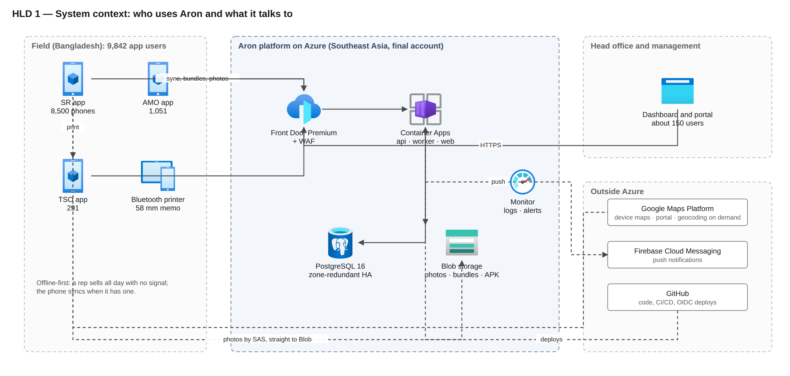
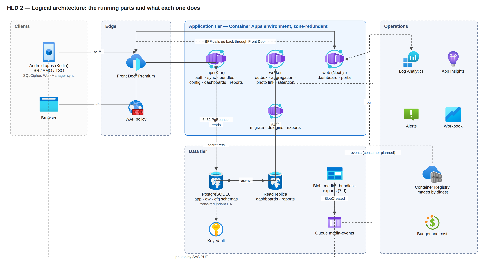
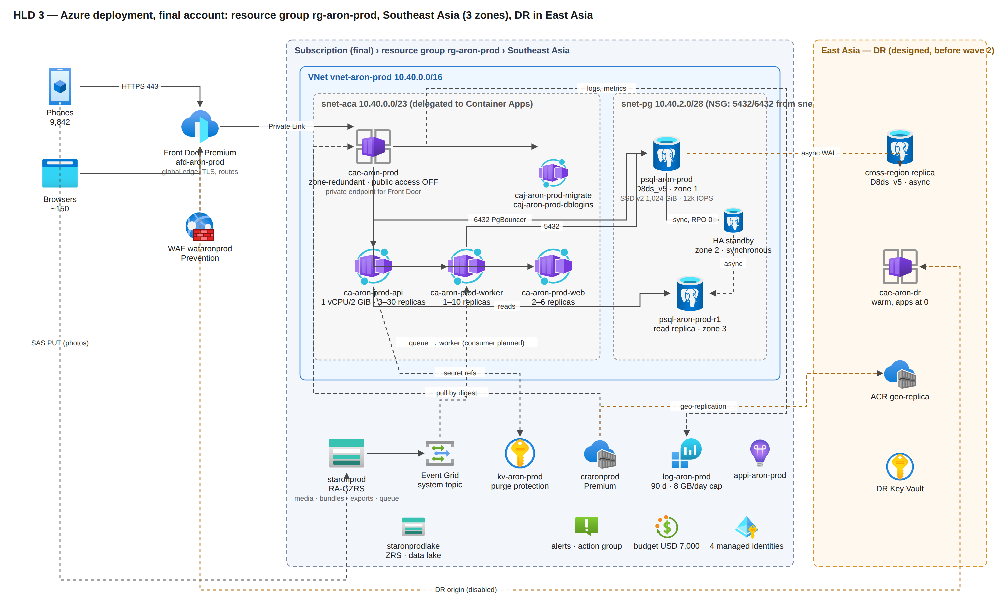
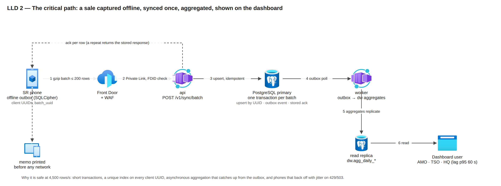
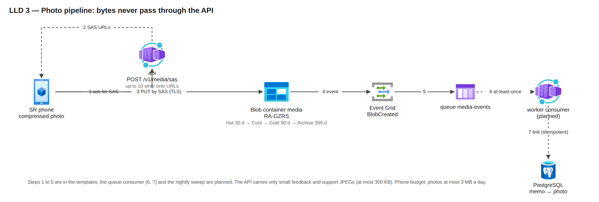
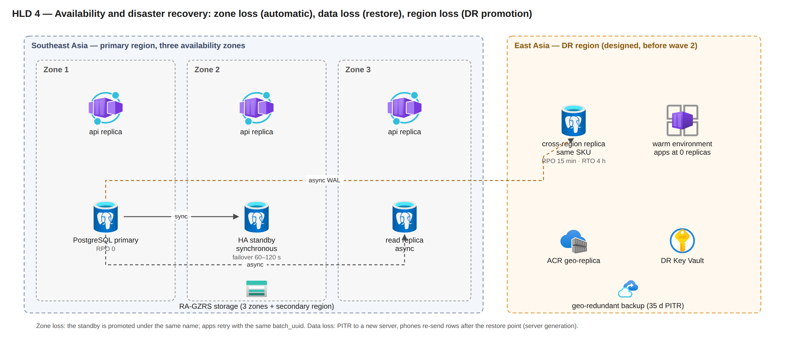
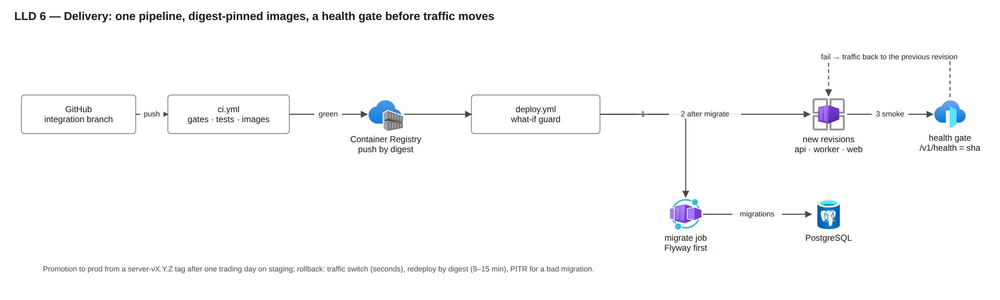

# 01 — High-level design (HLD): Aron on Azure, final account, 8,500 field users

Part of the owner pack `docs/35-final-azure-design-pack/` (index, totals and glossary in `README.md`; low-level design in `02-low-level-design.md`; resource plan and monthly cost in `03-resource-plan-and-cost.md`; the precise version with quantities in `04-precise-version.md`). Written 2026-10-29 by the lead from the production templates in `infra/`, the design in `docs/18`, the verification pack `docs/33` and the sponsor rules in `docs/28`; corrected the same day after three independent review passes. Diagrams use Microsoft's official Azure architecture icons in the Visio style; the sources are `diagrams.py` and the PNG files in `diagrams/`.

**Status words used in every table.** `IaC` = the production parameter files create it on the first deploy. `designed` = decided and documented, not yet in a template. `proven-test` = exercised in the test account at pilot size. `final-only` = can only be proven in the final account (load, failover and restore drills at fleet size).

---

## 1. What the system must do at 8,500 users

Aron replaces AKTCL's field-sales platform: Android apps for 8,500 sales representatives (SR), about 1,051 area managers (AMO) and 291 territory officers (TSO), a web dashboard and admin portal for about 150 head-office and management users, one API and one database. The apps are **offline-first**: a rep loads the day's route in the morning, visits outlets, records sales, prints memos and collects dues with no network in the critical path, and the phone syncs when it has signal. The server therefore sees **synchronised bursts**, not 8,500 constant sessions.

"8,500 simultaneous users, no lag, no crash" is designed as **8,500 phones syncing in two daily bursts**, with a load-test gate at 1.5 × the fleet. The design peaks (from `docs/18` section 1; the final-account load test is what proves them):

| Window (Dhaka time) | What happens | Expected peak | Designed for | Where it lands |
|---|---|---|---|---|
| 06:15–07:45 morning storm | every phone logs in or refreshes its token, downloads its route bundle, checks the app release | 131 requests/s | **400 requests/s**, 500 database transactions/s | API, PostgreSQL primary |
| 09:00–17:00 trickle | 60 % of visits upload within minutes of capture | 21 batches/s (about 125 rows/s) | 50 batches/s (about 300 rows/s) | API, primary |
| 17:00–17:30 check-out | reps close the day; phones that were offline push the whole day | 1,667 rows/s sustained for 30 min (3.0 M rows) | **4,500 rows/s** for the first 60 s; 3,333 rows/s at 2 × burstiness | primary (writes), worker (aggregation) |
| 17:00–19:00 dashboards | 1,051 AMO + 291 TSO (in their apps, through the API and the read replica) and about 150 head-office users (portal) watch live tiles | about 50 light queries/s | 150 queries/s budget; the web tier is sized for a pessimistic 25 pages/s | API, read replica, web |
| any time | 150,000 photos a day uploaded straight to Blob by SAS | 2.1 SAS/s, 21 PUT/s | 5 SAS/s, 50 PUT/s | Blob, Event Grid |
| load-test gate | 1.5 × the fleet (12,750 users), 8,000 rows/s probe | | primary CPU ≤ 80 %, disk IOPS ≤ 7,200 of 12,000; ack p95 ≤ 12 s at 8,000 rows/s | final-only |

Daily volumes behind those peaks: about 500,000 visits, 450,000 memos, 1.1 M memo lines, 3.0 M business rows (about 350 per SR-day), about 0.5 M API requests, 22.5 GB of photos. The database grows about 2.8 GB a day (about 1.0 TB in year one).

## 2. Architecture drivers

| Driver | Consequence in the design |
|---|---|
| Not one lost sale | Offline-first apps; every record carries a client UUID; the server **upserts by UUID**, so a retried or duplicated upload never creates a second sale. |
| No lag at the peaks | Stateless API on Container Apps that scales on request rate, pre-scaled before the two storms; PostgreSQL General Purpose D8ds_v5 with 12,000 IOPS; dashboards read a replica so readers are kept off the write path by design. |
| No single point of failure inside the region | API and web replicas are spread across three zones; PostgreSQL has a synchronous standby in a second zone (RPO 0); storage is RA-GZRS. The worker runs one replica today and the read replica is single-zone; the region itself is a single point until the DR tier is built. |
| Survive a region outage | Geo-redundant backup from day one (geo-restore, RPO about 1 h); a warm East Asia environment with a cross-region replica before wave 2 (RTO 4 h, RPO 15 min). |
| Keep attackers out, keep data private | One entrance (Front Door Premium with WAF); the application network has **no public ingress** (Private Link); PostgreSQL only on a private subnet; secrets only in Key Vault; scope derived server-side from the token, never sent by the client. |
| Cheap to run for the size | Consumption-billed compute, one database SKU step that fits with headroom, lifecycle tiers for photos, reservations once stable. |
| Operable by a small team | Everything is Bicep in Git, deployed by GitHub Actions with a what-if guard and a health gate; one workbook, alerts to e-mail; runbooks for failover, restore and rollback (two written, the rest designed). |

## 3. System context (level 0)

*Figure HLD 1. Who uses Aron and what it talks to. Phones sync through Front Door and upload photos straight to Blob by SAS; Google Maps, Firebase and GitHub are outside Azure.*

Outside the Azure bill but part of the system: Google Maps Platform (device maps, the portal map once its key is wired, on-demand geocoding; per-key quota and budget alert), Firebase (free tier at this volume), GitHub Actions, the field printers and the phones.

## 4. Logical architecture (level 1, containers)

*Figure HLD 2. The running parts. The web tier's server-side calls go back through Front Door like every other client.*

| Container | Responsibility | Why it is separate |
|---|---|---|
| **api** | Login and device binding, token refresh, sync ingest, route bundles, config delta, dashboards and reports, admin portal API, small media uploads (feedback and support JPEGs) | The one thing that must never be slow; stateless so it scales horizontally and survives a zone loss. |
| **worker** | Reads the domain-event outbox and recomputes daily aggregates (`dw`), risk signals, route-day planning, the server geo re-check sweep, retention and partition upkeep; the photo-queue consumer and export jobs are planned | Keeps heavy and bursty work off the request path; scales on backlog depth once the designed KEDA rules exist. |
| **web** | Next.js dashboard and admin portal (69 pages), server-side rendering, backend-for-frontend | Different runtime, release cadence and scaling (readers, not reps). |
| **jobs** | `migrate` (Flyway, before any app revision changes), `dblogins` (per-app PostgreSQL logins), export jobs (designed) | Run-to-completion work must not live in a long-running replica. |
| **PostgreSQL** | System of record: schemas `app` (visits, memos, lines, outlets, routes, devices, config tables `app.cfg_*`), `dw` (daily aggregates, stable `dw.v_*` views), `stg` (imports) | One relational store keeps idempotency, money and scope rules in one place; the `dw` layer is the product other dashboards reuse. |
| **Blob + queue** | Photos (direct SAS upload), route bundles (container created; bundles are built live today), report exports (7-day expiry); photo events in a queue | Bytes stay out of the database and the API. |

## 5. Azure deployment architecture (level 2, final account)

Region: **Southeast Asia (Singapore)**, the nearest region to Bangladesh with three availability zones and every needed feature (SSD v2, zone-redundant HA, Private Link, geo backup). DR: **East Asia (Hong Kong)**. A latency bake-off against Central India is planned before the move (D-422); the choice changes only if Dhaka-to-Pune is at least 25 % faster, and the cost figures would then be re-priced.

*Figure HLD 3. One resource group in Southeast Asia; the East Asia tier is designed and not yet in a template.*

Reading the picture: the only public entrance to the application is Front Door; the Container Apps environment refuses public traffic and is reached over Front Door's managed Private Link; PostgreSQL has no public address at all. Storage, Key Vault and the registry keep Entra-protected public endpoints today, with private endpoints planned as hardening after wave 1 (`02-low-level-design.md` section 2).

## 6. Key runtime flows

### 6.1 A sale, offline, then synced (the critical path)

*Figure LLD 2. One gzip batch, one short transaction, idempotent by client UUID, aggregated asynchronously, read by AMO, TSO and head-office users.*

Why this is safe at 4,500 rows/s: the ingest is one short transaction per batch (no queue to lose), idempotency is a unique index on the client UUID, the aggregation is asynchronous and catches up from the outbox, and the phones back off with jitter when the API sheds load (429 "too fast", 503 "shedding", both retryable). The accepted acknowledgement latency at the 17:00 spike is p95 8 s for a 200-row catch-up batch and 12 s at the 8,000 rows/s gate; the trickle target is 1.5 s.

### 6.2 Morning bundle (the other storm)

Phones wake between 06:15 and 07:45. Each refreshes its token, downloads one gzip bundle (SR median 25 KB, AMO about 90 KB, TSO about 300 KB) and checks the release channel. The API is pre-scaled to 8 replicas from 06:15 (a cron scale rule) and the autoscaler doubles replicas every 15 s up to 30. Bundles are built live by the API with a per-replica delta cache (1,024 snapshots per replica), so with many replicas most delta requests rebuild the full bundle; pre-generated bundles in Blob (planned, F-SYS-067) are the first scale lever if the load test asks for it.

### 6.3 Photo upload

*Figure LLD 3. Steps 1 to 5 are in the templates; the queue consumer and the nightly sweep are planned.*

The app asks the API for up to ten write-only SAS URLs, uploads straight to Blob (compressed on the phone, mobile-data budget 3 MB a day), and Blob raises a `BlobCreated` event into a Storage queue. The worker consumer that links the photo to its memo is planned (today the photo row stays pending until it exists); the API carries only small feedback, support and portal JPEGs (at most 300 KB).

### 6.4 Configuration change from the portal to 8,500 phones

An admin saves a setting in the portal; the API writes the config table with an audit row and bumps the config version; every API response carries `X-Config-Version`; a phone that sees a newer version pulls a delta on its next natural request. Scheduled values (for example an app-blocking window) are stored on the device and applied offline.

### 6.5 Zone failure of the database

The standby in zone 2 is synchronous (RPO 0). On failure Azure promotes it under the same name; the API's readiness probe checks the database only, so replicas are not restarted; the apps retry with the same `batch_uuid`. Documented 60–120 s at size; about 30 s user-visible measured once on the small dev server.

### 6.6 Region outage

*Figure HLD 4. Zone loss is automatic; data loss is a restore; region loss is a DR promotion once the East Asia tier exists.*

Before the DR tier: geo-restore of the latest geo-redundant backup into East Asia (RPO about 1 h, RTO to be measured in a timed drill). Target state (before wave 2): forced promotion of the East Asia replica (loss = replication lag, alert above 5 min), a new server generation published to the phones so they re-send anything acknowledged after the restore point, apps scaled up in the warm environment from the registry geo-replica, Front Door switched to the DR origin. Budget 3 h 30 min inside the 4 h RTO; phones keep selling throughout and hold up to 3 days of rows.

## 7. Capacity: demand against what is provisioned

| Tier | Provisioned (final parameters) | Capacity | Peak demand | Headroom | Status |
|---|---|---|---|---|---|
| API | 1 vCPU / 2 GiB replicas, min 3, **pre-scaled 8** at the storms, max 30; deployed trigger: 50 concurrent requests per replica | design rule 30 requests/s per replica (`docs/18`): 240 req/s pre-scaled, 360 at 12, 900 at max | 131 req/s expected, 400 design-for | 1.8 × pre-scaled on the expected peak; 2.3 × at max on the design-for peak; the 50-concurrent trigger fires later than the design rule and must be calibrated in S1–S10 | IaC; final-only proof |
| Database writes | D8ds_v5, 8 vCores, 32 GiB, 12,000 IOPS (cap 12,800), built-in PgBouncer | gate probe 8,000 rows/s; 1.5 × fleet at 5,000 rows/s | 4,500 rows/s for 60 s; 3,333 rows/s burst, 1,667 sustained | 1.8 × on the spike; **step-up to D16ds_v5 (same disk, in place) if the load test shows CPU above 80 % or IOPS above about 7,700** | IaC; final-only proof |
| Database reads | D8 replica, zone 3 | 150 queries/s budget | about 50 light + 0.5 heavy queries/s | 3 × | IaC template; final-only |
| Connections | 10 write + 10 read per API replica → 300 + 300 at max, pooled by PgBouncer (20 server connections per login) | transaction-mode pooling | 30 replicas | fits; `max_connections` on D8 confirmed at first deploy | IaC |
| Worker | 1 vCPU / 2 GiB; deployed 1 replica with no scale rule; designed KEDA to 10 | as deployed about 66 dirty keys/s; with the designed rules about 660/s | about 340 dirty keys/s at the 17:00 spike | as deployed 0.2 × (the backlog clears in minutes, not seconds); designed 1.9 × | IaC (1 replica); scaling designed |
| Web | 0.5 vCPU / 1 GiB, 2–6 replicas, 50 concurrent each | not derived; S5 (1,500 readers) is the proof | 25 pages/s pessimistic (portal readers are about 150 + 291 TSO; AMOs read through the API) | unproven | IaC; final-only |
| Edge | Front Door Premium, global | Microsoft-scale | 400 req/s | not a constraint | IaC |
| Storage | RA-GZRS account | 40,000 requests/s per account | 50 PUT/s photos, 5 SAS/s | not a constraint | IaC |
| Disk | 1,024 GiB SSD v2, no autogrow | 972 GiB usable | 2.8 GB a day → 70 % (680 GiB) at about day 243 | grow to 2,048 GiB at month 6 (manual, online) on primary, replica and DR replica; alert at 70 % in IaC, 60 % and 90 % designed | IaC alert (70 %) |

Honest reading: the platform is **designed** for these peaks with 1.8–3 × headroom at the API and database tiers and a defined step-up at each; the worker needs its designed scale rule before wave 1; the web tier's capacity is unproven. It is **proven** only when scenarios S1–S10 of `docs/18` section 8 run in the final account (the test account cannot host fleet size by sponsor rule). The first three stable trading days of every rollout wave are the live proof before the next wave.

## 8. Availability and recovery targets

RPO (recovery point objective) is how much data could be lost; RTO (recovery time objective) is how long selling is interrupted on the server side. Phones keep selling in every case below.

| Failure | Mechanism | RPO | RTO | Status |
|---|---|---|---|---|
| Phone offline | offline-first, outbox with UUIDs | 0 | none (selling continues) | IaC; tested at unit level and in the slice smoke |
| API replica or zone lost | zone-redundant environment, min 3 replicas, probes | 0 | seconds | IaC; never drilled |
| Database zone lost | zone-redundant HA, automatic promotion | 0 | 60–120 s | IaC; measured once on a small server |
| Bad deploy | Multiple revisions, health gate returns traffic; redeploy by digest | 0 | seconds to 15 min | IaC; no rollback drill yet |
| Bad migration or data loss | PITR to a new server (35 days), server generation re-sync | to the restore point | 2 h (assumed) | IaC procedure; runbook written, never run |
| Region outage before the DR tier | geo-redundant backup, geo-restore into East Asia | about 1 h | unmeasured (timed drill planned) | backup IaC; runbook not yet written |
| Region outage, target | cross-region replica, warm environment, DR origin | 15 min | 4 h | designed |
| Blob loss in region | RA-GZRS, soft delete 14 d | geo-lag | read from secondary | IaC |

SLO: 99.9 % availability of auth, sync and day-close calls 07:00–21:00 Dhaka on working days (25 minutes a month; the 06:15–07:00 start of the storm is outside the window and is reported separately); batch ack p95 1.5 s (trickle, ≤ 50 rows) and 8 s (catch-up, 200 rows), bundle p95 2 s, dashboards p95 1 s, aggregation lag p95 60 s, sync success 99.5 %, reconciliation mismatch ≤ 0.1 %.

## 9. Security architecture (summary)

| Layer | Control | Status |
|---|---|---|
| Edge | Front Door Premium: TLS 1.2+, WAF in Prevention (managed rule set in Log mode for one wave on real payloads, then Block), bot manager, per-IP backstop 60,000 requests per 5 minutes (carrier NAT puts thousands of phones behind one IP), method allow-list; the API rejects any request without the Front Door ID header | IaC |
| Network | No public ingress to the application; PostgreSQL on a delegated private subnet with an NSG allowing only the app subnet on 5432/6432; peer traffic encryption in the environment | IaC; private endpoints for Key Vault, registry and Blob designed |
| Identity | Phones: password + device binding (OTP seen by the TSO) + attestation; admins: TOTP MFA; refresh-token families with reuse detection; lockout per username, device and IP class | IaC |
| Token signing | ES256 key held as a Key Vault secret today; a non-exportable key in a signing vault with 24-hour per-replica delegations | IaC (secret); signing vault designed |
| Authorisation | Seven portal levels and the field roles; **reach derived on the server** from role and assignment and encoded in the token; the client never sends scope IDs | IaC (application level); row-level security designed |
| Data | TLS everywhere; SQLCipher on the phone; money in integer milli-taka; audit log append-only with a hash chain | IaC; PII envelope encryption (schema exists, no writer) and the WORM audit export designed |
| Secrets | Only in Key Vault and GitHub secrets (OIDC, no stored cloud credentials); Container Apps secret references; a missing secret fails start-up by name only | IaC; per-secret RBAC designed (today every app identity can read the whole vault) |
| Database logins | per-app logins (`app_api`, `app_jobs`, `app_bi`, `lake_export`) built and proven in dev | **off in the prod parameters** until the owner flips `dbPerAppLogins` before the first real user |
| Anti-spoofing | Mock-location detection, implausible-track checks on the device and re-checked on the server at sync; flags surfaced to the TSO | IaC |

## 10. Environments and delivery

*Figure LLD 6. One pipeline, digest-pinned images, migrations first, a health gate before traffic moves.*

The same Bicep deploys every environment; only the parameter file differs (`dev*.bicepparam` versus `stage`/`prod`). Staging in the final account is **parameters only today**: the committed stage file is prod-shaped, the deploy script and the backend settings do not yet accept `stage`, and a staging-lite parameter file is a prerequisite before the load-test windows. The move to the final account is "new subscription + prod parameters + data restore" (`docs/setup/move-to-final-account.md`). Rollout to 8,500 reps is in waves (pilot 10–20 routes; wave 1 one territory per wing; then one division per wing; half the fleet; the rest), with a next-wave gate on login rate, reconciliation mismatch, sync success and crash rate.

## 11. What is proven where

| Claim | Proven in the test account | Needs the final account |
|---|---|---|
| Idempotent sync, offline day, memo print, dashboard tile | yes (slice smoke on every deploy; device lab) | fleet-size rates |
| Zone-redundant topology, VNet-injected environment, HA failover | rehearsed at D2 size (sponsor exception, `docs/28`); one failover measured | D8 size |
| Front Door Premium with Private Link, environment with public access off, managed WAF rules on real payloads | never run at any size (dev ran Standard without Private Link) | pilot on prod with managed rules in Log mode |
| 400 req/s, 8,000 rows/s, 1,500 readers | no (sponsor rule: no fleet-sized resources in the test account) | load-test windows S1–S10 |
| Point-in-time restore, geo-restore, DR promotion | RB-14 written and never run; RB-52 and RB-13 not yet written | timed drills on staging |
| Cost | dev about USD 15 a day measured | first invoices |
