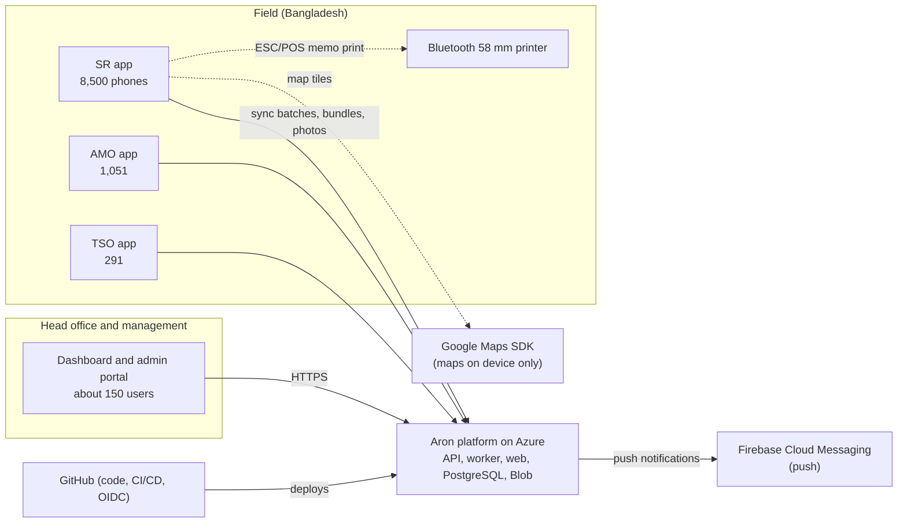
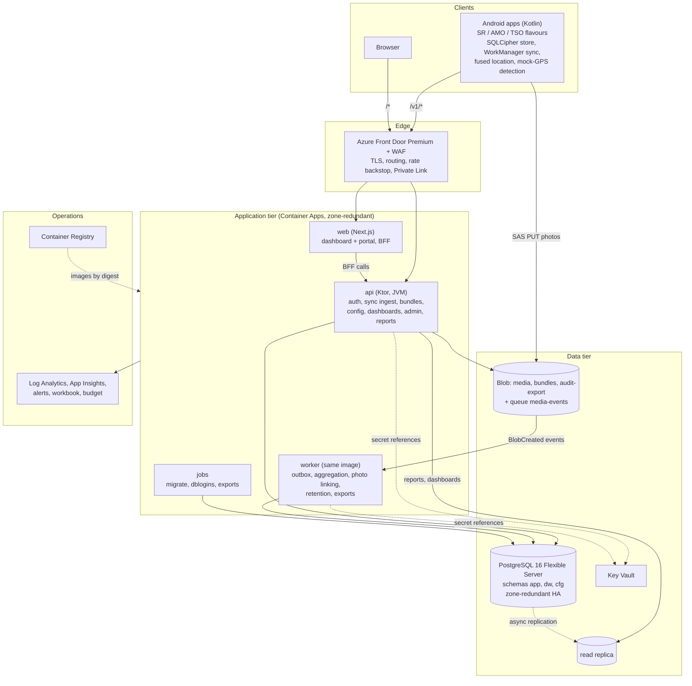
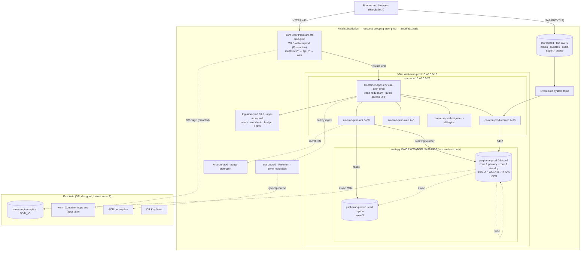
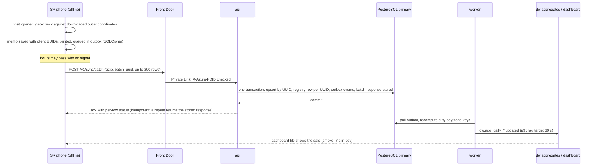
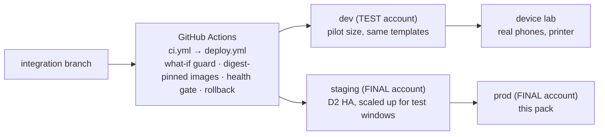

# 01 — High-level design (HLD): Aron on Azure, final account, 8,500 field users

Part of the owner pack `docs/35-final-azure-design-pack/` (index and totals in `README.md`; low-level design in `02-low-level-design.md`; resource plan and monthly cost in `03-resource-plan-and-cost.md`). Written 2026-10-29 by the lead from the production templates in `infra/`, the design in `docs/18`, the verification pack `docs/33` and the sponsor rules in `docs/28`.

**Status words used in every table.** `IaC` = the production parameter files create it on the first deploy. `designed` = decided and documented, not yet in a template. `proven-test` = exercised in the test account at pilot size. `final-only` = can only be proven in the final account (load, failover and restore drills at fleet size).

---

## 1. What the system must do at 8,500 users

Aron replaces AKTCL's field-sales platform: Android apps for 8,500 sales representatives (SR), about 1,051 area managers (AMO) and 291 territory officers (TSO), a web dashboard and admin portal for about 150 head-office and management users, one API and one database. The apps are **offline-first**: a rep loads the day's route in the morning, visits outlets, records sales, prints memos and collects dues with no network in the critical path, and the phone syncs when it has signal. The server therefore sees **synchronised bursts**, not 8,500 constant sessions.

"8,500 simultaneous users, no lag, no crash" translates into these design peaks (design values from `docs/18` section 1; the final-account load test is what proves them):

| Window (Dhaka time) | What happens | Demand the platform is sized for | Where it lands |
|---|---|---|---|
| 06:30–07:45 morning storm | every phone logs in or refreshes its token, downloads its route bundle, checks the app release | **400 requests/s** design-for (131 expected), 500 database transactions/s | API, PostgreSQL primary, Blob (bundles) |
| 09:00–17:00 trickle | 60 % of visits upload within minutes of capture | 50 batches/s, about 125 rows/s ingest | API, primary |
| 17:00–17:30 check-out | reps close the day; phones that were offline push the whole day | **4,500 rows/s** for 60 s at 17:00:00, 3,333 rows/s worst case for 30 min | primary (writes), worker (aggregation) |
| 17:00–19:00 dashboards | 1,051 AMO + 291 TSO + 150 HQ watch live tiles | about **1,500 concurrent readers**, 25 requests/s, 150 queries/s | web, API, read replica |
| any time | 150,000 photos a day uploaded straight to Blob by SAS | 5 SAS/s, 50 PUT/s | Blob, Event Grid, worker |
| load-test gate | 1.5 × the fleet (12,750 users), 8,000 rows/s probe | primary CPU ≤ 80 %, disk IOPS ≤ 7,200 of 12,000 | final account only |

Daily volumes behind those peaks: about 500,000 visits, 450,000 memos, 1.1 M memo lines, 3.0 M business rows (about 350 per SR-day), about 0.5 M API requests, 22.5 GB of photos. The database grows about 2.8 GB a day (1.0 TB in year one).

## 2. Architecture drivers

| Driver | Consequence in the design |
|---|---|
| Not one lost sale | Offline-first apps; every record carries a client UUID; the server **upserts by UUID**, so a retried or duplicated upload never creates a second sale (`CLAUDE.md` constraint 2). |
| No lag at the peaks | Stateless API on Container Apps that scales on request rate with pre-scaled replicas before the two storms; PostgreSQL General Purpose D8ds_v5 with 12,000 provisioned IOPS; dashboards read a replica, so 1,500 readers never slow the sale path. |
| No single point of failure | Every tier is zone-redundant inside Southeast Asia: Container Apps environment across three zones, PostgreSQL zone-redundant HA (synchronous standby, RPO 0), RA-GZRS storage, Premium registry, global Front Door. |
| Survive a region outage | Geo-redundant backup from day one; a warm East Asia environment with a cross-region replica before wave 2 (RTO 4 h, RPO 15 min). |
| Keep attackers out, keep data private | One entrance (Front Door Premium with WAF); the application network has **no public ingress** (Private Link); PostgreSQL only on a private subnet; secrets only in Key Vault; scope derived server-side from the token, never sent by the client. |
| Cheap to run for the size | Consumption-billed compute, one database SKU step that fits with headroom, lifecycle tiers for photos, reservations once stable. |
| Operable by a small team | Everything is Bicep in Git, deployed by GitHub Actions with a what-if guard and a health gate; one workbook, alerts to e-mail (SMS optional); runbooks for failover, restore and rollback. |

## 3. System context (level 0)

Outside the Azure bill but part of the system: Google Maps (per-key quota and budget alert), Firebase (free tier at this volume), GitHub Actions, the field printers and the phones.

## 4. Logical architecture (level 1, containers)

| Container | Responsibility | Why it is separate |
|---|---|---|
| **api** | Login and device binding, token refresh, sync ingest (`POST /v1/sync/batch`), route bundles, config delta, dashboards and reports, admin portal API | The one thing that must never be slow; it is stateless so it scales horizontally and survives a zone loss. |
| **worker** | Reads the domain-event outbox and recomputes daily aggregates (`dw`), links photos to memos, prunes partitions, runs retention, builds exports | Keeps heavy and bursty work off the request path; scales on backlog depth, not on HTTP. |
| **web** | Next.js dashboard and admin portal (69 pages), server-side rendering, backend-for-frontend | Different runtime, different release cadence, different scaling (readers, not reps). |
| **jobs** | `migrate` (Flyway, before any app revision changes), `dblogins` (per-app PostgreSQL logins), export jobs | Run-to-completion work must not live in a long-running replica. |
| **PostgreSQL** | System of record: `app` (visits, memos, lines, outlets, routes, devices), `dw` (daily aggregates, stable `dw.v_*` views), `cfg` (settings, audit) | One relational store keeps idempotency, money and scope rules in one place; the `dw` layer is the product other dashboards reuse (`docs/31`). |
| **Blob + queue** | Photos (direct SAS upload), route bundles, APK channel, WORM audit export; photo events | Bytes stay out of the database and the API; events decouple photo linking. |

## 5. Azure deployment architecture (level 2, final account)

Region: **Southeast Asia (Singapore)**, the nearest region to Bangladesh with three availability zones and every needed feature (SSD v2, zone-redundant HA, Private Link, geo backup). DR: **East Asia (Hong Kong)**, the paired region. A latency bake-off against Central India is planned before the move (D-422); the choice changes only if Dhaka-to-Pune is at least 25 % faster.

Reading the picture: the only public entrance to the application is Front Door; the Container Apps environment refuses public traffic and is reached over Private Link; PostgreSQL has no public address at all. Storage, Key Vault and the registry keep Entra-protected public endpoints today, with private endpoints planned (`02-low-level-design.md` section 2).

## 6. Key runtime flows

### 6.1 A sale, offline, then synced (the critical path)

Why this is safe at 4,500 rows/s: the ingest is one short transaction per batch (no queue to lose), idempotency is a unique index on the client UUID, the aggregation is asynchronous and catches up from the outbox, and the phones back off with jitter when the API sheds load (429/503 with `Retry-After`).

### 6.2 Morning bundle (the other storm)

Phones wake between 06:15 and 07:45. Each refreshes its token, downloads one gzip bundle (SR median 25 KB, AMO about 90 KB, TSO about 300 KB) and checks the release channel. The API is pre-scaled to 8 replicas from 06:15 (a cron scale rule), and the autoscaler doubles replicas every 15 s on request rate up to 30. Bundles are served from the API with a delta cache; pre-generated bundles in Blob are the first scale lever if the load test asks for it.

### 6.3 Photo upload

The app asks the API for up to ten write-only SAS URLs, uploads straight to Blob (compressed on the phone, mobile-data budget 3 MB a day), and Blob raises a `BlobCreated` event into a Storage queue that the worker drains to link the photo to its memo; a nightly sweep is the safety net. The API never carries photo bytes.

### 6.4 Configuration change from the portal to 8,500 phones

An admin saves a setting in the portal; the API writes `cfg` with an audit row and bumps the config version; every API response carries `X-Config-Version`; a phone that sees a newer version pulls a delta on its next natural request. Scheduled values (for example an app-blocking window) are stored on the device and applied offline.

### 6.5 Zone failure of the database

The standby in zone 2 is synchronous (RPO 0). On failure Azure promotes it under the same name; the API's readiness probe checks the database only, so replicas are not restarted; the apps retry with the same `batch_uuid`. Documented 60–120 s at size; about 30 s user-visible measured once on the small dev server.

### 6.6 Region outage (target state, before wave 2)

Forced promotion of the East Asia replica (loss = replication lag, alert above 5 min), a new server generation published to the phones so they re-send anything acknowledged after the restore point, apps scaled up in the warm environment from the registry geo-replica, Front Door switched to the DR origin. Budget 3 h 30 min inside the 4 h RTO; phones keep selling throughout and hold up to 3 days of rows.

## 7. Capacity: demand against what is provisioned

| Tier | Provisioned (final parameters) | Capacity | Peak demand | Headroom | Status |
|---|---|---|---|---|---|
| API | 1 vCPU / 2 GiB replicas, min 3, **pre-scaled 8** at the storms, max 30; HTTP rule 50 concurrent per replica | design rule 30 requests/s per replica → 240 req/s pre-scaled, 900 req/s at max | 131 req/s expected, 400 design-for | 1.8 × pre-scaled on the expected peak; 2.3 × at max on the design-for peak; recommended lever: pre-scale 12 on wave mornings (+USD 45 a month) | IaC; rule untested at fleet size |
| Database writes | D8ds_v5, 8 vCores, 32 GiB, 12,000 IOPS (cap 12,800), built-in PgBouncer | gate probe 8,000 rows/s; 1.5 × fleet at 5,000 rows/s | 4,500 rows/s for 60 s; 3,333 rows/s for 30 min | 1.8 × on the spike; **step-up to D16ds_v5 (same disk, in place) if the load test shows CPU above 80 % or IOPS above 7,200** | IaC; final-only proof |
| Database reads | D8 replica, zone 3 | 150 queries/s budget | 50 light + 0.5 heavy queries/s from 1,500 readers | 3 × | IaC template |
| Connections | 10 write + 10 read per API replica → 300 + 300 at max, pooled by PgBouncer to 20 server connections per login | PgBouncer transaction mode | 30 replicas | fits; `max_connections` on D8 to be confirmed on the first deploy | IaC |
| Worker | 1 vCPU / 2 GiB, 1–10 replicas | 10 × 66 recomputes/s drain a 30-minute backlog (38,000 rows) in about 60 s | 300 + 600 aggregate rows/s | 8 × | IaC; KEDA rule designed |
| Web | 0.5 vCPU / 1 GiB, 2–6 replicas, 50 concurrent each | 25 pages/s with 90 % cache hits | 1,500 readers at 60 s refresh | 2 × | IaC; unproven against 1,500 |
| Edge | Front Door Premium, global | Microsoft-scale | 400 req/s | not a constraint | IaC |
| Storage | RA-GZRS, 20,000 requests/s per account | 50 PUT/s photos | 2.1 SAS/s, 50 PUT/s | not a constraint | IaC |
| Disk | 1,024 GiB SSD v2, no autogrow | 972 GiB usable | 2.8 GB a day → 70 % at about month 7 | grow to 2,048 GiB by month 6 (manual, online); alerts at 60/70/90 % | IaC alerts |

Honest reading: the platform is **designed** for these peaks with 1.8–3 × headroom at every tier and a defined step-up at each; it is **proven** only when scenarios S1–S10 of `docs/18` section 8 run in the final account (the test account cannot host fleet size by sponsor rule). The first three stable trading days of every rollout wave are the live proof before the next wave.

## 8. Availability and recovery targets

| Failure | Mechanism | RPO | RTO | Status |
|---|---|---|---|---|
| Phone offline | offline-first, outbox with UUIDs | 0 | none (selling continues) | proven-test |
| API replica or zone lost | zone-redundant environment, min 3 replicas, probes | 0 | seconds | IaC |
| Database zone lost | zone-redundant HA, automatic promotion | 0 | 60–120 s | IaC; measured once small |
| Bad deploy | Multiple revisions, health gate returns traffic; redeploy by digest | 0 | seconds to 15 min | IaC |
| Bad migration or data loss | PITR to a new server (35 days), server generation re-sync | to the restore point | 2 h (assumed, drill pending) | IaC procedure |
| Region outage, wave 1 | geo-redundant backup, geo-restore into East Asia | about 1 h | unmeasured (timed drill on staging) | backup IaC |
| Region outage, target | cross-region replica, warm environment, DR origin | 15 min | 4 h | designed |
| Blob loss in region | RA-GZRS, soft delete 14 d | geo-lag | read from secondary | IaC |

SLO: 99.9 % availability of auth, sync and day-close calls 07:00–21:00 Dhaka on working days (25 minutes a month); batch ack p95 1.5 s (≤ 50 rows), bundle p95 2 s, dashboards p95 1 s, aggregation lag p95 60 s, sync success 99.5 %, reconciliation mismatch ≤ 0.1 %.

## 9. Security architecture (summary)

| Layer | Control |
|---|---|
| Edge | Front Door Premium: TLS 1.2+, WAF in Prevention (managed rule set in Log mode for one wave on real payloads, then Prevention), bot manager, per-IP backstop 60,000 requests per 5 minutes (carrier NAT puts thousands of phones behind one IP), method allow-list; the API rejects any request without the Front Door ID header. |
| Network | No public ingress to the application; PostgreSQL on a delegated private subnet with an NSG allowing only the app subnet on 5432/6432; peer traffic encryption in the environment. |
| Identity | Phones: password + device binding (OTP seen by the TSO) + attestation; admins: TOTP MFA; tokens signed with a Key Vault EC P-256 key through per-replica delegated keys; refresh-token families with reuse detection; lockout per username, device and IP class. |
| Authorisation | Seven portal levels and the field roles; **reach derived on the server** from role and assignment and encoded in the token; the client never sends scope IDs. |
| Data | TLS everywhere; SQLCipher on the phone; PII (NID, TIN, trade licence) envelope-encrypted with Key Vault-wrapped keys; audit log append-only with a hash chain and a WORM export; money in integer milli-taka. |
| Secrets | Only in Key Vault and GitHub secrets (OIDC, no stored cloud credentials); Container Apps secret references; a missing secret fails start-up by name only. |
| Anti-spoofing | Mock-location detection, implausible-track checks on the device and re-checked on the server at sync; flags surfaced to the TSO. |

## 10. Environments and delivery

The same Bicep deploys every environment; only the parameter file differs (`dev*.bicepparam` versus `stage`/`prod`). The move to the final account is "new subscription + prod parameters + data restore" (`docs/setup/move-to-final-account.md`). Rollout to 8,500 reps is in waves (pilot 10–20 routes; wave 1 one territory per wing; then one division per wing; half the fleet; the rest), with a next-wave gate on login rate, reconciliation mismatch, sync success and crash rate.

## 11. What is proven where

| Claim | Proven in the test account | Needs the final account |
|---|---|---|
| Idempotent sync, offline day, memo print, dashboard tile | yes (slice smoke on every deploy; device lab) | fleet-size rates |
| Zone-redundant topology, VNet-injected environment, HA failover | rehearsed at D2 size (sponsor exception, `docs/28`) | D8 size, Private Link, Premium WAF |
| 400 req/s, 8,000 rows/s, 1,500 readers | no (sponsor rule: no fleet-sized resources in the test account) | load-test windows S1–S10 |
| PITR, geo-restore, DR promotion | runbooks written, drills not yet run | timed drills on staging |
| Cost | dev about USD 15 a day measured | first invoices |
