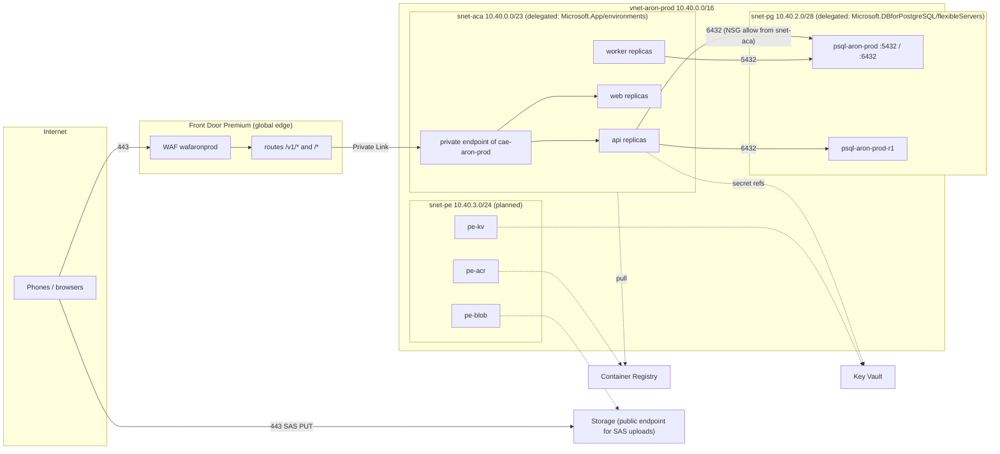
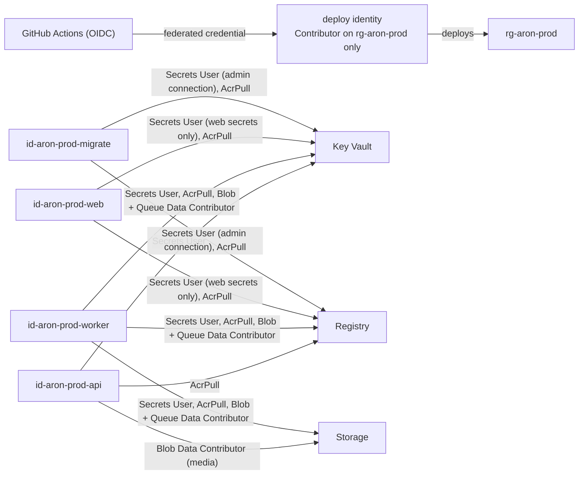
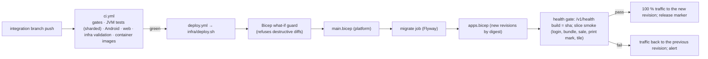

# 02 — Low-level design (LLD): every Azure resource, its settings and why

Part of the owner pack `docs/35-final-azure-design-pack/`. Each row names the resource as the production templates create it (`infra/main.bicep`, `infra/apps.bicep`, `infra/params/prod.bicepparam`, `infra/params/prod.apps.bicepparam`), the specification, and a **short justification**. The monthly cost of every row is in `03-resource-plan-and-cost.md`. Names end in a six-character suffix derived from the resource group (`<s>`), omitted here. Deeper evidence per setting is in `docs/33-final-azure-architecture/part-b-low-level-platform.md`.

---

## 1. Resource catalogue with specification and justification

| # | Resource (name) | Specification | Why this specification | Status |
|---|---|---|---|---|
| 1 | **Resource group** `rg-aron-prod` | one group per environment, Southeast Asia, tags `project=aron`, `environment=prod`, `owner=aktcl`, `managed-by=bicep` | one blast radius, one cost view, one RBAC boundary for the deploy identity | IaC (group created by bootstrap) |
| 2 | **Virtual network** `vnet-aron-prod` | `10.40.0.0/16`; `snet-aca 10.40.0.0/23` (delegated to Container Apps); `snet-pg 10.40.2.0/28` (delegated to PostgreSQL) | a /23 gives 512 addresses for up to about 250 replica IPs during a revision swap; PostgreSQL needs its own delegated subnet for private access; distinct ranges from stage (`10.41`) and dev (`10.51`) so environments can be peered later without renumbering | IaC |
| 3 | **Network security groups** `…-snet-pg-nsg`, `…-snet-aca-nsg` | pg NSG: allow TCP 5432 and 6432 from `snet-aca`, deny the rest inbound; aca NSG: Azure defaults | the database accepts connections only from the application subnet; the environment's own ingress is already private | IaC |
| 4 | **Private DNS zone** `…private.postgres.database.azure.com` + VNet link | one zone, one link | required for private-access Flexible Server name resolution from the apps | IaC |
| 5 | **Container Apps environment** `cae-aron-prod` | workload-profiles environment, Consumption profile, **zone-redundant**, VNet-injected into `snet-aca`, `publicNetworkAccess Disabled`, peer traffic encryption on, private endpoint for Front Door | zone redundancy spreads replicas across three zones so one zone loss costs capacity, not availability; disabling public access means the only way in is Front Door's Private Link; Consumption billing means idle hours cost almost nothing | IaC |
| 6 | **Container App** `ca-aron-prod-api` | image `backend` by digest; **1 vCPU / 2 GiB**; min 3, max 30; HTTP scale rule 50 concurrent requests per replica; cron pre-scale to 8 replicas 06:15–10:00 and 16:45–20:00 Dhaka; revisions mode Multiple (previous revision kept at 0 % traffic); probes: startup, liveness (process), readiness `/v1/health/ready` (database, 2 s); env from Key Vault references; `ARON_FRONT_DOOR_ID` header check | 1 vCPU / 2 GiB is the JVM sweet spot for a Ktor service (one G1 heap of about 1.2 GiB, 150–300 requests/s a vCPU); **min 3 = one replica per zone**; max 30 = 900 requests/s, 2.3 × the design-for storm; pre-scaling removes cold-start and JIT warm-up from the two daily storms; Multiple revisions give a seconds-fast rollback | IaC |
| 7 | **Container App** `ca-aron-prod-worker` | same image, role `worker`; 1 vCPU / 2 GiB; min 1, max 10; no ingress; KEDA rules designed: PostgreSQL outbox depth (target 200 rows per replica) and Storage queue length (100 messages per replica) | aggregation is bursty (check-out) and must never run inside the request path; backlog-based scaling drains a 30-minute outage (38,000 rows) in about a minute at 10 replicas | IaC (rules designed) |
| 8 | **Container App** `ca-aron-prod-web` | Next.js image; 0.5 vCPU / 1 GiB; min 2, max 6; HTTP rule 50 concurrent; pre-scale 4 at 16:45 designed | server-rendered pages are light; two replicas for zone spread; 1,500 readers at a 60 s refresh is 25 pages/s | IaC |
| 9 | **Container Apps Jobs** `caj-aron-prod-migrate`, `caj-aron-prod-dblogins`, export jobs | migrate: Flyway image by digest, manual trigger, timeout 1,800 s, retry 0, runs **before** any app revision changes; dblogins: psql 16 image, timeout 300 s; exports: concurrency 8, role `app_export`, results in Blob for 24 h | migrations and login grants are run-to-completion steps that must not sit in a serving replica; large Excel exports (over 10,000 rows) run as jobs so they cannot starve the API | IaC (exports designed) |
| 10 | **PostgreSQL Flexible Server** `psql-aron-prod` | PostgreSQL 16; **GeneralPurpose Standard_D8ds_v5** (8 vCores, 32 GiB); **zone-redundant HA** (primary zone 1, standby zone 2); **Premium SSD v2 1,024 GiB, 12,000 IOPS, 300 MB/s**, autogrow disabled (SSD v2 has none); backup retention 35 days, **geo-redundant**; built-in **PgBouncer** (transaction mode, pool 20 per login and database) on 6432; private access only; maintenance window Friday 01:00–02:00 Dhaka; extensions PostGIS, pg_stat_statements; Query Store on | D8 is the first SKU whose IOPS cap (12,800) covers the 12,000 IOPS the write peaks need and whose 8 vCores hold the 8,000 rows/s gate with CPU under 80 %; zone-redundant HA gives RPO 0 and automatic failover; SSD v2 decouples size, IOPS and throughput so IOPS are bought for the peak, not by buying a bigger disk; 1,024 GiB covers year one plus the Apsis import with the first grow at month 6; 35-day PITR covers a month-end discovered late; geo backup is the wave-1 region-outage fallback; PgBouncer keeps 600 client connections to about 40 server connections | IaC |
| 11 | **PostgreSQL read replica** `psql-aron-prod-r1` | same SKU and disk, zone 3, asynchronous, own PgBouncer, own parameters | dashboards, reports, exports and BI read here, so 1,500 readers never compete with 8,500 writers; the **same SKU** because WAL replay is single-threaded and a smaller replica falls behind at the 17:00 peak | IaC template (second deploy) |
| 12 | **Database** `aron` | UTF8, `en_US.utf8`; schemas `app` (operational), `dw` (aggregates and stable views), `cfg` (settings, audit); monthly partitions on the fact tables; retention job prunes the ingest registry at 45 days | one database keeps idempotency, money and scope rules transactional; partitions keep the hot set small and make retention a drop, not a delete | IaC + migrations |
| 13 | **Storage account** `staronprod` | StorageV2, **Standard_RAGZRS**, Hot; TLS 1.2; shared key off; public blob access off; containers `media` (photos), `bundles`, `audit-export` (WORM); queue `media-events`; soft delete 14 days; lifecycle: photos to Cool at 30 days, Cold at 90 days, Archive after 365 days; bundles deleted after 3 days | RA-GZRS keeps evidence photos readable even in a region outage (three zones plus a readable secondary region); lifecycle tiers cut the photo bill by about 80 % after the first month; SAS-only writes keep keys out of the apps | IaC (Archive rule designed) |
| 14 | **Event Grid system topic** `evgt-aron-prod-storage` | `BlobCreated` on `media/` → queue `media-events`; 30 delivery attempts, 24 h TTL | at-least-once delivery with the worker's idempotent link; no Service Bus (ingest is synchronous, photo events need no ordering) | IaC |
| 15 | **Key Vault** `kv-aron-prod` (+ signing vault `kv-aron-sign`) | Standard; RBAC authorisation; soft delete 90 days; **purge protection on**; secrets: database connection strings per login, JWT signing key reference, Argon2 pepper, Maps key, Firebase service account, Storage SAS delegation; signing vault: non-exportable EC P-256 key, `sign` only | purge protection makes a deleted secret recoverable for 90 days (a wrong delete is not an outage); a separate vault for the root signing key limits who can even list it; Container Apps secret references mean the code has no vault client | IaC (signing vault designed) |
| 16 | **User-assigned identities** `id-aron-prod-api`, `-worker`, `-web`, `-migrate` | one per app; roles: Key Vault Secrets User, AcrPull, Storage Blob Data Contributor (worker, api on `media`), Storage Queue Data Contributor (worker) | least privilege per process; a compromised web replica cannot read the database secret | IaC |
| 17 | **Container Registry** `craronprod` | **Premium**, zone-redundant, admin user off, untagged manifests purged after 30 days; geo-replica to East Asia designed | Premium is the only tier with zone redundancy, private link and geo-replication (a region outage must not strand image pulls); 500 GiB included | IaC |
| 18 | **Front Door profile** `afd-aron-prod` | **Premium_AzureFrontDoor**; endpoint `fde-aron-prod-<s>.azurefd.net` (custom domain when AKTCL names one); routes `/v1/*` → origin group `og-api`, `/*` → `og-web`; origins are the Container Apps environment over **Private Link**; health probe `/v1/health` every 30 s; origin response timeout 60 s (the API answers in 25 s itself); caching for the APK channel designed | Premium is required for Private Link origins and the managed WAF rule sets; a global anycast edge terminates TLS close to Dhaka and absorbs volumetric attacks; one hostname for phones and browsers | IaC |
| 19 | **WAF policy** `wafaronprod` | mode **Prevention**; managed `Microsoft_DefaultRuleSet 2.1` in **Log** action for the first wave, then Block; `Microsoft_BotManagerRuleSet 1.1`; custom rules: per-IP rate backstop 60,000 requests / 5 min, method allow-list, body size limit (1 MiB compressed batches) | real sync payloads must be observed before managed rules block them (a false positive on `/v1/sync` would stop sales); the IP backstop is high because carrier NAT puts thousands of phones behind one address, so the real limits are per device and per user inside the API | IaC |
| 20 | **Log Analytics workspace** `log-aron-prod` | PerGB2018; retention **90 days**; daily cap **8 GB**; diagnostic settings from Key Vault, ACR, PostgreSQL, Container Apps environment, Front Door (access + WAF), Storage | 90 days covers a quarter-end investigation; the cap protects the bill from a logging bug (alert at 80 % of cap); design volume 5.5 GB/day | IaC |
| 21 | **Application Insights** `appi-aron-prod` | workspace-based, Java agent 3.7.10 pinned by hash in the image; release annotations after each deploy | traces and dependency timings without code changes; annotations line up incidents with releases | IaC |
| 22 | **Alerts and action group** `ag-aron-prod` | 5 log-search alerts (5xx rate, sync failures, aggregation lag, auth failures, WAF blocks), PostgreSQL metric alerts (CPU > 80 %, storage 60/70/90 %, replication lag > 5 min, connections), Container Apps restarts, Front Door origin health, Resource Health, budget 50/90/100 %; e-mail receivers; SMS/voice designed | each alert maps to a runbook; thresholds come from the capacity table so an alert means "act now", not noise | IaC |
| 23 | **Workbook** "Aron operations" | six tiles: request rate and p95 by route, sync success, aggregation lag, database CPU/IOPS, worker backlog, WAF actions | one screen for the war room during rollout waves | IaC |
| 24 | **Budget** `budget-aron-prod` | **USD 7,000 a month**; alerts at 50, 90, 100 % actual and 100 % forecast; raise to about 9,000 when the DR tier is built | an early warning that is independent of any alert rule | IaC |
| 25 | **GitHub OIDC deploy identity** | federated credential for the `azure-prod` environment; roles on the resource group only: Contributor, AcrPush, Key Vault Secrets Officer, RBAC Administrator (scoped) | no stored cloud credentials anywhere; the pipeline cannot touch other groups | IaC (bootstrap) |

### Designed, not yet in a template (DR tier and hardening)

| Resource | Specification | Why | When |
|---|---|---|---|
| Cross-region replica `psql-aron-prod-dr` (East Asia) | D8ds_v5, same disk tier, asynchronous; lag alerts at 5 and 12 minutes | RPO 15 min, RTO 4 h for a region outage without a second writer | before wave 2 |
| Warm environment `cae-aron-dr` (East Asia) | zone-redundant, VNet `10.42.0.0/16`, apps at 0 replicas, same images and secrets | promotion in under 4 h needs the environment to exist already | before wave 2 |
| ACR geo-replica, DR Key Vault, DR Front Door origin (disabled, readiness requires `pg_is_in_recovery() = false`) | | pulls and secrets available when Southeast Asia is not | before wave 2 |
| Private endpoints for Key Vault, ACR, Blob (`snet-pe 10.40.3.0/24`) | three endpoints, private DNS zones | closes the last public endpoints; SAS uploads from phones stay on the public Blob endpoint by design | hardening after wave 1 |
| Azure Policy, resource locks, Defender for Cloud | deny public PostgreSQL, deny non-ZRS storage, CanNotDelete locks on data | subscription-scope guard rails the final-account owner applies once | at the move |
| Azure Load Testing resource | engines for 12,750 virtual users; Locust scripts S1–S10 | the 8,500-user proof | final account only |

## 2. Network design

| Item | Setting | Why |
|---|---|---|
| Address plan | prod `10.40.0.0/16`, stage `10.41.0.0/16`, dev `10.51.0.0/16`, DR `10.42.0.0/16` | non-overlapping so peering or a hub is possible later |
| Ingress | only Front Door → Private Link → environment; environment `publicNetworkAccess Disabled` | no address on the internet except the edge |
| East-west | NSG on `snet-pg`: allow 5432 and 6432 from `10.40.0.0/23`, deny all other inbound; the environment encrypts peer traffic | database reachable from the app subnet only |
| Egress | Container Apps default outbound (platform SNAT) to Azure services (Key Vault, Blob, ACR, Event Grid) and to Firebase; no NAT gateway unless a partner needs a fixed IP | nothing in the design needs an allow-listed source address |
| DNS | private zone for PostgreSQL; Azure-provided DNS otherwise; private zones for the planned endpoints | private resolution without a custom resolver |
| TLS | TLS 1.2 minimum at Front Door, Storage and PostgreSQL (`require_secure_transport on`); managed certificate on the custom domain when named | no plaintext anywhere |
| Header pinning | the API returns 403 unless `X-Azure-FDID` equals the profile id (health endpoints excepted for probes) | even a leaked origin address cannot bypass the WAF |

## 3. Edge design (Front Door and WAF)

| Setting | Value | Why |
|---|---|---|
| Origin groups | `og-api` → environment Private Link, `/v1/health` probe every 30 s, 2 successes to be healthy; `og-web` same | separate health so a web issue never fails over API traffic |
| Routes | `/v1/*` → api, HTTPS only, HTTP redirected; `/*` → web; `/apk/*` → Blob (cached 24 h) designed | one hostname, cheap APK distribution from the edge |
| Timeouts | origin response 60 s; the API's own request timeout is 25 s | the API always answers first with its own JSON envelope, so phones never see an edge HTML error for a slow request |
| Rate limits | WAF custom rule: 60,000 requests / 5 min per IP (backstop); API: per device and per user limits, in-flight limiter per replica, 429 "too fast" and 503 "shedding", both retryable | per-IP limits would punish whole carriers; the real protection is per device inside the API |
| Managed rules | DRS 2.1 in Log for the first wave on real payloads, then Block; Bot Manager 1.1 | avoid blocking legitimate sync bodies before they have been observed |
| Body limit | 1 MiB compressed (8 MiB decompressed in the API) | a batch is at most 200 rows (about 12 KB gzip); anything larger is not a phone |
| Logging | access and WAF logs to Log Analytics | every blocked request is reviewable |
| Propagation | about 15 minutes per configuration change | deploy script waits up to 45 minutes on the `azurefd.net` host before smoke |

## 4. Compute design (Container Apps)

### 4.1 Request pipeline in `api`

```mermaid
flowchart LR
  R["request"] --> F["Front Door id check"] --> L["in-flight limiter per replica"] --> A["auth: token verify (delegated EC key), device binding, role"] --> S["scope: reach derived from role + assignment (never from the client)"] --> V["validation: envelope, units, money in milli-taka, business date Asia/Dhaka"] --> T["one transaction (PgBouncer 6432)"] --> O["outbox event + response stored"] --> E["JSON envelope, X-Config-Version, request id"]
```

### 4.2 Replica profile over a trading day (Dhaka time)

```mermaid
gantt
  dateFormat HH:mm
  axisFormat %H:%M
  title api replicas: minimum 3 all day, pre-scaled 8 in the two storms, autoscale to 30
  section api
  min 3            :a1, 00:00, 06:15
  pre-scale 8      :a2, 06:15, 10:00
  min 3 (autoscale on demand) :a3, 10:00, 16:45
  pre-scale 8      :a4, 16:45, 20:00
  min 3            :a5, 20:00, 23:59
  section worker
  min 1, scales on outbox depth to 10 :w1, 00:00, 23:59
  section web
  min 2, pre-scale 4 at 16:45 (designed) :v1, 00:00, 23:59
```

| App | Setting | Value | Why |
|---|---|---|---|
| api | resources | 1 vCPU, 2 GiB; JVM `-XX:MaxRAMPercentage=60` | heap about 1.2 GiB leaves room for metaspace and threads; one vCPU per replica scales in small steps |
| api | scale rule | HTTP concurrent requests 50 (design 30 req/s) per replica; evaluated every 15 s; up-step doubles; scale-in after 300 s | fast out, slow in; never flaps |
| api | pre-scale | cron 06:15–10:00 and 16:45–20:00 → 8 (lever: 12 on wave mornings) | removes JIT and cold start from the storms |
| api | probes | startup 60 s; liveness process-only; readiness database only (Redis-free design) | a database hiccup marks replicas unready, never restarts them |
| api | revisions | Multiple; previous revision 0 % traffic; health gate in the deploy moves traffic back on failure | rollback in seconds |
| api | pools | 10 write (primary 6432) + 10 read (replica 6432) per replica; PgBouncer transaction mode; no named prepared statements; `SET LOCAL` inside transactions only | 600 clients at max fit in 40 server connections |
| worker | scale | min 1, max 10; KEDA postgresql (outbox rows / 200) and azure-queue (messages / 100) designed | backlog, not HTTP, is the signal |
| worker | polling | own queue every 5 s; KEDA polls every 30 s | trickle backlog stays near zero |
| web | resources | 0.5 vCPU, 1 GiB; Node.js; BFF calls the API over the environment's internal DNS | no public API calls from the browser |
| jobs | migrate | runs first in every deploy; a failed migration stops the deploy before any revision changes | schema and code never diverge |
| all | images | pulled by digest from the Premium registry with the app identity (AcrPull) | no `latest`, no credentials |
| all | secrets | Key Vault references → environment variables (or `<NAME>_FILE`) | the code has no vault client; a missing secret fails start-up naming only the variable |

### 4.3 Capacity quota to request in the final subscription

| Quota | Request | Arithmetic |
|---|---|---|
| Container Apps Consumption cores, prod environment | 100 | replica maxima api 30 + worker 10 + web 3 + jobs 8 = 51 vCPU; a revision swap doubles the api briefly; 100 leaves about 1.6 × |
| Managed environments per subscription and region | 2 (prod Southeast Asia, DR East Asia) + stage | one per environment |
| PostgreSQL General Purpose Ddsv5 vCores, Southeast Asia | 40 (prod alone) or 64 (stage in the same subscription) | prod 8 primary + 8 standby + 8 replica = 24; a restore-drill server 8; stage 8 + 8 + 8 in a test window |
| PostgreSQL vCores, East Asia | 24 | replica 8; after promotion 8 + 8 standby |
| Azure Load Testing engines | 30–40 | 12,750 virtual users at about 500 per engine |

## 5. Database design

| Area | Setting | Why |
|---|---|---|
| Server parameters | `max_connections` per SKU default (confirm on first deploy), `shared_buffers` 25 % (platform), `work_mem` 16 MB, `maintenance_work_mem` 512 MB, `wal_compression on`, `track_io_timing on`, `pg_stat_statements` on, `log_min_duration_statement 500 ms`, `idle_in_transaction_session_timeout 30 s`, `statement_timeout` set per role (api 20 s, jobs 30 min) | protects the primary from runaway queries; gives the war room query evidence |
| HA | zone-redundant, synchronous standby, automatic failover; the application reconnects through the same hostname; failover drill RB-02 monthly on staging | RPO 0 and an exercised path |
| Connection pooling | built-in PgBouncer, transaction mode, `default_pool_size 20` per login and database; api on 6432; worker, migrate and jobs on 5432 | ten thousand phones must not become ten thousand server connections |
| Logins and privileges | `aronadmin` (deploy only); `app_api` (read/write on `app`, read on `dw`), `app_worker`, `app_jobs`, `app_bi` (read on `dw.v_*` only), `lake_export`; passwords generated by the deploy and stored in Key Vault; row-level security on scope tables | least privilege; a BI credential can never see raw PII |
| Schemas | `app` operational tables (148 relations), `dw` aggregates and 8 stable `dw.v_*` views (view contract 1.2), `cfg` settings, audit, device registry; `stg` for imports | the `dw` layer is the reusable product for later dashboards and verticals |
| Idempotency | unique index on every client UUID; `sync_batch.response` stores the ack; a repeat of the same `batch_uuid` within 24 h replays the stored response | a retried or duplicated upload never creates a second sale |
| Partitioning and retention | monthly partitions on visits, memos, lines, attendance, locations; the next three partitions are created ahead by the retention job every 6 h; ingest registry pruned at 45 days; `app` hot window 13 months, `dw` 25 months; archived partitions exported to the data lake | keeps the hot set and the indexes inside RAM; retention is a partition drop |
| Money, units, dates | money integer milli-taka; quantities in base units with `pack_factor`; `timestamptz` UTC plus `business_date` in Asia/Dhaka on every transaction | no floating-point money, no time-zone bugs at midnight |
| Geo | PostGIS `geography(Point, 4326)`, GiST, `ST_DWithin` for the server geo re-check | the same arithmetic as the device, re-checked on sync |
| Backup and restore | PITR 35 days, geo-redundant; restore always to a **new** server; server-generation re-sync tells phones to re-send rows acknowledged after the restore point; verification checklist (counts, control totals, audit chain, memo gaps) after every restore | data loss is bounded and visible, and the phones heal the gap |
| Growth | 2.8 GB a day; alerts at 60 % (warn), 70 % (grow now), 90 % (Sev1); grow to 2,048 GiB by month 6 online | SSD v2 has no autogrow and the server goes read-only at 95 % |
| Maintenance | custom window Friday 01:00–02:00 Dhaka (the weekly off day) | patches never land on a trading morning |
| Step-up rule | D16ds_v5 (16 vCores, 64 GiB, cap 25,600 IOPS) when sustained CPU > 80 % or IOPS > 7,200 in the load test or two consecutive peaks; compute scales in place with one short failover | the next step is a parameter change, not a redesign |

## 6. Storage design

| Container / queue | Content | Access | Lifecycle | Why |
|---|---|---|---|---|
| `media` | compressed photos, path `photo/<business_date>/<uuid>.jpg` | phones write with one-blob, write-only SAS (10 per request); API and worker read with identity | Hot 30 d → Cool → Cold at 90 d → Archive at 365 d; soft delete 14 d | evidence must survive, cheaply |
| `bundles` | daily route bundles (gzip) | API writes; phones read via API | deleted after 3 days | a bundle is only valid for its day |
| `audit-export` | daily hash-chained audit export | worker writes once; immutable (WORM) policy, 7-year retention | none (immutable) | tamper-evident record |
| `apk` (designed) | signed per-ABI APKs for the in-house channel | Front Door cached reads; SHA-256 verified on the phone | keep last 3 releases | 8,500 phones update from the edge, not from Play |
| queue `media-events` | BlobCreated events | Event Grid writes; worker reads | TTL 24 h, 30 attempts | decoupled photo linking |

## 7. Identity, access and secrets

| Secret (Key Vault name) | Used by | Rotation |
|---|---|---|
| `pg-admin-password` | migrate job | on demand by the deploy |
| `pg-app-api-url`, `pg-app-worker-url`, `pg-app-jobs-url`, `pg-app-bi-url` | the matching app | dblogins job regenerates |
| `jwt-signing-key` (reference to the signing vault key) | api | key version rotation; 24-hour delegations make rotation outage-free |
| `argon2-pepper` (+ `pepper_version`) | api | versioned; old peppers kept until the last hash is rehashed |
| `maps-web-key`, `firebase-service-account` | web, api | owner's Google project; never in code or logs |
| `storage-sas-signing` | api | user-delegation SAS, short-lived |

Human access: portal roles Super Admin, Admin (per-module grants), National, Brand, Wing Manager, DMO, TSO; admins log in with password + TOTP MFA; every admin action writes an audit row. Azure access: the final-account owner is Owner at the subscription; the team gets Reader plus the deploy pipeline; no standing Contributor for people.

## 8. Observability and alerting

| Signal | Source → sink | Alert (threshold → severity → runbook) |
|---|---|---|
| Request rate, p95, 5xx by route | api JSON log lines → Log Analytics; App Insights requests | 5xx > 2 % for 5 min → Sev2 → RB-rollback |
| Sync success | api `sync_batch` outcomes → log + `app` tables | success < 99.5 % for 15 min → Sev2 |
| Aggregation lag | worker metric (outbox age) | p95 > 60 s for 10 min → Sev3; > 10 min → Sev2 |
| Database | platform metrics | CPU > 80 % 10 min → Sev2; storage 60/70/90 % → Sev3/Sev2/Sev1; replication lag > 5 min → Sev2, > 12 min → Sev1; failover event → Sev2 informational |
| Edge | Front Door access + WAF logs | origin unhealthy → Sev1; WAF blocks on `/v1/sync` > 100 in 5 min → Sev2 (false-positive check) |
| Platform | Resource Health, Service Health (subscription Reader needed) | any → Sev2 |
| Cost | budget | 50/90/100 % → e-mail |
| Business | sync-health dashboard reads PostgreSQL, not logs | a log cap can never blind the war room |

Telemetry budget: about 5.5 GB a day (request lines about 300 B each × 0.5 M, platform diagnostics, sampled traces); cap 8 GB; retention 90 days.

## 9. Delivery pipeline

Promotion to production is from a `server-vX.Y.Z` tag through `promote-prod.yml` with the same steps against the `prod` parameters, after staging has run the release for one trading day. Rollback paths: traffic switch (seconds), redeploy by digest (8–15 min), PITR for a bad migration (restore to a new server, never in place).

## 10. Operations: runbooks and drills

| Runbook | Trigger | Steps (summary) | Drill cadence |
|---|---|---|---|
| RB-02 database failover | zone loss or planned | observe automatic promotion; confirm readiness; check PgBouncer pools; record RTO | monthly on staging |
| RB-14 point-in-time restore | bad migration or data corruption | restore to a new server at time T; verification checklist; repoint secrets; mint a server generation; phones re-send; keep the old server read-only 7 days | monthly on staging |
| RB-13 region outage | Service Health + probes agree for 15 min | forced promotion of the East Asia replica; new generation; scale the warm environment; enable the DR origin; reconcile | twice a year and before wave 2 |
| RB-52 geo-restore (wave 1) | region outage before the replica exists | geo-restore into East Asia (RPO about 1 h); then as RB-13 | timed once on staging before wave 1 |
| Rollback bad deploy | health gate fails or Sev1 after release | traffic to the previous revision; redeploy by digest | every deploy exercises the gate |
| Disk grow | 70 % alert | grow SSD v2 online to 2,048 GiB on primary and replicas; raise IOPS tier if the peak table says so | once at month 6 |
| Kill switch | bad app build | `min_version` blocks a new day's login; `blocked_versions` blocks new captures; uploads of captured rows are never blocked | tested in the device lab |

## 11. Moving from the test account to the final account

1. Final-account owner: subscription, resource groups `rg-aron-stage` and `rg-aron-prod`, quota requests (section 4.3), Azure Policy and locks, the deploy identity's federated credential, GitHub environment variables (`AZURE_LOCATION`, `AZURE_RESOURCE_GROUP`, `ARON_ALERT_EMAILS`, `ARON_NAME_SUFFIX`).
2. Pipeline: deploy `stage` parameters, run the slice smoke, run the load-test windows S1–S10 against staging scaled to the prod shape, run the failover and restore drills, record the measured RTO/RPO.
3. Deploy `prod` parameters (first deploy without the replica, second with it after the first backup), seed reference data and users, enrol the pilot phones.
4. Waves: pilot → wave 1 → DR tier built → wave 2 → 3 → 4, each behind the next-wave gate.
Details and the exact commands: `docs/setup/move-to-final-account.md`.
