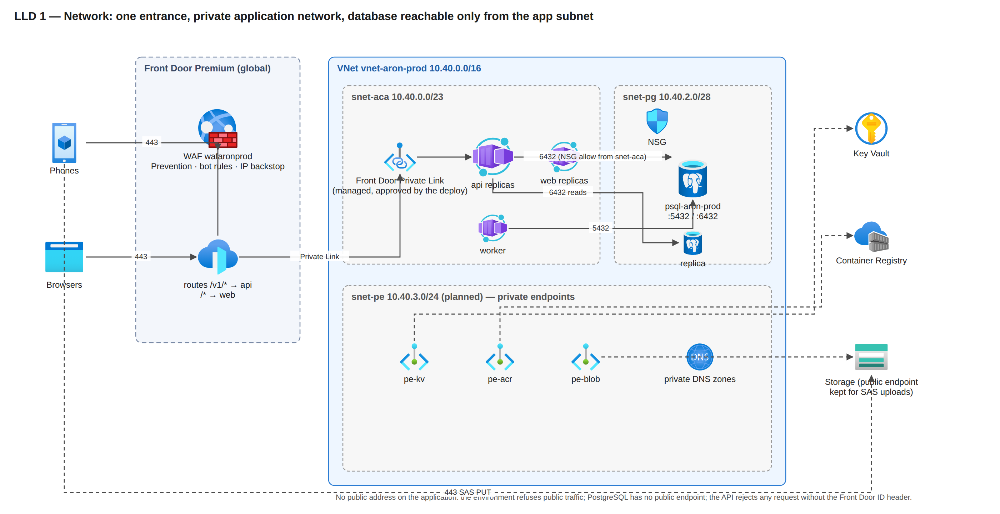
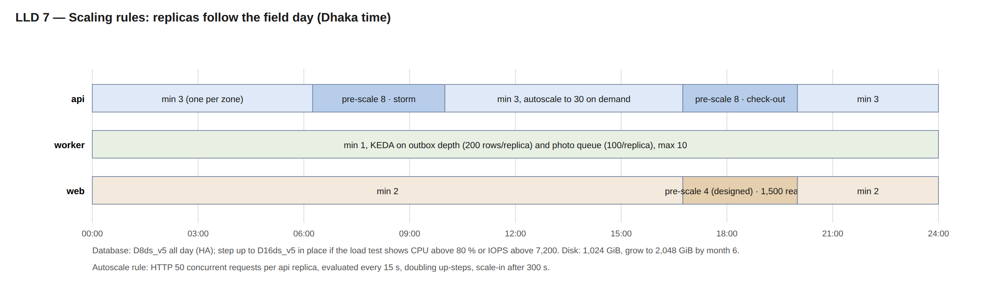
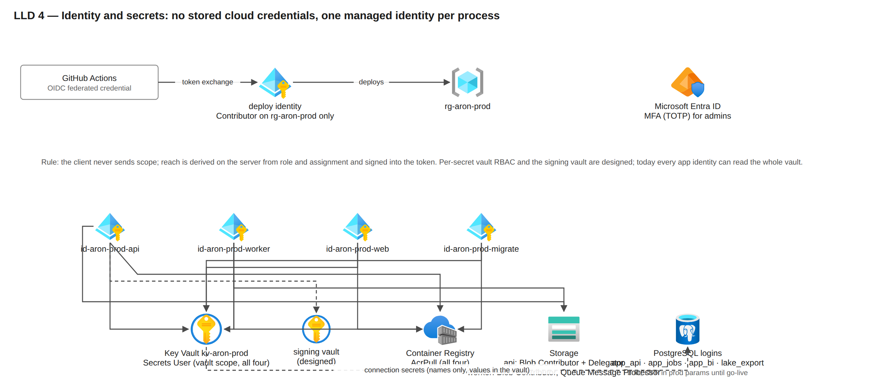
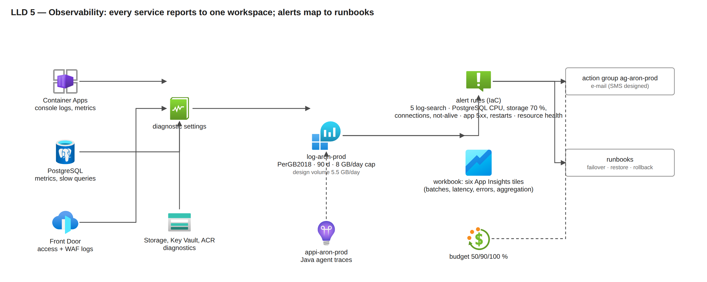

# 02 — Low-level design (LLD): every Azure resource, its settings and why

Part of the owner pack `docs/35-final-azure-design-pack/`. Each row names the resource as the production templates create it (`infra/main.bicep`, `infra/apps.bicep`, `infra/modules/*.bicep`, `infra/params/prod.bicepparam`, `infra/params/prod.apps.bicepparam`), the specification, a **short justification**, and whether it is in the templates (`IaC`) or `designed`. The monthly cost of every row is in `03-resource-plan-and-cost.md`; quantities and the "why this quantity" column are in `04-precise-version.md`. Names end in a six-character suffix derived from the resource group (`<s>`), omitted here except where the suffix sits in the middle of a name. Deeper evidence per setting is in `docs/33-final-azure-architecture/part-b-low-level-platform.md`. Corrected on 2026-10-29 after review against the templates.

---

## 1. Resource catalogue with specification and justification

| # | Resource (name) | Specification | Why this specification | Status |
|---|---|---|---|---|
| 1 | **Resource group** `rg-aron-prod` | one group per environment, Southeast Asia, tags `project=aron`, `environment=prod`, `owner=aktcl`, `managed-by=bicep` | one blast radius, one cost view, one RBAC boundary for the deploy identity | IaC (group created by bootstrap) |
| 2 | **Virtual network** `vnet-aron-prod` | `10.40.0.0/16`; `snet-aca 10.40.0.0/23` (delegated to Container Apps); `snet-pg 10.40.2.0/28` (delegated to PostgreSQL); stage `10.41`, dev `10.51`, DR `10.42` (moved from the `10.41` of `docs/18` because stage uses it) | a /23 gives 512 addresses for up to about 250 replica IPs during a revision swap; PostgreSQL needs its own delegated subnet for private access; distinct ranges allow peering later | IaC |
| 3 | **Network security groups** `…-snet-pg-nsg`, `…-snet-aca-nsg` | pg NSG, three rules: allow 5432/6432 from `snet-aca` (100), allow subnet-internal (110, HA replication), deny VirtualNetwork to PostgreSQL (4000); other sources fall to the platform default deny; aca NSG: Azure defaults | the database accepts connections only from the application subnet, which blocks lateral movement from any other workload placed in the VNet later | IaC |
| 4 | **Private DNS zone** `…private.postgres.database.azure.com` + VNet link | one zone, one link | required for private-access Flexible Server name resolution from the apps | IaC |
| 5 | **Container Apps environment** `cae-aron-prod` | workload-profiles environment, Consumption profile, **zone-redundant**, VNet-injected into `snet-aca`, `publicNetworkAccess Disabled`, peer traffic encryption on, Front Door Private Link connection (a managed private endpoint approved by the deploy script), `maxInactiveRevisions 5` | zone redundancy spreads replicas across three zones so one zone loss costs capacity, not availability; disabling public access means the only way in is Front Door's Private Link; Consumption billing means idle hours cost almost nothing | IaC |
| 6 | **Container App** `ca-aron-prod-api` | image `backend` by digest; **1 vCPU / 2 GiB**; JVM `-XX:MaxRAMPercentage=75` (heap ceiling about 1.5 GiB) and `ExitOnOutOfMemoryError`; min 3, max 30; HTTP scale rule 50 concurrent requests per replica; cron pre-scale to 8 replicas 06:15–10:00 and 16:45–20:00 Dhaka; revisions mode Multiple (previous revision kept at 0 % traffic); probes: startup `GET /v1/health` (delay 5 s, every 5 s, up to 30 failures, about 155 s), liveness (10 s, 3 failures), readiness `/v1/health/ready` (database only); env from Key Vault references; `ARON_FRONT_DOOR_ID` header check | 1 vCPU / 2 GiB is the smallest step that holds a Ktor JVM at 150–300 requests/s a vCPU; **min 3 = one replica per zone**; max 30 = 900 requests/s, 2.3 × the design-for storm; pre-scaling removes cold-start and JIT warm-up from the two daily storms; Multiple revisions give a seconds-fast rollback | IaC (the 50-concurrent trigger is to be calibrated in S1–S10) |
| 7 | **Container App** `ca-aron-prod-worker` | same image, role `worker`; 1 vCPU / 2 GiB; min 1, max 10; no ingress; jobs: aggregation from the outbox, risk signals, route-day planning, geo re-check sweep (every 10 min), retention and partition upkeep (every 6 h), outlet-request lapse; KEDA rules (PostgreSQL outbox depth, target 200 rows per replica; Storage queue length, 100 per replica) and the photo-queue consumer | aggregation is bursty (check-out) and must never run inside the request path; backlog-based scaling drains a 30-minute outage (38,000 rows) in about a minute at 10 replicas | IaC (1 replica, no scale rule); KEDA rules and the queue consumer designed |
| 8 | **Container App** `ca-aron-prod-web` | Next.js image; 0.5 vCPU / 1 GiB; min 2, max 6; HTTP rule 50 concurrent; its backend-for-frontend calls reach the api through Front Door (`ARON_API_BASE_URL` = the Front Door host), so they pass the WAF and the per-IP backstop from the environment's shared egress address | server-rendered pages are light; two replicas for zone spread; the portal audience is about 150 head-office users plus 291 TSOs (AMOs read in their app) | IaC (16:45 pre-scale designed; check the BFF rate against the 200 req/s per-IP backstop in S5) |
| 9 | **Container Apps Jobs** `caj-aron-prod-migrate`, `caj-aron-prod-dblogins` (+ export jobs designed) | migrate: Flyway image by digest, manual trigger, timeout 1,800 s, retry 0, runs **before** any app revision changes; dblogins: psql 16 image, timeout 300 s, creates the per-app logins; exports: concurrency 8, role `app_export`, results in Blob | migrations and login grants are run-to-completion steps that must not sit in a serving replica; large Excel exports (over 10,000 rows) must not starve the API | IaC (exports designed; today exports above 10,000 rows return 503) |
| 10 | **PostgreSQL Flexible Server** `psql-aron-prod` | PostgreSQL 16; **GeneralPurpose Standard_D8ds_v5** (8 vCores, 32 GiB); **zone-redundant HA** (primary zone 1, standby zone 2); **Premium SSD v2 1,024 GiB, 12,000 IOPS, 300 MB/s** (12,000 IOPS and 500 MB/s are included with a disk of 400 GiB or more; only IOPS above 12,000 would cost extra, and the D8 cap is 12,800), autogrow disabled (SSD v2 has none); backup retention 35 days, **geo-redundant**; built-in **PgBouncer** (transaction mode, `default_pool_size 20`, `query_wait_timeout 5 s`) on 6432; private access only; maintenance window Friday 01:00–02:00 Dhaka; extensions allow-listed: btree_gist, pgcrypto, pg_stat_statements, pg_trgm, PostGIS (PostGIS and pgcrypto are not used yet) | D8 is the first SKU whose IOPS cap (12,800) covers the 12,000 IOPS the write peaks need and whose 8 vCores hold the 8,000 rows/s gate with CPU under 80 %; zone-redundant HA gives RPO 0 and automatic failover; SSD v2 decouples size from IOPS so the disk is bought for a year's data, not for its IOPS; 1,024 GiB covers the first six months with the grow to 2,048 GiB planned at month 6 (any history loaded later is headroom; the Apsis migration itself is out of scope); 35-day PITR covers a month-end discovered late; geo backup is the wave-1 region-outage fallback; PgBouncer keeps 600 client connections to about 40 server connections | IaC |
| 11 | **PostgreSQL read replica** `psql-aron-prod-<s>-r1` | same SKU and disk, zone 3, asynchronous, own PgBouncer, own parameters | dashboards, reports, exports and BI read here, so readers never compete with 8,500 writers; the **same SKU** because WAL replay is single-threaded and a smaller replica falls behind at the 17:00 peak | IaC template; the pipeline cannot create it as it stands (the parameter defaults to true, nothing forwards `ARON_PG_READ_REPLICA`, and the what-if guard refuses a second server): fix before the first prod deploy (`docs/33` B13.2 rows 36, 37) |
| 12 | **Database** `aron` | UTF8, `en_US.utf8`; schemas `app` (operational tables and the config tables `app.cfg_*`), `dw` (aggregates and the stable `dw.v_*` views, contract 1.2), `stg` (imports); monthly partitions on the fact tables; the retention job creates the next three partitions and prunes the ingest registry at 45 days; migrations V0001–V0122 | one database keeps idempotency, money and scope rules transactional; partitions keep the hot set small and make retention a drop, not a delete | IaC + migrations |
| 13 | **Storage account** `staronprod` | StorageV2, **Standard_RAGZRS**, Hot; TLS 1.2; shared key off; public blob access off; CORS rule for browser uploads; containers `media` (photos under `photos/<business_date>/<device_uuid>/<media_uuid>.jpg`, support files, feedback), `bundles` (created; bundles are built live today), `exports` (report exports, deleted after 7 days); queue `media-events` (message TTL 7 days); soft delete 14 days; lifecycle: photos to Cool at 30 days, Cold at 90 days, **deleted at 730 days**; support files deleted at 30 days; bundles at 3 days. The Archive tier is not available on RA-GZRS | RA-GZRS keeps evidence photos readable even in a region outage (three zones plus a readable secondary region); the tiers cut the stored-data cost of photos by about 70 % (net about 24 % after the tier-move operations, see 03); SAS-only writes keep keys out of the apps | IaC (a WORM audit-export container with 7-year retention is designed) |
| 14 | **Data-lake account** `staronprodlake` | StorageV2, Standard_ZRS, hierarchical namespace, container `lake`, soft delete 14 days; nightly Parquet export of the `dw.v_*` views and archived partitions; worker identity only | BI and archive reads come from files, never from the live database; ZRS because the lake holds partitions past the 13-month hot window | IaC (the sponsor's written yes to ZRS is still open, `docs/28`; the writer is planned) |
| 15 | **Event Grid system topic** `evgt-aron-prod-storage` | `BlobCreated` on `media/photos/` → queue `media-events`; 30 delivery attempts, event TTL 24 h | at-least-once delivery with an idempotent consumer; no Service Bus (ingest is synchronous, photo events need no ordering) | IaC (the consumer is designed) |
| 16 | **Key Vault** `kv-aron-prod` | Standard; RBAC authorisation; soft delete 90 days; **purge protection on**; secrets (names only): `aron-jwt-signing-key`, `aron-jwt-kid`, `aron-mfa-key`, `aron-web-session-secret`, `aron-fcm-service-account`, `aron-play-integrity-service-account`, `aron-db-admin-password`, `aron-db-url` / `-direct-url` / `-read-url`, the per-app `aron-db-pw-app-*` and `aron-db-*-url`, the lake and BI secrets | purge protection makes a wrong delete recoverable for 90 days; Container Apps secret references mean the code has no vault client; a missing secret fails start-up naming only the variable | IaC (a separate signing vault with a non-exportable EC P-256 key and 24-hour per-replica delegations, an Argon2 pepper secret and per-secret RBAC are designed) |
| 17 | **User-assigned identities** `id-aron-prod-api`, `-worker`, `-web`, `-migrate` | all four: AcrPull and Key Vault Secrets User at vault scope; api: Storage Blob Data Contributor and Storage Blob Delegator on the account; worker: Storage Blob Data Contributor, Storage Queue Data Message Processor, and Blob Data Contributor on the lake account | one identity per process so a role can be tightened without touching the others; each app template references only its own secrets | IaC (per-secret vault RBAC designed; today every identity can read the whole vault) |
| 18 | **Container Registry** `craronprod` | **Premium**, zone-redundant, admin user off, untagged manifests purged after 30 days | Premium is the only tier with zone redundancy, private link and geo-replication; 500 GiB included | IaC (geo-replica to East Asia designed) |
| 19 | **Front Door profile** `afd-aron-prod` | **Premium_AzureFrontDoor**; endpoint `fde-aron-prod-<s>.azurefd.net` (custom domain when AKTCL names one); routes `/v1/*` → origin group `og-api`, `/*` → `og-web`; origins = the Container Apps environment over **Private Link**; probes `og-api` HEAD `/v1/health` every 60 s, 3 of 4 samples; `og-web` HEAD `/` every 100 s, 3 of 4; origin response timeout 60 s (the API answers in 25 s itself) | Premium is required for Private Link origins and the managed WAF rule sets; a global anycast edge terminates TLS close to Dhaka and absorbs volumetric attacks; one hostname for phones and browsers | IaC (APK route and caching designed) |
| 20 | **WAF policy** `wafaronprod` | mode **Prevention**; managed `Microsoft_DefaultRuleSet 2.1` in **Log** action for the first wave, then Block; `Microsoft_BotManagerRuleSet 1.1`; exactly two custom rules: per-IP rate backstop 60,000 requests / 5 min and a method allow-list; request-body check on; gzip bodies are not inspected; the 1 MiB compressed / 8 MiB decompressed batch limit is enforced by the API, not the WAF | real sync payloads must be observed before managed rules block them (a false positive on `/v1/sync` would stop uploads); the IP backstop is high because carrier NAT puts thousands of phones behind one address, so the real limits are per device and per user inside the API | IaC |
| 21 | **Log Analytics workspace** `log-aron-prod` | PerGB2018; retention **90 days**; daily cap **8 GB**; diagnostic settings from Key Vault, ACR, PostgreSQL, Container Apps environment, Front Door (access + WAF), Storage blob and queue, the lake | 90 days covers a quarter-end investigation; the cap protects the bill from a logging bug; design volume 5.5 GB/day | IaC (an alert at 80 % of the cap is designed) |
| 22 | **Application Insights** `appi-aron-prod` | workspace-based, Java agent 3.7.10 pinned by hash in the image; release annotations after each deploy | traces and dependency timings without code changes; annotations line up incidents with releases | IaC |
| 23 | **Alert rules and action group** `ag-aron-prod` | **IaC:** five log-search alerts: `batch5xx` (more than 1 % 5xx on `/v1/sync/batch` in 5 min, Sev1), `batchP95` (p95 above 3 s, Sev2), `dashboardsP95` (above 1 s, Sev3), `syncErrors` (Sev2), `aggregationStuck` (3 or more worker errors in 15 min, Sev2); PostgreSQL metric alerts: CPU above 80 % for 15 min, storage above 70 %, failed connections, server not alive (Sev1); app alerts: api 5xx, restarts, no replica; Resource Health and recovery; budget 50/90/100 %; e-mail receivers. **Designed:** replication lag 5/12 min, Front Door origin health, WAF blocks on `/v1/sync`, sync success, aggregation lag (metric not emitted yet), storage 60 % and 90 %, Log Analytics cap at 80 %, Service Health (needs subscription Reader), SMS and voice | each alert maps to a runbook; thresholds come from the capacity table so an alert means "act now" | IaC + designed as listed |
| 24 | **Workbook** "Aron operations" | six Application Insights tiles: sync batches per 5 min (total and 5xx), batch latency p50/p95, errors by logger, aggregation failures, slowest endpoints (p95), latest errors | one screen for the war room during rollout waves | IaC (database, edge/WAF, cost and quota workbooks designed) |
| 25 | **Budget** `budget-aron-prod` | **USD 7,000 a month** in the template; alerts at 50, 90, 100 % actual and 100 % forecast; raise to the recommended figure in 03 once the DR tier and the buffer are approved | an early warning that is independent of any alert rule | IaC |
| 26 | **GitHub OIDC deploy identity** | federated credential for the `azure-prod` environment; roles on the resource group only: Contributor, AcrPush, Key Vault Secrets Officer, Role Based Access Control Administrator (scoped) | no stored cloud credentials anywhere; the pipeline cannot touch other groups | IaC (bootstrap) |

### Designed, not yet in a template (DR tier and hardening)

| Resource | Specification | Why | When |
|---|---|---|---|
| Cross-region replica `psql-aron-prod-dr` (East Asia) | D8ds_v5, same disk tier, asynchronous; lag alerts at 5 and 12 minutes | RPO 15 min, RTO 4 h for a region outage without a second writer | before wave 2 |
| Warm environment `cae-aron-dr` (East Asia) | zone-redundant, VNet `10.42.0.0/16`, apps at 0 replicas, same images and secrets | promotion in under 4 h needs the environment to exist already | before wave 2 |
| ACR geo-replica, DR Key Vault, DR Front Door origin (disabled; readiness requires `pg_is_in_recovery() = false`) | | pulls and secrets available when Southeast Asia is not | before wave 2 |
| Private endpoints for Key Vault, ACR, Blob (`snet-pe 10.40.3.0/24`) | three endpoints, private DNS zones | closes the last public endpoints; SAS uploads from phones stay on the public Blob endpoint by design | hardening after wave 1 |
| Signing vault `kv-aron-sign`, PII key vault, per-secret RBAC, Argon2 pepper | non-exportable EC P-256 key, `sign` only; envelope-encryption keys for NID, TIN and trade licence | a key that cannot leave the vault; a web replica that cannot read the database secret | before wave 2 |
| WORM audit-export container, 7-year retention | immutable daily export of the hash-chained audit log | tamper-evident record | before wave 2 |
| Worker KEDA rules, photo-queue consumer, nightly photo sweep, export jobs, pre-generated bundles | see rows 7, 9 and 15 | the first items to prove or build in the final account | before wave 1 |
| Staging-lite parameter file; `deploy.sh` and `Settings.kt` accepting `stage` | D2 HA, Standard Front Door; prod shape only inside a test window | the release gate and the drills need a deployable twin | before the load-test windows |
| Azure Policy, resource locks, Defender for Cloud | deny public PostgreSQL, deny non-ZRS storage, CanNotDelete locks on data | subscription-scope guard rails the final-account owner applies once | at the move |
| Azure Load Testing resource | 26 engines for 12,750 virtual users (40 requested); Locust scripts S1–S10 | the 8,500-user proof | final account only |

## 2. Network design

*Figure LLD 1. One entrance; the application network has no public address; the database is reachable only from the app subnet. The `snet-pe` endpoints are planned.*

| Item | Setting | Why |
|---|---|---|
| Address plan | prod `10.40.0.0/16`, stage `10.41.0.0/16`, dev `10.51.0.0/16`, DR `10.42.0.0/16` | non-overlapping so peering or a hub is possible later; DR moved to `10.42` because stage already uses `10.41` |
| Ingress | only Front Door → managed Private Link → environment; environment `publicNetworkAccess Disabled` | a leaked origin address is useless to an attacker: the environment refuses anything that does not arrive over the Private Link |
| East-west | NSG on `snet-pg` (three rules, row 3); the environment encrypts peer traffic | a compromised replica of another workload could not open a database socket |
| Egress | Container Apps default outbound (platform SNAT) to Azure services (Key Vault, Blob, ACR, Event Grid), to Front Door for the BFF, and to Firebase; no NAT gateway unless a partner needs a fixed IP | nothing in the design needs an allow-listed source address |
| DNS | private zone for PostgreSQL; Azure-provided DNS otherwise; private zones for the planned endpoints | private resolution without a custom resolver |
| TLS | TLS 1.2 minimum at Front Door, Storage and PostgreSQL (`require_secure_transport on`); managed certificate on the custom domain when named | no plaintext anywhere |
| Header pinning | the API returns 403 unless `X-Azure-FDID` equals the profile id (health endpoints excepted for probes) | even a request that reaches the origin by another path is refused |

## 3. Edge design (Front Door and WAF)

| Setting | Value | Why |
|---|---|---|
| Origin groups | `og-api`: HEAD `/v1/health` over HTTPS every 60 s, 3 of 4 samples healthy, latency sensitivity 50 ms; `og-web`: HEAD `/` every 100 s, 3 of 4 | separate health so a web issue never fails over API traffic |
| Routes | `/v1/*` → api, HTTPS only, HTTP redirected; `/*` → web; `/apk/*` → Blob (designed) | one hostname; the APK channel from the edge once the container exists |
| Timeouts | origin response 60 s; the API's own request timeout is 25 s | the API always answers first with its own JSON envelope, so phones never see an edge HTML error for a slow request |
| Rate limits | WAF custom rule: 60,000 requests / 5 min per IP (backstop); API: per device and per user limits, in-flight limiter per replica, 429 "too fast" and 503 "shedding", both retryable | per-IP limits would punish whole carriers; the real protection is per device inside the API |
| Managed rules | DRS 2.1 in Log for the first wave on real payloads, then Block; Bot Manager 1.1 | avoid blocking legitimate sync bodies before they have been observed |
| Body limit | API: 1 MiB compressed, 8 MiB decompressed (a batch is at most 200 rows, about 12 KB gzip); the WAF does not inspect gzip bodies | anything larger than a batch is not a phone |
| Egress billing | edge-to-client bytes are billed on cache hits too; the billing zone is that of the serving edge (zone 2 assumed; Indian edges are zone 5) | caching the APK does not save egress; it only saves origin load |
| Logging | access and WAF logs to Log Analytics | every blocked request is reviewable |
| Propagation | about 15 minutes per configuration change | the deploy script waits up to 45 minutes on the `azurefd.net` host before smoke |

## 4. Compute design (Container Apps)

### 4.1 Request pipeline in `api`

Every request passes, in order: the Front Door id check; the per-replica in-flight limiter; authentication (token verification, device binding, role); scope derivation (reach from role and assignment, never from the client); validation (envelope, units, money in milli-taka, business date in Asia/Dhaka); one transaction through PgBouncer on 6432; the outbox event and the stored response; the JSON envelope with `X-Config-Version` and the request id.

### 4.2 Replica profile over a trading day

*Figure LLD 7. The api follows the field day; the worker scales on backlog once its rules exist; the web pre-scale at 16:45 is designed.*

| App | Setting | Value | Why |
|---|---|---|---|
| api | resources | 1 vCPU, 2 GiB; JVM `MaxRAMPercentage=75` (heap ceiling about 1.5 GiB), `ExitOnOutOfMemoryError`; no explicit collector flag (verify with `-Xlog:gc` at the first load test) | one vCPU per replica scales in small steps; about 0.5 GiB stays for metaspace and threads |
| api | scale rule | HTTP 50 concurrent requests per replica (deployed); design rule 30 requests/s per replica; evaluated every 15 s; up-step doubles; scale-in after 300 s | fast out, slow in, designed to damp flapping; the concurrency value is calibrated in S1–S10 |
| api | pre-scale | cron 06:15–10:00 and 16:45–20:00 → 8 (lever: 12 on wave mornings, about USD 45 a month if used on 20 mornings) | removes JIT and cold start from the storms |
| api | probes | startup `GET /v1/health` delay 5 s, every 5 s, up to 30 failures (about 155 s); liveness every 10 s, 3 failures; readiness `/v1/health/ready` database only | a database hiccup marks replicas unready, never restarts them |
| api | revisions | Multiple; previous revision 0 % traffic; health gate in the deploy moves traffic back on failure | rollback in seconds |
| api | pools | 10 write (primary 6432) + 10 read (replica 6432) per replica; PgBouncer transaction mode; no named prepared statements; `SET LOCAL` inside transactions only | 600 clients at max fit in 40 server connections |
| worker | scale | min 1, max 10; KEDA postgresql (outbox rows / 200) and azure-queue (messages / 100) designed; deployed today with no rule (1 replica) | backlog, not HTTP, is the signal |
| worker | polling | own queue every 5 s; KEDA polls every 30 s | trickle backlog stays near zero |
| web | resources | 0.5 vCPU, 1 GiB; Node.js; BFF calls the api through Front Door | no public API calls from the browser; the BFF is subject to the WAF and the per-IP backstop |
| jobs | migrate | runs first in every deploy; a failed migration stops the deploy before any revision changes | schema and code never diverge |
| all | images | pulled by digest from the Premium registry with the app identity (AcrPull) | no `latest`, no credentials |
| all | secrets | Key Vault references → environment variables (or `<NAME>_FILE`) | the code has no vault client; a missing secret fails start-up naming only the variable |

### 4.3 Capacity quota to request in the final subscription

| Quota | Request | Arithmetic |
|---|---|---|
| Container Apps Consumption cores, prod environment | 100 | replica maxima api 30 + worker 10 + web 3 + migrate 0.5 = 43.5 vCPU (51 with the designed export jobs); a revision swap briefly adds up to 30 → 100 / 73.5 = 1.4 × |
| Container Apps cores, stage environment | 100 during test windows | same shape |
| Managed environments | Southeast Asia: prod + stage = 2; East Asia: DR = 1 | one per environment and region |
| PostgreSQL General Purpose Ddsv5 vCores, Southeast Asia | 40 (prod alone) or 64 (stage in the same subscription) | prod 8 primary + 8 standby + 8 replica = 24; a restore-drill server 8; stage 8 + 8 + 8 in a test window; zonal access to be requested with it |
| PostgreSQL vCores, East Asia | 24 | replica 8; after promotion 8 + 8 standby |
| Azure Load Testing engines | 40 concurrent, 40 per run, 24 h test duration | 26 engines at 12,750 users; 30 at 1.5 × 9,842 app users |

## 5. Database design

| Area | Setting | Why |
|---|---|---|
| Server parameters (IaC) | PgBouncer enabled, `default_pool_size 20`, `query_wait_timeout 5`; `log_min_duration_statement 500 ms`; `track_io_timing on`; `idle_in_transaction_session_timeout 30 s`; Query Store capture `top`; extensions allow-listed (row 10) | protects the primary from runaway sessions; gives the war room query evidence |
| Server parameters (designed) | `work_mem 16 MB`, `maintenance_work_mem 512 MB`, `wal_compression on`, `pg_stat_statements.track`, `max_connections` and autovacuum tuning after the first load test | set once the load test shows the real profile |
| Statement timeouts (migration V0020, per role) | api 15 s, web 60 s, worker 10 min, jobs 30 min, BI 10 min | a runaway query cannot hold a pool slot |
| HA | zone-redundant, synchronous standby, automatic failover; the application reconnects through the same hostname; failover drill RB-02 (one run on dev, about 30 s user-visible) | RPO 0 and an exercised path |
| Connection pooling | built-in PgBouncer, transaction mode, 20 server connections per login and database; api on 6432; worker, migrate and jobs on 5432 | ten thousand phones must not become ten thousand server connections |
| Logins and privileges | `aronadmin` (deploy); per-app logins `app_api`, `app_jobs` (used by the worker), `app_bi` (read on `dw.v_*` only), `lake_export`, created by the dblogins job with passwords in Key Vault; **`dbPerAppLogins` is off in the prod parameters**, so api and worker connect as `aronadmin` until the owner flips it before the first real user; row-level security designed | least privilege; a BI credential can never see raw PII |
| Schemas | `app` (operational tables, config tables `app.cfg_*`, audit, device registry), `dw` (aggregates and 8 stable `dw.v_*` views, contract 1.2), `stg` (imports) | the `dw` layer is the reusable product for later dashboards |
| Idempotency | unique index on every client UUID; `sync_batch.response` stores the ack; a repeat of the same `batch_uuid` within 24 h replays the stored response | a retried or duplicated upload never creates a second sale |
| Partitioning and retention | monthly partitions on visits, memos, lines, attendance, locations; the next three partitions created ahead every 6 h; ingest registry pruned at 45 days; `app` hot window 13 months, `dw` 25 months; archived partitions exported to the lake (writer planned) | keeps the hot set and the indexes inside RAM; retention is a partition drop |
| Money, units, dates | money integer milli-taka; quantities in base units with `pack_factor`; `timestamptz` UTC plus `business_date` in Asia/Dhaka on every transaction | no floating-point money, no time-zone bugs at midnight |
| Geo | lat/lng index plus haversine distance in the api; server geo re-check sweep in the worker every 10 min; PostGIS allow-listed for later | the same arithmetic as the device, re-checked on sync |
| Backup and restore | PITR 35 days, geo-redundant; restore always to a **new** server; server-generation re-sync tells phones to re-send rows acknowledged after the restore point; verification checklist (counts, control totals, audit chain, memo gaps) after every restore | data loss is bounded and visible, and the phones heal the gap |
| Growth | 2.8 GB a day; alert at 70 % in IaC (60 % and 90 % designed); grow to 2,048 GiB at month 6 online on primary, replica and DR replica | SSD v2 has no autogrow and the server goes read-only at 95 % |
| Maintenance | custom window Friday 01:00–02:00 Dhaka (the weekly off day); Azure may still apply emergency patches outside it | patches never land on a trading morning by plan |
| Step-up rule | D16ds_v5 (16 vCores, 64 GiB, cap 25,600 IOPS) when the load test or two consecutive peaks show CPU above 80 % or IOPS above about 7,700 (60 % of the D8 cap); compute scales in place with one short failover | the next step is a parameter change, not a redesign |

## 6. Storage design

| Container / queue | Content | Access | Lifecycle | Why |
|---|---|---|---|---|
| `media` | photos `photos/<business_date>/<device_uuid>/<media_uuid>.jpg`, support bundles, feedback and portal JPEGs | phones write with one-blob, write-only SAS (10 per request); api and worker read with identity | Cool 30 d → Cold 90 d → deleted 730 d; support files deleted 30 d; soft delete 14 d | evidence must survive two years, cheaply |
| `bundles` | daily route bundles (gzip) | api (writer planned; bundles are built live today) | deleted after 3 days | a bundle is only valid for its day |
| `exports` | report exports | export jobs (designed) | deleted after 7 days | results are collected within the week |
| `audit-export` (designed) | daily hash-chained audit export | worker writes once; immutable (WORM), 7-year retention | none | tamper-evident record |
| `apk` (designed) | signed per-ABI APKs for the in-house channel | Front Door cached reads; SHA-256 verified on the phone | old releases kept 90 days for a rescue release | 8,500 phones update from the edge, not from Play |
| queue `media-events` | BlobCreated events | Event Grid writes; worker reads (consumer designed) | message TTL 7 d; event TTL 24 h, 30 attempts | decoupled photo linking |

## 7. Identity, access and secrets

*Figure LLD 4. No stored cloud credentials; one managed identity per process; the signing vault and per-secret RBAC are designed.*

Human access: portal roles Super Admin, Admin (per-module grants), National, Brand, Wing Manager, DMO, TSO; admins log in with password + TOTP MFA; every admin action writes an audit row. Azure access: the final-account owner is Owner at the subscription; the team gets Reader plus the deploy pipeline; no standing Contributor for people.

## 8. Observability and alerting

*Figure LLD 5. Every service reports to one workspace; the alerts in the templates are listed in row 23, the designed ones beside them.*

| Signal | Source → sink | Alert (IaC unless marked) |
|---|---|---|
| Sync batch 5xx and latency | api JSON log lines; App Insights requests | `batch5xx` > 1 % in 5 min → Sev1; `batchP95` > 3 s → Sev2 |
| Dashboards | App Insights | `dashboardsP95` > 1 s → Sev3 |
| Sync errors, aggregation | api and worker logs | `syncErrors` → Sev2; `aggregationStuck` (3 worker errors in 15 min) → Sev2; aggregation-lag metric alert designed |
| Database | platform metrics | CPU > 80 % for 15 min → Sev2; storage > 70 %; failed connections; server not alive → Sev1; replication lag 5/12 min designed; storage 60 % and 90 % designed |
| Apps | Container Apps metrics | api 5xx, restarts, no replica |
| Edge | Front Door access + WAF logs | origin health and WAF-block alerts designed |
| Platform | Resource Health (and recovery); Service Health designed (needs subscription Reader) | any → Sev2 |
| Cost | budget | 50/90/100 % → e-mail |
| Business | sync-health dashboard reads PostgreSQL, not logs | a log cap can never blind the war room |

Telemetry budget: about 5.5 GB a day (request lines about 300 B each × 0.5 M, platform diagnostics, sampled traces); cap 8 GB; retention 90 days.

## 9. Delivery pipeline

Promotion to production is from a `server-vX.Y.Z` tag through `promote-prod.yml` with the same steps against the `prod` parameters, after staging has run the release for one trading day (once staging is deployable). Rollback paths: traffic switch (seconds), redeploy by digest (8–15 min), PITR for a bad migration (restore to a new server, never in place). Figure LLD 6 is in `01-high-level-design.md` section 10.

## 10. Operations: runbooks and drills

| Runbook | Trigger | Steps (summary) | Status | Drill cadence |
|---|---|---|---|---|
| RB-02 database failover | zone loss or planned | observe automatic promotion; confirm readiness; check PgBouncer pools; record RTO | written; drilled once on dev (about 30 s) | monthly on staging |
| RB-14 point-in-time restore | bad migration or data corruption | restore to a new server at time T; verification checklist; repoint secrets; mint a server generation; phones re-send; keep the old server read-only 7 days | written; never run (waits for the owner's phrase) | monthly on staging |
| RB-13 region outage | Service Health + probes agree for 15 min | forced promotion of the East Asia replica; new generation; scale the warm environment; enable the DR origin; reconcile | not yet written | twice a year and before wave 2 |
| RB-52 geo-restore (before the DR tier) | region outage before the replica exists | geo-restore into East Asia (RPO about 1 h); then as RB-13 | not yet written | timed once on staging before wave 1 |
| Rollback bad deploy | health gate fails or Sev1 after release | traffic to the previous revision; redeploy by digest | written; every deploy exercises the gate; no manual drill yet | every release |
| Disk grow | 70 % alert | grow SSD v2 online to 2,048 GiB on primary, replica and DR replica | designed | once at month 6 |
| Kill switch | bad app build | `min_version` blocks a new day's login; `blocked_versions` blocks new captures; uploads of captured rows are never blocked | built; tested in the device lab | per release |

Of about 54 runbooks in the plan, four are written (RB-01, RB-02, RB-14, rotate-mfa-key); the rest are designed.

## 11. Moving from the test account to the final account

1. Final-account owner: subscription, resource groups `rg-aron-stage` and `rg-aron-prod`, quota requests (section 4.3), Azure Policy and locks, the deploy identity's federated credential, GitHub environment variables (`AZURE_LOCATION`, `AZURE_RESOURCE_GROUP`, `ARON_ALERT_EMAILS` to a monitored address, `ARON_NAME_SUFFIX`).
2. Prerequisite fixes before the first prod deploy: a staging-lite parameter file and `stage` accepted by `deploy.sh` and `Settings.kt`; the read-replica creation path (`ARON_PG_READ_REPLICA` forwarded, what-if guard exception); `dbPerAppLogins` flipped to true before the first real user; the worker scale rule.
3. Pipeline: deploy `stage`, run the slice smoke, run the load-test windows S1–S10 against staging scaled to the prod shape, run the failover and restore drills, record the measured RTO and RPO.
4. Deploy `prod` (first deploy without the replica, second with it after the first backup), seed reference data and users, enrol the pilot phones; run the pilot with the managed WAF rules in Log mode to prove the edge path on real traffic.
5. Waves: pilot → wave 1 → DR tier built → wave 2 → 3 → 4, each behind the next-wave gate.
Details and the exact commands: `docs/setup/move-to-final-account.md`.

## 12. Known gaps at 2026-10-29 (from `docs/33` B13.2)

| Gap | Severity | Section | Owner |
|---|---|---|---|
| Per-app database logins off in the prod parameters (api and worker run as the admin login) | high | 5 | owner flips before the first real user |
| Staging not deployable (parameter file prod-shaped; `stage` not accepted by the deploy path) | high | 10 | infra lane |
| No DR tier in a template | high | 1 | infra lane, before wave 2 |
| Photo-queue consumer and nightly sweep not built (photo rows stay pending) | high | 6 | backend lane, before wave 1 |
| JWT signing key exportable (a secret, not a vault key) | high | 7 | backend + infra, before wave 2 |
| No row-level security in PostgreSQL (application-level scope only) | medium | 5 | db lane |
| E-mail-only paging | medium | 8 | owner decision (SMS/voice) |
| Four of about 54 runbooks written | medium | 10 | lead |
| Read-replica creation path blocked by the pipeline | high | 1 | infra lane, before the first prod deploy |
| Worker runs one replica with no scale rule | medium | 4 | infra lane, before wave 1 |
