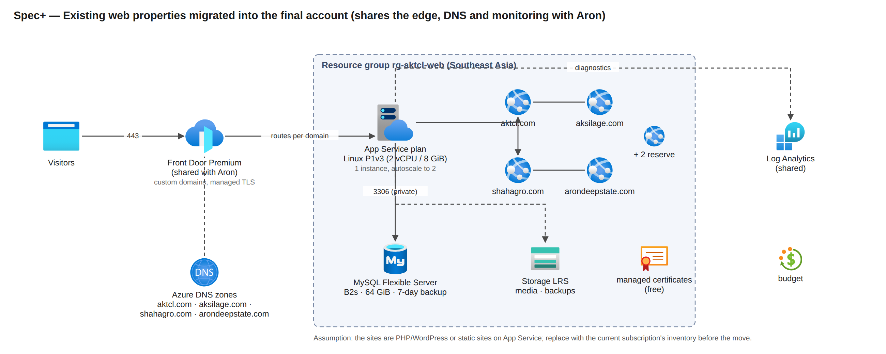

# 04 — Precise version: diagrams, resources with quantity and justification, monthly cost

Part of the owner pack `docs/35-final-azure-design-pack/`. This is the short, exact version: the high-level and low-level diagrams drawn with Microsoft's Azure architecture icons, one resource table with the specification, the quantity, why that specification, why that quantity and the monthly cost, the disaster-recovery tier, the contingency buffer, and a separate table for the existing web properties that move into the same account (Spec+). Every figure comes from `cost-model.py` (Azure Retail Prices API, 2026-10-29, Southeast Asia). The long explanations are in documents 01 to 03.

## 1. High-level design diagrams

*HLD 1 — System context. 9,842 field users on Android phones and about 150 portal users reach one platform through Front Door; photos go straight to Blob; Google Maps, Firebase and GitHub are outside Azure.*

*HLD 2 — Logical architecture. Edge, application tier (api, worker, web, jobs), data tier (PostgreSQL with a read replica, Blob and queue, Key Vault) and operations.*

*HLD 3 — Azure deployment in the final account: one resource group in Southeast Asia with a private application network, and the East Asia DR tier (designed).*

*HLD 4 — Availability and disaster recovery: zone loss is automatic (RPO 0), data loss is a 35-day point-in-time restore, region loss is a DR promotion (RPO 15 min, RTO 4 h) once the East Asia tier exists.*

## 2. Low-level design diagrams

*LLD 1 — Network: Front Door's Private Link is the only entrance; the database subnet accepts only the app subnet on 5432/6432; the private endpoints for Key Vault, registry and Blob are planned.*

*LLD 2 — The critical path: a sale captured offline, one gzip batch, one short transaction idempotent by client UUID, asynchronous aggregation, the dashboard.*

*LLD 3 — Photo pipeline: SAS upload straight to Blob, Event Grid to a queue; the worker consumer is planned.*

*LLD 4 — Identity and secrets: GitHub OIDC for deploys, one managed identity per process, Key Vault references.*

*LLD 5 — Observability: every service reports to one Log Analytics workspace; alerts map to runbooks.*

*LLD 6 — Delivery: digest-pinned images, migrations first, a health gate before traffic moves.*

*LLD 7 — Scaling rules over the field day (Dhaka time).*

## 3. Resource table: specification, quantity, why, monthly cost

| # | Resource | Specification | Quantity | Why this specification | Why this quantity | USD / month |
|---|---|---|---|---|---|---:|
| 1 | **PostgreSQL Flexible Server primary `psql-aron-prod`** | General Purpose D8ds_v5 (8 vCore, 32 GiB), PostgreSQL 16, zone-redundant HA, Premium SSD v2 1,024 GiB at 12,000 IOPS / 300 MB/s (included with the disk size), PITR 35 days, geo-redundant backup, built-in PgBouncer | 1 server = 2 nodes (primary zone 1 + synchronous standby zone 2) | D8 is the first SKU whose 12,800 IOPS cap and 8 vCores hold the 17:00 write peak (4,500 rows/s) and the 8,000 rows/s load gate under 80 % CPU; SSD v2 gives 12,000 IOPS free with a 1,024 GiB disk | One system of record keeps idempotency, money and scope transactional; the standby is what makes a zone loss a 60-120 s blip with zero data loss (RPO 0) | 1,829 |
| 2 | **PostgreSQL read replica `psql-aron-prod-<s>-r1`** | same SKU and disk as the primary, zone 3, asynchronous, no HA, own PgBouncer | 1 | The same SKU because WAL replay is single-threaded and a smaller replica falls behind at the 17:00 peak | One replica serves the 150 queries/s read budget with 3x headroom; a second would only isolate BI later | 854 |
| 3 | **Container App `ca-aron-prod-api`** | 1 vCPU / 2 GiB per replica (JVM heap ceiling about 1.5 GiB); HTTP scale rule 50 concurrent requests per replica; cron pre-scale 06:15-10:00 and 16:45-20:00 Dhaka; Multiple revisions; startup, liveness and readiness probes | 3 to 30 replicas (8 pre-scaled in the storms; about 5 on average) | 1 vCPU / 2 GiB is the smallest step that holds a Ktor JVM at 150-300 requests/s; small steps scale finely | 3 = one replica per availability zone; 8 pre-scaled covers the expected 131 requests/s with 1.8x; 30 = 900 requests/s, 2.3x the design-for storm of 400 | 662 |
| 4 | **Container App `ca-aron-prod-worker`** | 1 vCPU / 2 GiB; no ingress; outbox aggregation, risk signals, route-day planning, geo re-check sweep, retention; KEDA rules on outbox depth and photo queue designed | 1 to 10 replicas (deployed: 1 and no scale rule; costed at 2) | Aggregation is bursty (17:00) and must not run inside the request path | 1 steady replica drains the trickle; 10 drain a 30-minute backlog (38,000 rows) in about a minute once the KEDA rules exist | 221 |
| 5 | **Container App `ca-aron-prod-web`** | 0.5 vCPU / 1 GiB; Next.js dashboard and portal; its server-side calls reach the api through Front Door | 2 to 6 replicas (costed at 3) | Server-rendered pages are light; half a vCPU per replica is enough | 2 for zone spread; 6 gives 2x on the pessimistic 25 pages/s reader load | 166 |
| 6 | **Container Apps Jobs `caj-aron-prod-migrate`, `caj-aron-prod-dblogins` (+ export jobs designed)** | run-to-completion jobs: Flyway migrations before any revision change; per-app database logins; large exports | 2 jobs defined (+ exports designed); about 60 vCPU-hours a month | Migrations and grants must finish before code changes; they do not belong in a serving replica | One job per task; they run only when invoked | 9 |
| 7 | **Container Apps environment `cae-aron-prod`** | workload-profiles environment, Consumption profile, zone-redundant, VNet-injected, public access off, Front Door Private Link connection | 1 | Zone redundancy spreads replicas over three zones; disabling public access leaves Front Door as the only way in | One environment per region and environment; the DR region gets its own | 175 |
| 8 | **Front Door Premium `afd-aron-prod` + WAF policy `wafaronprod`** | Premium tier (Private Link origins, managed rule sets), WAF in Prevention with managed rules in Log for the first wave, custom rules: IP backstop 60,000 / 5 min and method allow-list; origin timeout 60 s; probes HEAD /v1/health every 60 s | 1 profile, 1 endpoint, 2 origin groups, 2 routes, 1 WAF policy | Only Premium can reach a private origin and run the managed firewall rules; the edge terminates TLS close to Dhaka | One entrance for phones and browsers; a second route only for the APK channel | 403 |
| 9 | **Storage account `staronprod` (Blob + queue)** | StorageV2 Standard_RAGZRS Hot; containers media (photos), bundles, exports (7-day expiry); lifecycle photos Cool 30 d, Cold 90 d, delete 730 d; soft delete 14 d; queue media-events (message TTL 7 d) | 1 account, 3 containers, 1 queue | Read-access geo-zone-redundant keeps evidence photos readable through a zone or region loss; lifecycle tiers cut stored-data cost by about 70 % | One account is within the 40,000 requests/s limit by a wide margin; a second account only for a separate APK/content channel later | 530 |
| 10 | **Data-lake account `staronprodlake`** | StorageV2 Standard_ZRS with hierarchical namespace, container lake, soft delete 14 d; nightly Parquet export of the dw views (writer planned) | 1 | BI and archived partitions are read from files, not from the live database | One lake per environment | 5 |
| 11 | **Container Registry `craronprod`** | Premium, zone-redundant, 500 GiB included, untagged manifests purged after 30 days | 1 (+1 geo-replica in DR) | Only Premium is zone-redundant and can geo-replicate so image pulls survive a region loss | One registry per subscription is enough; images are pulled by digest | 51 |
| 12 | **Key Vault `kv-aron-prod`** | Standard, RBAC, soft delete 90 d, purge protection on; secrets referenced by the Container Apps; JWT signing key as a secret (signing vault with a non-exportable key designed) | 1 (+1 signing vault designed) | Purge protection makes a wrong delete recoverable for 90 days; references keep vault clients out of the code | One vault per environment; the signing key gets its own later | 6 |
| 13 | **Log Analytics `log-aron-prod` + Application Insights `appi-aron-prod` + alerts + workbook** | PerGB2018, 90-day retention, 8 GB/day cap; diagnostics from every service; Java agent traces; 5 log-search alerts, PostgreSQL and app metric alerts, resource-health alerts, e-mail action group; one workbook | 1 workspace, 1 App Insights, about 15 alert rules, 1 workbook, 1 action group | 90 days covers a quarter-end investigation; the daily cap bounds the bill if a logging bug appears | One workspace keeps queries simple; a second (sync) workspace is designed | 552 |
| 14 | **Event Grid system topic `evgt-aron-prod-storage`** | BlobCreated on media/photos to the queue, 30 attempts, event TTL 24 h | 1 | At-least-once delivery with an idempotent consumer; no Service Bus needed | One topic per storage account | 3 |
| 15 | **VNet `vnet-aron-prod`, 2 NSGs, private DNS zone (+ 3 private endpoints planned)** | 10.40.0.0/16; snet-aca /23 (Container Apps); snet-pg /28 (PostgreSQL) with NSG allow 5432/6432 from snet-aca and subnet-internal; private DNS for PostgreSQL | 1 VNet, 2 subnets (+1 planned), 2 NSGs, 1 DNS zone, 4 managed identities | A /23 holds up to 250 replica addresses during a revision swap; the database subnet is reachable only from the app subnet | One network per environment with non-overlapping ranges so environments can be peered later | 26 |
| 16 | **Budget `budget-aron-prod`, Cost Management, tags, GitHub OIDC deploy identity** | USD 7,000 (raise with DR and buffer) with alerts at 50/90/100 % actual and 100 % forecast; daily cost report | 1 | An early warning independent of any alert rule | One budget per environment | 0 |

**Core total: about USD 5,490 a month** (list prices, 730-hour month, Southeast Asia). Includes about USD 28 for items designed but not yet in a template (private endpoints, signing vault, export jobs).

### 3.1 Disaster-recovery tier (designed; built before rollout wave 2)

| # | Resource | Specification | Quantity | Why this specification | Why this quantity | USD / month |
|---|---|---|---|---|---|---:|
| 1 | **PostgreSQL cross-region replica, East Asia** | D8ds_v5, SSD v2 1,024 GiB (12,000 IOPS included), asynchronous; promoted only in a region outage | 1 | Same SKU as the primary so replay keeps up with the 17:00 WAL burst | One replica gives RPO 15 min / RTO 4 h without a second writer | 939 |
| 2 | **Inter-region replication traffic** | WAL stream Southeast Asia to East Asia | about 190 GB a month |  |  | 15 |
| 3 | **Container Apps environment East Asia (warm, apps at 0)** | zone-redundant, VNet 10.42.0.0/16, Private Link, api/worker/web at 0 replicas until promotion; weekly smoke | 1 | Promotion inside 4 h needs the environment to exist already | One warm environment | 206 |
| 4 | **ACR geo-replica, DR Key Vault, disabled DR Front Door origin** | image pulls and secrets survive a Southeast Asia outage | 1 each |  |  | 52 |

**DR total: about USD 1,212 a month. Core + DR: about USD 6,702.**

### 3.2 Contingency buffer

| Line | USD / month | What it covers |
|---|---:|---|
| Buffer (owner's 1,000-3,000 band) | 2,000 | a D16ds_v5 step-up for a quarter (+1,425 compute with HA), log overage above 5.5 GB/day, extra replicas in a storm, prices the API does not publish, a billing-zone difference |

**Core + DR + buffer: about USD 8,702 a month. Recommended budget: USD 9,000.**

### 3.3 Optional and non-production lines

| # | Resource | Specification | Quantity | Why this specification | Why this quantity | USD / month |
|---|---|---|---|---|---|---:|
| 1 | **Staging-lite in the final account** | D2ds_v5 zone-redundant HA on 128 GiB, three small Container Apps, Front Door Standard, 1 GB/day logs, ACR Standard; scaled to the prod shape only inside a test window (about 75 per 8-hour window); Premium Front Door + Private Link for the edge proof adds 295 | 1 environment | Release gates and drills need a prod-like twin; D2 keeps it cheap between windows | One staging; dev stays in the test account | 708 |
| 2 | **BI path: Microsoft Fabric F2 + 10 Power BI Pro licences (D-560)** | F2 = 2 CU pay-as-you-go; VNet data gateway; archived partitions in the lakehouse | 1 capacity, 10 users |  |  | 461 |
| 3 | **Azure Managed Redis Balanced B3** | replay cache, per-device rate limits, config fan-out | 1 |  |  | 59 |
| 4 | **Microsoft Defender for Cloud (3 PostgreSQL servers, Key Vault, Storage)** | threat detection on the data stores |  |  |  | 60 |

**Optional total if all are taken: about USD 1,289 a month.**

### 3.4 One-off costs

| # | Item | Specification | USD per run | How it is computed | Status |
|---|---|---|---:|---|---|
| 1 | **Load-test runs S1-S10** | one full-size hour = 12,750 virtual users (1.5 x 8,500 SRs) x 1 h = 12,700 billable VUH; 26 engines at 500 users each; 1 certified run with Azure Load Testing + Locust runs on Container Apps Jobs | 1,905 | 12,700 x 0.15 = 1,905 per Azure Load Testing run; a Locust run on Container Apps Jobs costs about 20 | final account only |

## 4. Spec+: existing web properties migrated into the same account

*Spec+ — The existing sites share the edge, DNS and monitoring with Aron and get their own App Service plan and MySQL server.*

| # | Resource | Specification | Quantity | Why this specification | Why this quantity | USD / month |
|---|---|---|---|---|---|---:|
| 1 | **App Service plan `asp-aktcl-web` (Linux Premium v3 P1)** | 2 vCPU / 8 GiB, Linux, zone-redundant off, autoscale 1 to 2 instances, deployment slots, managed TLS certificates | 1 plan hosting 4 sites + 2 reserve | P1v3 runs four to six PHP/WordPress or Node sites with headroom; Basic tiers have no autoscale or slots | One plan shares its vCPU across the sites; a second instance only during campaigns | 154 |
| 2 | **Azure Database for MySQL Flexible Server `mysql-aktcl-web`** | Burstable B2s (2 vCore, 4 GiB), 64 GiB storage, 7-day backup, private access | 1 server, one database per site | A burstable server fits brochure sites whose database load is small and spiky | One server for all sites; the free backup covers the storage size | 85 |
| 3 | **Storage account `staktclweb` (LRS)** | media uploads and App Service backups | 1 | Static media and nightly backups off the web server |  | 3 |
| 4 | **Azure DNS public zones** | aktcl.com, aksilage.com, shahagro.com, arondeepstate.com and two more | 6 zones | Zones move with the sites so the cut-over is a name-server change |  | 4 |
| 5 | **Front Door routes and custom domains (shared Premium profile)** | one route per domain on `afd-aron-prod`, WAF, managed certificates | 6 domains | No second edge profile: the Aron profile already pays the base fee |  | 51 |
| 6 | **Diagnostics into the shared Log Analytics workspace** | 0.5 GB a day |  |  |  | 45 |

**Existing sites: about USD 342 a month, plus their own buffer of 500 = about USD 842.** These are assumptions until the current subscription is inventoried (one `az resource list` per subscription).

These rows are assumptions (brochure or WordPress sites on one Linux plan, one MySQL server, about 300 GB a month of traffic) until the current subscription is inventoried; a site that runs on a virtual machine adds about USD 95 a month (B2s v2 and a 128 GiB disk). The migration itself is a one-off (App Service Migration Assistant or a redeploy, DNS name-server change at the cut-over) with no Azure charge beyond the running resources.

## 5. Totals, buffer and budget

| Scope | USD / month |
|---|---:|
| Aron core production | 5,490 |
| Aron core + DR tier | 6,702 |
| Aron core + DR + buffer (Spec) | 8,702 |
| Existing sites + their buffer | 842 |
| Everything (Spec+) | 9,544 |
| Everything with 1-year PostgreSQL reservations (SEA 24 vCores, EA 8) | 8,374 |
| Staging-lite (optional) | 708 |

The buffer of USD 2,000 a month sits inside the owner's 1,000 to 3,000 band and covers a D16ds_v5 step-up for a quarter (+1,425 a month of HA compute), log overage, extra replicas in a storm, the handful of prices the API does not publish and a billing-zone difference at the edge. Recommended budgets: USD 9,000 for Aron (Spec), USD 10,000 for everything (Spec+), each with alerts at 50, 90 and 100 percent.

### 5.1 Reservation lever (PostgreSQL compute)

| Term | USD / month | Saving a month | Rule |
|---|---:|---:|---|
| Southeast Asia 24 vCores pay as you go | 2,137 | - | primary 8 + standby 8 + replica 8 |
| 1-year reserved (641 per vCore) | 1,282 | 855 (40 %) | buy after 30 stable days at D8 (D-426) |
| 3-year reserved (1,282 per vCore) | 855 | 1,283 (60 %) | only after the load test and a year of running |
| East Asia DR replica 8 vCores, 1-year reserved (706 per vCore) | 471 | 315 | buy when the DR tier is built |
| Sensitivity: D16ds_v5 step-up on the three Southeast Asia servers | +2,137 | - | if the load test shows CPU above 80 % or IOPS above about 7,700 |

### 5.2 Year one, month by month (ceiling: D8 from month 1, DR from month 4, staging-lite all year, one paid load-test run in month 2 and three Locust runs)

| Month | Aron core | DR | Total | Total with 1-year reservations (SEA from month 2, EA from month 4) |
|---|---:|---:|---:|---:|
| 1 | 5,113 | 0 | 5,822 | 5,822 |
| 2 | 5,224 | 0 | 7,838 | 6,982 |
| 3 | 5,246 | 0 | 5,974 | 5,118 |
| 4 | 5,425 | 1,212 | 7,345 | 6,175 |
| 5 | 5,433 | 1,212 | 7,373 | 6,203 |
| 6 | 5,441 | 1,212 | 7,362 | 6,191 |
| 7 | 5,873 | 1,366 | 7,948 | 6,777 |
| 8 | 5,881 | 1,366 | 7,976 | 6,806 |
| 9 | 5,889 | 1,366 | 7,964 | 6,794 |
| 10 | 5,898 | 1,366 | 7,972 | 6,802 |
| 11 | 5,906 | 1,366 | 7,980 | 6,810 |
| 12 | 5,914 | 1,366 | 7,988 | 6,818 |
| **Year one** | | | **89,542** | **77,299** |

## 6. What is designed but not yet in a template

The East Asia DR tier, the private endpoints for Key Vault, registry and Blob, the signing vault with a non-exportable key, the worker scale rules and the photo-queue consumer, the export jobs, the APK channel, the WORM audit export, staging-lite, Azure Policy and locks. The fleet-size proof (load tests S1–S10, the timed failover and restore drills at D8 size, Private Link and the Premium firewall under real traffic) can only run in the final account before rollout wave 1.

## 7. Decisions for the owner

| # | Decision | Default in this pack | Decide by |
|---|---|---|---|
| 1 | Build the East Asia DR tier (about USD 1,212 a month) | yes, before wave 2 | before wave 2 |
| 2 | Staging-lite in the final account (about USD 708 a month, stoppable) | yes | before the load-test windows |
| 3 | Buffer amount (1,000 to 3,000) | 2,000 | at the budget creation |
| 4 | Existing sites in the same subscription and edge profile | yes (Spec+) | at the move |
| 5 | BI path (Fabric F2 + Power BI, about USD 461) | deferred | when reporting needs it |
| 6 | Load tests: one certified Azure Load Testing run (about USD 1,905) plus Locust runs | yes | before wave 1 |
| 7 | Region: Southeast Asia unless the Dhaka latency bake-off favours Central India by 25 % (figures would be re-priced) | Southeast Asia | before the first prod deploy |
| 8 | 1-year PostgreSQL reservations after 30 stable days (saves about USD 855 a month in Southeast Asia) | recommended | month 2 |
| 9 | Data-lake account zone redundancy (ZRS needs the sponsor's written yes, `docs/28`) | ZRS | before the first prod deploy |
