# ARON TSO App User Manual (October 2026, owner-supplied, with the Tickets module)

Source: `ARON_TSO_App_User_Manual.docx` and `ARON_TSO_Manual_Screenshots_JPG.zip`, given by the owner on 2026-10-28. Text extracted verbatim from the document (tables flattened to lines); the screenshots are in `docs/ui-reference/tso/` (numbered as in the manual). The figures and names in the screenshots come from the test account "Apsis" (zone "Banani - Test") and are examples only.

ARON
TSO App User Manual
Step-by-step guide with screenshots, including the new Ticketing module
Abul Khair Tobacco Co. Ltd.  |  October 2026

## 1. About this manual

This manual explains every screen of the ARON TSO app, in the order a TSO uses it. Each step shows one screenshot (or two parts of a long screen) on the left, and on the right what the screen shows and what to do.
- Who uses the app: Territory Sales Officers (TSO). The TSO follows the sales of the SRs in their area, does the daily Final Submit for each zone, plans outlet visits, checks targets, applies for leave and raises support tickets.
- New in this version: the Tickets module (section 6), which replaces phone calls and messages to IT support for app and data problems.
- Common buttons: the back arrow (top left) returns to the previous screen; the round home button (bottom centre) returns to the Dashboard from any screen.
- Units used everywhere: Cigarette and Bidi in sticks, Lighter in pieces, Match in dozens. "K" means thousand.
- Screenshots: taken from a test account ("Apsis", zone "Banani - Test"), so the names and figures are examples only. Every screenshot is numbered; the text next to it describes everything on the screen.

## 2. Installing the app

The app is installed from the APK file shared by the company (it is not on Play Store).

### Screenshot 1. Find the APK file

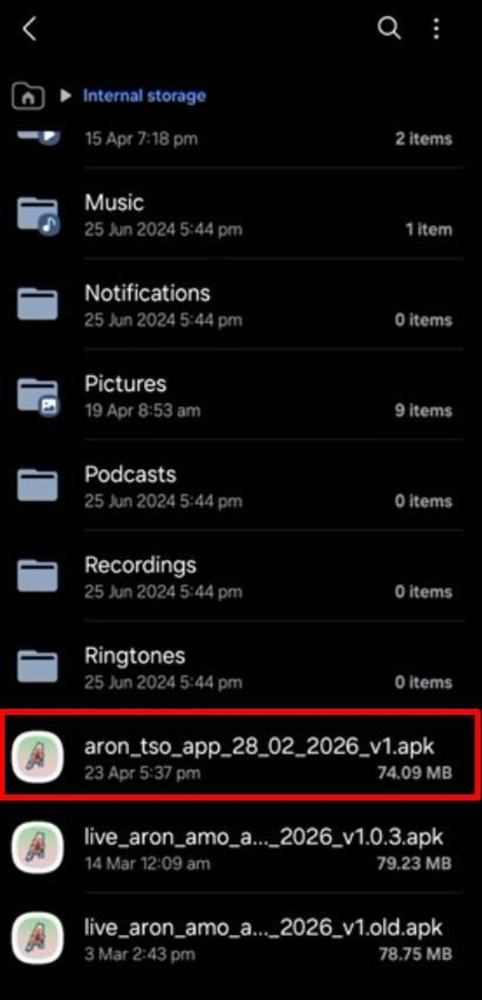

**What you see**

- The phone's file manager, Internal storage. The ARON TSO file is named like "aron_tso_app_<date>_v1.apk".

**What to do**

- Open the File Manager on the phone.
- Find the ARON TSO APK file (usually in Downloads or the folder where it was received) and tap it.
Note: If the phone blocks the install, allow "Install unknown apps" for the File Manager in phone settings when asked.

### Screenshot 2. Install

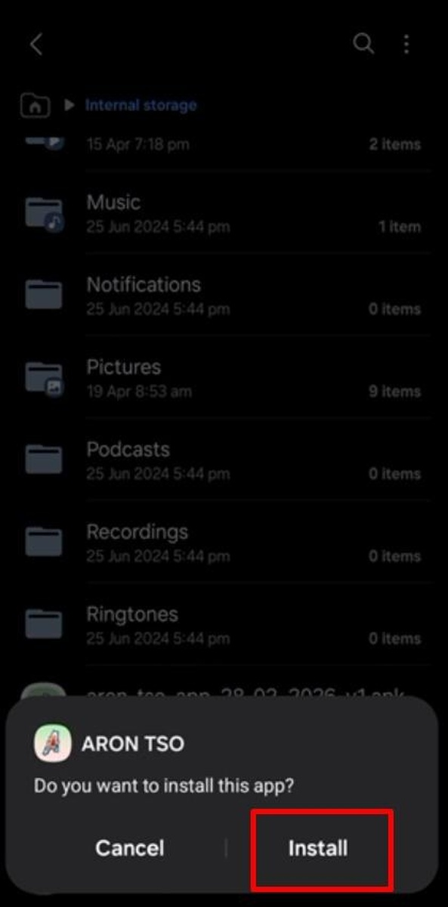

**What you see**

- A pop-up: "ARON TSO - Do you want to install this app?" with Cancel and Install.

**What to do**

- Tap Install and wait.

### Screenshot 3. Installation complete

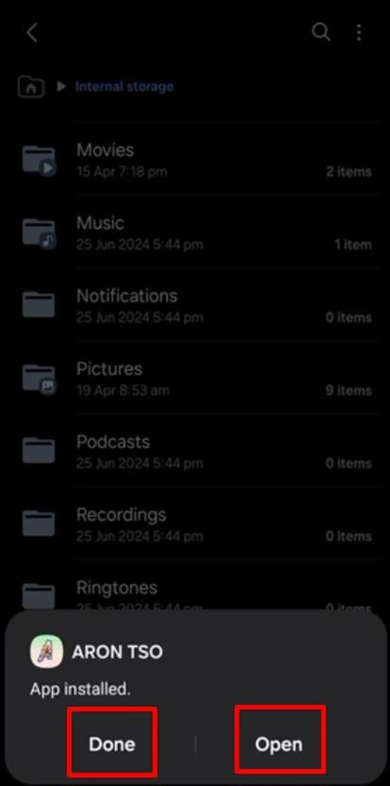

**What you see**

- "App installed" with Done and Open.

**What to do**

- Tap Open to start the app now, or Done to close the installer.

### Screenshot 4. App icon

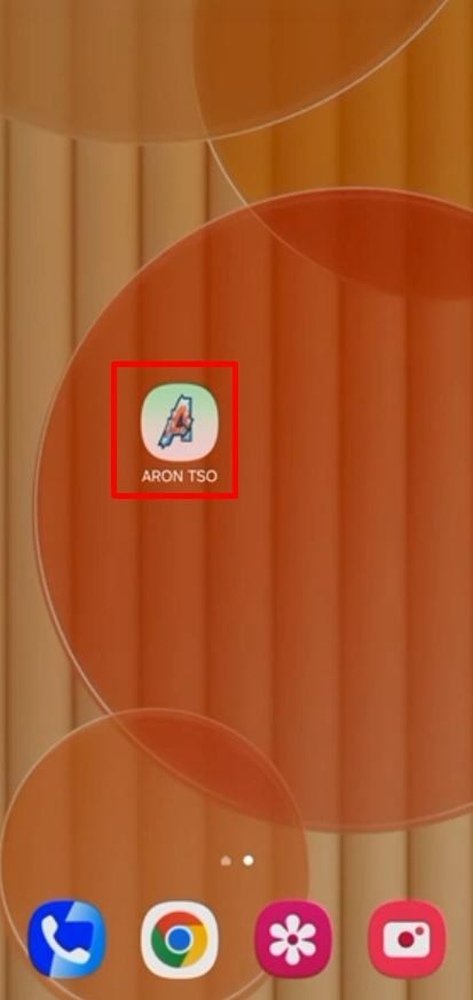

**What you see**

- The ARON TSO icon on the phone's home screen or app list.

**What to do**

- Tap the icon whenever you want to open the app.

## 3. Logging in

### Screenshot 5. Login screen

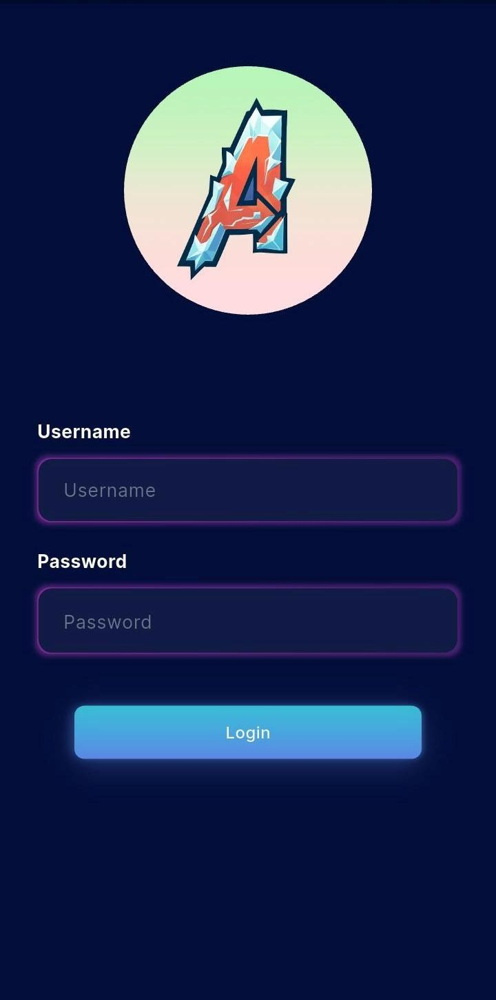

**What you see**

- Username and Password boxes and the Login button.

**What to do**

- Enter the username and password given to you as TSO.
- Tap Login. The Dashboard opens.
Note: If you cannot log in or the OTP does not come, raise a ticket (type "User Login issue" or "Login OTP issue") from another user's phone or ask your AMO/DMO.

## 4. Dashboard

The Dashboard is the first screen after login. It shows the live position of your area for today: every figure is updated till the current time as SRs sell and sync.

### Screenshot 6. Dashboard: top bar, sales and geo-fencing

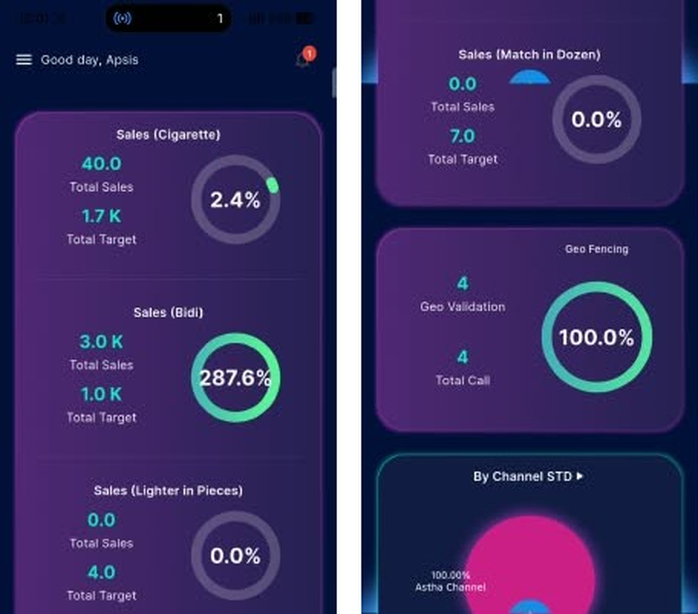

**What you see**

- Top bar: menu icon (☰) to open the main menu, the greeting with your name, and the bell icon with the number of new notifications.
- Sales cards for Cigarette, Bidi, Lighter (pieces) and Match (dozen): Total Sales today, Total Target for today and the achievement % (Total Sales / Total Target). Today's target = monthly target / working days of the month (Fridays and holidays excluded). Sales are live, updated till the current time; with all areas selected the figures are the national total. In the example Cigarette is 40 of 1.7K (2.4%) and Bidi 3.0K of 1.0K (287.6%).
- Geo Fencing: Geo Validation (calls made inside the outlet's geo-fence radius) / Total Call. 4 of 4 = 100%.

**What to do**

- Scroll down to see all cards.
- A low geo-fencing % means SRs are selling away from the outlet (Force Sale); check with the SR.

### Screenshot 7. Dashboard: channel, CPR and status

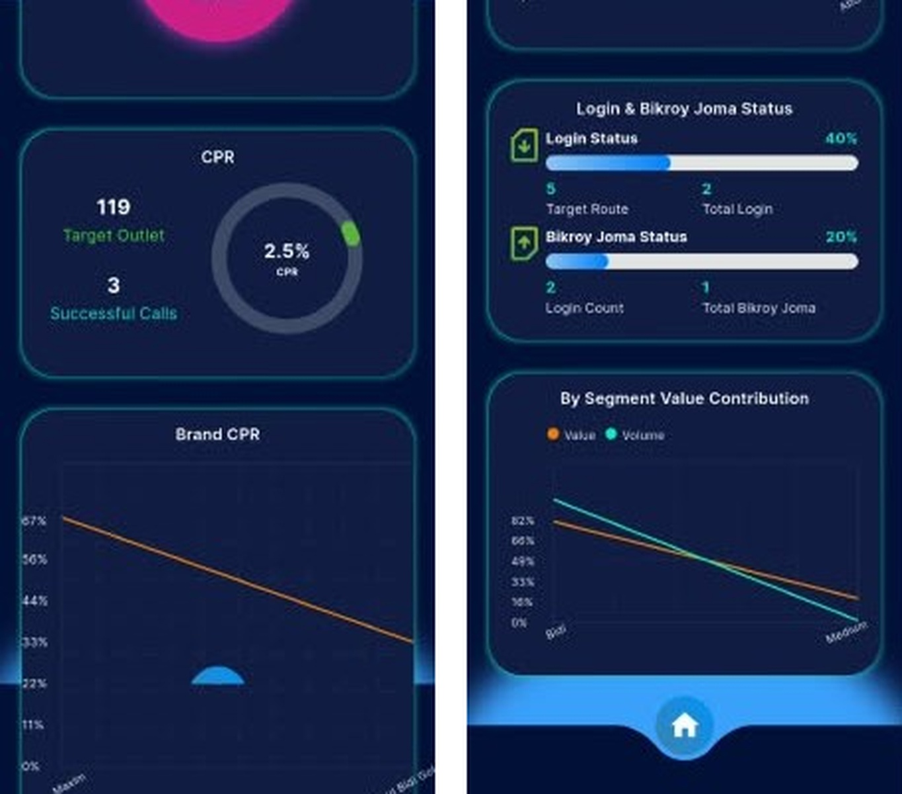

**What you see**

- By Channel STD: today's sales split by outlet channel (GT, Astha, RCC, DCC, MT, HoReCa). The arrow (▸) next to the title switches to the next chart.
- CPR: Target Outlet (outlets on today's routes), Successful Calls (outlets that bought) and CPR % = Successful Calls / Target Outlet.
- Brand CPR: the CPR of each brand (outlets that bought the brand / Target Outlet).
- Login & Bikroy Joma Status: Login Status = Total Login / Target Route (2 of 5 = 40%); Bikroy Joma Status = SRs who have submitted their day's sales (1 of 5 routes = 20%).
- By Segment Value Contribution: each segment's share of sales value and volume.

**What to do**

- Use Login & Bikroy Joma Status during the day to see which SRs have not started or not submitted (next screenshot).

### Screenshot 8. Not Logged In / Not Uploaded

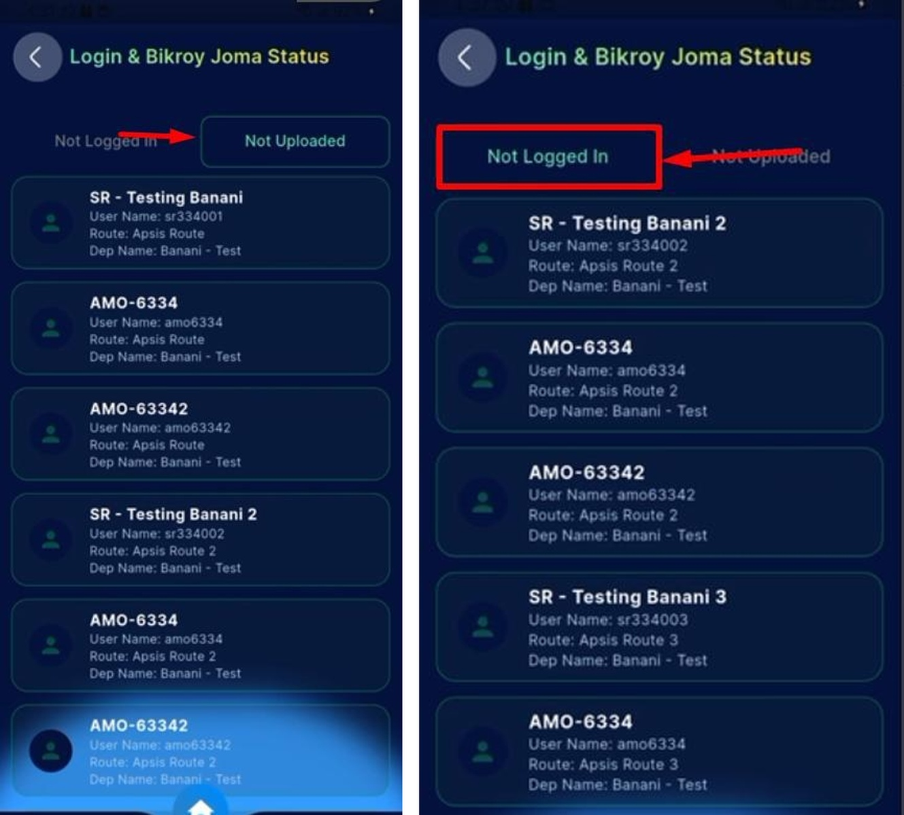

**What you see**

- Opens from the Login & Bikroy Joma Status card on the Dashboard.
- Not Logged In: SRs and AMOs of your area who have not logged in today, with User Name, Route and Dep Name.
- Not Uploaded: users who logged in but have not done Bikroy Joma (sales upload) yet.

**What to do**

- Tap a tab to switch the list.
- Call the listed SRs before the day ends; their routes must be uploaded before you do Final Submit.

## 5. Main menu

### Screenshot 9. Main menu

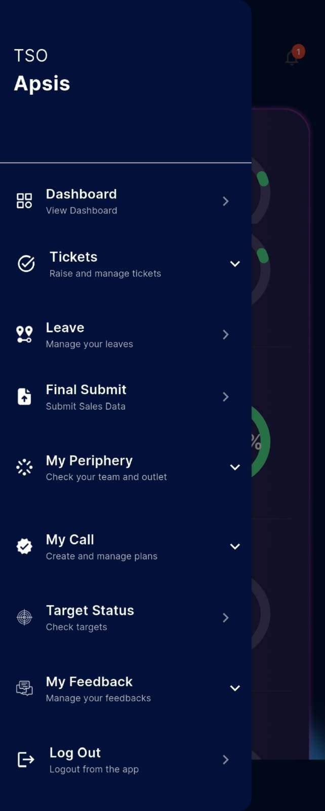

**What you see**

- Opens with the ☰ icon on the Dashboard. Shows your role (TSO) and name.
- Items: Dashboard, Tickets (new), Leave, Final Submit, My Periphery, My Call, Target Status, My Feedback, Log Out.
- An arrow (›) opens the screen directly; a down arrow (˅) opens sub-menus.

**What to do**

- Tap an item to open it. Tap outside the menu to close it.

## 6. Tickets (new)

Use Tickets to report any problem with the app, data, targets, outlets or devices to the support team, and to follow it until it is solved. Each ticket gets a number (e.g. INC010700), a priority and a status.
Status
Meaning
New
Ticket raised, not yet picked up by support.
In Progress
Support is working on it.
Resolved
Support has fixed it and written the resolution notes. The TSO checks it.
Closed
The ticket is finished (after the TSO's review, or closed by support).
Cancelled
Ticket withdrawn or not valid (e.g. duplicate, test).

### Screenshot 10. Tickets menu

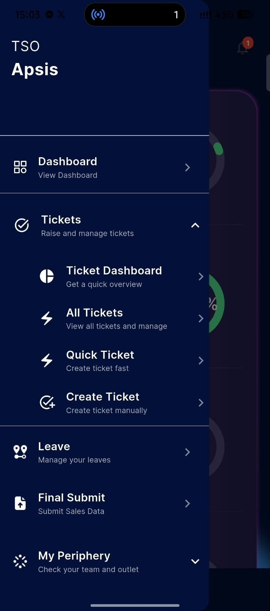

**What you see**

- Tickets opens four sub-menus:
- Ticket Dashboard: a quick overview.
- All Tickets: view and manage all your tickets.
- Quick Ticket: raise a ticket fast from a list of common issues.
- Create Ticket: write a ticket manually with any issue type.

**What to do**

- Tap Tickets in the main menu, then the sub-menu you need.

### Screenshot 11. Ticket Dashboard

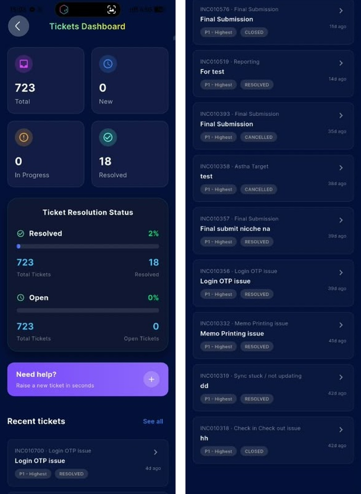

**What you see**

- Summary cards: Total, New, In Progress and Resolved tickets.
- Ticket Resolution Status: Resolved % (resolved / total) and Open % (open / total) with bars.
- Need help? "Raise a new ticket in seconds": the + button opens Quick Ticket directly.
- Recent tickets: the latest tickets with number, issue type, title, priority, status and age. "See all" opens All Tickets.

**What to do**

- Tap "Need help?" to report a new problem.
- Tap a recent ticket to open its details.

### Screenshot 12. All Tickets

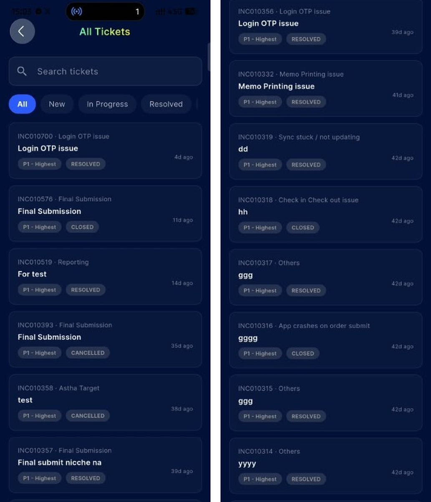

**What you see**

- Search box: find a ticket by number or text.
- Status tabs: All, New, In Progress, Resolved, Closed (swipe the tabs to see more).
- Ticket card: ticket number and issue type (e.g. "INC010700 · Login OTP issue"), title, priority (P1 - Highest), status and how long ago it was raised.

**What to do**

- Tap a tab to filter, or search.
- Tap a ticket to open its details.

### Screenshot 13. All Tickets filtered by Resolved

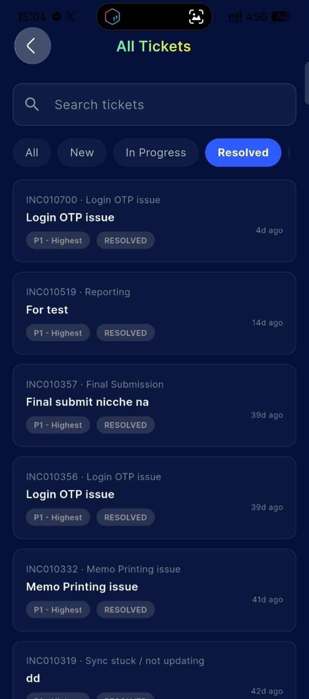

**What you see**

- Only tickets with status Resolved are listed (the Resolved tab is highlighted).

**What to do**

- Open each resolved ticket, check the fix, and close it (next screenshot).

### Screenshot 14. Ticket Details

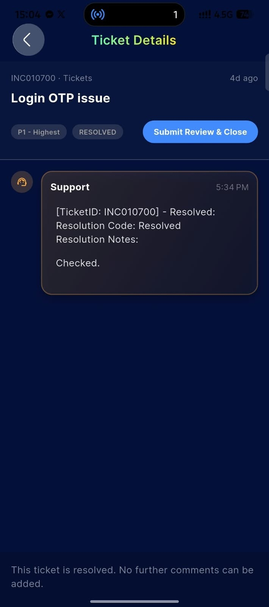

**What you see**

- Ticket number, issue type, age, title, priority and status.
- Conversation: replies from Support, including the Resolution Code and Resolution Notes (here "Resolved - Checked").
- Submit Review & Close: confirms the problem is solved and closes the ticket.
- Once a ticket is resolved, no further comments can be added.

**What to do**

- Read the resolution and check in the app that the problem is solved.
- If it is solved, tap Submit Review & Close.
- If it is not solved, raise a new ticket that mentions the old ticket number.

### Screenshot 15. Quick Ticket (Quick Report)

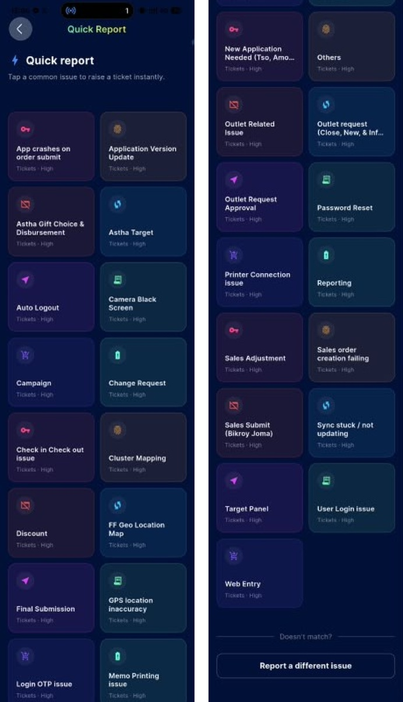

**What you see**

- "Tap a common issue to raise a ticket instantly." Each tile is one frequent issue type (all 31 types are listed in Annex A), shown with its default priority.
- Doesn't match? "Report a different issue" at the bottom opens Create Ticket.

**What to do**

- Tap the tile that matches your problem.

### Screenshot 16. Quick Ticket: describe and submit

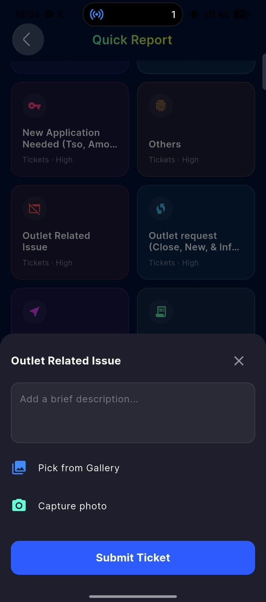

**What you see**

- Example: the "Outlet Related Issue" tile was tapped. A panel opens with the issue name.
- Add a brief description: what happened, with outlet code, route and date.
- Pick from Gallery / Capture photo: attach a screenshot or a photo.

**What to do**

- Write the description, attach a photo if it helps, and tap Submit Ticket.
- The ticket appears in All Tickets with status New.

### Screenshot 17. Create Ticket (manual)

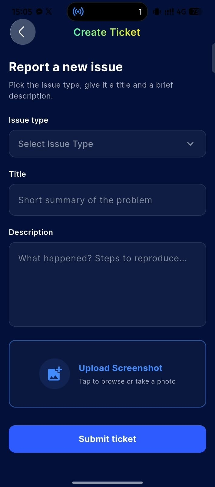

**What you see**

- "Report a new issue - pick the issue type, give it a title and a brief description."
- Issue type: choose from the list (next screenshot).
- Title: a short summary of the problem.
- Description: what happened and the steps to reproduce it.
- Upload Screenshot: tap to browse the gallery or take a photo.

**What to do**

- Fill in all fields, add a screenshot, and tap Submit ticket.

### Screenshot 18. Issue types

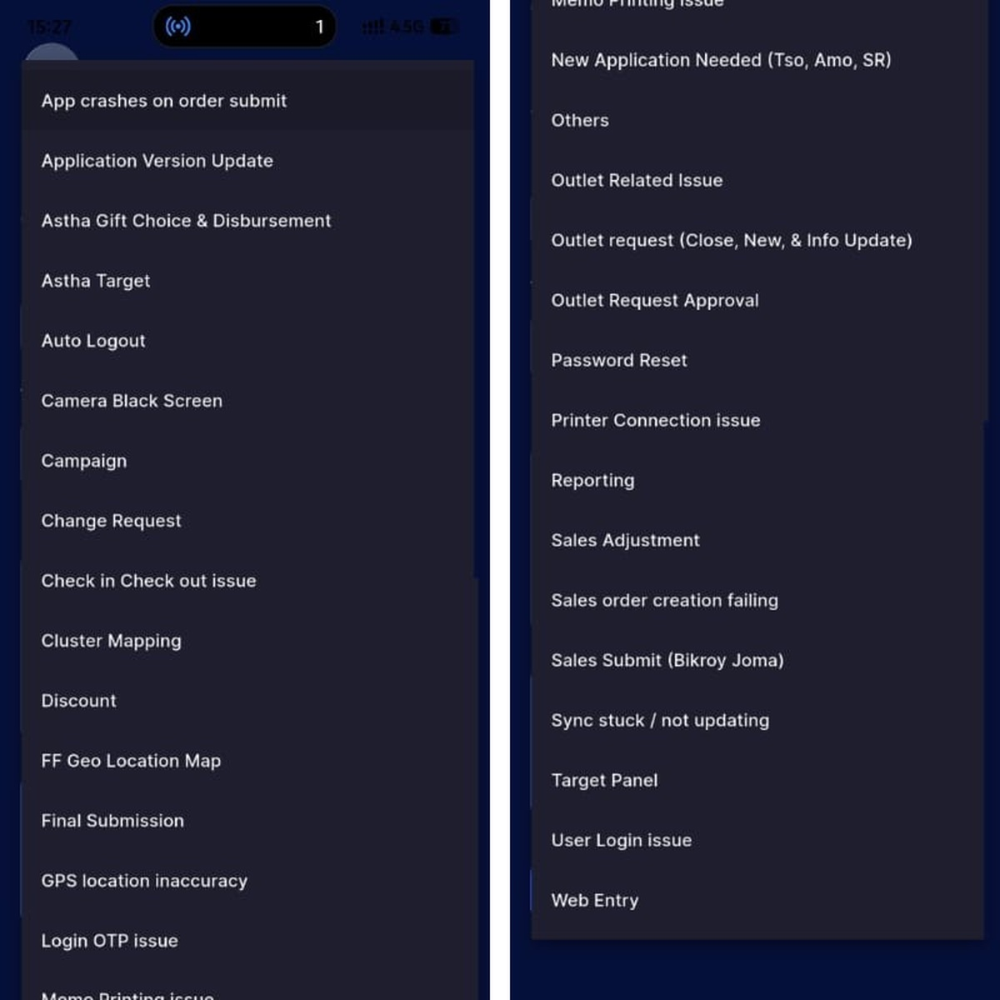

**What you see**

- The Issue type list in Create Ticket: 31 types from "App crashes on order submit" to "Web Entry". Annex A explains when to use each one.

**What to do**

- Choose the closest type. Use "Others" only if nothing fits.

## 7. Leave

### Screenshot 19. Leave Applications

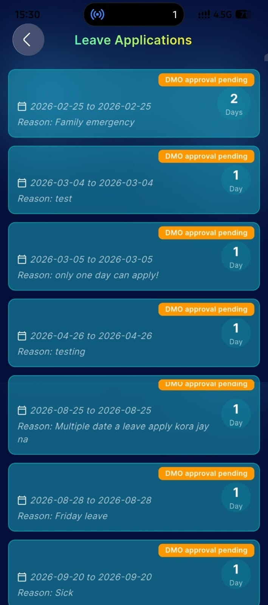

**What you see**

- All your leave applications, newest first.
- Each card: date range, number of days, reason and status (e.g. "DMO approval pending").

**What to do**

- Scroll to see older applications.
- Use Apply For Leave (bottom of the screen) to apply for new leave.

### Screenshot 20. Leave Apply form

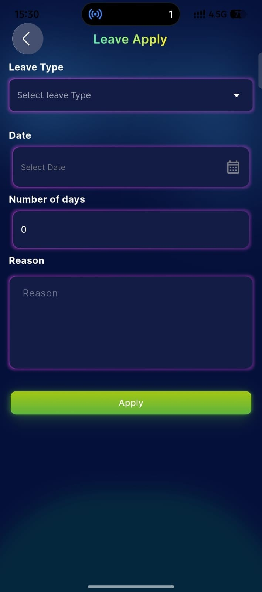

**What you see**

- Leave Type, Date, Number of days, Reason and the Apply button.

**What to do**

- Fill in every field (next two screenshots), then tap Apply.

### Screenshot 21. Choose the leave type

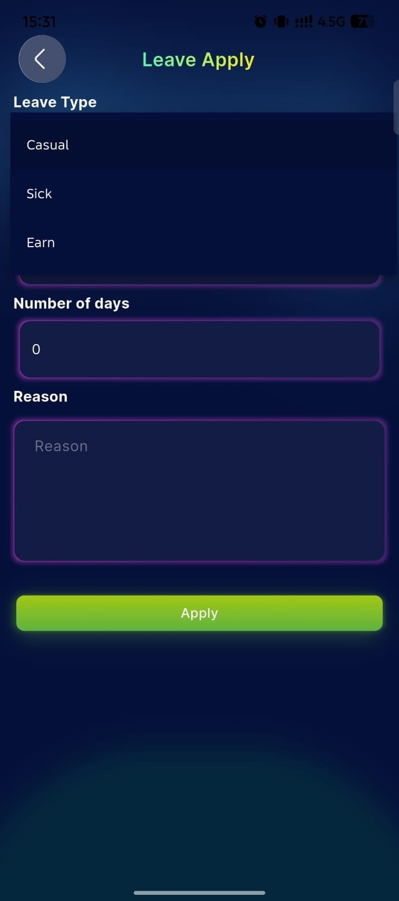

**What you see**

- Leave Type options: Casual, Sick, Earn.

**What to do**

- Tap Leave Type and choose one.

### Screenshot 22. Completed form

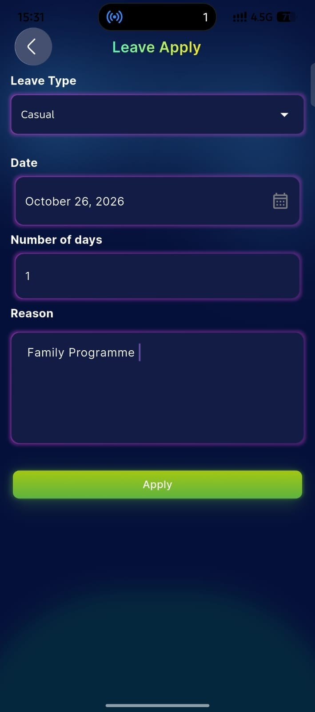

**What you see**

- Example: Casual leave on October 26, 2026, 1 day, reason "Family Programme".

**What to do**

- Pick the start date from the calendar, enter the number of days and the reason.
- Tap Apply. The application appears in the list with status "DMO approval pending" until it is approved.

## 8. Final Submit

At the end of each day the TSO checks each zone's sales and does the Final Submit. After Final Submit the day is locked for that zone: no memo can be edited and the figures are final. Do it only after all routes have done Bikroy Joma and the sales are checked. Zones not submitted by 12 midnight are submitted automatically.

### Screenshot 23. Select the zone

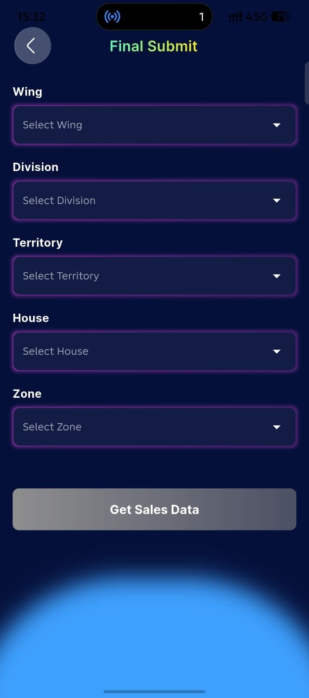

**What you see**

- Wing, Division, Territory, House and Zone selectors, and Get Sales Data.

**What to do**

- Select each level from top to bottom.

### Screenshot 24. Get Sales Data

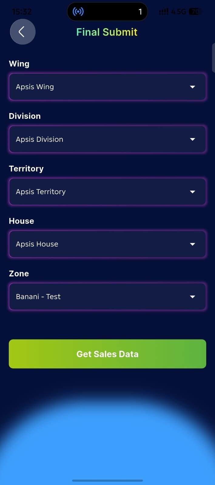

**What you see**

- Example: Apsis Wing > Apsis Division > Apsis Territory > Apsis House > Banani - Test.

**What to do**

- Tap Get Sales Data to load the zone's routes for today.

### Screenshot 25. Routes of the zone

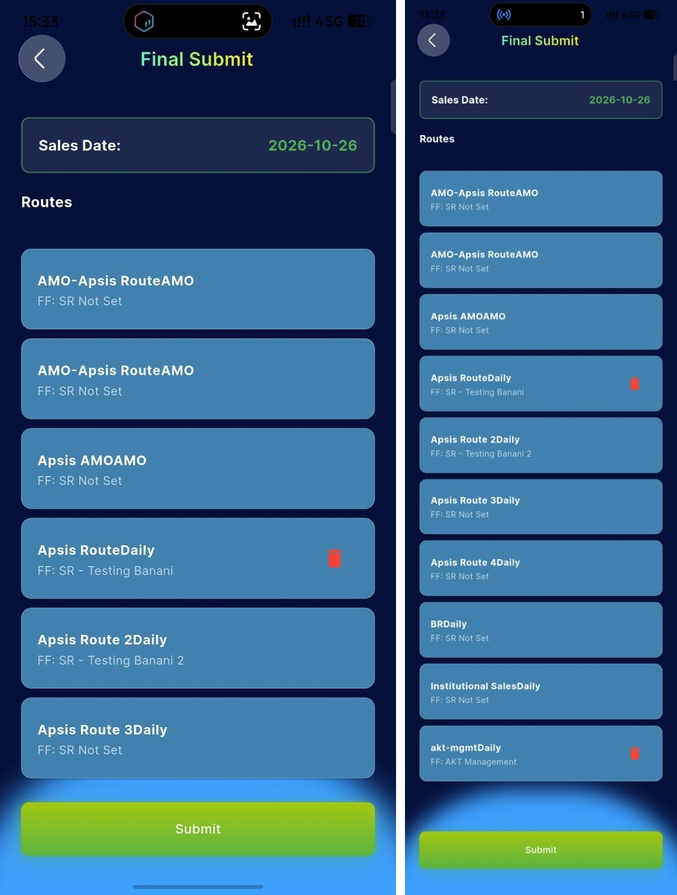

**What you see**

- Sales Date: the day being submitted (today).
- Route cards: every route of the zone, including the BR and Institutional Sales routes, with the SR assigned ("FF: SR - name"), or "SR Not Set" for a vacant route.
- Red dot: only a marking left on some routes in these screenshots; it has no meaning in the app.

**What to do**

- Scroll through all routes. Make sure every working route has uploaded its sales and Web Entry is done for routes without an SR.
- Tap Submit.
Note: The app warns but does not block if some routes have not uploaded. Submitting locks the day, so check first.

### Screenshot 26. Final Submit done

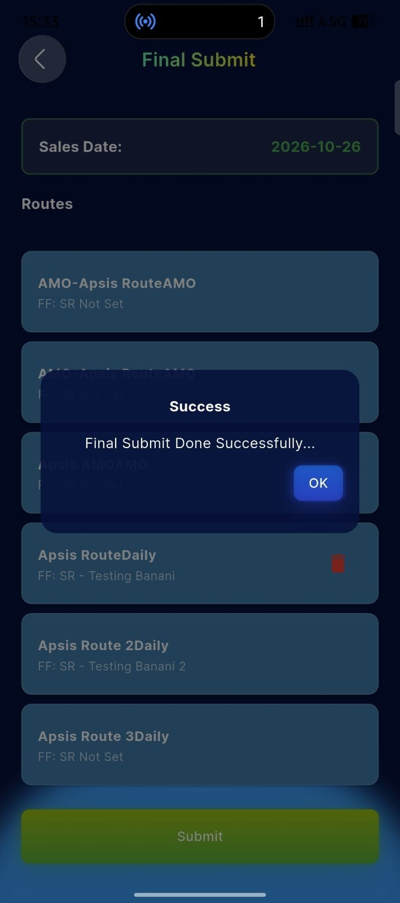

**What you see**

- "Success - Final Submit Done Successfully..." The Submit button is now disabled for this zone and date.

**What to do**

- Tap OK.
- Repeat for each of your zones.
Note: A zone can be submitted only once per day. Trying again shows an alert. To reopen a zone, a special request to the back-end team is needed.

## 9. My Periphery

### Screenshot 27. My Periphery menu

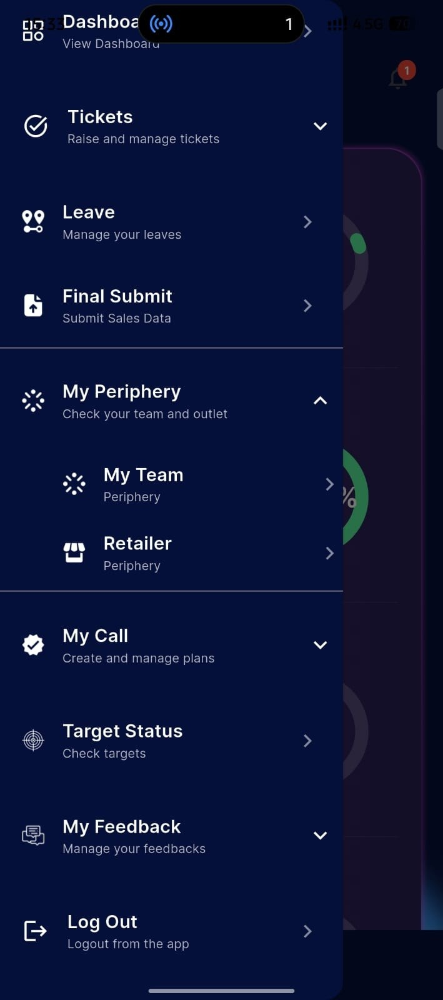

**What you see**

- Two sub-menus: My Team (live location of your SRs) and Retailer (location of outlets).

**What to do**

- Tap My Periphery, then My Team or Retailer.

### Screenshot 28. My Team

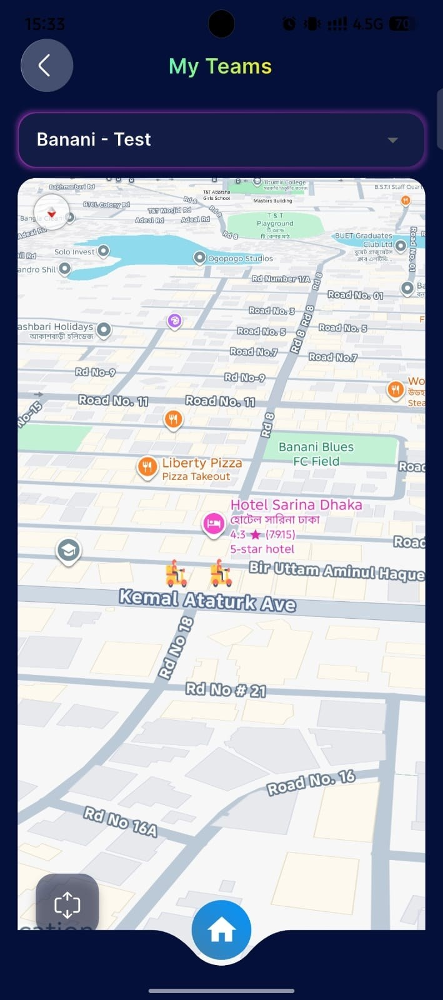

**What you see**

- Map with the live location of the SRs of the selected zone, route by route.

**What to do**

- Choose the zone at the top.
- Zoom and tap a marker to see the SR.

### Screenshot 29. Retailer (Outlets)

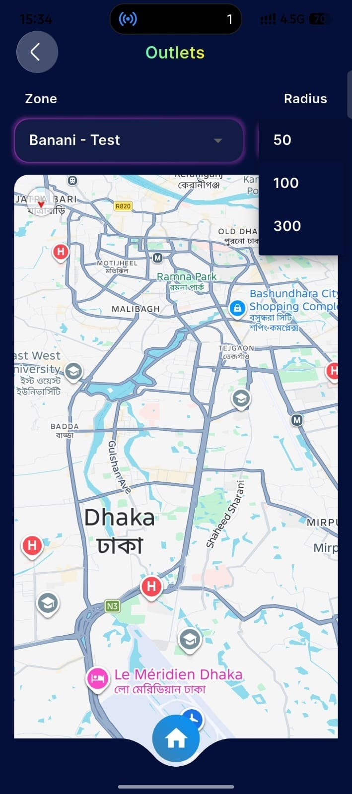

**What you see**

- Zone and Radius: choose the zone and a radius of 50, 100 or 300 m.
- The map shows the outlets of the zone within that radius of the TSO's current position (the phone's GPS location).

**What to do**

- Choose the zone and the radius.
- Use it during market visits to find nearby outlets.

## 10. My Call (visit plans)

With My Call the TSO plans market visits to outlets, records the outlet's answers during the visit, and can give the SR a task for that outlet.

### Screenshot 30. My Call menu

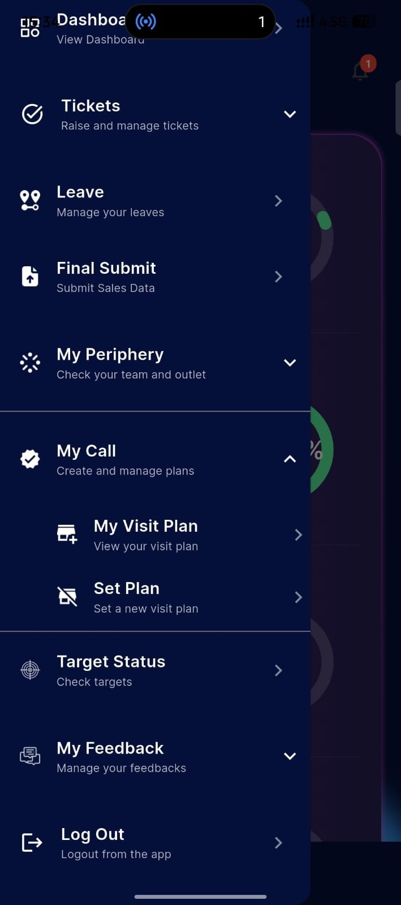

**What you see**

- Two sub-menus: My Visit Plan (view your plan) and Set Plan (make a new plan).

**What to do**

- First make a plan with Set Plan, then visit with My Visit Plan.

### Screenshot 31. Set Plan

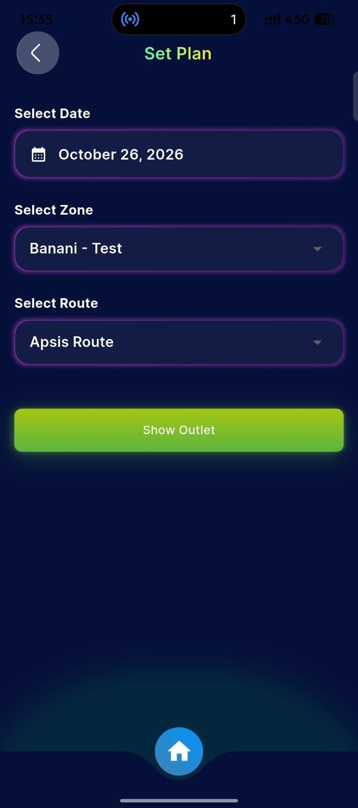

**What you see**

- Select Date, Select Zone, Select Route and Show Outlet.

**What to do**

- Choose the visit date, zone and route.
- Tap Show Outlet.

### Screenshot 32. Choose the route

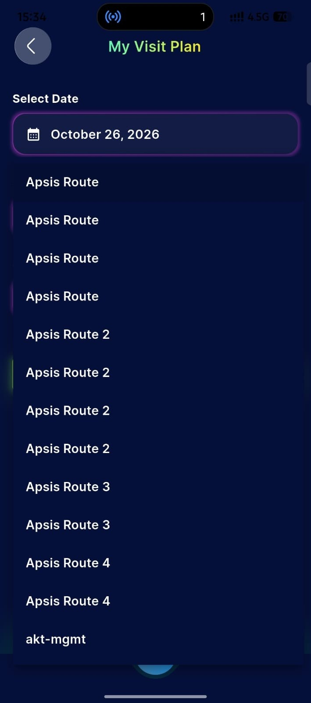

**What you see**

- The list of routes of the selected zone.

**What to do**

- Tap the route you want to visit.

### Screenshot 33. Select Outlets and Set Plan

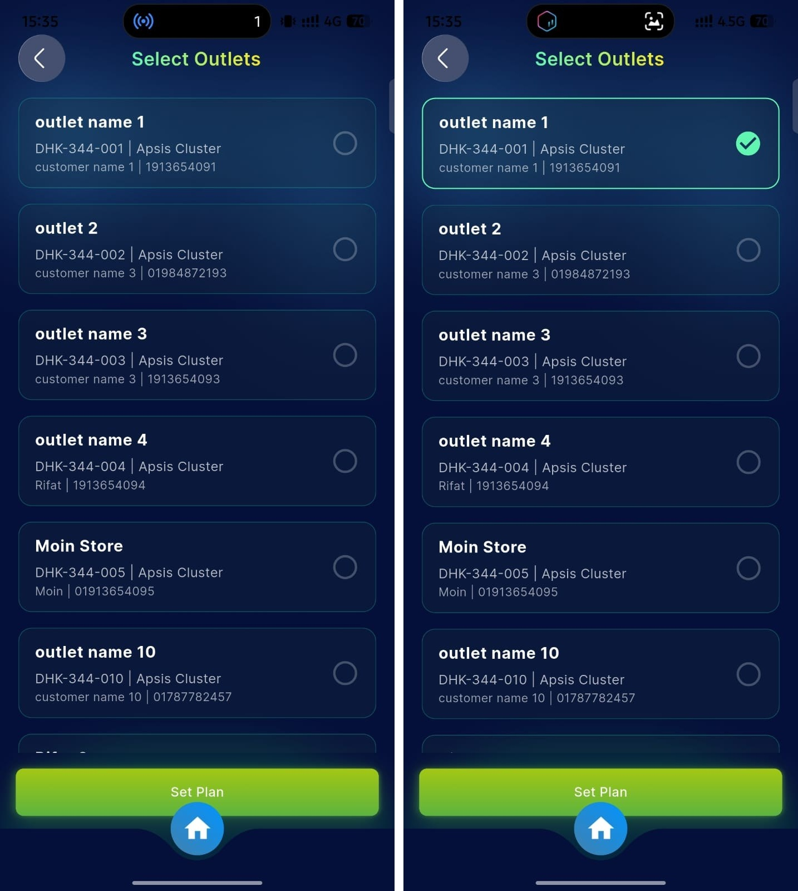

**What you see**

- Outlets of the route: outlet name, code, cluster, owner and phone.
- A tick shows the outlets selected for the visit.

**What to do**

- Tick the outlets you will visit.
- Tap Set Plan. The outlets are added to My Visit Plan for that date.

### Screenshot 34. My Visit Plan

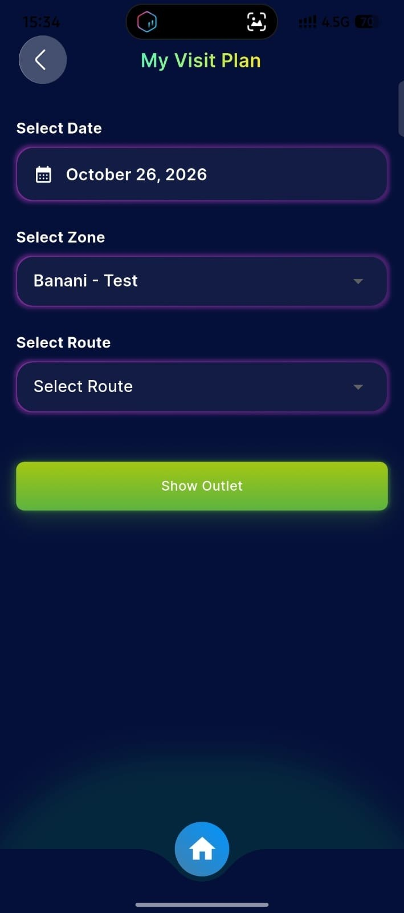

**What you see**

- Select Date, Select Zone, Select Route and Show Outlet.

**What to do**

- Choose the date, zone and route of the plan, and tap Show Outlet.

### Screenshot 35. Visit Plan Outlets: Pending and Completed

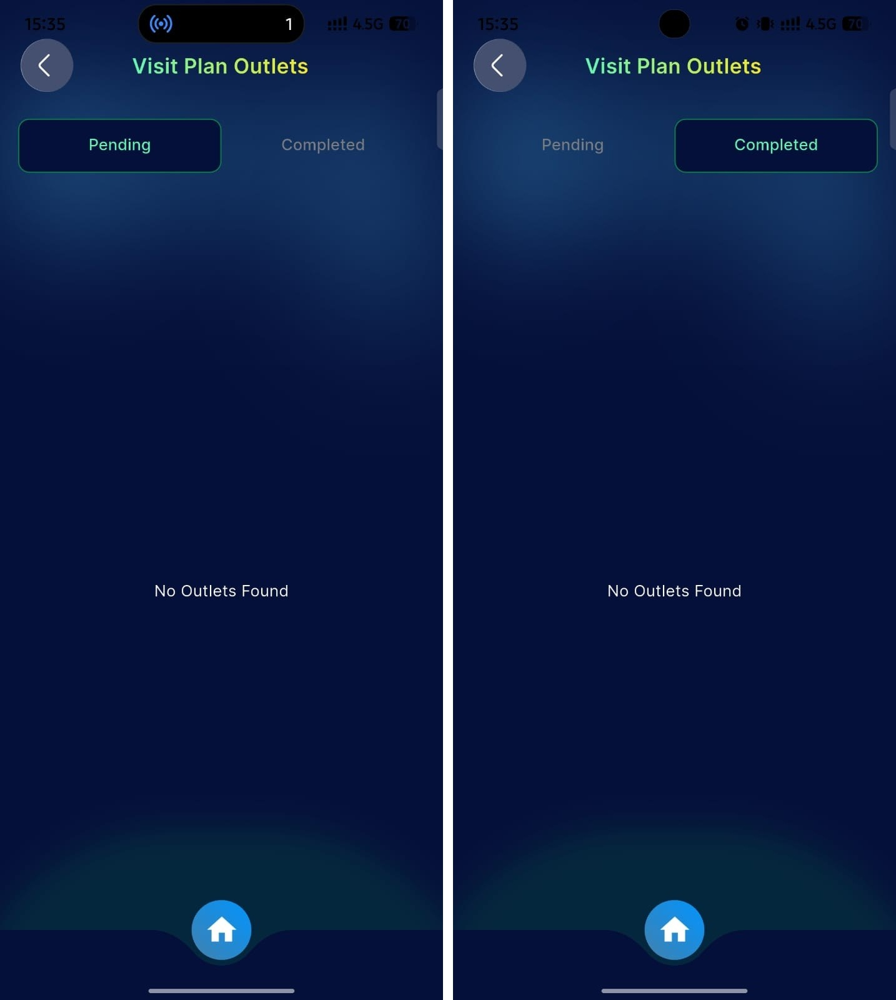

**What you see**

- Pending: planned outlets not visited yet.
- Completed: outlets already visited.
- "No Outlets Found" means there is no plan for that date and route.

**What to do**

- Tap Pending to see the outlets still to visit.

### Screenshot 36. Planned outlet

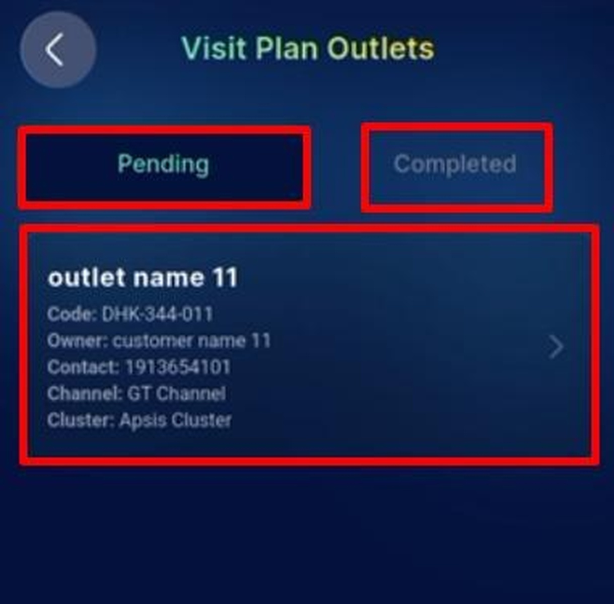

**What you see**

- Outlet card: name, code, owner, contact, channel and cluster.

**What to do**

- At the outlet, tap the card to start the visit.

### Screenshot 37. Visit Query

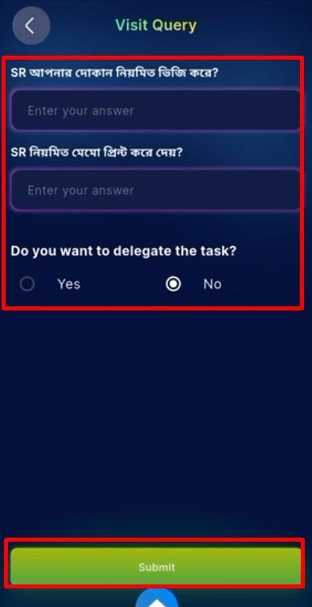

**What you see**

- Questions to ask the retailer, e.g. "Does the SR visit your shop regularly?" and "Does the SR give you a printed memo regularly?".
- Do you want to delegate the task? Yes / No.

**What to do**

- Ask the retailer and type the answers.
- Choose Yes if the SR must follow up, then tap Submit.

### Screenshot 38. Assign Task

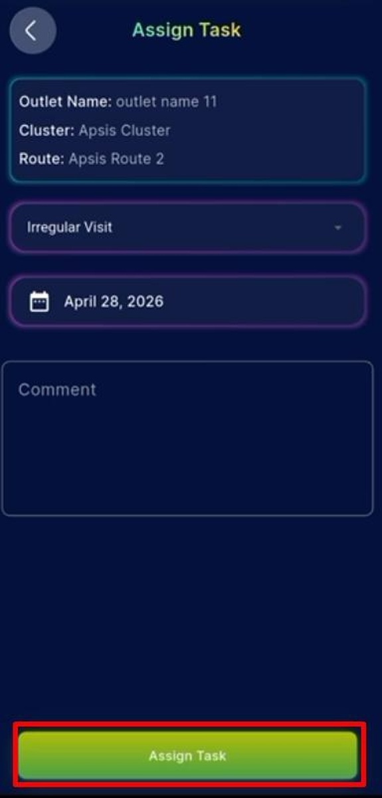

**What you see**

- Outlet Name, Cluster, Route; Task Type (e.g. Irregular Visit), date and Comment.

**What to do**

- Select the Task Type, pick the date, write a comment for the SR and tap Assign Task.
- The visit moves to Completed.

## 11. Target Status

### Screenshot 39. Monthly Target

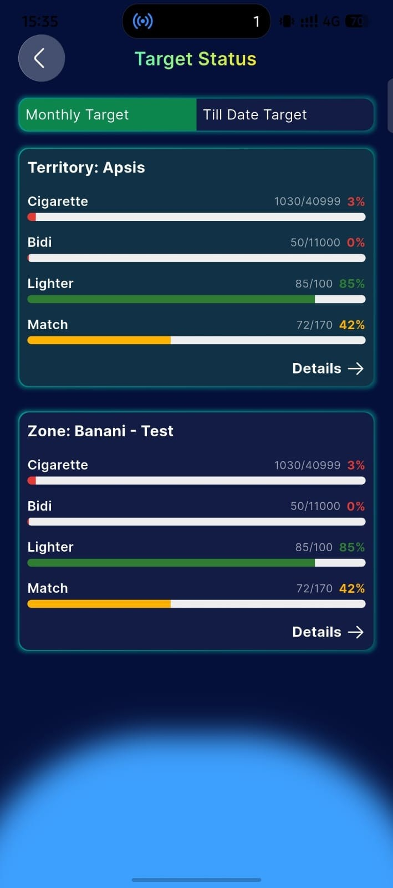

**What you see**

- Cards for your Territory and for each Zone.
- For each category (Cigarette, Bidi, Lighter, Match): achievement / monthly target and %, with a bar. Example: Cigarette 1030/40999 = 3%.
- Bar colour: red when far behind, amber part-way, green when near or above target.

**What to do**

- Tap Details on a card to see the target by brand.

### Screenshot 40. Till Date Target

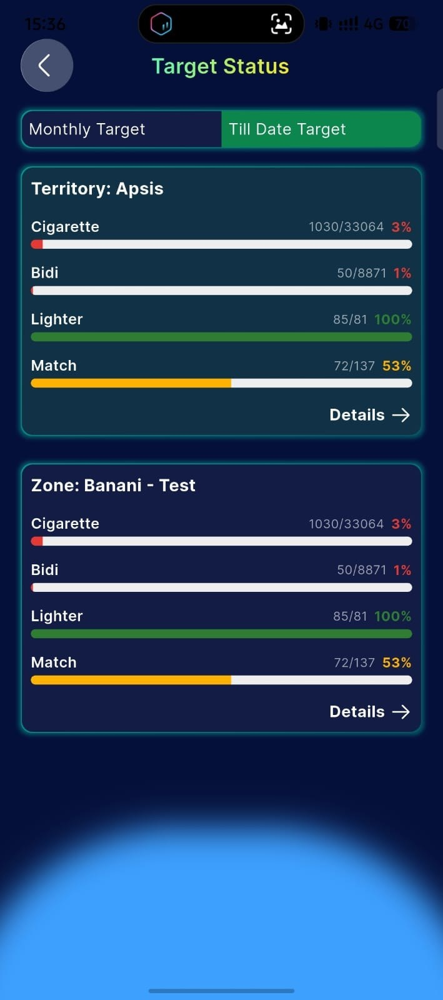

**What you see**

- The same cards against the target due up to today (the part of the monthly target for the working days passed). Example: Cigarette 1030/33064 = 3%; Lighter 85/81 = 100%.

**What to do**

- Use Till Date to see whether the area is on track today; use Monthly for the month as a whole.

### Screenshot 41. Details: target by brand

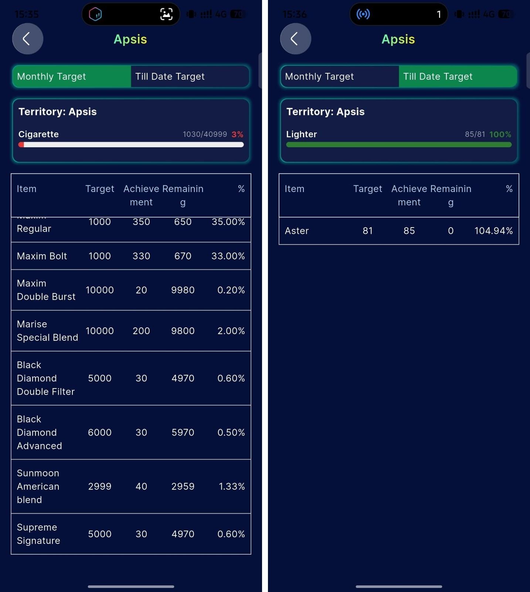

**What you see**

- Table: Item (brand), Target, Achievement, Remaining (Target minus Achievement, 0 when achieved) and %.
- Left: Cigarette brands, Monthly Target. Right: Lighter (Aster), Till Date: 85 against 81 = 104.94%.

**What to do**

- Scroll the table to see all brands.

### Screenshot 42. Details: Till Date view

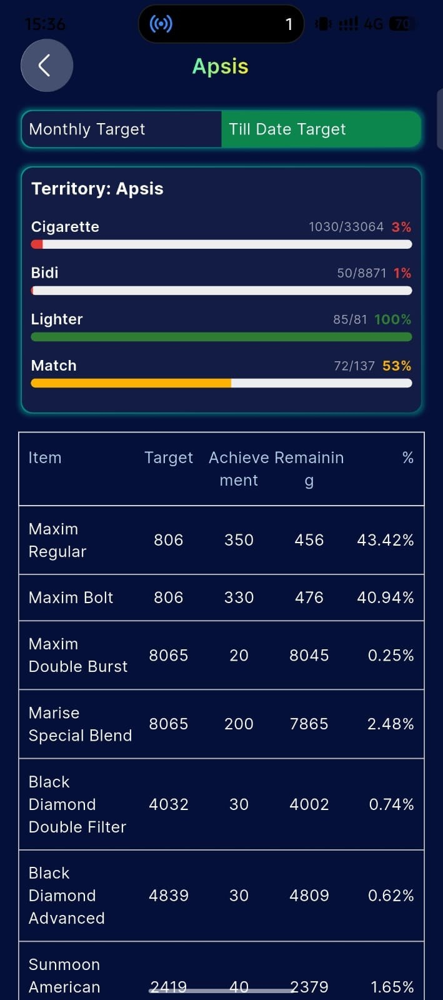

**What you see**

- Territory bars on top and the brand table below, against the till-date target.

**What to do**

- Switch between Monthly Target and Till Date Target at the top.

## 12. My Feedback

### Screenshot 43. Create New Feedback

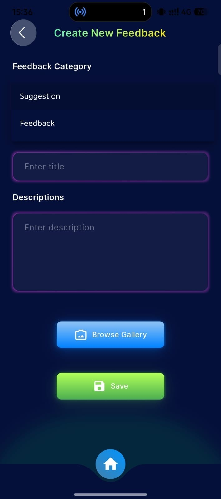

**What you see**

- Feedback Category: Suggestion or Feedback.
- Title and Descriptions.
- Browse Gallery: attach a picture.

**What to do**

- Open the menu > My Feedback > Add new feedback.
- Choose the category, write the title and description, add a picture if needed, and tap Save.
Note: Use My Feedback for ideas and comments about the app. Use Tickets for problems that need a fix.

## 13. Log Out

### Screenshot 44. Log Out

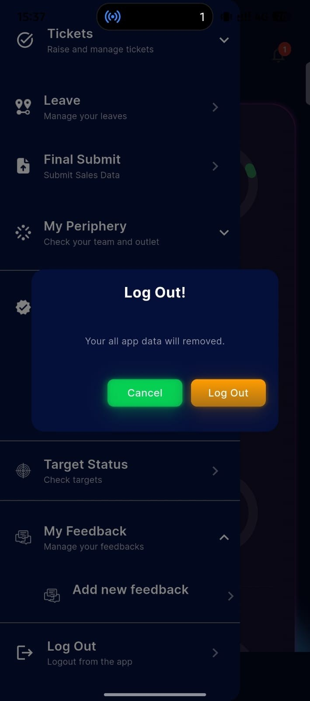

**What you see**

- Log Out is the last item of the menu. A confirmation appears: "Your all app data will removed." with Cancel and Log Out.

**What to do**

- Tap Log Out in the menu, then Log Out again to confirm, or Cancel to stay logged in.
Note: Logging out deletes the app data on the phone. Make sure everything is synced and submitted before you log out.

## 14. Quick answers (FAQ)

Short answers to the questions TSOs ask most often. Each answer points to the screenshot that shows the screen.
Question
Answer
How do I install the app?
Open the APK file from the File Manager, tap Install, then Open (Screenshots 1 to 4).
I cannot log in or the OTP does not come.
Raise a ticket of type "User Login issue" or "Login OTP issue" from another phone, or ask your AMO/DMO (Screenshot 5).
What target is shown on the Dashboard?
Today's target: monthly target divided by the working days of the month (Fridays and holidays excluded). Sales and achievement % are live, updated till the current time (Screenshot 6).
How is CPR calculated?
Successful Calls (outlets that bought) / Target Outlet (outlets on today's routes) x 100 (Screenshot 7).
How do I see which SRs have not logged in or not uploaded?
Dashboard > Login & Bikroy Joma Status > Not Logged In / Not Uploaded tabs (Screenshots 7 and 8).
How do I report a problem?
Menu > Tickets > Quick Ticket, tap the matching issue, describe it, add a photo and tap Submit Ticket (Screenshots 15 and 16). If no tile matches, use Create Ticket (Screenshot 17).
How do I follow my ticket?
Menu > Tickets > All Tickets; filter by status or search by ticket number (Screenshot 12).
Support says my ticket is resolved. What now?
Open the ticket, read the resolution notes, check the app, and tap Submit Review & Close (Screenshot 14). If it is not solved, raise a new ticket quoting the old number.
Which issue type should I choose?
See Annex A. Use "Others" only when nothing else fits.
How do I apply for leave?
Menu > Leave > Apply For Leave; choose type (Casual, Sick, Earn), date, number of days, reason, and tap Apply (Screenshots 19 to 22). It stays "DMO approval pending" until approved.
How do I do Final Submit?
Menu > Final Submit; select Wing to Zone, tap Get Sales Data, check the routes, tap Submit (Screenshots 23 to 26).
Can I edit sales after Final Submit?
No. The zone and date are locked; no memo can be edited. Only the back-end team can reopen a zone, on special request.
What if I forget Final Submit?
Zones not submitted by 12 midnight are submitted automatically.
Can I submit a zone twice?
No. A second attempt shows an alert.
Some routes have not uploaded. Can I still submit?
Yes, the app only warns. But the day is then locked, so get the routes uploaded (or Web Entry done) first.
How do I see where my SRs are?
Menu > My Periphery > My Team, then choose the zone (Screenshot 28).
How do I find outlets near me?
Menu > My Periphery > Retailer; choose the zone and a radius of 50, 100 or 300 m around your current position (Screenshot 29).
How do I plan outlet visits?
Menu > My Call > Set Plan; choose date, zone, route, Show Outlet, tick outlets, Set Plan (Screenshots 31 to 33).
How do I record a visit?
Menu > My Call > My Visit Plan > Show Outlet > Pending > tap the outlet, answer the Visit Query, Submit, then Assign Task if needed (Screenshots 34 to 38).
Where do I see targets by brand?
Menu > Target Status > Details, in Monthly or Till Date view (Screenshots 39 to 42).
What is the difference between Monthly and Till Date target?
Monthly = the full month's target. Till Date = the part of it due up to today, for the working days passed.
How do I send a suggestion?
Menu > My Feedback > Add new feedback (Screenshot 43). Use Tickets, not Feedback, for problems.
What happens when I log out?
All app data on the phone is removed. Make sure everything is synced and submitted first (Screenshot 44).

## Annex A. Ticket issue types

The issue types available in Quick Ticket and Create Ticket, and when to use each one.
Issue type
Use it when
App crashes on order submit
The app closes or freezes when a memo/order is submitted.
Application Version Update
A new app version is needed, or the app asks for an update that does not install.
Astha Gift Choice & Disbursement
Problems choosing or handing over Astha gifts.
Astha Target
Astha outlet targets are missing or wrong.
Auto Logout
The app logs out by itself.
Camera Black Screen
The camera shows a black screen when taking an outlet or force-sale photo.
Campaign
A campaign or trade offer is missing or not applied correctly.
Change Request
Asking for a change to the app or a report.
Check in Check out issue
Problems with SR check-in at the start or check-out at the end of the day.
Cluster Mapping
An outlet or route is in the wrong cluster.
Discount
A discount or cashback is wrong on the memo.
FF Geo Location Map
The field force map shows wrong or no locations.
Final Submission
Final Submit fails, or a zone needs to be reopened.
GPS location inaccuracy
The phone location is wrong, causing wrong geo-fencing.
Login OTP issue
The login OTP does not arrive or is not accepted.
Memo Printing issue
The memo does not print or prints wrongly.
New Application Needed (Tso, Amo, SR)
A new user needs the app and an account.
Others
Nothing else fits.
Outlet Related Issue
Any problem with an outlet's data or sales.
Outlet request (Close, New, & Info Update)
Request to open a new outlet, close one, or change its information.
Outlet Request Approval
An outlet request is waiting for approval or was not applied.
Password Reset
A user forgot the password.
Printer Connection issue
The Bluetooth printer does not connect.
Reporting
A report is wrong, missing or does not open.
Sales Adjustment
Sales figures need correction.
Sales order creation failing
A memo/order cannot be created.
Sales Submit (Bikroy Joma)
Bikroy Joma (end-of-day sales submit) fails.
Sync stuck / not updating
Download or upload does not complete, or data does not refresh.
Target Panel
Targets are missing or wrong in the target screens.
User Login issue
A user cannot log in (other than OTP).
Web Entry
Problems with Web Entry in the portal.
